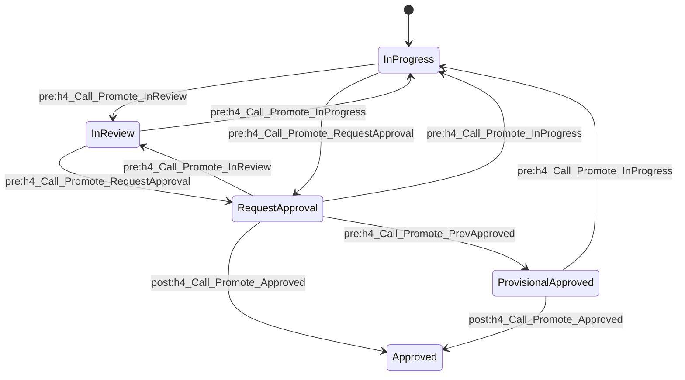
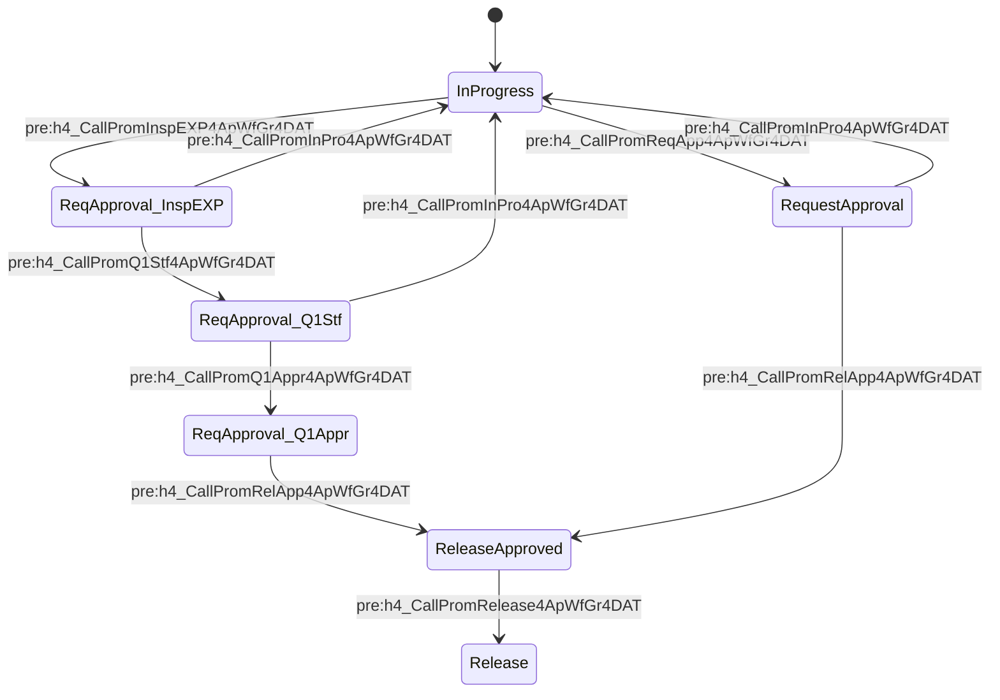
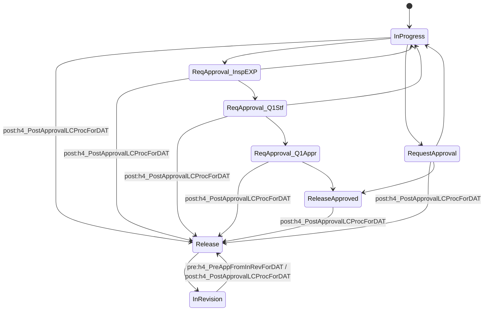
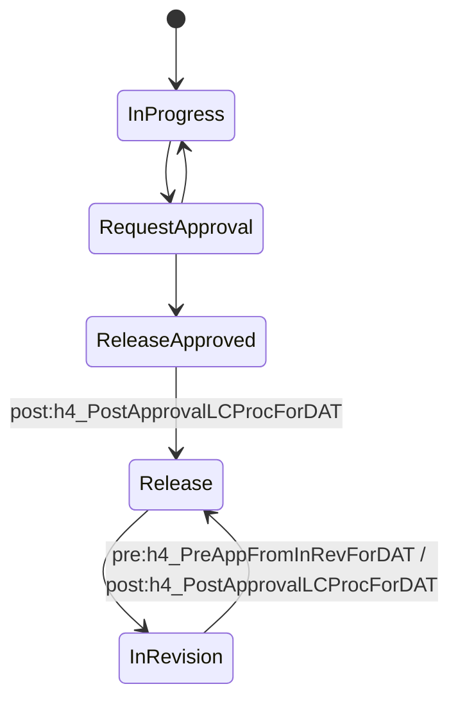
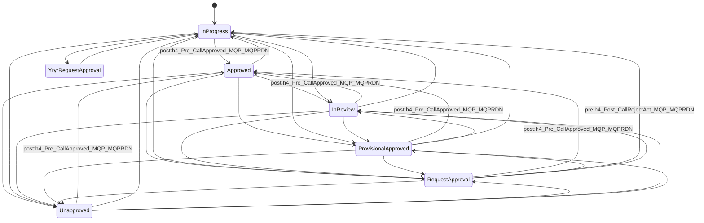
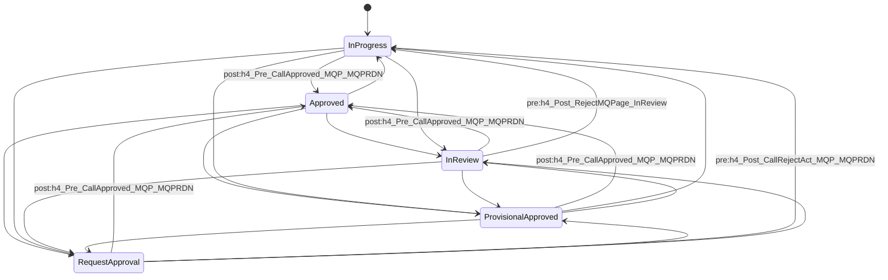
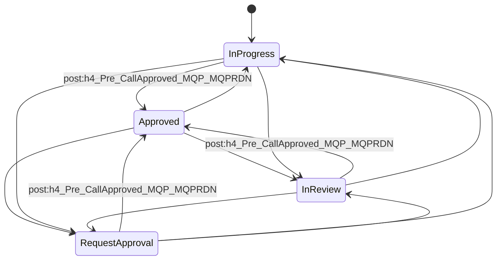

# HND-マルQ Step3 機能設計書

| 項目 | 内容 |
|---|---|
| 対象 | Aras Innovator 開発機能「マルQ Step3」(パッケージ h4.01〜h4.15 + コードツリー) |
| 入力資料 | `HND-マルQ Step3パッケージ`(AML/XML 820件、imports.mf)、`HND-マルQ Step3コードツリー`(html/js/css 等 24件) |
| 作成方法 | 全ファイルを読み取り、章ごとに整理して統合(自動生成) |
| 注意 | Method本体・画面コードに記載のない事項は書かず、呼出契機など読み取れない点は「推測」と明記している。各章は読取担当ごとに作成したため見出し番号は章内で完結している |

## 0. 全体構成

### 0.1 インポートパッケージ(imports.mf の順)
| # | パッケージ | 内容 | 主な記載章 |
|---|---|---|---|
| 01 | h4.01.Independent | Method 273件、LifeCycle 7、List 19、Form 17、Permission 26、CommandBar、UserMessage 92 等 | 第3章・第4章 |
| 02 | h4.02.WFMap | Workflow Map 5、qry_QueryDefinition 5、TreeGridView 7 | 第2章(G-c) |
| 03 | h4.03.DATFormatLink | DATFormatLink の Form/cui | 第1章(F) |
| 04 | h4.04.RevisionHistory | 改訂履歴の Form/cui | 第1章(F) |
| 05 | h4.05.AppWFGroupForDATFormat | h4_AppWFGroupForDATFormat | 第1章(F) |
| 06 | h4.06.DATFormat | h4_DATFormat | 第1章(F) |
| 07 | h4.07.DATMaster | h4_DATMaster, h4_RevisionHistory | 第1章(F) |
| 08 | h4.08.DptMQMaster | h4_DeptMQMaster | 第1章(F) |
| 09 | h4.09.MQPage | h4_MQPage, h4_destination History | 第2章(G-a) |
| 10 | h4.10.PointOut | h4_PointOut | 第2章(G-a) |
| 11 | h4.11.TestResult | h4_Test_Result | 第2章(G-b) |
| 12 | h4.12.ReqDoc | h4_ReqDoc | 第2章(G-b) |
| 13 | h4.13.AppWFGr | h4_ApprovalWFGroup, h4_ApprovalTarget, h4_ApprovalWFGroupSignOff | 第1章(F) |
| 14 | h4.14.AllEventTable | h4_AllEventTable | 第1章(F) |
| 15 | h4.15.Last | h4_MQPage_Tree と各種RelationshipType | 第2章(G-b) |

### 0.2 主要ItemType
h4_DATFormat(開達書式) / h4_DATMaster(帳票マスタ) / h4_RevisionHistory(改訂履歴) / h4_DeptMQMaster(マルQマスタ) / h4_AppWFGroupForDATFormat(開達実施要領一括承認) / h4_ApprovalWFGroup(一括承認) / h4_ApprovalTarget(承認対象) / h4_ApprovalWFGroupSignOff / h4_AllEventTable / h4_MQPage(マルQページ) / h4_destination History / h4_PointOut(指摘) / h4_ReqDoc(必要資料) / h4_Test_Result(検証結果・根拠) / h4_MQPage_Tree(マルQページ一覧)

### 0.3 主要ライフサイクル
h4_DATFormatLC / h4_MQPageLC / h4_MQPage ReqDocsNLC / h4_DATMasterLC / h4_ApprovalWFGroupLC / h4_AppWFGroupForDATFormatLC / h4_Test_ResultLC(詳細は第3章)

### 0.4 Workflow Map
h4_ApprovalWFGroupWF / h4_ApprovalWFMQAndReqDoc / h4_DATFormatEXPWF / h4_DATFormatWF / h4_Test_ResultWF(詳細は第2章 G-c)

### 0.5 クライアント画面(コードツリー)
h4_AllEventTable / h4_DATMasterTable / h4_DeptMQMasterTable / h4_EventSumTable(Wijmo FlexGrid等の表)、h4_Tree/ModTop(機種別マルQページツリー)。サーバMethod `h4_table_AllEvent_get` `h4_table_DATMaster_get` `h4_table_DeptMQMaster_get` `h4_table_1event_get` `h4_treeModGet` から取得(第6章)。

## 目次
1. 第1章 データ系パッケージ(DATFormat/DATMaster/DeptMQMaster/一括承認/AllEventTable)
2. 第2章 MQ・指摘・必要資料・検証結果・ワークフロー
3. 第3章 ライフサイクル・権限・値リスト・Form
4. 第4章 コマンドバー・メッセージ・その他
5. 第5章 Method(No.1〜273)
6. 第6章 コードツリー(クライアント側)
7. 付録 既知の注意点・バグ疑い(第5章・第6章内「注意点」参照)


---

<!-- ===== 第1章 ===== -->

# F. データ系パッケージ調査結果（Import配下XML全読）

ベース: `C:\Claude\TEST\HND-マルQ Step3パッケージ\Step3パッケージ\<パッケージ名>\Import`

## 0. 共通事項（全パッケージで確認できたこと）

- 各XMLはAras AML形式（`action="add"` / `edit`）。ItemType内の `Relationships` にProperty／View／Server Event／Client Event／ItemType Life Cycle／Allowed Workflow／Can Add／Allowed Permission／ITPresentationConfiguration が入る。
- Server Event / Client Event / Grid Event は `Method` を名前（`<name>`）で参照しているだけで、Methodの本体はこれら8パッケージには含まれない（Method定義は `Independent\Import\Method` 側に存在。例 `h4_ctrl_keyed_name.xml`）。本書ではMethod名とイベント発火タイミングのみ記載。
- Form上のイベントのうち `sk_method_code` が埋め込まれているもの（Form Event / Field Event）のみ、コード内容を読み取って記載した。
- CommandBarItem（ボタン定義）自体はこの8パッケージに含まれていない。CommandBarSection / PresentationConfiguration が参照するボタン名のみ分かる。ボタン→Methodの対応はこの範囲では確認できない（後述）。
- `cui_Control`（ItemView.Form）の各 `cui_ControlFormField` は、全件 `action=Add`, `role=World`。`cui_FormField` は全件 `readonly=1`, `required=1` と出力されている（XML値そのまま。DATFormatLinkのh4_itemnameのみ readonly=0, required=0）。
- 以下「プロパティ表」の列は、XMLに記載のあったものだけ記載。`-`はXMLに記載なし。系統共通で記載がない項目（is_indexed=0, is_federated=0 等の 0 値）は省略。
- ItemType共通で `Relationships` 末尾に `ItemType edit` があり、システムプロパティ（created_by_id, created_on, managed_by_id, modified_by_id, modified_on, owned_by_id, state, superseded_date）のラベル・非表示・並び順等を上書きしている。

---

## 1. DATFormat（ItemType: h4_DATFormat 「開達書式」）

### 1.1 ファイル一覧
cui_Control/ItemView.Form.xml, cui_Control/h4_DATFormat_Input_Init_EventVal.xml, cui_WindowSection/h4_DATFormat.xml, cui_WindowSection/h4_DATFormat_Input_Init_EventVal.xml, Form/(h4_DATFormat, h4_DATFormat CLN, h4_DATFormat EXPCLN, h4_DATFormat_Input_Init_DestVal, h4_DATFormat_Input_Init_EventVal), ItemType/h4_DATFormat.xml, PresentationConfiguration/(h4_DATFormatCLNCS, h4_DATFormatEXPCLNCS, h4_DATFormatLink_CS), RelationshipType/(h4_AppWFGr4DATFormat DATFormat, h4_DATFormat CLN, h4_DATFormat Doc, h4_DATFormat EXPCLN, h4_DATFormat SingOff, h4_DATFormat TGVRevQuery, h4_DATFormatLink)

### 1.2 ItemType 基本設定
| 項目 | 値 |
|---|---|
| 名前 | h4_DATFormat |
| ラベル | en: TE Format / ja: 開達書式（複数形も同じ） |
| ID | A13E2920E0A2442286CFA172EE076880 |
| implementation_type / instance_data | table / H4_DATFORMAT |
| is_versionable / manual_versioning | 1 / 0（バージョン管理あり・自動） |
| revisions（リビジョン体系） | h4_RevManagementRev |
| history_template | Default |
| unlock_on_logout | 1（ログアウト時アンロック） |
| allow_private_permission | 1 |
| enforce_discovery | 1 |
| default_page_size | 100 |
| auto_search / hide_where_used / is_dependent / is_relationship | 0 / 0 / 0 / 0 |
| show_parameters_tab | 0 |
| structure_view | tabs on |
| use_src_access | 0 |
| アイコン | ../images/RequirementDocument.svg（large/open） |
| 継承 | XMLに継承（extends/ポリモーフィック）の記載なし（table実装） |
| ライフサイクル | h4_DATFormatLC（Life Cycle Map） |
| 許可ワークフロー（Allowed Workflow） | h4_DATFormatWF（sort 128, is_default=0）、h4_DATFormatEXPWF（sort 256, is_default=0） |
| 許可アクセス権（Allowed Permission） | h4_Everyone_Full_Control（is_default=1） |
| Can Add | World（can_add=1） |
| View | Form「h4_DATFormat」, role=World, type=default, display_priority=1, client=js |
| ITPresentationConfiguration | h4_DATFormat_TOC_Configuration（client=js, sort 128）※このXML自体はこのパッケージ内に無い |

### 1.3 プロパティ表（h4_DATFormat固有）
| 名前 | ラベル(ja / en) | 型 | 長さ | 必須 | データソース | 既定値 | ソート順 | その他 |
|---|---|---|---|---|---|---|---|---|
| name | 資料名称（マスタ） / Document Master Name | string | 32 | 必須(1) | - | - | 110 | keyed_name_order=3, column_width=160 |
| h4_delta_version | Δバージョン / Δversion | list | 256 | - | list: h4_DeltaVersion | 空 | 100 | readonly=1, keyed_name_order=1, column_width=128 |
| h4_category | 資料分類 / Document Classification | list | 256 | - | list: h4_category | - | 130 | default_search=format, column_width=96 |
| h4_class | 技No. / Technique No. | string | 32 | - | - | - | 120 | column_width=96 |
| h4_doc_class | No. / No. | string | 32 | - | - | - | 140 | keyed_name_order=2, column_width=96 |
| h4_event | イベント / Event | text | - | - | - | - | 195 | readonly=1, column_width=640 |
| h4_doc_link1 | 帳票リンク① / Form Link (1) | item | - | - | ItemType h4_DATFormat | - | 3584 | item_behavior=float |
| h4_doc_link2 | 帳票リンク② / Form Link (2) | item | - | - | h4_DATFormat | - | 3712 | float |
| h4_doc_link3 | 帳票リンク③ / Form Link (3) | item | - | - | h4_DATFormat | - | 3840 | float |
| h4_guideline_link1 | 実施要領リンク① / Guidelines Link(1) | item | - | - | h4_DATFormat | - | 3968 | float |
| h4_guideline_link2 | 実施要領リンク② / Guidelines Link(2) | item | - | - | h4_DATFormat | - | 4096 | float |
| h4_guideline_link3 | 実施要領リンク③ / Guidelines Link(3) | item | - | - | h4_DATFormat | - | 4224 | float |
| h4_doc_description | 帳票説明内容 / Form Description | text | - | - | - | - | 4352 | - |
| h4_supplementary_materials1 | 帳票補足資料① / Form Supplementary Materials(1) | image | - | - | - | - | 4480 | - |
| h4_supplementary_materials2 | 帳票補足資料② / Form Supplementary Materials(2) | image | - | - | - | - | 4608 | - |
| h4_state | ステータス / status | foreign | - | - | 参照元プロパティ current_state（自ItemType）、表示元は Life Cycle State の label | - | 4736 | - |
| h4_updatedate | 更新日 / Modified on | date(pattern short_date_time) | - | - | - | - | 4864 | readonly=1 |
| h4_document_content | 資料内容 | text | - | - | - | - | 4992 | is_hidden=1, is_hidden2=1 |
| h4_approval_group_item | 一括承認リンク | item | - | - | ItemType h4_AppWFGroupForDATFormat | - | 5120 | readonly=1, is_hidden2=1, item_behavior=float |

システムプロパティ（edit）:
| 名前 | ラベル(ja/en) | 型 | その他 | ソート |
|---|---|---|---|---|
| created_by_id | 作成者 / Created by | item→User | 必須, readonly, 非表示 | 640 |
| created_on | 作成日 / Created on | date | 必須, readonly, 非表示, width150 | 512 |
| managed_by_id | 管理者 / Administrator | item→Identity | 非表示 | 896 |
| modified_by_id | 更新者 / Modified by | item→User | readonly, width160 | 1152 |
| modified_on | 更新日 / Modified on | date | readonly, width150 | 1024 |
| owned_by_id | 閲覧者（ja） | item→Identity | is_hidden2=1 | 768 |
| state | ステータス / status | string 32 | readonly, 非表示 | 1408 |
| superseded_date | Superseded Date | date | 非表示 | 3200 |

### 1.4 サーバーイベント（Method名と発火タイミング）
sort_orderは同一イベント内の実行順。

| 発火タイミング | Method | sort_order |
|---|---|---|
| GetKeyedName | h4_ctrl_keyed_name | 256 |
| onBeforeGet | h4_sort_control | 128 |
| onBeforeAdd | h4_CheckLockRelationDoc | 1280 |
| onAfterAdd | h4_ChangeWfForDATFormatAtAdd | 512 |
| onAfterAdd | h4_NewAssignInProgressForDat | 515 |
| onAfterAdd | h4_InitSetPermissionAndNo | 1152 |
| onBeforeUpdate | h4_ChangeWfForDATFormat | 384 |
| onBeforeUpdate | h4_CheckLockRelationDoc | 896 |
| onBeforeUpdate | h4_ReSetPermisson_Before | 2176 |
| onAfterUpdate | h4_ReAssignInProgressForDat | 640 |
| onAfterUpdate | h4_InitSetPermissionAndNo | 1024 |
| onAfterUpdate | h4_ReSetPermisson_After | 1920 |
| onBeforeVersion | h4_SetWfForDATAtRevisio_Before | 630 |
| onAfterVersion | h4_SetWfForDATAtRevisio_After | 768 |
| onBeforePromote | h4_CheckLockRelationDoc | 1408 |
| onAfterPromote | h4_UpdatePermissionForPromote | 1536 |
| onBeforeDelete | h4_CheckLockRelationDoc | 1664 |
| onBeforeDelete | h4_ReSetPermisson_Before | 2048 |
| onAfterDelete | h4_ReSetPermisson_After | 1792 |

### 1.5 クライアントイベント
| イベント | Method | sort |
|---|---|---|
| OnAfterNew | h4_ControlItemCreation | 128 |
| OnAfterNew | h4_setDefaultChargeListForDAT | 256 |

### 1.6 関係ItemType（RelationshipType）
| 名前 | ラベル(ja / en) | source | related | behavior | その他 | sort |
|---|---|---|---|---|---|---|
| h4_DATFormat Doc | 書式ドキュメント / Format Document | h4_DATFormat | Document | float | grid_view=intermix, description「SH: 開達書式 - ドキュメントリレーションシップ」。View/Formはdelete指定 | 128 |
| h4_DATFormatLink | リンク / Link | h4_DATFormat | （related_id指定なし。relationship ItemTypeは h4_DATFormatLink） | float | ItemType h4_DATFormatLink の `is_released`(boolean, 非表示, readonly, ラベル「Released Matsumoto」)をedit | 256 |
| h4_DATFormat SingOff | サインオフ / Sign-off | h4_DATFormat | （related指定なし） | float | Relationship View: Form h4_WFSignOffsForMQReqDoc, role=World | 384 |
| h4_DATFormat TGVRevQuery | サインオフ / Sign-off | h4_DATFormat | （related指定なし） | float | Relationship View: start_page=`../Modules/aras.innovator.TreeGridView/Views/MainPage.html`, parameters=`tgvdId=51B00F3519EA4525BAF4CDD560AB6EAB&startConditionProvider=ItemDefault({"id":"id"})` | 385 |
| h4_DATFormat CLN | 担当者一覧 / List of Responsible Parties | h4_DATFormat | Identity | hard_float | grid_view=right | 512 |
| h4_DATFormat EXPCLN | 担当者一覧(EXP) / List of Responsible Parties(EXP) | h4_DATFormat | Identity | hard_float | grid_view=right | 640 |
| h4_AppWFGr4DATFormat DATFormat | 承認対象 | source=h4_AppWFGroupForDATFormat | related=h4_DATFormat | float | related_idプロパティ（relationship ItemType側）に Grid Event `onsearchdialog` → Method `h4_propIsExpFilter`(sort128)。View/Form delete | 128 |

共通: auto_search=1, copy_permissions=0, create_related=0, related_option=2, related_notnull=0, inc_rel_key_name=1, inc_related_key_name=1, new_show_related=0。

### 1.7 Form
**h4_DATFormat**（Responsive, 1024x172, SH: 開達書式）
- Body（bg #ffffff）にFieldなし。レイアウトはcui_Control側で定義。
- Form Event: `onload` → Method `h4_ControlTabbarForDAT`（コメント「開達書式の担当者一覧タブの表示制御」）。コード内容:
  - 定数: DATCLN=`h4_DATFormat CLN`, DATEXPCLN=`h4_DATFormat EXPCLN`, SINGOFF=`h4_DATFormat SingOff`, TGVSINGOFF=`h4_DATFormat TGVRevQuery`, InProgress=`InProgress`, EXPTest=`EXPTest`。
  - `parent.relationships` が未生成の間は50msでリトライ。thisItemから `state` と `h4_category` を取得。各RelationshipType名からIDを引いてタブIDとする。
  - `h4_AppWFGr4DATFormat DATFormat` を related_id=自身のIDで検索し、紐づく各 `h4_AppWFGroupForDATFormat` の `is_current` を取得（取得エラー時は UserMessage `h4_C_E_0002` をAlert）。`is_current=="1"` が1件でもあれば「一括承認対象」と判定。
  - 表示制御: 一括承認対象 → CLN/EXPCLN/SingOff非表示、TGVRevQuery表示。 そうでなく state が `InProgress` または空 → CLN, EXPCLN, SingOff表示、TGV非表示。 そうでなく category==`EXPTest` → EXPCLN, SingOff表示（CLN, TGV非表示）。 それ以外 → CLN, SingOff表示（EXPCLN, TGV非表示）。
- FormComposite → cui_WindowSection `h4_DATFormat`。

**h4_DATFormat CLN**（699x234）: Field `h4_workflow_role`(dropdown, 役割, 上ラベル, x10 y10, sort128) と `h4_check_required`(checkbox, 必須, 右ラベル, x10 y50, sort256)。イベントなし。
**h4_DATFormat EXPCLN**: CLNと同構成（propertytype_idのみ別）。
**h4_DATFormat_Input_Init_DestVal**（イベント/仕向け地選択ダイアログ用）:
- Field `button0`（button, ラベル「OK」）— Field Event `onclick` → Method `h4_frm_get_destination`: ダイアログ内のチェック済みcheckboxのidを配列化し `parent.dialogArguments.dialog.close(strDestinations)` で返却（コメント「マルQページ仕向け地の取得」）。
- Field `h4_destination`(html, `<div id="destinationField">`)。
- Form Event `onload` → Method `h4_setDestinaionInit`: `dialogArguments.destinations`（カンマ区切り）を取得、List `h4_destination` の Value(label,sort_order,value) を取得して8個ずつ行分けでチェックボックス生成。既存選択値はchecked。
**h4_DATFormat_Input_Init_EventVal**（開達書式イベント設定用, css font-size 20px）:
- Field `button0`（OK）— Field Event `onclick` → Method `h4_frm_getSettingEvents`: チェック済みcheckboxのidを `dialog.close(strEvents)` で返却。
- Field `h4_events`(html, `<div id="eventField">`)。
- Form Event `onload` → Method `h4_setEventInit`: `dialogArguments.deltaVer`, `dialogArguments.events` を取得。List `h4_events` の `Filter Value`（filter=deltaVer, inactive=0, select=filter,label,sort_order,value,inactive）を取得。0件なら UserMessage `h4_C_E_0410` をAlert。labelが「個別」のものは除外。8個ずつ行分けでチェックボックス生成。
- FormComposite → cui_WindowSection `h4_DATFormat_Input_Init_EventVal`。

### 1.8 画面（cui）
- cui_WindowSection `h4_DATFormat`（location=ItemView, classification=Data Model）→ cui_WindowSectionControl(Add, World, sort128) → cui_Control `ItemView.Form`(id 58C4C519…)。
- cui_WindowSection `h4_DATFormat_Input_Init_EventVal` → cui_Control `h4_DATFormat_Input_Init_EventVal`（control_type=FormControl, parent=ItemView.FormTab, additional_data `{"layout":{},"order":[]}`）。
- cui_Control `ItemView.Form`（FormControl, parent=ItemView.FormTab）: cui_ControlFormField 33件（重複登録あり）。ユニークなフィールド構成:
  - 1行目 Column Set 0: h4_delta_version(filterList, maxWidth144), name(text, 144), h4_category(72–144), h4_class, h4_doc_class
  - h4_event（単独行）
  - Column Set 2: h4_doc_link1 / 2 / 3（item）
  - Column Set 3: h4_guideline_link1 / 2 / 3（item）
  - Column Set 4: h4_supplementary_materials1 / 2（image）
  - Column Set 5: created_on(date), created_by_id(item), h4_state(multiLingual), h4_updatedate(date)
  - Column Set 6: managed_by_id, owned_by_id（Column Set 7）／ h4_approval_group_item（Column Set 9）
  - Column Set 8: h4_document_content(textarea), h4_doc_description(textarea)
  - order: Column Set 0, h4_event, Column Set 2, 3, 4, 5, 6, 8
  - 全フィールド readonly=1/required=1（XML値）。field_type: h4_delta_version=filterList, name=text, h4_category=filterList(別エントリでtextもあり), h4_class/h4_doc_class=text, link系=item, supplementary=image, h4_event=text。
  - 同一data_source（name, h4_category, h4_class, h4_doc_class, h4_delta_version, h4_event）が複数回登録されている（sort_order 128〜1408, 3712〜4608 等）。
- ボタン→Method対応: cui_Control/cui_WindowSectionにボタン定義なし。

### 1.9 PresentationConfiguration
| 名前 | 参照CommandBarSection | role | sort |
|---|---|---|---|
| h4_DATFormatCLNCS | h4_DATFormatCLNIVRCB | World | 128 |
| h4_DATFormatEXPCLNCS | h4_DATFormatEXPCLNIVRCB | World | 128 |
| h4_DATFormatLink_CS | h4_DATFormatLink_IVRGCM | World | 128 |

（CommandBarSection本体は `Independent\Import\CommandBarSection` にある。このパッケージ範囲外。）

### 1.10 qry_* / rb_* / CommandBar*
このパッケージには存在しない。

---

## 2. DATFormatLink（Form / cui のみ。ItemType定義はこのフォルダに無い）

ファイル: cui_Control/ItemView.Form.xml, cui_WindowSection/h4_DATFormatLink.xml, Form/h4_DATFormatLink.xml
- ItemType h4_DATFormatLink の定義XMLはこのパッケージにも他の調査対象にも無い（RelationshipType h4_DATFormatLink は DATFormat パッケージに存在）。
- Form `h4_DATFormatLink`（Responsive, 699x234）: Bodyのみ（Field/イベントなし）。FormComposite→cui_WindowSection `h4_DATFormatLink`。
- cui_WindowSection `h4_DATFormatLink` → ItemView.Form(id ED271989…)。
- cui_Control ItemView.Form の cui_ControlFormField 7件:
| data_source | field_type | ラベル | readonly | required | sort |
|---|---|---|---|---|---|
| h4_itemname | text | Item Name | 0 | 0 | 768 |
| h4_datformatlink | item | TE Item Link | 1 | 1 | 896 |
| h4_description | textarea | Content | 1 | 1 | 1024 |
| h4_event | text | Event | 1 | 1 | 1152 |
| h4_urllink | text | External URL | 1 | 1 | 1280 |
| classification | classification | Classification | 1 | 1 | 1408 |
| is_released | checkbox | Released | 1 | 1 | 1536 |
- レイアウト: Column Set 6（Column13=[h4_itemname, h4_datformatlink], Column14=[h4_description]）、Column Set 4（h4_event, ratio 2）、Column Set 5（h4_urllink, ratio 2）。order: Column Set 6, 4, 5, classification, is_released。
- プロパティ表はこのフォルダでは定義なし（フィールドのdata_sourceから上記プロパティ名の存在が分かるのみ。型・長さは不明）。

---

## 3. DATMaster（ItemType: h4_DATMaster「帳票マスタ」＋ h4_RevisionHistory「改訂履歴」）

### 3.1 ファイル一覧
CommandBarSection/h4_DATMaster RevisionHistoryIVRCB.xml, cui_Control/ItemView.Form.xml, cui_WindowSection/h4_DATMaster.xml, Form/(h4_DATMaster, h4_DATMaster CLN), ItemType/(h4_DATMaster, h4_RevisionHistory), PresentationConfiguration/(h4_DATFormat RevisionHistoryCS, h4_DATMaster RevisionHistoryCS, h4_DATMasterCLNCS, h4_RevisionHistory_CS), RelationshipType/(h4_DATFormat RevisionHistory, h4_DATMaster CLN, h4_DATMaster DATFormat, h4_DATMaster RevisionHistory, h4_DATMaster SingOff, h4_DATMaster Table, h4_RevisionHistory Doc, h4_RevisionHistory RevHist)

### 3.2 ItemType h4_DATMaster 基本設定
| 項目 | 値 |
|---|---|
| ラベル | en: Form Master / ja: 帳票マスタ |
| ID | 95C9A38FE49C46B5A5656226665D2EBC |
| implementation_type / instance_data | table / H4_DATMASTER |
| is_versionable / manual_versioning | 1 / 0 |
| revisions | h4_RevManagementRev |
| history_template | Default |
| unlock_on_logout | 1 |
| allow_private_permission / enforce_discovery | 1 / 1 |
| default_page_size | 100 |
| structure_view | tabs on |
| show_parameters_tab | 0 |
| アイコン | ../images/FromTemplate.svg |
| ライフサイクル | h4_DATMasterLC |
| 許可ワークフロー | h4_DATFormatWF（sort128） |
| 許可アクセス権 | h4_Everyone_Full_Control（is_default=1） |
| Can Add | World |
| View | Form h4_DATMaster, role World, default |
| ITPresentationConfiguration | h4_DATMaster_TOC_Configuration（本パッケージ内にXMLなし） |

### 3.3 プロパティ表（h4_DATMaster）
| 名前 | ラベル(ja/en) | 型 | 長さ | 必須 | データソース | 既定値 | ソート | その他 |
|---|---|---|---|---|---|---|---|---|
| h4_delta_version | Δバージョン / Δversion | list | 256 | 必須 | list h4_DeltaVersion | 空 | 100 | keyed_name_order=1, width128 |
| name | 名称 / Name | string | 32 | 必須 | - | - | 110 | keyed_name_order=2, width160 |
| h4_state | ステータス / status | foreign | - | - | current_state → Life Cycle State.label | - | 3712 | - |
| h4_updatedate | 更新日 / Modified on | date | - | - | - | - | 3584 | readonly |

システムプロパティ(edit): created_by_id(作成者,必須,readonly,非表示,640), created_on(作成日,必須,readonly,非表示,512), managed_by_id(管理者,非表示,896), modified_by_id(更新者,readonly,1152), modified_on(更新日,readonly,1024), state(string 32,readonly,非表示,1408), superseded_date(非表示,3200)。

### 3.4 イベント（h4_DATMaster）
サーバー:
| タイミング | Method | sort |
|---|---|---|
| GetKeyedName | h4_ctrl_keyed_name | 256 |
| onBeforeGet | h4_sort_control | 128 |
| onAfterAdd | h4_SetWfForDATMasterAtAdd | 512 |
| onAfterAdd | h4_NewAssignInProgressForDat | 640 |
| onAfterCopy | h4_SetWfForDATMasterAtAdd | 700 |
| onAfterUpdate | h4_ReAssignInProgressForDat | 384 |
| onBeforeVersion | h4_SetWfForDATAtRevisio_Before | 956 |
| onAfterVersion | h4_SetWfForDATAtRevisio_After | 828 |

クライアント: OnAfterNew → h4_setDefaultChargeListForDAT（128）。
（開達書式と異なり、権限再設定系・h4_CheckLockRelationDoc等は設定されていない。）

### 3.5 ItemType h4_RevisionHistory（このパッケージ内で定義）
| 項目 | 値 |
|---|---|
| ラベル | en/ja: Revision History / 改訂履歴 |
| ID | 00DB7AFBCD5D4B8D89483816E141FE65 |
| implementation_type / instance_data | table / H4_REVISIONHISTORY |
| is_versionable / manual_versioning | 1 / 0 |
| revisions | Default |
| history_template | Default |
| unlock_on_logout | 0 |
| show_parameters_tab | 1 |
| structure_view | tabs on |
| ライフサイクル / ワークフロー | XMLに記載なし |
| 許可アクセス権 | h4_RevisionHistory（is_default=1） |
| Can Add | World |
| ITPresentationConfiguration | h4_RevisionHistory_CS |
| View | Form h4_RevisionHistory, World, default |

プロパティ表:
| 名前 | ラベル(ja / en) | 型 | 長さ | 必須 | データソース | 既定値 | ソート | その他 |
|---|---|---|---|---|---|---|---|---|
| h4_revision_number | 確認No. / Confirmation No. | string | 32 | - | - | - | 10 | readonly, keyed_name_order=1 |
| h4_revision_sub_number | 枝番 / Branch Number | integer | - | - | - | 1 | 20 | readonly, 非表示 |
| h4_revision_summary | 確認事項（改訂内容） / Confirmation Items (Revised Content) | text | - | 必須 | - | - | 30 | keyed_name_order=5 |
| h4_rel_dat_master | 対象：帳票マスタ / Target: Form Master | item | - | - | ItemType h4_DATMaster | - | 30 | readonly, keyed_name_order=3, is_hidden2=1 |
| h4_rel_dat_format | 対象：開達書式 / Target:TE Format | item | - | - | ItemType h4_DATFormat | - | 40 | readonly, keyed_name_order=4 |
| h4_revised_by | 担当者（改訂者） / Revised by | item | - | - | User | - | 50 | readonly, is_hidden2=1 |
| h4_revision_date | 改訂日（公開承認になった日） / Revision Date (Date Public Approval Granted) | date | - | - | - | - | 60 | readonly |
| h4_applover_1 | 承認者 / Approver | item | - | - | Identity | - | 70 | - |
| h4_applover_2 | 承認者2 / Approver2 | item | - | - | Identity | - | 71 | - |
| h4_confirmation_status | 確認済み / Confirmed | list | 256 | 必須 | list h4_confirmation_status | `not_confirmed`(ja) | 3712 | 非表示 |
| h4_due_date | 対応期日 / Due Date | date | - | - | - | - | 3840 | 非表示 |
| h4_newest_revision_history | 最新 / Latest Data | item | - | - | ItemType h4_RevisionHistory | - | 3968 | readonly, 非表示 |
| h4_response_note | 回答事項 / Response Content | text | - | - | - | - | 4352 | 非表示 |
| h4_revision_reason | 改訂理由 / Reason for Revision | text | - | 必須 | - | - | 4864 | 非表示 |

システムプロパティ(edit): created_on(記載日 / Date of Record, 必須, readonly, 非表示, 512), managed_by_id(管理者,非表示,896), superseded_date(非表示,3200)。
サーバーイベント: onAfterAdd → h4_SetNos（128）、onAfterAdd → h4_CreateNewRevisionHistory（130）。
クライアントイベント: OnAfterNew → h4_setPropToRevisionHistory（128）。

### 3.6 関係ItemType
| 名前 | ラベル(ja/en) | source | related | behavior | その他 | sort |
|---|---|---|---|---|---|---|
| h4_DATMaster DATFormat | 帳票マスタ-開達書式 / Form Master - TE Format | h4_DATMaster | h4_DATFormat | float | grid_view=intermix。Relationship Grid Event `oninsertrow` → Method `h4_addDatFormatCheck`(128)。relationship ItemTypeのrelated_idプロパティ(item→h4_DATFormat, is_indexed)に Grid Event `onsearchdialog` → `h4_propDeltaFilter`(128)。sort_orderプロパティ(integer, 非表示, ラベル「並び順」, 3200)。View/Form delete | 128 |
| h4_DATMaster SingOff | サインオフ / Sign-off | h4_DATMaster | - | float | Relationship View: Form h4_WFSignOffsForMQReqDoc, World | 256 |
| h4_DATMaster Table | Table / やるやら | h4_DATMaster | - | float | Relationship View: start_page=`../../Solutions/h4_Table/h4_DATMasterTable/html/index.html`, World | 256 |
| h4_DATMaster CLN | 担当者一覧 / List of Responsible Parties | h4_DATMaster | Identity | hard_float | grid_view=right | 384 |
| h4_DATMaster RevisionHistory | 改訂履歴 / Revision History | h4_DATMaster | h4_RevisionHistory | hard_float | View/Form delete | 512 |
| h4_DATFormat RevisionHistory | 改訂履歴 / Revision History | h4_DATFormat | h4_RevisionHistory | hard_float | View/Form delete | 768 |
| h4_RevisionHistory Doc | 補足資料（ja） | h4_RevisionHistory | Document | float | View/Form delete | 128 |
| h4_RevisionHistory RevHist | 関連改訂履歴（ja） | h4_RevisionHistory | h4_RevisionHistory | float | View/Form delete | 256 |

### 3.7 Form
- **h4_DATMaster**（Responsive, 1024x256, SH: 帳票マスタ）: Field `h4_delta_version`(dropdown, ラベル⊿バージョン, display_length128, x0 y0, sort100) と `name`(text, 名称, length192, x200 y0, sort110)。Form Eventなし。FormComposite→cui_WindowSection h4_DATMaster。
- **h4_DATMaster CLN**（699x234）: h4_workflow_role(dropdown 役割) / h4_check_required(checkbox 必須)。イベントなし。

### 3.8 画面（cui / CommandBar）
- cui_WindowSection `h4_DATMaster` → cui_Control ItemView.Form（id 8244FC6D…）。
- ItemView.Form: cui_ControlFormField 7件（重複あり）。ユニーク構成: Column Set 0 = h4_delta_version(filterList, max200) / name(text, max432)、Column Set 4 = managed_by_id(item)、Column Set 3 = h4_state(multiLingual) / h4_updatedate(date)。order: Column Set 0, 4, 3。全 readonly=1。
- CommandBarSection **h4_DATMaster RevisionHistoryIVRCB**（location=ItemView.RelationshipsCommandBar）。CommandBarSectionItem:
| action | 対象CommandBarItem | alternate（置換先） | sort |
|---|---|---|---|
| Remove | itemview.relationshipscommandbar.default.selectitems | - | 128 |
| Remove | itemview.relationshipcommandbar.addrow | - | 256 |
| Replace | itemview.relationshipscommandbar.create_item | h4_DATHistRelIVCBNewItem | 384 |
| Replace | itemview.relationshipscommandbar.default.deleterow | h4_DATHistRelIVCBRowDell | 512 |
| Add | h4_ivrcb_directCreateHistory | - | 520 |
| Add | h4_ivrcb_directDeleterow | - | 524 |
  （全て role=World）。ボタン→Methodの対応（CommandBarItemのon_click_handler等）は本パッケージ内に無く不明。

### 3.9 PresentationConfiguration
| 名前 | CommandBarSection |
|---|---|
| h4_DATMasterCLNCS | h4_DATMasterCLNIVRCB |
| h4_DATFormat RevisionHistoryCS | h4_DATFormat RevisionHistoryIVRCB |
| h4_DATMaster RevisionHistoryCS | h4_DATMaster RevisionHistoryIVRCB（上記） |
| h4_RevisionHistory_CS | h4_RevisionHistory_IVCB |
（いずれも role=World, sort128）

### 3.10 qry/rb
なし。

---

## 4. DptMQMaster（ItemType: h4_DeptMQMaster「マルQマスタ」）

ファイル: cui_Control/ItemView.Form.xml, cui_WindowSection/h4_DeptMQMaster.xml, Form/h4_DeptMQMaster.xml, ItemType/h4_DeptMQMaster.xml, RelationshipType/(h4_DMPMaster Table, h4_DMQMaster DATFormat)

### 4.1 基本設定
| 項目 | 値 |
|---|---|
| ラベル | en: Dept. Maru Q Master / ja: マルQマスタ |
| ID | B8AEEFB599DB4EC2A4067C036DC3C0C3 |
| implementation_type / instance_data | table / H4_DEPTMQMASTER |
| is_versionable / manual_versioning | 1 / **1**（手動バージョン管理） |
| revisions | Default |
| history_template | Default |
| unlock_on_logout | 1 |
| default_page_size | 100 |
| show_parameters_tab | 0 |
| structure_view | tabs on |
| アイコン | ../images/GenericIcon.svg |
| ライフサイクル / ワークフロー | XMLに記載なし |
| 許可アクセス権 | h4_Everyone_Full_Control（sort128, default指定なし）, h4_DeptMQMaster（sort256, is_default=1） |
| Can Add | World |
| ITPresentationConfiguration | h4_DeptMQMaster_TOC_Configuration（XML本パッケージ内なし） |

### 4.2 プロパティ表
| 名前 | ラベル(ja / en) | 型 | 長さ | 必須 | データソース | 既定値 | ソート | その他 |
|---|---|---|---|---|---|---|---|---|
| h4_dept | 室課 | string | 32 | 必須 | - | 空(ja) | 100 | - |
| name | 名称 / Name | string | 32 | 必須 | - | - | 120 | keyed_name_order=1, width250 |
| h4_delta_version | ⊿バージョン / Delta Ver. | list | 256 | - | list h4_DeltaVersion | 空 | 110 | readonly, width128 |
| h4_base_format_master | ベース帳票マスタ / Base Format Master | item | - | - | ItemType h4_DATMaster | - | 125 | readonly, 非表示, float, width250。Grid Event `onsearchdialog` → Method `h4_DeptMQMasterReleaseFilte`(128) |
| h4_class | 区分 | mv_list(複数値リスト) | 256 | - | list h4_class | - | 3628 | - |
| h4_group | グループ | string | 32 | - | - | - | 3756 | - |
| h4_section | セクション | string | 32 | - | - | - | 3884 | - |
| h4_approve_style | ワークフローの有無 | boolean | - | - | - | 1(ja) | 3456 | 非表示 |

システムプロパティ(edit): created_on(必須,readonly,非表示,3500), managed_by_id(管理者,非表示,896), modified_by_id(readonly,1152), modified_on(readonly,1024), owned_by_id(一般ユーザ / general user, 非表示, 768), superseded_date(非表示, 3200)。

### 4.3 イベント
- サーバー: onBeforeGet → h4_sort_control（128）。
- クライアント: OnAfterNew → h4_ControlItemCreation（256）。

### 4.4 関係ItemType
| 名前 | ラベル | source | related | behavior | その他 | sort |
|---|---|---|---|---|---|---|
| h4_DMQMaster DATFormat | マルQマスタ - 開達書式 / DAT Format | h4_DeptMQMaster | h4_DATFormat | **fixed** | grid_view=intermix。Relationship Grid Event `oninsertrow` → h4_addDatFormatCheck(128)。relationship側related_idに Grid Event `onsearchdialog` → h4_propDeltaFilter(128)。sort_orderプロパティ(integer,非表示,並び順,3200) | 128 |
| h4_DMPMaster Table | やるやら表 / Master Table | h4_DeptMQMaster | - | float | Relationship View: start_page=`../../Solutions/h4_Table/h4_DeptMQMasterTable/html/index.html`, World | 256 |

### 4.5 Form / 画面
- Form `h4_DeptMQMaster`（Responsive, 1024x172, SH: 室課マルQマスタ）: Field `h4_delta_version`(dropdown, x0 y0, length128), `name`(text, x150 y0, length160), `h4_base_format_master`(item, x4 y52, length160)。イベントなし。FormComposite→cui_WindowSection h4_DeptMQMaster。
- cui_Control ItemView.Form（id 48925850…）: 10フィールド。レイアウト: Column Set 6 = h4_class(checkboxList), h4_dept(text,72), h4_group(72), h4_section(72), h4_approve_style(checkbox), managed_by_id(item), owned_by_id(item)。Column Set 5 = h4_delta_version(filterList), name(text, max432), h4_base_format_master(item)。order: Column Set 6, 5。全 readonly=1。
- PresentationConfiguration / CommandBar / qry / rb: なし。

---

## 5. RevisionHistory（Form/cuiのみ。ItemType定義は DATMaster パッケージ側 §3.5）

ファイル: cui_Control/ItemView.Form.xml, cui_WindowSection/h4_RevisionHistory.xml, Form/h4_RevisionHistory.xml
- Form `h4_RevisionHistory`（Responsive, 699x234）: Bodyのみ、Field/イベントなし。FormComposite→cui_WindowSection h4_RevisionHistory。
- cui_Control ItemView.Form（id 87CD661E…）: 16フィールド（全 readonly=1）:
  h4_revision_number(text), h4_revision_sub_number(integer), managed_by_id(item), h4_newest_revision_history(item), h4_rel_dat_master(item), h4_rel_dat_format(item), h4_revised_by(item), h4_due_date(date), h4_confirmation_status(filterList), h4_applover_1(item), h4_applover_2(item), h4_revision_summary(textarea), h4_revision_reason(textarea), h4_response_note(textarea), h4_revision_date(date), created_on(date)。
- レイアウト order: Column Set 4（Set5: 確認No./枝番/管理者/最新、Set8: 対象帳票マスタ/対象開達書式/記載日）→ Column Set 1（Set2: 改訂者/対応期日/確認済み/承認者、Set11: 承認者2/改訂日）→ Column Set 10（改訂内容/改訂理由）→ Column Set 0（回答事項）。
- CommandBar/PresentationConfiguration/qry/rb: このフォルダには無し（`h4_RevisionHistory_CS` は DATMaster パッケージ側）。

---

## 6. AppWFGroupForDATFormat（ItemType: h4_AppWFGroupForDATFormat「開達実施要領一括承認」）

ファイル: cui_Control/ItemView.Form.xml, cui_WindowSection/h4_AppWFGroupForDATFormat.xml, Form/(h4_AppWFGrForDATFormat CLN, h4_AppWFGrForDATFormat EXPCLN, h4_AppWFGroupForDATFormat), ItemType/h4_AppWFGroupForDATFormat.xml, PresentationConfiguration/(h4_AppWFGr4DATFormat_DATFormatCS, h4_AppWFGrForDATFormatCLNCS, h4_AppWFGrForDATFormatEXPCLNCS, h4_AppWFGroupForDATFormat_TOC_Configuration), RelationshipType/(h4_AppWFGrForDATFormat CLN, h4_AppWFGrForDATFormat EXPCLN, h4_AppWFGrForDATFormat SingOff, h4_TGVWFGDATFormatRevHistory)

### 6.1 基本設定
| 項目 | 値 |
|---|---|
| ラベル | ja: 開達実施要領一括承認（複数形同）, enラベルなし |
| ID | 018E955AA0DC4FAFBDE9BDC651E3188A |
| implementation_type / instance_data | table / H4_APPWFGROUPFORDATFORMAT |
| is_versionable / manual_versioning | 1 / 0 |
| revisions | Default |
| history_template | Default |
| unlock_on_logout | 0 |
| show_parameters_tab | 1 |
| structure_view | tabs on |
| アイコン | ../images/PackageDefinition.svg |
| ライフサイクル | h4_AppWFGroupForDATFormatLC |
| 許可ワークフロー | h4_DATFormatEXPWF（sort256）, h4_DATFormatWF（sort384）（is_default記載なし） |
| 許可アクセス権 | h4_Everyone_Full_Control（is_default=1, sort256） |
| Can Add | World |
| ITPresentationConfiguration | h4_AppWFGroupForDATFormat_TOC_Configuration |
| View | Form h4_AppWFGroupForDATFormat, World, default |

### 6.2 プロパティ表
| 名前 | ラベル(ja) | 型 | 長さ | 必須 | データソース | 既定値 | ソート | その他 |
|---|---|---|---|---|---|---|---|---|
| h4_approvalitemname | 承認項目 | string | 100 | - | - | - | 3456 | keyed_name_order=1 |
| h4_remarks | 備考 | text | - | - | - | - | 3584 | 非表示 |
| h4_state | ステータス | foreign | - | - | current_state → Life Cycle State.label | - | 3712 | - |
| h4_isexp | EXP検定： | boolean | - | - | - | - | 3840 | readonly |
システムプロパティ(edit): managed_by_id(管理者,非表示,896), superseded_date(非表示,3200)。

### 6.3 イベント
サーバー:
| タイミング | Method | sort |
|---|---|---|
| onBeforeGet | h4_sort_control | 128 |
| onAfterAdd | h4_SaveCKAppWFGroup4DATFormat | 200 |
| onAfterAdd | h4_ChangeWfForDATFormatAtAdd | 256 |
| onAfterUpdate | h4_SaveCKAppWFGroup4DATFormat | 300 |
| onAfterUpdate | h4_ReAssignInProgressForDat | 384 |
| onBeforeUpdate | h4_CheckManagedByIdRequired | 640 |
| onAfterPromote | h4_UpdatePointOutPermission | 512 |
クライアント: OnAfterNew → h4_ControlItemCreation（128）。

### 6.4 関係ItemType
| 名前 | ラベル(ja) | source | related | behavior | その他 | sort |
|---|---|---|---|---|---|---|
| h4_AppWFGr4DATFormat DATFormat | 承認対象 | h4_AppWFGroupForDATFormat | h4_DATFormat | float | DATFormatパッケージ側に定義（§1.6） | 128 |
| h4_AppWFGrForDATFormat SingOff | サインオフ | 本ItemType | - | float | Relationship View: Form h4_WFSignOffsForMQReqDoc, World | 200 |
| h4_AppWFGrForDATFormat CLN | 担当者一覧 | 本ItemType | Identity | float | grid_view=right | 256 |
| h4_AppWFGrForDATFormat EXPCLN | 担当者一覧（EXP検定） | 本ItemType | Identity | float | grid_view=right | 384 |
| h4_TGVWFGDATFormatRevHistory | 確認項目一覧 | 本ItemType | - | float | Relationship View: start_page=`../Modules/aras.innovator.TreeGridView/Views/MainPage.html`, parameters=`tgvdId=DDE13B5BC4EE4357A7EF7571DCFC4595&startConditionProvider=ItemDefault({"id":"id"})` | 512 |

### 6.5 Form
- **h4_AppWFGroupForDATFormat**（Responsive, 699x234）: Bodyのみ。Form Event `onload` → Method `h4_ControlTabbarForApWFGr4DAT`（コメント「開達書式の一括の担当者一覧タブの表示制御」）。コード: `parent.relationships` 未生成なら50msリトライ。thisItemの `h4_isexp` を取得し、`"1"` なら `h4_AppWFGrForDATFormat EXPCLN` タブを表示・`h4_AppWFGrForDATFormat CLN` タブを非表示、それ以外は逆。タブIDはRelationshipType名で検索して取得。
- **h4_AppWFGrForDATFormat CLN / EXPCLN**（699x234）: h4_workflow_role(dropdown 役割) / h4_check_required(checkbox 必須)。イベントなし。

### 6.6 画面
- cui_WindowSection h4_AppWFGroupForDATFormat → ItemView.Form(id 16B4FA7F…)。5フィールド: h4_approvalitemname(text), managed_by_id(item), h4_state(multiLingual), h4_remarks(textarea), h4_isexp(checkbox)。レイアウト: Column Set 0 = 承認項目/EXP検定/ステータス、Column Set 3 = managed_by_id、Column Set 1 = h4_remarks。全 readonly=1。

### 6.7 PresentationConfiguration
| 名前 | 参照CommandBarSection (sort) |
|---|---|
| h4_AppWFGr4DATFormat_DATFormatCS | h4_AppWFGr4DATFormat_DATFormatIVRCB (128), h4_AppWFGr4DATFormat_DATFormatIVRGCM (256) |
| h4_AppWFGrForDATFormatCLNCS | h4_AppWFGrForDATFormatCLNIVRCB |
| h4_AppWFGrForDATFormatEXPCLNCS | h4_AppWFGrForDATFormatEXPCLNIVRCB |
| h4_AppWFGroupForDATFormat_TOC_Configuration | h4_AppWFGroupForDATFormat_TOC_Content (128), h4_AppWFGroupForDATFormat_IVICB (128) |
（role=World）。CommandBarSection本体・ボタンは本パッケージに含まれない。

---

## 7. AppWFGr（ItemType: h4_ApprovalWFGroup「一括承認」, h4_ApprovalTarget「承認対象」, h4_ApprovalWFGroupSignOff）

ファイル: cui_Control/ItemView.Form.xml, cui_WindowSection/h4_ApprovalWFGroup.xml, Form/(h4_ApprovalTarget, h4_ApprovalWFGroup, h4_ApprovalWFGroup PointOut, h4_ApprovalWFGroupSignOff), ItemType/(h4_ApprovalTarget, h4_ApprovalWFGroup, h4_ApprovalWFGroupSignOff), PresentationConfiguration/h4_ApprovalWFGroup CLN_TOC_Configuration.xml, Property/(h4_approval_group_item, h4_rel_approvalwfgroup), RelationshipType/(h4_ApprovalWFGroup CLN, h4_ApprovalWFGroup PointOut, h4_ApprovalWFGroup_ApSignOff, h4_ApprovalWFGroup_ApTarget)

### 7.1 ItemType h4_ApprovalWFGroup 基本設定
| 項目 | 値 |
|---|---|
| ラベル | en: h4_ApprovalWFGroup / ja: 一括承認（複数形ja同） |
| ID | DD0E19C0D9DE43E986F27A243FBD2298 |
| implementation_type / instance_data | table / H4_APPROVALWFGROUP |
| is_versionable / manual_versioning | 1 / 0 |
| revisions / history_template | Default / Default |
| unlock_on_logout | 0 |
| default_page_size | 100 |
| show_parameters_tab | 1 |
| structure_view | tabs on |
| アイコン | ../images/PackageDependsOn.svg |
| ライフサイクル | h4_ApprovalWFGroupLC |
| 許可ワークフロー | h4_ApprovalWFGroupWF（is_default=1） |
| 許可アクセス権 | h4_Everyone_Full_Control（is_default=1） |
| Can Add | World |
| ITPresentationConfiguration | h4_ApprovalWFGroup_TOC_Configuration（XMLなし） |
| View | Form h4_ApprovalWFGroup, World, default |

### 7.2 プロパティ表（h4_ApprovalWFGroup）
| 名前 | ラベル(ja / en) | 型 | 長さ | 必須 | データソース | 既定値 | ソート | その他 |
|---|---|---|---|---|---|---|---|---|
| h4_my | MY | list | 256 | - | list h4_ModelYear | - | 3072 | readonly, keyed_name_order=1 |
| h4_model_name | 機種呼称 | item | - | - | ItemType HRDPMTypModelProject | - | 4096 | readonly, float, keyed_name_order=2 |
| h4_event | イベント | filter list | 256 | - | list h4_Events（filter元 pattern=h4_delta_version） | - | 5522 | readonly, 非表示, keyed_name_order=3 |
| h4_unique_event | 個別イベント | string | 256 | - | - | - | 5266 | readonly, keyed_name_order=4 |
| h4_destination | 仕向け | text | - | - | - | - | 3300 | readonly, keyed_name_order=5 |
| h4_evaluation_unit | 評価単位 | string | 256 | - | - | - | 5394 | readonly, keyed_name_order=6 |
| h4_delta_version | ⊿バージョン / Copy of Delta Ver. | list | 256 | 必須 | list h4_DeltaVersion | 空 | 130 | readonly, 非表示, width128 |
| h4_dept | 室課 | string | 32 | - | - | - | 1300 | readonly |
| h4_model_code | 機種コード | string | 32 | 必須 | - | `-` | 3600 | readonly |
| h4_approval_round | 次数 | integer | - | - | - | 1 | 3712 | readonly |
| h4_approver | 承認者 | item | - | - | User | - | 3840 | readonly, 非表示, float |
| h4_approval_date | 承認日時 | date | - | - | - | - | 3968 | readonly, 非表示 |
| h4_remarks | 備考 | text | - | - | - | - | 3584 | 非表示 |
| h4_directaplist | ステート | list | 256 | 必須 | list h4_ApprovalWFGroupLCS | InProgress(en) | 5138 | readonly, 非表示 |
システムプロパティ(edit): created_on(必須,readonly,非表示,3800), current_state(ステート, item→Life Cycle State, readonly, 1280), managed_by_id(編集者 / 利用者(同室課), 非表示, 896), modified_by_id(readonly, 5010), modified_on(readonly, 5000), owned_by_id(閲覧者 / 利用者(別室課), 非表示, 768), superseded_date(非表示, 5906)。

### 7.3 イベント（h4_ApprovalWFGroup）
| タイミング | Method | sort |
|---|---|---|
| onBeforeGet | h4_sort_control | 428 |
| onAfterAdd | h4_set_owner_for_ApprovalWFGroup | 128 |
| onAfterAdd | h4_SaveCheckhApprovalWFGroup | 200 |
| onAfterUpdate | h4_SaveCheckhApprovalWFGroup | 32 |
| onAfterUpdate | h4_set_owner_for_ApprovalWFGroup | 256 |
| onAfterUpdate | h4_ReAssignInProgress | 300 |
| onAfterUpdate | h4_SetVoteInProgress | 310 |
| onBeforeUpdate | h4_CheckManagedByIdRequired | 1069 |
| onAfterPromote | h4_ListByPromoteApWFGroup | 940 |
| onAfterPromote | h4_UpdatePointOutPermission | 941 |
クライアント: OnAfterNew → h4_ControlItemCreation（128）。

### 7.4 ItemType h4_ApprovalTarget（承認対象、ポリモーフィック）
| 項目 | 値 |
|---|---|
| ラベル | en: ApprovalTarget / ja: 承認対象 |
| ID | 379A81DD9B26418CA278E7E4F9FB4C4E |
| implementation_type | **polymorphic**（instance_data H4_APPROVALTARGET） |
| is_versionable | 1（manual_versioning 0） |
| revisions / history_template | Default / Default |
| show_parameters_tab | 1, structure_view=tabs off, unlock_on_logout=0 |
| Can Add | Administratorsのみ |
| Morphae（実体ItemType） | h4_MQPage（sort256）, h4_ReqDoc（sort384） |
| ライフサイクル・ワークフロー | XMLに記載なし |
プロパティ: h4_approval_date(承認日時, item→h4_ApprovalTarget, 非表示, float, 3584), h4_approver(承認者, item→h4_ApprovalTarget, 非表示, float, 3712)。edit: classification(string 512, is_hidden2, 256), current_state(item→Life Cycle State, 非表示, readonly, 1408), itemtype(list, データソース List h4_ApprovalTarget, stored_length 64, readonly, 128), keyed_name(string 128, 384), superseded_date(非表示, 3328)。
サーバーイベント（全てポリモーフィック標準Method）: onBeforeDelete→polymorphic_item_onBeforeDelete(128), onBeforeLock→…onBeforeLock(256), onBeforeUnlock→…onBeforeUnlock(384), onBeforeVersion→…onBeforeVersion(512), onBeforeUpdate→…onBeforeUpdate(640), onBeforeAdd→…onBeforeAdd(768), onBeforeCopy→…onBeforeCopy(896)。
Form `h4_ApprovalTarget`: Field `itemtype`(dropdown, ラベル itemtype, x10 y10, propertytype=Property itemtype)。イベントなし。

### 7.5 ItemType h4_ApprovalWFGroupSignOff（WFの親アイテムサインオフ）
| 項目 | 値 |
|---|---|
| ID | 99CDDC94A3594E9C82EE78E1989A68A9 |
| ラベル | ja: WFの親アイテムサインオフ |
| implementation_type / instance_data | table / H4_APPROVALWFGROUPSIGNOFF |
| is_relationship | **1**, is_versionable=0 |
| structure_view | tabs off, show_parameters_tab=1, unlock_on_logout=0 |
プロパティ: h4_signoff_role(string 32, "Signoff Role", 3072), assigned_use(item→User, float, "Assigned Use", 3200), h4_comment(text, 3456), approved_on(date, "Approved On", 3584), source_type(item→ItemType, 非表示, float, 3712)。edit: related_id(item, indexed, float, 3968), source_id(item, indexed, 非表示, readonly, float, 3840)。
Form `h4_ApprovalWFGroupSignOff` / `h4_ApprovalWFGroup PointOut`: Bodyのみ（Field・イベントなし）。

### 7.6 Property単体XML
| 名前 | ラベル | 型 | データソース | 属性 | sort |
|---|---|---|---|---|---|
| h4_approval_group_item | 一括承認リンク | item | ItemType h4_ApprovalWFGroup | readonly, is_hidden2, float | 9162 |
| h4_rel_approvalwfgroup | 対象：一括承認 | item | ItemType h4_ApprovalWFGroup | float, column_width=240 | 6650 |
（source_idは出力されていない＝どのItemType上のプロパティかは別パッケージ側の定義に依存。XML上は特定不能。）

### 7.7 関係ItemType（source = h4_ApprovalWFGroup）
| 名前 | ラベル(ja) | related | behavior | その他 | sort |
|---|---|---|---|---|---|
| h4_ApprovalWFGroup_ApTarget | 承認対象 | h4_ApprovalTarget | float | View/Form delete | 128 |
| h4_ApprovalWFGroup_ApSignOff | サインオフ | h4_ApprovalWFGroupSignOff | float | Relationship View: Form h4_WFSignOffsForMQReqDoc, World。View/Form delete | 256 |
| h4_ApprovalWFGroup CLN | 担当者一覧 | Identity | float | grid_view=right。View/Form delete | 384 |
| h4_ApprovalWFGroup PointOut | 指摘 | h4_PointOut | float | related_option=1, related_notnull=1, new_show_related=1 | 512 |

### 7.8 Form（h4_ApprovalWFGroup）
Responsive 699x234。Field（全てx/y絶対配置）: h4_my(dropdown MY,x10 y10), h4_model_name(text 機種呼称, x10 y50), h4_destination(dropdown 仕向け, x10 y90), h4_event(dropdown イベント, x10 y130), h4_remarks(textarea 備考, 350x50, x10 y170), current_state(item, x153 y10), h4_approval_round(text, 次数, is_disabled=1, x155 y61)。Form Eventなし。FormComposite→cui_WindowSection h4_ApprovalWFGroup。

### 7.9 画面
- cui_WindowSection h4_ApprovalWFGroup → ItemView.Form（id 97301AE0…）。18フィールド（h4_destination, h4_approval_round等）。ユニーク構成: Column Set 30 = h4_dept, h4_approval_round, h4_directaplist(filterList), h4_delta_version(filterList), h4_model_code, h4_my(filterList)。Column Set 32 = h4_destination, h4_model_name(item), Column Set 33（h4_evaluation_unit, h4_unique_event）, h4_event(filterList)。Column Set 31 = managed_by_id, owned_by_id, h4_approver, h4_approval_date。単独: h4_remarks(textarea)。order: Column Set 30, 32, 31, h4_remarks。
- フィールド型: h4_destination は filterList と text の2エントリ、current_state は item、h4_model_name は item。全て readonly=1。

### 7.10 PresentationConfiguration
h4_ApprovalWFGroup CLN_TOC_Configuration → CommandBarSection `h4_ApprovalWFGroup CLN_IVRCB`（World, 128）。CommandBarSection本体は本パッケージに無い。

---

## 8. AllEventTable（ItemType: h4_AllEventTable「マルQ イベント横通し表示」）

ファイル: CommandBarMenuButton/com.aras.innovator.cui_default.toc_h4_AllEventTable_AF93993…xml, CommandBarSection/h4_AllEventTable_TOC_Content.xml, cui_Control/ItemView.Form.xml, cui_WindowSection/h4_AllEventTable.xml, Form/(h4_AllEventTable, h4_AllEventTable Table), ItemType/h4_AllEventTable.xml, PresentationConfiguration/h4_AllEventTable_TOC_Configuration.xml, RelationshipType/h4_AllEventTable Table.xml

### 8.1 基本設定
| 項目 | 値 |
|---|---|
| ラベル | en: MaruQ All Event Data List / ja: マルQ イベント横通し表示 |
| ID | 4E29B9EE8D40476A85B338A4781E37EC |
| implementation_type / instance_data | table / H4_ALLEVENTTABLE |
| is_versionable | **0**（バージョン管理なし） |
| revisions | Default（history_templateなし） |
| unlock_on_logout | 0 |
| show_parameters_tab | 1 |
| structure_view | tabs on |
| ライフサイクル / ワークフロー | なし |
| 許可アクセス権 | h4_Everyone_Full_Control（is_default=1） |
| Can Add | World |
| ITPresentationConfiguration | h4_AllEventTable_TOC_Configuration |
| View | Form h4_AllEventTable, World, default |
| サーバー/クライアントイベント | なし |

### 8.2 プロパティ表
| 名前 | ラベル(ja / en) | 型 | 長さ | 必須 | データソース | ソート | その他 |
|---|---|---|---|---|---|---|---|
| h4_model_name | 機種呼称 / Model Name | item | - | 必須 | ItemType HRDPMTypModelProject | 100 | float, keyed_name_order=2 |
| h4_delta_version | Δバージョン / Delta Version | list | 256 | 必須 | list h4_DeltaVersion | 300 | keyed_name_order=3 |
| h4_dept | 室課 / Dept. | string | 32 | 必須 | - | 3072 | - |
| h4_group | グループ | string | 32 | - | - | 3200 | - |
| h4_section | セクション | string | 32 | - | - | 3328 | - |
| h4_model_code | 機種コード | string | 32 | 必須 | - | 3456 | keyed_name_order=4 |
| h4_my | MY | list | 256 | 必須 | list h4_ModelYear | 3584 | keyed_name_order=1 |
（既定値の記載なし。システムプロパティのedit なし。）

### 8.3 関係ItemType
`h4_AllEventTable Table`（ラベル 一覧 / List, source=h4_AllEventTable, float, sort_order=1）: Relationship View start_page=`../../Solutions/h4_Table/h4_AllEventTable/html/index.html`, role=World。

### 8.4 Form
- **h4_AllEventTable**（Responsive, 699x150）: Bodyのみ。Form Event `onload` → Method `h4_MainFormMin`（コメント「マルQページ一覧ツリー、イベント横通しテーブルを表示した際にメインフォームを最小化する」）。コード: アイテムIDが空（新規作成時）なら何もせず終了（設定画面表示のため）。`aras.getIdentityList()` を順に `Identity` 取得し、keyed_name が `Administrators` のものがあれば adminCheck=false。`parent.document` の最初の `aras-accordion` に対し `toggle(adminCheck)` を呼ぶ（Administrators以外はtrue=閉じる、Administratorsは開く）。
- **h4_AllEventTable Table**（699x234）: Bodyのみ。

### 8.5 画面（cui / CommandBar）
- cui_WindowSection h4_AllEventTable → ItemView.Form（id B16CF129…）: 7フィールド(h4_model_name=item, h4_dept/h4_section/h4_group/h4_model_code=text, h4_delta_version/h4_my=filterList)。レイアウト: Column Set 0 = [h4_dept, h4_group]＋[h4_section]、Column Set 1 = [h4_delta_version, h4_model_code]、[h4_my, h4_model_name]。全readonly=1。
- CommandBarMenuButton `com.aras.innovator.cui_default.toc_h4_AllEventTable_AF93993530274CD187DA94A790908CC8`: ラベル en「MaruQ All Event Data List」/ ja「マルQ イベント横通し表示」, image=../images/calendar.svg, parent_menu=h4_toc_menu_HND_SH, additional_data=`{"itemTypeId":"4E29B9EE8D40476A85B338A4781E37EC"}`（ItemType h4_AllEventTableを開くTOCメニュー項目）。Method指定なし。
- CommandBarSection `h4_AllEventTable_TOC_Content`（location=TOC）に上記ボタンを Add（World, sort768）。
- PresentationConfiguration `h4_AllEventTable_TOC_Configuration` → CommandBarSection h4_AllEventTable_TOC_Content（World, 128）。
- 一覧UI本体は RelationshipType h4_AllEventTable Table の start_page（Solutions/h4_Table/h4_AllEventTable/html/index.html）。このHTMLは今回の対象XMLに含まれない。

---

## 9. 横断メモ（設計書化時の注意）
- 8パッケージいずれにも qry_*（Query Definition）、rb_*（Report/Relationship系）定義のXMLは存在しなかった。
- CommandBarItem（ボタン）定義が無いため「ボタン→Method」の対応は、このデータ系8パッケージの範囲では取得不可（`Independent\Import\CommandBar*` 側の調査が必要）。Form上のボタンは DATFormat 内の2つのダイアログForm（OK ボタン → h4_frm_get_destination / h4_frm_getSettingEvents）のみ確認できた。
- ItemView.Form の cui_ControlFormField に同一プロパティの重複登録がある（DATFormat 33件中ユニーク約21、DATMaster 7件中ユニーク5 等）。実際に画面に出るのは layout の children に載っているものと推測されるが、レイアウト優先の挙動はXMLからは断定しない。
- ItemType h4_DATFormatLink と h4_RevisionHistory の ItemType: 前者の定義XMLは対象パッケージに無い。後者は DATMaster パッケージ内にある。


---

<!-- ===== 第2章 ===== -->

# G. マルQ・指摘・必要資料・検証結果・WF 系パッケージ 読込メモ (その1: MQPage / PointOut)

ベース: `C:\Claude\TEST\HND-マルQ Step3パッケージ\Step3パッケージ`

## 共通の読み方・注意

- 対象は各パッケージの `Import` 配下のXML全て。AMLの `Item` を機械的に展開した上で全件を確認した。
- **Method本体(サーバー側C#等)は、これらのImportには含まれない**。ItemType/RelationshipType/Workflow から「Method名」で参照されているだけである。したがって「Methodが何をするか」は名前以外コードに無く、本書では推測を書かない。例外は、Form/Field のイベントに**インライン記述されたJavaScript**(`sk_method_code`)で、これは内容を要約して記す。
- プロパティ表の「Hidden1/2」は AML の `is_hidden` / `is_hidden2` の値(1=true)。意味の解釈は書かない。「必須」は `is_required`、「読取専用」は `readonly`。「長さ」は `stored_length`(string/list系のみ)。
- データソースは list/filter list は List名、item は参照先ItemType名。
- 「ラベル(ja)」は `i18n:label xml:lang="ja"`、「ラベル(en)」は `label xml:lang="en"`。
- サーバーイベントは発火タイミング順(Before系→After系)に並べ、同一イベント内は `sort_order` 順に実行される並びで示した(実際の実行順序はAras仕様に依存し、ここでは並べ替えのみ)。
- ID(GUID)は省略し、名前で記載。

---

# 1. パッケージ MQPage (`MQPage\Import`)

含まれるファイル: cui_Control(3) / cui_WindowSection(3) / Form(4) / ItemType(2: h4_MQPage, h4_destination History) / qry_QueryDefinition(1) / rb_TreeGridViewDefinition(1)

## 1.1 ItemType: h4_MQPage (ラベル ja/en: マルQページ / Maru Q Page)

### 設定

| 項目 | 値 |
|---|---|
| name | h4_MQPage |
| label / label_plural | マルQページ(ja), Maru Q Page(en) |
| instance_data(テーブル) | H4_MQPAGE |
| implementation_type | table |
| is_versionable | 1 (manual_versioning=0) |
| is_relationship / is_dependent | 0 / 0 |
| structure_view | tabs on |
| default_page_size | 100 |
| auto_search / enforce_discovery / hide_where_used | 0 / 1 / 0 |
| allow_private_permission | 1 |
| show_parameters_tab | 0 |
| unlock_on_logout | 1 |
| use_src_access | 0 |
| history_template / revisions | Default / Default |
| icon(large/open) | ../images/AdvancedImageViewerOn.svg |
| class_structure | `<class id="(自ItemTypeのID)" />`(単一ノードのみ) |
| ITPresentationConfiguration | h4_MQPage_TOC_Configuration (client=js) |

### プロパティ・サーバーイベント・付随設定

**ItemType "h4_MQPage" のプロパティ** (ItemType action=add)

| 名前 | ラベル(ja) | ラベル(en) | 型 | 長さ | 必須 | データソース | 既定値 | 読取専用 | Hidden1/2 | 備考 |
|---|---|---|---|---|---|---|---|---|---|---|
| h4_approval_date | 承認日時 |  | date |  | 0 |  |  | 1 | 1/0 |  |
| h4_approval_round | 次数 |  | integer |  | 0 |  | 1 | 1 | 0/0 |  |
| h4_approve_style | ワークフローの有無 |  | boolean |  | 0 |  |  | 1 | 0/1 |  |
| h4_approver | 承認者 |  | item |  | 0 | User |  | 1 | 1/0 | item_behavior=float; GridEvent: onsearchdialog→h4_identity_grid_event_alias |
| h4_class | 区分 |  | list | 256 | 0 | h4_class |  | 0 | 0/0 | 列幅=50; GridEvent: onsearchdialog→h4_deptmqmaster_grid_event |
| h4_deadline | 提出期限 |  | date |  | 0 |  |  | 0 | 0/0 |  |
| h4_delta_version | ⊿バージョン | Delta Ver. | list | 256 | 1 | h4_DeltaVersion |  | 1 | 1/1 | 列幅=128 |
| h4_dept | 室課 |  | string | 32 | 0 |  |  | 1 | 0/0 |  |
| h4_destination | 仕向け | Destination | text |  | 0 |  |  | 1 | 0/0 | keyed_name_order=5; 列幅=128 |
| h4_developmentbase | 開発拠点 |  | text |  | 0 |  |  | 1 | 1/1 |  |
| h4_directaplist | ステート |  | list | 256 | 1 | h4_MQLCS | InProgress | 1 | 1/1 |  |
| h4_equipment | 装備 |  | string | 256 | 0 |  |  | 0 | 1/1 |  |
| h4_evaluation_unit | 評価単位 |  | string | 256 | 0 |  |  | 0 | 0/0 | keyed_name_order=6 |
| h4_event | イベント | Event | filter list | 256 | 0 | h4_Events |  | 0 | 0/0 | keyed_name_order=3; pattern=h4_delta_version; 列幅=64 |
| h4_group | グループ |  | string | 32 | 0 |  |  | 1 | 0/0 |  |
| h4_model_code | 機種コード |  | string | 32 | 1 |  | - | 1 | 0/0 |  |
| h4_model_name | 機種呼称 |  | item |  | 1 | HRDPMTypModelProject |  | 1 | 0/0 | keyed_name_order=2; item_behavior=float; GridEvent: change→h4_set_my, change→h4_changeModelName |
| h4_my | MY | MY | list | 256 | 0 | h4_ModelYear |  | 1 | 0/0 | keyed_name_order=1; 列幅=128 |
| h4_note | 備考 |  | text |  | 0 |  |  | 0 | 1/1 |  |
| h4_pre_event | 前イベント |  | item |  | 0 | h4_MQPage |  | 1 | 1/1 | item_behavior=float |
| h4_section | セクション |  | string | 32 | 0 |  |  | 1 | 0/0 |  |
| h4_src_mq_master | ソースマルQマスタ |  | item |  | 0 | h4_DeptMQMaster |  | 1 | 1/1 | item_behavior=float |
| h4_test_schedule | 検証会日程 |  | date |  | 0 |  |  | 0 | 0/0 |  |
| h4_unique_event | 個別イベント名 |  | string | 256 | 0 |  |  | 0 | 1/1 | keyed_name_order=4 |
| h4_variations | バリエーション |  | string | 256 | 0 |  |  | 0 | 1/1 |  |

**ItemType "h4_MQPage" のプロパティ** (ItemType action=edit)

| 名前 | ラベル(ja) | ラベル(en) | 型 | 長さ | 必須 | データソース | 既定値 | 読取専用 | Hidden1/2 | 備考 |
|---|---|---|---|---|---|---|---|---|---|---|
| created_on |  |  | date |  | 1 |  |  | 1 | 1/1 | pattern=short_date_time; 列幅=150; (標準プロパティのedit) |
| current_state | ステート |  | item |  | 0 | Life Cycle State |  | 1 | 0/1 | item_behavior=float; (標準プロパティのedit) |
| managed_by_id | 編集者 | 利用者(同室課) | item |  | 1 | Identity |  | 0 | 1/1 | item_behavior=float; (標準プロパティのedit) |
| modified_by_id |  |  | item |  | 0 | User |  | 1 | 0/1 | item_behavior=float; 列幅=160; (標準プロパティのedit) |
| modified_on |  |  | date |  | 0 |  |  | 1 | 0/1 | pattern=short_date_time; 列幅=150; (標準プロパティのedit) |
| owned_by_id | 閲覧者 | 利用者(別室課) | item |  | 0 | Identity |  | 0 | 1/1 | item_behavior=float; GridEvent: onsearchdialog→h4_identity_grid_event; (標準プロパティのedit) |
| superseded_date |  | Superseded Date | date |  | 0 |  |  | 0 | 1/1 | pattern=short_date_time; (標準プロパティのedit) |


**ItemType "h4_MQPage" のイベント・付随設定**

サーバーイベント(発火タイミング順。同一イベント内はsort_order順)

| イベント(発火タイミング) | Method | sort_order | is_required |
|---|---|---|---|
| onBeforeUpdate | h4_SetYaruYara | 528 | 0 |
| onBeforeUpdate | h4_SetItemManagedAndOwned_be | 784 | 0 |
| onAfterUpdate | h4_AddItemWhenSave | 8 | 0 |
| onAfterUpdate | h4_SetItemManagedAndOwned_af | 16 | 0 |
| onAfterUpdate | h4_Promote_By_List_MQPage | 128 | 0 |
| onAfterUpdate | h4_AddRelPointOutMQPage | 384 | 0 |
| onAfterUpdate | h4_ReAssignInProgress | 400 | 0 |
| onAfterUpdate | h4_SetVoteInProgress | 410 | 0 |
| onAfterUpdate | h4_checkModelName | 912 | 0 |
| onBeforeGet | h4_sort_control | 656 | 0 |
| onBeforeLock | h4_checkDeadline | 1040 | 0 |
| onAfterPromote | h4_List_By_Promote_MQPage | 100 | 0 |
| onAfterPromote | h4_UpdatePointOutPermission | 101 | 0 |

クライアントイベント

| イベント | Method |
|---|---|
| OnNew | h4_ControlItemCreation |

その他の付随設定

- ITPresentationConfiguration : client=js, related_id=h4_MQPage_TOC_Configuration
- View : client=js, related_id=h4_MQPage, role=World, show_ssvc=0, type=default
- ItemType Life Cycle : related_id=h4_MQPageLC
- Allowed Workflow : is_default=1, related_id=h4_ApprovalWFMQAndReqDoc
- Can Add : can_add=1, related_id=World
- Allowed Permission : is_default=1, related_id=h4_Everyone_Full_Control


- ライフサイクル: h4_MQPageLC。許可ワークフロー: h4_ApprovalWFMQAndReqDoc(既定)。→ ワークフロー詳細は `G_mq_wf_packages_c.md`(WFMap)参照。
- グリッドイベント(プロパティ側)は上表「備考」に記載。まとめ: h4_approver(onsearchdialog→h4_identity_grid_event_alias) / h4_class(onsearchdialog→h4_deptmqmaster_grid_event) / h4_model_name(change→h4_set_my, h4_changeModelName) / owned_by_id(onsearchdialog→h4_identity_grid_event)。
- 「標準プロパティのedit」行は同ファイル内の2つ目の `ItemType action="edit"` による設定。created_on(必須・読取専用・短い日時書式)、current_state(ラベル「ステート」、Life Cycle State参照)、managed_by_id(ラベル ja「編集者」/ en「利用者(同室課)」、必須)、owned_by_id(ラベル ja「閲覧者」/ en「利用者(別室課)」)、modified_by_id、modified_on、superseded_date。

### 関係ItemType(このパッケージ内)
h4_MQPage を source とする RelationshipType は `Last` パッケージ側にある(本書 `_b.md` の Last 節参照)。このパッケージのItemTypeとしての関係は下の 1.2 のみ。

## 1.2 ItemType: h4_destination History (関係ItemType相当)

| 項目 | 値 |
|---|---|
| name | h4_destination History |
| instance_data | H4_DESTINATION_HISTORY |
| is_relationship | 1 (is_versionable=0, use_src_access=1, structure_view=tabs off, enforce_discovery=0) |
| プロパティ | なし(コード上に定義なし) |
| View | default / role=World (client=js) |
| イベント | なし |

対応するForm `h4_destination History` は Body のみ(フィールド・イベントなし、width=699 height=234)。この名前を参照するRelationshipType定義は、調査した全パッケージ(Step3パッケージ配下全XML)の中にこの4ファイル(ItemType/Form/qry_QueryDefinition/rb_TreeGridViewDefinition)以外に存在しない。同名のQuery定義とTreeGridView定義が下記 1.5 / 1.6 にある(事実のみ。Relationship Viewへの紐付けはコード上に無い)。

## 1.3 Form

### 1.3.1 h4_MQPage (classification=Responsive, 1024x172, stylesheet=../styles/default.css, description「SH: マルQページ」)

フィールド(Body、位置はx,y)

| フィールド名 | 型 | ラベル(ja) | 対応プロパティ | x,y | 備考 |
|---|---|---|---|---|---|
| h4_my | dropdown | MY | h4_my | 0,0 | |
| h4_delta_version | dropdown | ⊿バージョン | h4_delta_version | 95,0 | |
| h4_destination | dropdown | 仕向け | h4_destination | 185,0 | |
| h4_model_name | text | 機種呼称 | (propertytype_idはa0=未解決/非バインド) | 265,0 | |
| h4_model_code | text | 機種コード | h4_model_code | 410,0 | |
| h4_event | dropdown | イベント | h4_event | 0,44 | orientation=vertical |
| h4_wf_status | text | MQページのステータス | (a0=非バインド) | 200,48 | |
| h4_src_mq_master | item | ソースマルQマスタ | h4_src_mq_master | 407,47 | |
| h4_directaplist | dropdown | ステート(Direct) | h4_directaplist | 4,99 | |
| h4_approve_style | checkbox | ワークフローを使用 | h4_approve_style | 236,100 | |
| h4_approval_round | text | 次数 | h4_approval_round | 102,104 | is_disabled=1 |

フォームイベント

| イベント | Method | 内容(インラインJS要約) |
|---|---|---|
| onload | h4_ControlTabbar | コメント「WFの仕様有無によってサインオフタブの表示を制御する」。マルQページ・必要資料・テスト結果のロード時に実行。Top画面のアイテムの `h4_approve_style` を取得(=WF使用有無)。h4_MQPage の場合: WF不使用→リレーションタブ `h4_MQSingOff1` / `h4_TGVRevQueryMQ` / `h4_MQPage CLN` を全て非表示。WF使用時は `h4_ApprovalWFGroup_ApTarget`(related_id=自アイテムID)をgetし、1件以上ある(=一括承認WFの対象)なら単数サインオフタブ `h4_MQSingOff1` を非表示、無ければ複数用 `h4_TGVRevQueryMQ` を非表示。h4_ReqDoc の場合は `h4_ReqDoc SingOff1N` / `h4_ReqDoc TGVRevQuery` / `h4_ReqDoc CLN` を同様に制御(3段目アコーディオンのためDOMの `aras-tabs__tab` の style=display:none で非表示)。h4_Test_Result の場合: WF不使用なら `h4_Test_Result SignOff` / `h4_Test_Result CLN` を非表示(テスト結果は一括承認の対象外のためそれ以上処理なし)。タブIDは RelationshipType をname検索して取得。 |
| onload | h4_MQPage_MainFormMin | コメント「マルQアイテムを開いたときに1stアコーディオンを閉じる」。新規作成時(idなし)は何もしない。既存アイテムなら `aras-accordion` の先頭を toggle(true) で閉じる。 |

FormComposite: h4_MQPage (ItemType h4_MQPage と対応づけ)。

### 1.3.2 h4_MQPageInputInitVal (マルQページ初期値入力画面, 460x250, description「SH: マルQページ初期値入力画面」)

ダイアログ型フォーム。HTMLフィールド(input/select)とボタンで構成。

| フィールド名 | 型 | ラベル(ja) | x,y | 備考 |
|---|---|---|---|---|
| h4_frm_Dept | html(input Dept size=10) | 室課 | 10,15 | |
| h4_frm_Gr | html(input Gr size=10) | グループ | 100,15 | |
| h4_frm_Sec | html(input Sec size=10) | セクション | 190,15 | |
| h4_frm_unit | html(input Unit size=15) | 評価単位 | 300,15 | |
| h4_frm_DeltaVersion | html(input size=5) | ⊿バージョン | 10,60 | 初期化時にreadOnly・required |
| h4_frm_my | html(input My size=5) | MY | 80,60 | |
| h4_frm_model_name | html(input ModelName size=15) | 機種呼称 | 150,60 | |
| h4_frm_setModeName | button | 選択 | 285,70 | onclick: h4_frm_set_ModelName |
| h4_frm_event | html(select Event class=event-list) | イベント | 380,60 | |
| h4_frm_model_code | html(input ModelCode size=8) | 機種コード | 490,60 | |
| h4_frm_Destination | html(input Destination size=15) | 仕向け | 10,105 | |
| h4_frm_setDestination | button | 選択 | 140,115 | onclick: h4_setDestinations |
| h4_frm_managed_by_id | html(input Managed_by_id size=15) | 利用者(同室課) | 250,105 | |
| button3 | button | 選択 | 380,115 | onclick: h4_frm_set_Managed_by_id |
| h4_frm_ok | button | OK | 510,115 | onclick: h4_frm_get_value |

フィールドイベント(ボタン→Method)

| ボタン(フィールド) | イベント | Method | インラインJS要約 |
|---|---|---|---|
| h4_frm_setModeName | onclick | h4_frm_set_ModelName | 「機種呼称選択ボタンのクリックイベント」。SearchDialog(itemtypeName='HRDPMTypModelProject', タイトル「Project選択」, 単一選択)を表示し、選択結果の keyed_name を `h4_frm_model_name` に、IDをその要素idに設定。また選択ProjectItemの `iq_model_year` を `h4_frm_my` に設定。 |
| h4_frm_setDestination | onclick | h4_setDestinations | 「イベント設定ダイアログの表示」。フォーム `h4_DATFormat_Input_Init_DestVal`(タイトル「仕向け設定」460x200、ShowFormAsADialog.html)をダイアログ表示し、返却された仕向け値配列を `h4_frm_Destination` に設定。 |
| button3 | onclick | h4_frm_set_Managed_by_id | 「利用者(同室課)選択ボタン」。SearchDialog(itemtypeName='identity', タイトル「利用者(同室課)選択」, 単一選択)を表示し、結果を `h4_frm_managed_by_id` に設定。 |
| h4_frm_ok | onclick | h4_frm_get_value | 「初期値入力画面の設定値の取得」。入力値を取得し検証: 機種呼称空→UserMessage `h4_C_E_0402`、機種コード空→`h4_C_E_0403`、仕向け空→`h4_C_E_0405`、利用者(同室課)空→`h4_C_E_0406`。List `h4_ModelName` の Filter Value で「⊿バージョン⇔機種呼称」の対応が存在するか確認し、無ければ `h4_C_E_0404`。同一 [室課][機種呼称ID][機種コード][イベント](グループ・セクションは未入力ならNULL/空条件)の h4_MQPage が既に存在(event=special は除外)するとき `h4_C_E_0408` を表示。問題なければダイアログを閉じ、`イベントラベル,MY,仕向け(カンマは@へ置換),機種コード,機種呼称,機種呼称ID,利用者ID,評価単位,グループ,セクション` のカンマ区切り文字列を返す。 |

フォームイベント

| イベント | Method | 内容 |
|---|---|---|
| onload | h4_frm_init_setDeltaVersion | 「初期値設定画面の初期化」。`dialogArguments`(deltaVersion, dept, grp, sec, eventValue, eventLabel, selEvent, my, destination, isUseWF, modelName, modelNameId, modelCode, managedById, unit)を受け取り、イベントselectや仕向けselectにoptionを追加、各inputの名前を `h4_frm_*` に付け替えて初期値を設定(⊿バージョンは先頭に「⊿」を付与、required/readOnly設定)。(全137行。先頭約45行確認。以降は同種の初期値反映処理) |

FormComposite: h4_MQPageInputInitVal。

### 1.3.3 h4_uu_ReqDoc DocsInfoForm (ファイル名 h4_ReqDoc DocsInfoForm.xml, 699x105)

| フィールド名 | 型 | ラベル(ja) | 対応プロパティ | x,y |
|---|---|---|---|---|
| h4_custom01 | text | プロパティ名 | h4_custom01 | 0,0 |
| h4_custom02 | text | プロパティ値 | h4_custom02 | 130,0 |
| h4_custom03 | text | データタイプ | h4_custom03 | 260,0 |

フォームイベント: onload → h4_optimize_tab_form_size(コメント「sk：アコーディオンタブフォームサイズ最適化」。トップアコーディオン上に複数タブを表示するレイアウトで、メイン以外のタブの表示領域を調整。現Form IDを `Relationship View` で参照する RelationshipType をAMLで特定し、そのIDで制御対象iFrameを特定、Formの height/width を使用して制御。全63行)。
FormComposite: h4_ReqDoc DocsInfoForm。

### 1.3.4 h4_destination History (699x234)
Bodyのみ。フィールド・イベントなし。

## 1.4 画面定義(cui_Control / cui_WindowSection)

ボタン(cui_CommandBarButton等)の定義はこのパッケージに無く、**画面構成は FormControl と WindowSection のみ**。ボタン→Method対応は 1.3 のForm内フィールドイベントで定義されている。

| cui_WindowSection | location | WindowSectionControl(related cui_Control) |
|---|---|---|
| h4_MQPage | ItemView | ItemView.Form (classification=Data Model) |
| h4_MQPageInputInitVal | ItemView | h4_MQPageInputInitVal |
| h4_ReqDoc DocsInfoForm | ItemView | h4_ReqDoc DocsInfoForm |

| cui_Control | control_type | parent_control | 備考 |
|---|---|---|---|
| h4_MQPageInputInitVal | FormControl | ItemView.FormTab | 追加フィールドなし |
| h4_ReqDoc DocsInfoForm | FormControl | ItemView.FormTab | 追加フィールドなし |
| ItemView.Form | FormControl | ItemView.FormTab | cui_ControlFormField 29件(下記) |

ItemView.Form(MQPage用)のレイアウト(`additional_data` の layout JSON。上から行順、`{}`=行/列セット、`|`=列区切り、`,`=同一列内縦積み):

```
行1: {{h4_dept | h4_group | h4_section} | {h4_class | h4_approval_round}}
行2: {{h4_directaplist | h4_approve_style} | {h4_src_mq_master | h4_approval_group_item}}
行3: {{{h4_delta_version | h4_model_code} | {h4_my | h4_destination} | {h4_model_name | h4_event} | h4_pre_event}}
行4: {{{h4_developmentbase | h4_equipment} | {h4_variations | h4_unique_event} | {h4_evaluation_unit}}}
行5: {{managed_by_id, owned_by_id | h4_test_schedule, h4_deadline | h4_approver, h4_approval_date}}
行6: {h4_note}
```
(列比率: 行1〜2 は3:3:2:1、行5 は 1:1:1:2 など。minWidth=72)

cui_ControlFormField 一覧(全て role=World、全て readonly=1・required=1 を override 指定ではなく `cui_FormField` として定義; field_type)

| データソース(プロパティ) | field_type | | データソース | field_type |
|---|---|---|---|---|
| h4_src_mq_master | item | | h4_directaplist | filterList |
| h4_event | filterList | | h4_unique_event | text |
| h4_destination | filterList および text(2件定義あり) | | h4_equipment | text |
| h4_delta_version | filterList | | h4_variations | text |
| h4_dept | text | | h4_class | filterList |
| h4_pre_event | item | | h4_group | text |
| h4_approve_style | checkbox | | h4_section | text |
| h4_deadline | date | | owned_by_id / managed_by_id | item |
| h4_test_schedule | date | | h4_developmentbase | text |
| h4_approval_round | integer | | h4_evaluation_unit | text |
| h4_approver | item | | h4_my | filterList |
| h4_approval_date | date | | h4_model_name | item |
| h4_approval_group_item | item | | h4_model_code | text |
| h4_note | text | | | |

(注: cui_FormField側の `readonly=1 / required=1 / hidden=0 / disabled=0 / show_label=1 / show_help=1` は全29フィールド共通値で定義されている。)

## 1.5 qry_QueryDefinition: h4_destination History

構造(QueryItem=参照ItemType、alias):

| ref | item_type | alias | 条件(filter_xml) | 選択プロパティ |
|---|---|---|---|---|
| 親(ルート) | h4_MQPage | h4_MQPage | `is_current = 1` | h4_dept, h4_group, h4_delta_version, h4_model_code, h4_my, h4_model_name, h4_destination, h4_section, h4_event |
| 子 | HRDPMTypModelProject | HRDPMTypModelProject | なし | name |

- ソート: h4_MQPage.h4_event **desc**
- 結合(QueryReference): ルート h4_MQPage → HRDPMTypModelProject、条件 `親(h4_MQPage).h4_model_name = HRDPMTypModelProject.id`

## 1.6 rb_TreeGridViewDefinition: h4_destination History

| 項目 | 値 |
|---|---|
| query_definition | h4_destination History |
| max_query_depth / max_child_items | 2 / 100 |

行定義(rb_TreeRowDefinition): 行1=h4_MQPage(親・child)、行2=HRDPMTypModelProject(行1に対する join)

列定義(全てbuilder_method共通、cell_view_type=Text):

| 順 | ヘッダ(ja) | 幅 | テンプレート |
|---|---|---|---|
| 0 | イベント | 309 | `{h4_MQPage.h4_event}`(list_name=`h4_Events for TGV`、data_templateはtype=h4_MQPage, id=INVALID_ID_VALUE) |
| 1 | 室課 | 136 | `{h4_MQPage.h4_dept}` |
| 2 | グループ | 100 | `{h4_MQPage.h4_group}` |
| 3 | セクション | 100 | `{h4_MQPage.h4_section}` |
| 4 | ⊿バージョン | 100 | `{h4_MQPage.h4_delta_version}` |
| 5 | 機種コード | 100 | `{h4_MQPage.h4_model_code}` |
| 6 | MY | 100 | `{h4_MQPage.h4_my}` |
| 7 | 機種呼称 | 100 | `{HRDPMTypModelProject.name}` |
| 8 | 仕向け | 100 | `{h4_MQPage.h4_destination}` |

---

# 2. パッケージ PointOut (`PointOut\Import`)

含まれるファイル: cui_Control(1) / cui_WindowSection(1) / Form(1) / ItemType(1) / RelationshipType(2)

## 2.1 ItemType: h4_PointOut (ラベル ja: 指摘 / 複数形 指摘)

### 設定

| 項目 | 値 |
|---|---|
| name | h4_PointOut |
| instance_data | H4_POINTOUT |
| is_versionable | 1 (manual_versioning=0) |
| is_relationship / is_dependent | 0 / 0 |
| structure_view | tabs on |
| default_page_size | 100 |
| auto_search / enforce_discovery | 0 / 1 |
| show_parameters_tab | 1 |
| unlock_on_logout | 0 |
| icon | ../images/DomainAccessControlDefinitionEditor.svg |
| ITPresentationConfiguration | h4_PointOut_TOC_Configulation (client=js) |

### プロパティ・イベント

**ItemType "h4_PointOut" のプロパティ** (ItemType action=add)

| 名前 | ラベル(ja) | ラベル(en) | 型 | 長さ | 必須 | データソース | 既定値 | 読取専用 | Hidden1/2 | 備考 |
|---|---|---|---|---|---|---|---|---|---|---|
| h4_answer_items | 回答事項 |  | text |  | 0 |  |  | 0 | 1/0 |  |
| h4_checked | 確認済 |  | list | 256 | 0 | h4_checkedList |  | 0 | 0/0 | 列幅=60 |
| h4_completed_by | 完了者 |  | item |  | 0 | User |  | 1 | 1/1 | item_behavior=float |
| h4_deadline | 対応期日 |  | date |  | 0 |  |  | 0 | 0/1 |  |
| h4_delta_version | ⊿バージョン |  | list | 256 | 0 | h4_DeltaVersion |  | 0 | 1/1 | 列幅=128 |
| h4_destination | 仕向け | Destination | text |  | 0 |  |  | 1 | 0/1 | keyed_name_order=5 |
| h4_evaluation_unit | 評価単位 |  | string | 256 | 0 |  |  | 1 | 0/0 | keyed_name_order=6 |
| h4_event | イベント |  | filter list | 256 | 0 | h4_Events |  | 1 | 0/1 | keyed_name_order=3; pattern=h4_delta_version |
| h4_indication_date | 指摘日 |  | date |  | 0 |  |  | 0 | 1/1 | 列幅=100 |
| h4_model_name | 機種呼称 |  | item |  | 0 | HRDPMTypModelProject |  | 1 | 0/1 | keyed_name_order=2; item_behavior=float |
| h4_my | MY |  | list | 256 | 0 | h4_ModelYear |  | 1 | 0/1 | keyed_name_order=1 |
| h4_newest_pointout | 最新 |  | item |  | 0 | h4_PointOut |  | 1 | 0/0 | item_behavior=float; 列幅=240 |
| h4_point_number | 指摘No. |  | string | 32 | 0 |  |  | 1 | 0/0 | keyed_name_order=0; 列幅=100 |
| h4_point_sub_number | 枝番 |  | integer |  | 0 |  | 1 | 1 | 0/0 | keyed_name_order=0; 列幅=50 |
| h4_pointer | 指摘者 |  | item |  | 0 | User |  | 0 | 0/0 | item_behavior=float; 列幅=120 |
| h4_points_to_note | 指摘事項 |  | text |  | 0 |  |  | 0 | 1/0 |  |
| h4_rel_appwfgroupfordatformat | 対象：開達実施要領一括承認 |  | item |  | 0 | h4_AppWFGroupForDATFormat |  | 0 | 0/0 | keyed_name_order=7; item_behavior=float; 列幅=240 |
| h4_rel_mq | 対象：マルQ |  | item |  | 0 | h4_MQPage |  | 1 | 0/0 | item_behavior=float; 列幅=240 |
| h4_respondent | 回答者 |  | item |  | 0 | User |  | 0 | 0/0 | item_behavior=float; 列幅=120 |
| h4_response_date | 回答日 |  | date |  | 0 |  |  | 0 | 1/1 | 列幅=100 |
| h4_unique_event | 個別イベント |  | string | 256 | 0 |  |  | 1 | 0/0 | keyed_name_order=4 |
| source_type |  |  | item |  | 0 | ItemType |  | 0 | 1/1 | item_behavior=float |

**ItemType "h4_PointOut" のプロパティ** (ItemType action=edit)

| 名前 | ラベル(ja) | ラベル(en) | 型 | 長さ | 必須 | データソース | 既定値 | 読取専用 | Hidden1/2 | 備考 |
|---|---|---|---|---|---|---|---|---|---|---|
| created_on |  |  | date |  | 1 |  |  | 1 | 1/1 | pattern=short_date_time; 列幅=150; (標準プロパティのedit) |
| managed_by_id | 編集者 | 利用者(同室課) | item |  | 1 | Identity |  | 0 | 1/1 | item_behavior=float; (標準プロパティのedit) |
| modified_by_id |  |  | item |  | 0 | User |  | 1 | 0/1 | item_behavior=float; 列幅=160; (標準プロパティのedit) |
| modified_on |  |  | date |  | 0 |  |  | 1 | 0/1 | pattern=short_date_time; 列幅=150; (標準プロパティのedit) |
| superseded_date |  | Superseded Date | date |  | 0 |  |  | 0 | 1/1 | pattern=short_date_time; (標準プロパティのedit) |


**ItemType "h4_PointOut" のイベント・付随設定**

サーバーイベント(発火タイミング順。同一イベント内はsort_order順)

| イベント(発火タイミング) | Method | sort_order | is_required |
|---|---|---|---|
| onBeforeAdd | h4_CheackWhenSaveAddItem | 16 | 0 |
| onBeforeAdd | h4_SaveCheckPointOut | 20 | 0 |
| onBeforeAdd | h4_SetCompletedByForAdd | 1024 | 0 |
| onBeforeAdd | h4_CheckLockRelationDoc | 1152 | 0 |
| onAfterAdd | h4_CreateNewPointOut | 128 | 0 |
| onAfterAdd | h4_InitSetPermissionAndNo | 1408 | 0 |
| onBeforeUpdate | h4_CreateReqDocPointOut_be | 16 | 0 |
| onBeforeUpdate | h4_CheckValueUnchanged | 32 | 0 |
| onBeforeUpdate | h4_SaveCheckPointOut | 64 | 0 |
| onBeforeUpdate | h4_SetCompletedByForUpdate | 896 | 0 |
| onBeforeUpdate | h4_CheckLockRelationDoc | 1280 | 0 |
| onBeforeUpdate | h4_ReSetPermisson_Before | 2048 | 0 |
| onAfterUpdate | h4_CreateReqDocPointOut_af | 512 | 0 |
| onAfterUpdate | h4_InitSetPermissionAndNo | 1536 | 0 |
| onAfterUpdate | h4_ReSetPermisson_After | 1792 | 0 |
| onBeforeDelete | h4_CheckLockRelationDoc | 1910 | 0 |
| onBeforeDelete | h4_ReSetPermisson_Before | 1920 | 0 |
| onAfterDelete | h4_ReSetPermisson_After | 1664 | 0 |
| onBeforeGet | h4_sort_control | 768 | 0 |

クライアントイベント

| イベント | Method |
|---|---|
| OnAfterNew | h4_setPropToPointOut |

その他の付随設定

- ITPresentationConfiguration : client=js, related_id=h4_PointOut_TOC_Configulation
- View : client=js, related_id=h4_PointOut, role=World, show_ssvc=0, type=default
- Can Add : can_add=1, related_id=World
- Allowed Permission : is_default=1, related_id=h4_PointOut
- Allowed Permission : is_default=0, related_id=h4_Everyone_Full_Control


- 許可パーミッション: h4_PointOut(既定=1)、h4_Everyone_Full_Control(既定=0)。Life Cycle / Allowed Workflow の定義なし(PointOut自体はWF対象として定義されていない)。
- ※プロパティ `h4_rel_reqdoc` / `h4_rel_testrsult` は PointOut 側のImportではなく `Last\Import\Property` でも別途 `add` されている(下記 Last節)。PointOut 側 ItemType の表にある `h4_rel_mq` / `h4_rel_appwfgroupfordatformat` と併せ、「対象：マルQ / 必要資料 / 検証結果・根拠 / 開達実施要領一括承認」への参照プロパティ(いずれも item、float)が揃う。`h4_rel_approvalwfgroup` は cui_Control には登場するが ItemType 定義には無い(コード上に定義なし)。

### 関係ItemType
PointOut を source とする RelationshipType: `h4_PointOut Doc`(関連資料)、`h4_PointOut History`(関連指摘)。下記 2.2。PointOut を related として参照する RelationshipType は `h4_MQPage PointOut`, `h4_ReqDoc PointOut`, `h4_Test_Result_PointOut`, `h4_MQPage ReqDocN PointOut`, `h4_AppWFGr4DATFormat PointOut`(それぞれ Last / ReqDoc / TestResult パッケージ)。

## 2.2 RelationshipType

**RelationshipType "h4_PointOut Doc"** (ラベル ja=関連資料)

- source(親)=h4_PointOut / related(子)=Document
- behavior=float / related_option=2 / related_notnull=0 / new_show_related=0 / create_related=0 / copy_permissions=0 / auto_search=1 / hide_in_all=0 / is_list_type=0 / inc_rel_key_name=1 / inc_related_key_name=1 / grid_view=
- リレーションシップ用ItemType: name=h4_PointOut Doc / instance_data=H4_POINTOUT_DOC / label_ja=
- (同ファイル内) View action=delete where=source_id='8AD1D81160704B1987FCD135E3CD6B3A' (既定のView/Formを削除する指示)
- (同ファイル内) Form action=delete where=name='h4_PointOut Doc' (既定のView/Formを削除する指示)


**ItemType "h4_PointOut Doc" のプロパティ** (ItemType action=add)

| 名前 | ラベル(ja) | ラベル(en) | 型 | 長さ | 必須 | データソース | 既定値 | 読取専用 | Hidden1/2 | 備考 |
|---|---|---|---|---|---|---|---|---|---|---|
| h4_parent_order_no |  |  | integer |  | 0 |  |  | 0 | 1/1 |  |


**RelationshipType "h4_PointOut History"** (ラベル ja=関連指摘)

- source(親)=h4_PointOut / related(子)=h4_PointOut
- behavior=float / related_option=0 / related_notnull=0 / new_show_related=0 / create_related=0 / copy_permissions=0 / auto_search=1 / hide_in_all=0 / is_list_type=0 / inc_rel_key_name=1 / inc_related_key_name=1 / grid_view=
- リレーションシップ用ItemType: name=h4_PointOut History / instance_data=H4_POINTOUT_HISTORY / label_ja=
- (同ファイル内) View action=delete where=source_id='065195251F6647FC8E4247DEA5157EB0' (既定のView/Formを削除する指示)
- (同ファイル内) Form action=delete where=name='h4_PointOut History' (既定のView/Formを削除する指示)


(`h4_PointOut History` はリレーションシップ用ItemType `h4_PointOut History`(instance_data=H4_POINTOUT_HISTORY)に ITPresentationConfiguration `h4_PointOut History_TOC_Configuration` を持つのみ。`h4_PointOut Doc` はリレーションシップ用ItemType に h4_parent_order_no(integer, hidden)を持つ。)

## 2.3 Form: h4_PointOut (classification=Responsive, 699x234)

| フィールド名 | 型 | ラベル(ja) | 対応プロパティ | x,y |
|---|---|---|---|---|
| h4_rel_reqdoc | item | 対象：必要資料 | h4_rel_reqdoc | 190,10 |
| h4_rel_mq | item | 対象：マルQ | h4_rel_mq | 190,60 |

イベント: なし(フォーム/フィールドイベント定義なし)。FormComposite: h4_PointOut。

## 2.4 画面定義

| cui_WindowSection | location | WindowSectionControl |
|---|---|---|
| h4_PointOut | ItemView | ItemView.Form (classification=Data Model) |

cui_Control `ItemView.Form` (FormControl, parent=ItemView.FormTab): ボタン/Method対応の定義はなし。レイアウト:

```
行1: {{h4_point_number | h4_point_sub_number | h4_newest_pointout}}
行2: {h4_rel_mq | h4_rel_reqdoc | h4_rel_testrsult | h4_rel_approvalwfgroup | h4_rel_appwfgroupfordatformat}
行3: {{h4_event | h4_my | h4_destination} | {h4_model_name | h4_unique_event | h4_evaluation_unit}}
行4: {{h4_checked | h4_completed_by}}
行5: {{h4_pointer | h4_indication_date | h4_deadline} | {h4_respondent | h4_response_date | managed_by_id}}
行6: {h4_points_to_note | h4_answer_items}
```

cui_ControlFormField(role=World)の対象プロパティ: h4_pointer, h4_indication_date, h4_points_to_note, h4_deadline, h4_answer_items, h4_response_date, h4_respondent, h4_event, h4_my, h4_point_sub_number, h4_newest_pointout, h4_rel_mq, h4_rel_reqdoc, h4_destination(2件), h4_model_name, h4_point_number, managed_by_id, h4_evaluation_unit, h4_unique_event, h4_checked, h4_rel_testrsult, h4_completed_by, h4_rel_approvalwfgroup, h4_rel_appwfgroupfordatformat (計25件)。


# G. マルQ・指摘・必要資料・検証結果・WF 系パッケージ 読込メモ (その2: ReqDoc / TestResult / Last)

ベース: `C:\Claude\TEST\HND-マルQ Step3パッケージ\Step3パッケージ`
読み方の注意は `G_mq_wf_packages_a.md` 冒頭の「共通の読み方・注意」に同じ(Method本体はImportに無く名前のみ。Form/Fieldのインラインjsだけ内容を要約。「Hidden1/2」は is_hidden/is_hidden2 の値)。

---

# 3. パッケージ ReqDoc (`ReqDoc\Import`)

含まれるファイル: cui_Control(8) / cui_WindowSection(2) / Form(6) / ItemType(1) / PresentationConfiguration(2) / RelationshipType(8)

## 3.1 ItemType: h4_ReqDoc (ラベル ja: 必要資料)

### 設定

| 項目 | 値 |
|---|---|
| name | h4_ReqDoc |
| label / label_plural | 必要資料 / 必要資料 |
| instance_data | H4_REQDOC |
| is_versionable | 1 (manual_versioning=0) |
| is_relationship / is_dependent | 0 / 0 |
| structure_view | tabs on |
| default_page_size | 100 |
| auto_search / enforce_discovery | 0 / 1 |
| show_parameters_tab | 1 |
| unlock_on_logout | 0 |
| icon | ../images/Copy.svg |
| ITPresentationConfiguration | h4_ReqDoc_TOC_Configuration (client=js) |

### プロパティ・サーバーイベント・付随設定

**ItemType "h4_ReqDoc" のプロパティ** (ItemType action=add)

| 名前 | ラベル(ja) | ラベル(en) | 型 | 長さ | 必須 | データソース | 既定値 | 読取専用 | Hidden1/2 | 備考 |
|---|---|---|---|---|---|---|---|---|---|---|
| h4_approval_date | 承認日時 |  | date |  | 0 |  |  | 1 | 1/0 |  |
| h4_approval_round | 次数 |  | integer |  | 0 |  | 1 | 1 | 0/0 |  |
| h4_approve_style | ワークフローの有無 |  | boolean |  | 0 |  |  | 1 | 1/1 |  |
| h4_approver | 承認者 |  | item |  | 0 | User |  | 1 | 1/0 | item_behavior=float |
| h4_category | 資料分類 | Document Classification | list | 256 | 0 | h4_category |  | 1 | 0/0 | 列幅=96 |
| h4_class | 区分 |  | list | 256 | 1 | h4_class | - | 0 | 0/1 | 列幅=50 |
| h4_custom01 | カスタム01 |  | string | 32 | 0 |  |  | 0 | 1/1 |  |
| h4_custom02 | カスタム02 |  | string | 32 | 0 |  |  | 0 | 1/1 |  |
| h4_custom03 | カスタム03 |  | string | 32 | 0 |  |  | 0 | 1/1 |  |
| h4_datformat_name | 資料名称（室課） |  | string | 32 | 0 |  |  | 0 | 1/0 | 列幅=200 |
| h4_deadline | 提出期限 |  | date |  | 0 |  |  | 0 | 0/0 |  |
| h4_delta_version | ⊿バージョン |  | list | 256 | 0 | h4_DeltaVersion |  | 1 | 1/1 | 列幅=128 |
| h4_dept | 室課 |  | string | 32 | 0 |  |  | 1 | 0/1 |  |
| h4_destination | 仕向け |  | text |  | 0 |  |  | 1 | 0/1 | keyed_name_order=6 |
| h4_developmentbase | 開発拠点 |  | text |  | 0 |  |  | 1 | 1/1 |  |
| h4_directaplist | ステート |  | list | 256 | 0 | h4_MQLDOCNULLLCS | InProgress | 1 | 1/0 |  |
| h4_doc_attached | 資料添付済 |  | boolean |  | 0 |  |  | 1 | 0/0 | 列幅=80 |
| h4_equipment | 装備 |  | string | 256 | 0 |  |  | 0 | 1/1 |  |
| h4_evaluation_unit | 評価単位 |  | string | 256 | 0 |  |  | 0 | 0/0 | keyed_name_order=7 |
| h4_event | イベント |  | filter list | 256 | 0 | h4_Events |  | 1 | 0/1 | keyed_name_order=4; pattern=h4_delta_version |
| h4_gr | Gr |  | string | 32 | 0 |  |  | 1 | 1/1 |  |
| h4_group | グループ |  | string | 32 | 0 |  |  | 1 | 0/0 |  |
| h4_model_code | 機種コード |  | string | 32 | 0 |  |  | 1 | 0/1 |  |
| h4_model_name | 機種呼称 |  | item |  | 0 | HRDPMTypModelProject |  | 1 | 0/1 | keyed_name_order=3; item_behavior=float |
| h4_my | MY |  | list | 256 | 0 | h4_ModelYear |  | 1 | 0/1 | keyed_name_order=2 |
| h4_pare_mq | 親マルQページ |  | item |  | 0 | h4_MQPage |  | 1 | 1/1 | item_behavior=float |
| h4_sec | sec |  | string | 32 | 0 |  |  | 1 | 1/1 |  |
| h4_section | セクション |  | string | 32 | 0 |  |  | 1 | 0/0 |  |
| h4_test_schedule | 検証会日程 |  | date |  | 0 |  |  | 0 | 0/0 |  |
| h4_unique_event | 個別イベント名 |  | string | 256 | 0 |  |  | 0 | 1/1 | keyed_name_order=5 |
| h4_variations | バリエーション |  | string | 256 | 0 |  |  | 0 | 1/1 |  |
| h4_yryr | やるやら |  | list | 256 | 1 | h4_yryr | 1 | 1 | 0/0 | 列幅=60 |
| h4_yryr_classification | 項目分類 |  | string | 100 | 0 |  |  | 0 | 1/1 |  |
| h4_yryr_reason | やるやら理由 |  | text |  | 0 |  |  | 0 | 0/0 |  |
| name | 資料名称（マスタ） |  | string | 32 | 0 |  |  | 1 | 0/0 | keyed_name_order=1; 列幅=200 |

**ItemType "h4_ReqDoc" のプロパティ** (ItemType action=edit)

| 名前 | ラベル(ja) | ラベル(en) | 型 | 長さ | 必須 | データソース | 既定値 | 読取専用 | Hidden1/2 | 備考 |
|---|---|---|---|---|---|---|---|---|---|---|
| created_on |  |  | date |  | 1 |  |  | 1 | 1/1 | pattern=short_date_time; 列幅=150; (標準プロパティのedit) |
| managed_by_id | 編集者 | 利用者(同室課) | item |  | 1 | Identity |  | 0 | 1/1 | item_behavior=float; (標準プロパティのedit) |
| modified_by_id |  |  | item |  | 0 | User |  | 1 | 0/1 | item_behavior=float; 列幅=160; (標準プロパティのedit) |
| modified_on |  |  | date |  | 0 |  |  | 1 | 0/1 | pattern=short_date_time; 列幅=150; (標準プロパティのedit) |
| owned_by_id | 閲覧者 | 利用者(別室課) | item |  | 0 | Identity |  | 0 | 1/1 | item_behavior=float; (標準プロパティのedit) |
| superseded_date |  | Superseded Date | date |  | 0 |  |  | 0 | 1/1 | pattern=short_date_time; (標準プロパティのedit) |


**ItemType "h4_ReqDoc" のイベント・付随設定**

サーバーイベント(発火タイミング順。同一イベント内はsort_order順)

| イベント(発火タイミング) | Method | sort_order | is_required |
|---|---|---|---|
| onBeforeAdd | h4_CheckLockRelationDoc | 1536 | 0 |
| onAfterAdd | h4_AddRelPointOutReqDoc | 384 | 0 |
| onAfterAdd | h4_InitSetPermissionAndNo | 1792 | 0 |
| onBeforeUpdate | h4_CheckLockRelationDoc | 1664 | 0 |
| onBeforeUpdate | h4_ReSetPermisson_Before | 2560 | 0 |
| onAfterUpdate | h4_Promote_By_List_MQPage ReqDoc | 128 | 0 |
| onAfterUpdate | h4_AddRelPointOutReqDoc | 256 | 0 |
| onAfterUpdate | h4_ReAssignInProgress | 300 | 0 |
| onAfterUpdate | h4_SetVoteInProgress | 310 | 0 |
| onAfterUpdate | h4_InitSetPermissionAndNo | 1920 | 0 |
| onAfterUpdate | h4_ReSetPermisson_After | 2304 | 0 |
| onBeforeDelete | h4_ReSetPermisson_Before | 2688 | 0 |
| onBeforeDelete | h4_CheckLockRelationDoc | 2816 | 0 |
| onAfterDelete | h4_ReSetPermisson_After | 2432 | 0 |
| onBeforeGet | h4_sort_control | 768 | 0 |
| onBeforeLock | h4_checkDeadline | 2944 | 0 |
| onBeforePromote | h4_CheckLockRelationDoc | 2048 | 0 |
| onAfterPromote | h4_List_By_Promote_MQPage ReqDoc | 100 | 0 |
| onAfterPromote | h4_UpdatePointOutPermission | 101 | 0 |
| onAfterPromote | h4_UpdatePermissionForPromote | 2176 | 0 |

クライアントイベント

| イベント | Method |
|---|---|
| OnAfterNew | h4_ControlItemCreation |
| OnAfterNew | h4_setPropToReqDoc |
| OnAfterNew | h4_setDefaultChargeList |

その他の付随設定

- ITPresentationConfiguration : client=js, related_id=h4_ReqDoc_TOC_Configuration
- View : client=js, related_id=h4_ReqDoc, role=World, show_ssvc=0, type=default
- ItemType Life Cycle : related_id=h4_MQPage ReqDocsNLC
- Allowed Workflow : is_default=1, related_id=h4_ApprovalWFMQAndReqDoc
- Can Add : can_add=1, related_id=World
- Allowed Permission : is_default=1, related_id=h4_Everyone_Full_Control


- ライフサイクル: h4_MQPage ReqDocsNLC。許可ワークフロー: h4_ApprovalWFMQAndReqDoc(既定)。WF詳細は `_c.md`。
- クライアントイベントは OnAfterNew に3件(上表の順: h4_ControlItemCreation, h4_setPropToReqDoc, h4_setDefaultChargeList)。
- フィールドイベントではなく、Form `h4_ReqDoc` の onload に `h4_ControlTabbar`(後述)。

### 関係ItemType (h4_ReqDoc を source とする RelationshipType: 8件) → 3.2

## 3.2 RelationshipType

**RelationshipType "h4_ReqDoc CLN"** (ラベル ja=担当者一覧)

- source(親)=h4_ReqDoc / related(子)=Identity
- behavior=float / related_option=2 / related_notnull=0 / new_show_related=0 / create_related=0 / copy_permissions=0 / auto_search=1 / hide_in_all=0 / is_list_type=0 / inc_rel_key_name=1 / inc_related_key_name=1 / grid_view=right
- リレーションシップ用ItemType: name=h4_ReqDoc CLN / instance_data=H4_REQDOC_CLN / label_ja=
- (同ファイル内) View action=delete where=source_id='BF7FB54D008543AB9B0F8845721EBA45' (既定のView/Formを削除する指示)
- (同ファイル内) Form action=delete where=name='h4_ReqDoc CLN' (既定のView/Formを削除する指示)


**ItemType "h4_ReqDoc CLN" のプロパティ** (ItemType action=add)

| 名前 | ラベル(ja) | ラベル(en) | 型 | 長さ | 必須 | データソース | 既定値 | 読取専用 | Hidden1/2 | 備考 |
|---|---|---|---|---|---|---|---|---|---|---|
| h4_check_required | 必須 |  | boolean |  | 0 |  |  | 0 | 1/0 |  |
| h4_workflow_role | 役割 |  | list | 256 | 1 | h4_Workflow_Role |  | 0 | 1/0 |  |


**ItemType "h4_ReqDoc CLN" のイベント・付随設定**

その他の付随設定

- ITPresentationConfiguration : client=js, related_id=h4_ReqDoc CLN_TOC_Configuration
- Item Action : related_id=h4_SubstituteApprover


**RelationshipType "h4_ReqDoc Doc"** (ラベル ja=成果物)

- source(親)=h4_ReqDoc / related(子)=Document
- behavior=float / related_option=2 / related_notnull=0 / new_show_related=0 / create_related=0 / copy_permissions=0 / auto_search=1 / hide_in_all=0 / is_list_type=0 / inc_rel_key_name=1 / inc_related_key_name=1 / grid_view=
- リレーションシップ用ItemType: name=h4_ReqDoc Doc / instance_data=H4_REQDOC_DOC / label_ja=
- Relationship Grid Event : grid_event=oninsertrow, related_id=h4_ReqDocsNDocGridEventAdd
- Relationship Grid Event : grid_event=ondeleterow, related_id=h4_ReqDocsNDocGridEventDel
- (同ファイル内) View action=delete where=source_id='5B76E13022254FCCB77157859B7BD694' (既定のView/Formを削除する指示)
- (同ファイル内) Form action=delete where=name='h4_ReqDoc Doc' (既定のView/Formを削除する指示)


**ItemType "h4_ReqDoc Doc" のプロパティ** (ItemType action=add)

| 名前 | ラベル(ja) | ラベル(en) | 型 | 長さ | 必須 | データソース | 既定値 | 読取専用 | Hidden1/2 | 備考 |
|---|---|---|---|---|---|---|---|---|---|---|
| h4_parent_order_no |  |  | integer |  | 0 |  |  | 0 | 1/1 |  |


**ItemType "h4_ReqDoc Doc" のイベント・付随設定**

その他の付随設定

- ITPresentationConfiguration : client=js, related_id=h4_ReqDoc Doc_TOC_Configuration


**RelationshipType "h4_ReqDoc DocsInfoGridN"** (ラベル ja=文書情報（グリッド）)

- source(親)=h4_ReqDoc / related(子)=(なし: related_idなし=関係先アイテムを持たない)
- behavior=float / related_option=2 / related_notnull=0 / new_show_related=0 / create_related=0 / copy_permissions=0 / auto_search=1 / hide_in_all=0 / is_list_type=0 / inc_rel_key_name=1 / inc_related_key_name=1 / grid_view=
- リレーションシップ用ItemType: name=h4_ReqDoc DocsInfoGridN / instance_data=H4_REQDOC_DOCSINFOGRIDN / label_ja=文書情報


**ItemType "h4_ReqDoc DocsInfoGridN" のプロパティ** (ItemType action=add)

| 名前 | ラベル(ja) | ラベル(en) | 型 | 長さ | 必須 | データソース | 既定値 | 読取専用 | Hidden1/2 | 備考 |
|---|---|---|---|---|---|---|---|---|---|---|
| h4_prop_data_type | データタイプ |  | list | 64 | 0 | Data Types |  | 0 | 0/0 |  |
| h4_prop_name | プロパティ名前 |  | string | 32 | 0 |  |  | 0 | 0/0 |  |
| h4_prop_value | プロパティ値 |  | string | 32 | 0 |  |  | 0 | 0/0 |  |


**ItemType "h4_ReqDoc DocsInfoGridN" のイベント・付随設定**

その他の付随設定

- View : client=js, related_id=h4_ReqDoc DocsInfoGridN, role=World, show_ssvc=0, type=default


**RelationshipType "h4_ReqDoc FormatN"** (ラベル ja=フォーマット)

- source(親)=h4_ReqDoc / related(子)=(なし: related_idなし=関係先アイテムを持たない)
- behavior=float / related_option=2 / related_notnull=0 / new_show_related=0 / create_related=0 / copy_permissions=0 / auto_search=1 / hide_in_all=0 / is_list_type=0 / inc_rel_key_name=1 / inc_related_key_name=1 / grid_view=
- リレーションシップ用ItemType: name=h4_ReqDoc FormatN / instance_data=H4_REQDOC_FORMATN / label_ja=フォーマット


**ItemType "h4_ReqDoc FormatN" のプロパティ** (ItemType action=add)

| 名前 | ラベル(ja) | ラベル(en) | 型 | 長さ | 必須 | データソース | 既定値 | 読取専用 | Hidden1/2 | 備考 |
|---|---|---|---|---|---|---|---|---|---|---|
| h4_format_file | フォーマットファイル |  | item |  | 0 | File |  | 0 | 0/0 | keyed_name_order=1; item_behavior=float; 列幅=480 |
| h4_revision_date | 改訂日（公開承認になった日） | Revision Date (Date Public Approval Granted) | date |  | 0 |  |  | 1 | 0/0 |  |
| h4_revision_summary | 確認事項（改訂内容） | Confirmation Items (Revised Content) | text |  | 0 |  |  | 1 | 0/0 |  |


**ItemType "h4_ReqDoc FormatN" のイベント・付随設定**

サーバーイベント(発火タイミング順。同一イベント内はsort_order順)

| イベント(発火タイミング) | Method | sort_order | is_required |
|---|---|---|---|
| onBeforeAdd | h4_setRevisionData | 128 | 0 |

その他の付随設定

- View : client=js, related_id=h4_ReqDocs FormatN, role=World, show_ssvc=0, type=default
- View : client=js, related_id=h4_ReqDoc FormatN, role=World, show_ssvc=0, type=default


**RelationshipType "h4_ReqDoc PointOut"** (ラベル ja=指摘)

- source(親)=h4_ReqDoc / related(子)=h4_PointOut
- behavior=float / related_option=1 / related_notnull=1 / new_show_related=1 / create_related=0 / copy_permissions=0 / auto_search=1 / hide_in_all=0 / is_list_type=0 / inc_rel_key_name=1 / inc_related_key_name=1 / grid_view=
- リレーションシップ用ItemType: name=h4_ReqDoc PointOut / instance_data=H4_REQDOC_POINTOUT / label_ja=
- (同ファイル内) View action=delete where=source_id='D15C79C60FD34F9BA52F00862C910AE5' (既定のView/Formを削除する指示)
- (同ファイル内) Form action=delete where=name='h4_ReqDoc PointOut' (既定のView/Formを削除する指示)


**ItemType "h4_ReqDoc PointOut" のイベント・付随設定**

その他の付随設定

- ITPresentationConfiguration : client=js, related_id=h4_ReqDoc PointOutt_TOC_Configuration


**RelationshipType "h4_ReqDoc SingOff1N"** (ラベル ja=サインオフ)

- source(親)=h4_ReqDoc / related(子)=(なし: related_idなし=関係先アイテムを持たない)
- behavior=float / related_option=2 / related_notnull=0 / new_show_related=0 / create_related=0 / copy_permissions=0 / auto_search=1 / hide_in_all=0 / is_list_type=0 / inc_rel_key_name=1 / inc_related_key_name=1 / grid_view=
- リレーションシップ用ItemType: name=h4_ReqDoc SingOff1N / instance_data=H4_REQDOC_SINGOFF1N / label_ja=
- Relationship View : form=h4_WFSignOffsForMQReqDoc, related_id=World


**ItemType "h4_ReqDoc SingOff1N" のイベント・付随設定**

その他の付随設定

- View : client=js, related_id=h4_ReqDoc SingOff1N, role=World, show_ssvc=0, type=default


**RelationshipType "h4_ReqDoc TestResult"** (ラベル ja=検証結果・根拠)

- source(親)=h4_ReqDoc / related(子)=h4_Test_Result
- behavior=float / related_option=2 / related_notnull=0 / new_show_related=1 / create_related=0 / copy_permissions=0 / auto_search=1 / hide_in_all=0 / is_list_type=0 / inc_rel_key_name=1 / inc_related_key_name=1 / grid_view=
- リレーションシップ用ItemType: name=h4_ReqDoc TestResult / instance_data=H4_REQDOC_TESTRESULT / label_ja=
- (同ファイル内) View action=delete where=source_id='67BBB057F126418E9D3809EFB3E9E566' (既定のView/Formを削除する指示)
- (同ファイル内) Form action=delete where=name='h4_ReqDoc TestResult' (既定のView/Formを削除する指示)


**ItemType "h4_ReqDoc TestResult" のイベント・付随設定**

その他の付随設定

- ITPresentationConfiguration : client=js, related_id=h4_ReqDoc TestResult_TOC_Configuration
- Allowed Permission : is_default=1, related_id=h4_Everyone_Full_Control


**RelationshipType "h4_ReqDoc TGVRevQuery"** (ラベル ja=サインオフ)

- source(親)=h4_ReqDoc / related(子)=(なし: related_idなし=関係先アイテムを持たない)
- behavior=float / related_option=2 / related_notnull=0 / new_show_related=0 / create_related=0 / copy_permissions=0 / auto_search=1 / hide_in_all=0 / is_list_type=0 / inc_rel_key_name=1 / inc_related_key_name=1 / grid_view=
- リレーションシップ用ItemType: name=h4_ReqDoc TGVRevQuery / instance_data=H4_REQDOC_TGVREVQUERY / label_ja=
- Relationship View : parameters='tgvdId=0BDB1D64F13C4E93A8016AA47EF388C8&startConditionProvider=ItemDefault({"id":"id"})', related_id=World, start_page=../Modules/aras.innovator.TreeGridView/Views/MainPage.html


**ItemType "h4_ReqDoc TGVRevQuery" のイベント・付随設定**

その他の付随設定

- View : client=js, related_id=h4_ReqDoc TGVRevQuery, role=World, show_ssvc=0, type=default


補足(RelationshipType間の対応): `h4_ReqDoc SingOff1N` は Relationship View に Form `h4_WFSignOffsForMQReqDoc`(承認履歴+承認引き戻しボタン、4.3参照)を使用。`h4_ReqDoc TGVRevQuery` は Relationship View で TreeGridView(`tgvdId=0BDB1D64F13C4E93A8016AA47EF388C8`、start_page=`../Modules/aras.innovator.TreeGridView/Views/MainPage.html`、`startConditionProvider=ItemDefault({"id":"id"})`)を表示する。tgvdIdのGUIDが指すTGV定義名はこのImportからは特定できない(WFMapの `h4_ReqDoc TGVRevQuery` が同名のTGVとして存在するが、GUIDとの対応は確認できていない)。

## 3.3 Form

### 3.3.1 h4_ReqDoc (classification=Responsive, 699x234)
Bodyにフィールドなし。フォームイベントのみ。

| イベント | Method | 内容 |
|---|---|---|
| onload | h4_ControlTabbar | MQPage の `h4_MQPage` フォームの onload と同一ロジック(1.3.1 参照)。サインオフ関連タブ(`h4_ReqDoc SingOff1N` / `h4_ReqDoc TGVRevQuery` / `h4_ReqDoc CLN`)の表示制御(WF使用有無 `h4_approve_style`、`h4_ApprovalWFGroup_ApTarget` の有無で単数/複数用を出し分け)。必要資料は3段アコーディオンのため DOM の `aras-tabs__tab` を `display:none`。 |

FormComposite: h4_ReqDoc。

### 3.3.2 h4_MultiDirectApproveStateSelect (一括ダイレクト承認遷移先選択フォーム, 699x234)

| フィールド | 型 | ラベル | x,y | イベント |
|---|---|---|---|---|
| h4_frm_state | html(select id=State) | ステート | 13,4 | なし |
| h4_frm_OK | button | OK | 182,45 | onclick → h4_frm_get_value_multi_direct_ap |

- h4_frm_get_value_multi_direct_ap(コメント「必要資料複数ダイレクト承認の遷移先選択フォーム終了」): select(name=State)の値を取得し、`parent.dialogArguments.dialog.close(strState)` で呼出元へ返す。
- フォームイベント onload → h4_frm_init_setState(「遷移先選択フォーム初期化」): `dialogArguments.state` / `.label` の配列から select に option を追加。

### 3.3.3 その他のForm(Bodyのみ、フィールド・イベントなし、699x234)
h4_ReqDoc DocsInfoGridN / h4_ReqDoc SingOff1N / h4_ReqDoc TGVRevQuery / h4_ReqDocs FormatN

(これらは RelationshipType の View として参照されている(3.2): DocsInfoGridN→`h4_ReqDoc DocsInfoGridN`、FormatN→`h4_ReqDocs FormatN` と `h4_ReqDoc FormatN`、SingOff1N/TGVRevQuery は同名Formを View で参照)。

## 3.4 画面定義(cui_Control / cui_WindowSection / PresentationConfiguration)

cui_WindowSection

| 名前 | location | WindowSectionControl(順) |
|---|---|---|
| h4_ReqDoc | ItemView | ItemView.Form |
| h4_ReqDoc itemview window (description「必要資料：Item View Window定義」) | ItemView | h4_ReqDoc AccCon, h4_ReqDoc TabCon, h4_ReqDoc FormatN, h4_ReqDoc Doc, h4_ReqDoc CLN, h4_ReqDoc PointOut, h4_ReqDoc SingOff1N, h4_ReqDoc TGVRevQuery, h4_ReqDoc TestResult |

(h4_ReqDoc AccCon / h4_ReqDoc TabCon の cui_Control 定義は、このImportには含まれない。参照のみ。)

cui_Control

| 名前 | control_type | parent_control | additional_data(relTypeId→RelationshipType) | ラベル(ja) |
|---|---|---|---|---|
| h4_ReqDoc CLN | TabElementControl | h4_ReqDoc TabCon | 38D46A5E…(= h4_ReqDoc CLN) | 担当者一覧 |
| h4_ReqDoc Doc | TabElementControl | h4_ReqDoc TabCon | 5B6FE242…(= h4_ReqDoc Doc) | 成果物 |
| h4_ReqDoc FormatN | TabElementControl | h4_ReqDoc TabCon | 2E7D31A0…(= h4_ReqDoc FormatN) | フォーマット |
| h4_ReqDoc PointOut | TabElementControl | h4_ReqDoc TabCon | 9FB4F403…(= h4_ReqDoc PointOut) | 指摘 |
| h4_ReqDoc SingOff1N | TabElementControl | h4_ReqDoc TabCon | 9C5A61B7…(= h4_ReqDoc SingOff1N) | サインオフ |
| h4_ReqDoc TestResult | TabElementControl | h4_ReqDoc TabCon | 2490FCE1…(= h4_ReqDoc TestResult) | 検証結果・根拠 |
| h4_ReqDoc TGVRevQuery | TabElementControl | h4_ReqDoc TabCon | 5D5E0409…(= h4_ReqDoc TGVRevQuery) | サインオフ |
| ItemView.Form | FormControl | ItemView.FormTab | (layout JSON) | - |

(relTypeIdの右の名前は、同名のcui_Controlとの対応であり、GUID照合までは行っていない。)

ItemView.Form のレイアウト:

```
行1: {h4_dept | h4_group | h4_section | h4_class | h4_approval_round | h4_category}
行2: {{h4_directaplist | h4_approve_style | h4_pare_mq} | {h4_approval_group_item}}
行3: {h4_delta_version | h4_model_code | h4_my | h4_destination | h4_model_name | h4_event}
行4: {name | h4_datformat_name | h4_yryr | h4_yryr_reason}
行5: {h4_developmentbase | h4_equipment | h4_variations | h4_unique_event | h4_yryr_classification | h4_evaluation_unit}
行6: {managed_by_id, owned_by_id | h4_test_schedule, h4_deadline | h4_approver, h4_approval_date}
```

cui_ControlFormField(role=World)の対象プロパティ(35件): h4_dept, h4_gr, h4_sec, h4_approval_round, h4_approve_style, h4_yryr, h4_delta_version, h4_my, h4_destination(2件), h4_approver, h4_approval_date, h4_model_name, h4_test_schedule, h4_deadline, h4_yryr_reason, h4_datformat_name, name, h4_pare_mq, h4_directaplist, h4_model_code, h4_event, h4_unique_event, h4_equipment, h4_variations, h4_yryr_classification, h4_class, h4_group, h4_section, owned_by_id, managed_by_id, h4_developmentbase, h4_evaluation_unit, h4_approval_group_item, h4_category。(h4_approval_group_item は ReqDoc の ItemType定義には無く、MQPage側の Property として `Last` で定義されている。コード上、ReqDoc に h4_approval_group_item を add する定義は見当たらない。)

PresentationConfiguration

| 名前 | 構成 |
|---|---|
| h4_ReqDoc_TOC_Configuration | cui_PresentConfigWinSection → h4_ReqDoc itemview window / PresentationCommandBarSection → h4_ReqDoc_TOC_Content, h4_ReqDoc_SVCB, h4_ReqDoc_IVICB (いずれも role=World) |
| h4_ReqDoc FormatN_TOC_Configuration | PresentationCommandBarSection → h4_ReqDoc FormatN_IVRCB (role=World) |

コマンドバーの中身(ボタン・Method)は上記CommandBarSection名の参照のみで、このImportには定義されていない。ボタン→Methodの対応が記述されているのは 3.3.2 のForm内 `h4_frm_OK` のみ。

---

# 4. パッケージ TestResult (`TestResult\Import`)

含まれるファイル: cui_Control(1) / cui_WindowSection(1) / Form(4) / ItemType(1) / PresentationConfiguration(1) / RelationshipType(5)

## 4.1 ItemType: h4_Test_Result (ラベル ja: 検証結果・根拠)

### 設定

| 項目 | 値 |
|---|---|
| name | h4_Test_Result |
| label / label_plural | 検証結果・根拠 |
| instance_data | H4_TEST_RESULT |
| is_versionable | 1 (manual_versioning=0) |
| is_relationship / is_dependent | 0 / 0 |
| structure_view | tabs on |
| default_page_size | 100 |
| auto_search / enforce_discovery | 0 / 1 |
| show_parameters_tab | 1 |
| unlock_on_logout | 0 |
| icon | ../images/ProductModel.svg |
| ITPresentationConfiguration | h4_Test_Result_TOC_Configuration (client=js) |

### プロパティ・サーバーイベント・付随設定

**ItemType "h4_Test_Result" のプロパティ** (ItemType action=add)

| 名前 | ラベル(ja) | ラベル(en) | 型 | 長さ | 必須 | データソース | 既定値 | 読取専用 | Hidden1/2 | 備考 |
|---|---|---|---|---|---|---|---|---|---|---|
| h4_approval_date | 承認日時 |  | date |  | 0 |  |  | 1 | 1/0 |  |
| h4_approve_style | ワークフローの有無 |  | boolean |  | 0 |  |  | 1 | 1/1 |  |
| h4_approver | 承認者 |  | item |  | 0 | User |  | 1 | 1/0 | item_behavior=float |
| h4_delta_version | ⊿バージョン |  | list | 256 | 0 | h4_DeltaVersion |  | 0 | 1/1 | 列幅=128 |
| h4_dept | 室課 |  | string | 32 | 0 |  |  | 1 | 0/0 |  |
| h4_destination | 仕向け |  | text |  | 0 |  |  | 1 | 0/1 | keyed_name_order=5 |
| h4_directaplist | ステート |  | list | 256 | 1 | h4_TestResultLCS | InProgress | 1 | 0/0 |  |
| h4_evaluation_unit | 評価単位 |  | string | 256 | 0 |  |  | 1 | 0/0 | keyed_name_order=6 |
| h4_event | イベント |  | filter list | 256 | 0 | h4_Events |  | 1 | 0/1 | keyed_name_order=3; pattern=h4_delta_version |
| h4_model_code | 機種コード |  | string | 32 | 0 |  |  | 1 | 0/1 |  |
| h4_model_name | 機種呼称 |  | item |  | 0 | HRDPMTypModelProject |  | 1 | 0/1 | keyed_name_order=2; item_behavior=float |
| h4_my | MY |  | list | 256 | 0 | h4_ModelYear |  | 1 | 0/1 | keyed_name_order=1 |
| h4_name | 担当者 |  | item |  | 0 | Identity |  | 1 | 1/0 | item_behavior=float |
| h4_test_date | テスト実施日 |  | date |  | 0 |  |  | 0 | 0/0 |  |
| h4_unique_event | 個別イベント |  | string | 256 | 0 |  |  | 1 | 0/0 | keyed_name_order=4 |

**ItemType "h4_Test_Result" のプロパティ** (ItemType action=edit)

| 名前 | ラベル(ja) | ラベル(en) | 型 | 長さ | 必須 | データソース | 既定値 | 読取専用 | Hidden1/2 | 備考 |
|---|---|---|---|---|---|---|---|---|---|---|
| managed_by_id | 編集者 | 利用者(同室課) | item |  | 1 | Identity |  | 0 | 1/1 | item_behavior=float; (標準プロパティのedit) |
| minor_rev |  |  | string | 8 | 0 |  |  | 0 | 0/1 | (標準プロパティのedit) |
| modified_by_id |  |  | item |  | 0 | User |  | 1 | 0/1 | item_behavior=float; 列幅=160; (標準プロパティのedit) |
| modified_on |  |  | date |  | 0 |  |  | 1 | 0/1 | pattern=short_date_time; 列幅=150; (標準プロパティのedit) |
| owned_by_id | 閲覧者 | 利用者(別室課) | item |  | 0 | Identity |  | 0 | 1/1 | item_behavior=float; (標準プロパティのedit) |
| superseded_date |  | Superseded Date | date |  | 0 |  |  | 0 | 1/1 | pattern=short_date_time; (標準プロパティのedit) |


**ItemType "h4_Test_Result" のイベント・付随設定**

サーバーイベント(発火タイミング順。同一イベント内はsort_order順)

| イベント(発火タイミング) | Method | sort_order | is_required |
|---|---|---|---|
| onBeforeAdd | h4_SaveTestResult | 428 | 0 |
| onBeforeAdd | h4_CheckLockRelationDoc | 1068 | 0 |
| onAfterAdd | h4_InitSetPermissionAndNo | 1196 | 0 |
| onBeforeUpdate | h4_SaveTestResult | 556 | 0 |
| onBeforeUpdate | h4_CheckLockRelationDoc | 1324 | 0 |
| onBeforeUpdate | h4_ReSetPermisson_Before | 1452 | 0 |
| onAfterUpdate | h4_Promote_By_List_MQPage ReqDoc | 200 | 0 |
| onAfterUpdate | h4_ReAssignInProgress | 300 | 0 |
| onAfterUpdate | h4_SetVoteInProgress | 310 | 0 |
| onAfterUpdate | h4_ReSetPermisson_After | 1708 | 0 |
| onAfterUpdate | h4_InitSetPermissionAndNo | 1836 | 0 |
| onBeforeDelete | h4_CheckLockRelationDoc | 1960 | 0 |
| onBeforeDelete | h4_ReSetPermisson_Before | 1964 | 0 |
| onAfterDelete | h4_ReSetPermisson_After | 2092 | 0 |
| onBeforeGet | h4_sort_control | 684 | 0 |
| onBeforePromote | h4_CheckLockRelationDoc | 2348 | 0 |
| onAfterPromote | h4_List_By_Promote_MQPage ReqDoc | 100 | 0 |
| onAfterPromote | h4_UpdatePointOutPermission | 101 | 0 |
| onAfterPromote | h4_UpdatePermissionForPromote | 2220 | 0 |

クライアントイベント

| イベント | Method |
|---|---|
| OnAfterNew | h4_CreateTestResult |
| OnAfterNew | h4_setDefaultChargeList |

その他の付随設定

- ITPresentationConfiguration : client=js, related_id=h4_Test_Result_TOC_Configuration
- View : client=js, related_id=h4_Test_Result, role=World, show_ssvc=0, type=default
- ItemType Life Cycle : related_id=h4_Test_ResultLC
- Allowed Workflow : is_default=1, related_id=h4_Test_ResultWF
- Can Add : can_add=1, related_id=World
- Allowed Permission : is_default=1, related_id=h4_Everyone_Full_Control


- ライフサイクル: h4_Test_ResultLC。許可ワークフロー: h4_Test_ResultWF(既定)。
- 注: `h4_parent`(親必要資料 → h4_ReqDoc)は `Last\Import\Property\h4_parent.xml` で別途定義。h4_Test_Result の二つ目のItemType(edit)には、managed_by_id / minor_rev(string 8) / modified_by_id / modified_on / owned_by_id / superseded_date が含まれる(上表の「標準プロパティのedit」行)。

## 4.2 RelationshipType

**RelationshipType "h4_Test_Result CLN"** (ラベル ja=担当者一覧)

- source(親)=h4_Test_Result / related(子)=Identity
- behavior=float / related_option=2 / related_notnull=0 / new_show_related=0 / create_related=0 / copy_permissions=0 / auto_search=1 / hide_in_all=0 / is_list_type=0 / inc_rel_key_name=1 / inc_related_key_name=1 / grid_view=right
- リレーションシップ用ItemType: name=h4_Test_Result CLN / instance_data=H4_TEST_RESULT_CLN / label_ja=
- Relationship Grid Event : grid_event=oninsertrow, related_id=h4_IncrementSequenceNumber
- (同ファイル内) View action=delete where=source_id='B98E4ACDE5FB4FC2AF9C39ED9414B9C4' (既定のView/Formを削除する指示)
- (同ファイル内) Form action=delete where=name='h4_Test_Result CLN' (既定のView/Formを削除する指示)


**ItemType "h4_Test_Result CLN" のプロパティ** (ItemType action=add)

| 名前 | ラベル(ja) | ラベル(en) | 型 | 長さ | 必須 | データソース | 既定値 | 読取専用 | Hidden1/2 | 備考 |
|---|---|---|---|---|---|---|---|---|---|---|
| h4_check_required | 必須 |  | boolean |  | 0 |  |  | 0 | 1/0 |  |
| h4_workflow_role | 役割 |  | list | 256 | 1 | h4_Workflow_Role |  | 0 | 1/0 |  |


**ItemType "h4_Test_Result CLN" のイベント・付随設定**

その他の付随設定

- ITPresentationConfiguration : client=js, related_id=h4_Test_Result CLN_TOC_Configuration
- Item Action : related_id=h4_SubstituteApprover


**RelationshipType "h4_Test_Result Doc"** (ラベル ja=関連資料)

- source(親)=h4_Test_Result / related(子)=Document
- behavior=float / related_option=2 / related_notnull=0 / new_show_related=0 / create_related=0 / copy_permissions=0 / auto_search=1 / hide_in_all=0 / is_list_type=0 / inc_rel_key_name=1 / inc_related_key_name=1 / grid_view=
- リレーションシップ用ItemType: name=h4_Test_Result Doc / instance_data=H4_TEST_RESULT_DOC / label_ja=
- (同ファイル内) View action=delete where=source_id='EBDCBC7BA2104B57ACEAE823F454C526' (既定のView/Formを削除する指示)
- (同ファイル内) Form action=delete where=name='h4_Test_Result Doc' (既定のView/Formを削除する指示)


**ItemType "h4_Test_Result Doc" のプロパティ** (ItemType action=add)

| 名前 | ラベル(ja) | ラベル(en) | 型 | 長さ | 必須 | データソース | 既定値 | 読取専用 | Hidden1/2 | 備考 |
|---|---|---|---|---|---|---|---|---|---|---|
| h4_parent_order_no |  |  | integer |  | 0 |  |  | 0 | 1/1 |  |


**ItemType "h4_Test_Result Doc" のイベント・付随設定**

その他の付随設定

- ITPresentationConfiguration : client=js, related_id=h4_Test_Result Doc_TOC_Configuration


**RelationshipType "h4_Test_Result SignOff"** (ラベル ja=サインオフ)

- source(親)=h4_Test_Result / related(子)=(なし: related_idなし=関係先アイテムを持たない)
- behavior=float / related_option=2 / related_notnull=0 / new_show_related=0 / create_related=0 / copy_permissions=0 / auto_search=1 / hide_in_all=0 / is_list_type=0 / inc_rel_key_name=1 / inc_related_key_name=1 / grid_view=
- リレーションシップ用ItemType: name=h4_Test_Result SignOff / instance_data=H4_TEST_RESULT_SIGNOFF / label_ja=
- Relationship View : form=h4_WFSignOffsForMQReqDoc, related_id=World


**ItemType "h4_Test_Result SignOff" のイベント・付随設定**

その他の付随設定

- View : client=js, related_id=h4_Test_Result SignOff, role=World, show_ssvc=0, type=default


**RelationshipType "h4_Test_Result_PointOut"** (ラベル ja=指摘)

- source(親)=h4_Test_Result / related(子)=h4_PointOut
- behavior=float / related_option=2 / related_notnull=0 / new_show_related=0 / create_related=0 / copy_permissions=0 / auto_search=1 / hide_in_all=0 / is_list_type=0 / inc_rel_key_name=1 / inc_related_key_name=1 / grid_view=
- リレーションシップ用ItemType: name=h4_Test_Result_PointOut / instance_data=H4_TEST_RESULT_POINTOUT / label_ja=
- (同ファイル内) View action=delete where=source_id='B8A71C16403E48BD835100172BE92349' (既定のView/Formを削除する指示)
- (同ファイル内) Form action=delete where=name='h4_Test_Result_PointOut' (既定のView/Formを削除する指示)


**ItemType "h4_Test_Result_PointOut" のイベント・付随設定**

その他の付随設定

- ITPresentationConfiguration : client=js, related_id=h4_Test_Result_PointOut_CS


**RelationshipType "h4_TGVTestResultReqDoc"** (ラベル ja=親必要資料一覧)

- source(親)=h4_Test_Result / related(子)=(なし: related_idなし=関係先アイテムを持たない)
- behavior=float / related_option=2 / related_notnull=0 / new_show_related=0 / create_related=0 / copy_permissions=0 / auto_search=1 / hide_in_all=0 / is_list_type=0 / inc_rel_key_name=1 / inc_related_key_name=1 / grid_view=
- リレーションシップ用ItemType: name=h4_TGVTestResultReqDoc / instance_data=H4_TGVTESTRESULTREQDOC / label_ja=
- Relationship View : parameters='tgvdId=ED6C8318436249F7866A2F270092C408&startConditionProvider=ItemDefault({"id":"id"})', related_id=World, start_page=../Modules/aras.innovator.TreeGridView/Views/MainPage.html


**ItemType "h4_TGVTestResultReqDoc" のイベント・付随設定**

その他の付随設定

- View : client=js, related_id=h4_TGVTestResultReqDoc, role=World, show_ssvc=0, type=default


PresentationConfiguration `h4_Test_Result_PointOut_CS`: PresentationCommandBarSection → h4_Test_Result_PointOut_IVCB (role=World)。(`h4_Test_Result_PointOut` の ITPresentationConfiguration から参照。コマンドバーの中身はImportに無い。)

## 4.3 Form

### 4.3.1 h4_Test_Result (classification=Responsive, 699x234)
Bodyにフィールドなし。onload → `h4_ControlTabbar`(1.3.1/3.3.1と同一ロジック。h4_Test_Result の場合は、WF不使用なら `h4_Test_Result SignOff` / `h4_Test_Result CLN` タブを非表示。WF使用時は何もしない(テスト結果は一括承認の対象外のため))。FormComposite: h4_Test_Result。

### 4.3.2 h4_WFSignOffsForMQReqDoc (800x250)
RelationshipType `h4_Test_Result SignOff` / `h4_ReqDoc SingOff1N` / `h4_MQSingOff1`(Last)の Relationship View で使われる承認履歴フォーム。

| フィールド | 型 | ラベル | x,y | イベント |
|---|---|---|---|---|
| button0 | button | 承認引き戻し | 750,0 (z_index=1) | onclick → h4_callPullBack |
| calculate_html | html(script) | - | 0,0 (absolute) | (スクリプト内でloadハンドラ設定) |
| result_iframe | html(`<iframe id="result_iframe_frame">`) | - | 0,30 (absolute) | なし |

- h4_callPullBack(コメント「ワークフローの引き戻しメソッドを呼ぶ」): 親フォームのアイテム(id, typeId, type)を取得し、type が `h4_DATMaster` / `h4_DATFormat` / `h4_AppWFGroupForDATFormat` 以外なら Method `h4_PullBack`、それらなら `h4_PullBack_DAT` をサーバー呼出(引数 id, type, typeName)。typeId で対象ItemTypeを判別(EC17A836…=h4_MQPage, DD0E19C0…=h4_ApprovalWFGroup, 984B394A…=h4_Test_Result, その他=h4_ReqDoc)。結果がエラー/件数-1の場合は UserMessage を取得して表示(全108行。先頭約45行確認)。
- calculate_html のスクリプト(全66行): onload でWFプロセス履歴を表示。`Workflow` アイテムを source_id=自アイテムID(related_id not null, sort_order desc)で取得し、Report「Workflow Process History」を `aras.runClientReport` で実行して iframe に書き込む。新規(action=add)の場合はリソース `imports_core.no_workflow_signoffs_exist` を表示。resize時にiframeサイズ調整。

### 4.3.3 その他のForm(Bodyのみ、699x234)
h4_Test_Result SignOff / h4_TGVTestResultReqDoc

## 4.4 画面定義

cui_WindowSection `h4_Test_Result` (location=ItemView) → ItemView.Form。

cui_Control ItemView.Form (FormControl, parent=ItemView.FormTab) のレイアウト:

```
行1: {h4_dept | h4_my | h4_destination | h4_event | h4_model_code | h4_model_name}
行2: {{h4_evaluation_unit | h4_unique_event}}
行3: {h4_directaplist | h4_test_date | h4_name | h4_approve_style | h4_parent}
行4: {managed_by_id | owned_by_id | h4_approver | h4_approval_date}
```

cui_ControlFormField(role=World)の対象プロパティ(17件): h4_test_date, h4_model_code, h4_dept, h4_model_name, h4_approver, h4_approval_date, h4_approve_style, h4_name, h4_parent, h4_my, h4_event, h4_directaplist, owned_by_id, managed_by_id, h4_evaluation_unit, h4_unique_event, h4_destination。ボタン/Method対応の定義はなし。

---

# 5. パッケージ Last (`Last\Import`)

含まれるファイル: Form(6) / ItemType(1) / Property(6) / RelationshipType(10) / h4_MQPage_Tree のデータアイテム(1)
(「Last」= 最後に取り込むパッケージ。他パッケージのItemTypeにプロパティや関係を追加する内容が主。)

## 5.1 ItemType: h4_MQPage_Tree (ラベル ja: マルQページ一覧 / en: MaruQ Page Tree)

| 項目 | 値 |
|---|---|
| name | h4_MQPage_Tree |
| instance_data | H4_MQPAGE_TREE |
| is_versionable | 0 |
| is_relationship / is_dependent | 0 / 0 |
| structure_view | tabs on |
| auto_search / enforce_discovery | 0 / 1 |
| show_parameters_tab | 1 |
| ITPresentationConfiguration | h4_MQPage_Tree_TOC_Configuration (client=js) |
| Can Add | Administrators |
| Allowed Permission | Administrators (既定=1) |

**ItemType "h4_MQPage_Tree" のプロパティ** (ItemType action=add)

| 名前 | ラベル(ja) | ラベル(en) | 型 | 長さ | 必須 | データソース | 既定値 | 読取専用 | Hidden1/2 | 備考 |
|---|---|---|---|---|---|---|---|---|---|---|
| h4_keyname_property | キーネーム用プロパティ | Keyname Property | string | 32 | 0 |  | マルQページ一覧 | 0 | 1/1 | keyed_name_order=1 |


イベント: サーバーイベント/クライアントイベントなし。View: default / role=World。

データアイテム `h4_MQPage_Tree\マルQページ一覧.xml`: `<Item type=h4_MQPage_Tree>` のインスタンス1件、h4_keyname_property=「マルQページ一覧」。

## 5.2 Property(他ItemTypeへのプロパティ追加)

| 対象ItemType(source) | 名前 | ラベル(ja) | 型 | データソース | 必須 | 読取専用 | Hidden1/2 | 備考 |
|---|---|---|---|---|---|---|---|---|
| Document | file_item | 添付ファイル (en: Download File) | item | File | 0 | 0 | 0/0 | item_behavior=float |
| Document | h4_parent_config_id | (ラベルなし) | string(32) | - | 0 | 0 | 1/1 | |
| h4_MQPage | h4_approval_group_item | 一括承認リンク | item | h4_ApprovalWFGroup | 0 | 1 | 0/1 | item_behavior=float |
| h4_Test_Result | h4_parent | 親必要資料 | item | h4_ReqDoc | 0 | 1 | 1/1 | item_behavior=float |
| h4_PointOut | h4_rel_reqdoc | 対象：必要資料 | item | h4_ReqDoc | 0 | 0 | 0/0 | 列幅=240 |
| h4_PointOut | h4_rel_testrsult | 対象：検証結果・根拠 | item | h4_Test_Result | 0 | 0 | 0/0 | |

## 5.3 RelationshipType

**RelationshipType "h4_MQPage CLN"** (ラベル ja=担当者一覧)

- source(親)=h4_MQPage / related(子)=Identity
- behavior=float / related_option=2 / related_notnull=0 / new_show_related=0 / create_related=0 / copy_permissions=0 / auto_search=1 / hide_in_all=0 / is_list_type=0 / inc_rel_key_name=1 / inc_related_key_name=1 / grid_view=right
- リレーションシップ用ItemType: name=h4_MQPage CLN / instance_data=H4_MQPAGE_CLN / label_ja=
- (同ファイル内) View action=delete where=source_id='5EA460A360BE4EC4B68931B5D99C1EC2' (既定のView/Formを削除する指示)
- (同ファイル内) Form action=delete where=name='h4_MQPage CLN' (既定のView/Formを削除する指示)


**ItemType "h4_MQPage CLN" のプロパティ** (ItemType action=add)

| 名前 | ラベル(ja) | ラベル(en) | 型 | 長さ | 必須 | データソース | 既定値 | 読取専用 | Hidden1/2 | 備考 |
|---|---|---|---|---|---|---|---|---|---|---|
| h4_check_required | 必須 |  | boolean |  | 0 |  |  | 0 | 0/0 |  |
| h4_workflow_role | 役割 |  | list | 256 | 1 | h4_Workflow_Role |  | 0 | 0/0 |  |


**ItemType "h4_MQPage CLN" のイベント・付随設定**

その他の付随設定

- ITPresentationConfiguration : client=js, related_id=h4_MQPage CLN_TOC_Configuration
- Item Action : related_id=h4_SubstituteApprover


**RelationshipType "h4_MQPage PointOut"** (ラベル ja=指摘)

- source(親)=h4_MQPage / related(子)=h4_PointOut
- behavior=float / related_option=1 / related_notnull=1 / new_show_related=1 / create_related=0 / copy_permissions=0 / auto_search=1 / hide_in_all=0 / is_list_type=0 / inc_rel_key_name=1 / inc_related_key_name=1 / grid_view=
- リレーションシップ用ItemType: name=h4_MQPage PointOut / instance_data=H4_MQPAGE_POINTOUT / label_ja=
- (同ファイル内) View action=delete where=source_id='57BF4E5D41C34DCDBA1075E36E3B1A9C' (既定のView/Formを削除する指示)
- (同ファイル内) Form action=delete where=name='h4_MQPage PointOut' (既定のView/Formを削除する指示)


**ItemType "h4_MQPage PointOut" のイベント・付随設定**

その他の付随設定

- ITPresentationConfiguration : client=js, related_id=h4_MQPage PointOut_TOC_Configuration


**RelationshipType "h4_MQPage ReqDoc"** (ラベル ja=必要資料一覧)

- source(親)=h4_MQPage / related(子)=h4_ReqDoc
- behavior=float / related_option=2 / related_notnull=1 / new_show_related=1 / create_related=0 / copy_permissions=0 / auto_search=1 / hide_in_all=0 / is_list_type=0 / inc_rel_key_name=1 / inc_related_key_name=1 / grid_view=
- リレーションシップ用ItemType: name=h4_MQPage ReqDoc / instance_data=H4_MQPAGE_REQDOC / label_ja=
- (同ファイル内) View action=delete where=source_id='4A519E2817044835894AF1900EE5AC6A' (既定のView/Formを削除する指示)
- (同ファイル内) Form action=delete where=name='h4_MQPage ReqDoc' (既定のView/Formを削除する指示)


**ItemType "h4_MQPage ReqDoc" のプロパティ** (ItemType action=edit)

| 名前 | ラベル(ja) | ラベル(en) | 型 | 長さ | 必須 | データソース | 既定値 | 読取専用 | Hidden1/2 | 備考 |
|---|---|---|---|---|---|---|---|---|---|---|
| sort_order | 並び順 |  | integer |  | 0 |  |  | 0 | 1/0 | (標準プロパティのedit) |


**ItemType "h4_MQPage ReqDoc" のイベント・付随設定**

サーバーイベント(発火タイミング順。同一イベント内はsort_order順)

| イベント(発火タイミング) | Method | sort_order | is_required |
|---|---|---|---|
| onAfterAdd | h4_ChangeSortOrderOfGI62 | 128 | 0 |

その他の付随設定

- ITPresentationConfiguration : client=js, related_id=h4_MQPage ReqDoc_TOC_Configuration


**RelationshipType "h4_MQPage ReqDocN PointOut"** (ラベル ja=必要資料指摘一覧)

- source(親)=h4_MQPage / related(子)=h4_PointOut
- behavior=float / related_option=0 / related_notnull=1 / new_show_related=0 / create_related=0 / copy_permissions=0 / auto_search=1 / hide_in_all=0 / is_list_type=0 / inc_rel_key_name=1 / inc_related_key_name=1 / grid_view=
- リレーションシップ用ItemType: name=h4_MQPage ReqDocN PointOut / instance_data=H4_MQPAGE_REQDOCN_POINTOUT / label_ja=
- (同ファイル内) View action=delete where=source_id='D97F10F9C16D46DD8ADC74D639E76706' (既定のView/Formを削除する指示)
- (同ファイル内) Form action=delete where=name='h4_MQPage ReqDocN PointOut' (既定のView/Formを削除する指示)


**ItemType "h4_MQPage ReqDocN PointOut" のプロパティ** (ItemType action=edit)

| 名前 | ラベル(ja) | ラベル(en) | 型 | 長さ | 必須 | データソース | 既定値 | 読取専用 | Hidden1/2 | 備考 |
|---|---|---|---|---|---|---|---|---|---|---|
| source_id |  |  | item |  | 0 | h4_MQPage |  | 0 | 0/1 | item_behavior=float; (標準プロパティのedit) |


**ItemType "h4_MQPage ReqDocN PointOut" のイベント・付随設定**

その他の付随設定

- ITPresentationConfiguration : client=js, related_id=h4_MQPage ReqDocN PointOut_TOC_Configuration


**RelationshipType "h4_MQPage Tree Tree"** (ラベル ja=ツリー)

- source(親)=h4_MQPage_Tree / related(子)=(なし: related_idなし=関係先アイテムを持たない)
- behavior=float / related_option=2 / related_notnull=0 / new_show_related=0 / create_related=0 / copy_permissions=0 / auto_search=1 / hide_in_all=0 / is_list_type=0 / inc_rel_key_name=1 / inc_related_key_name=1 / grid_view=
- リレーションシップ用ItemType: name=h4_MQPage Tree Tree / instance_data=H4_MQPAGE_TREE_TREE / label_ja=
- Relationship View : related_id=World, start_page=../../Solutions/h4_Tree/ModTop/index.html


**ItemType "h4_MQPage Tree Tree" のイベント・付随設定**

その他の付随設定

- View : client=js, related_id=h4_MQPage Tree Tree, role=World, show_ssvc=0, type=default


**RelationshipType "h4_MQSingOff1"** (ラベル ja=サインオフ)

- source(親)=h4_MQPage / related(子)=(なし: related_idなし=関係先アイテムを持たない)
- behavior=float / related_option=2 / related_notnull=0 / new_show_related=0 / create_related=0 / copy_permissions=0 / auto_search=1 / hide_in_all=0 / is_list_type=0 / inc_rel_key_name=1 / inc_related_key_name=1 / grid_view=
- リレーションシップ用ItemType: name=h4_MQSingOff1 / instance_data=H4_MQSINGOFF1 / label_ja=
- Relationship View : form=h4_WFSignOffsForMQReqDoc, related_id=World


**ItemType "h4_MQSingOff1" のイベント・付随設定**

その他の付随設定

- View : client=js, related_id=h4_MQSingOff1, role=World, show_ssvc=0, type=default
- View : client=js, related_id=h4_MQSingOff, role=World, show_ssvc=0, type=default


**RelationshipType "h4_MQWijimo"** (ラベル ja=やるやら表)

- source(親)=h4_MQPage / related(子)=(なし: related_idなし=関係先アイテムを持たない)
- behavior=float / related_option=2 / related_notnull=0 / new_show_related=0 / create_related=0 / copy_permissions=0 / auto_search=1 / hide_in_all=0 / is_list_type=0 / inc_rel_key_name=1 / inc_related_key_name=1 / grid_view=
- リレーションシップ用ItemType: name=h4_MQWijimo / instance_data=H4_MQWIJIMO / label_ja=
- Relationship View : related_id=World, start_page=../../Solutions/h4_Table/h4_EventSumTable/html/index.html


**ItemType "h4_MQWijimo" のイベント・付随設定**

その他の付随設定

- View : client=js, related_id=h4_MQWijimo, role=World, show_ssvc=0, type=default


**RelationshipType "h4_TGVMQRDocPointOut"** (ラベル ja=指摘一覧(TGV))

- source(親)=h4_MQPage / related(子)=(なし: related_idなし=関係先アイテムを持たない)
- behavior=float / related_option=2 / related_notnull=0 / new_show_related=0 / create_related=0 / copy_permissions=0 / auto_search=1 / hide_in_all=0 / is_list_type=0 / inc_rel_key_name=1 / inc_related_key_name=1 / grid_view=
- リレーションシップ用ItemType: name=h4_TGVMQRDocPointOut / instance_data=H4_TGVMQRDOCPOINTOUT / label_ja=
- Relationship View : parameters='tgvdId=60E7C2F89A4640CFAF0AED5A674D815A&startConditionProvider=ItemDefault({"id":"id"})', related_id=World, start_page=../Modules/aras.innovator.TreeGridView/Views/MainPage.html


**ItemType "h4_TGVMQRDocPointOut" のイベント・付随設定**

その他の付随設定

- View : client=js, related_id=h4_TGVMQRDocPointOut, role=World, show_ssvc=0, type=default


**RelationshipType "h4_TGVRevQueryMQ"** (ラベル ja=サインオフ)

- source(親)=h4_MQPage / related(子)=(なし: related_idなし=関係先アイテムを持たない)
- behavior=float / related_option=2 / related_notnull=0 / new_show_related=0 / create_related=0 / copy_permissions=0 / auto_search=1 / hide_in_all=0 / is_list_type=0 / inc_rel_key_name=1 / inc_related_key_name=1 / grid_view=
- リレーションシップ用ItemType: name=h4_TGVRevQueryMQ / instance_data=H4_TGVREVQUERYMQ / label_ja=
- Relationship View : parameters='tgvdId=5091CF5756E143CDB42C99872E2D9DFE&startConditionProvider=ItemDefault({"id":"id"})', related_id=World, start_page=../Modules/aras.innovator.TreeGridView/Views/MainPage.html


**ItemType "h4_TGVRevQueryMQ" のイベント・付随設定**

その他の付随設定

- View : client=js, related_id=h4_TGVRevQueryMQ, role=World, show_ssvc=0, type=default


**RelationshipType "h4_AppWFGr4DATFormat PointOut"** (ラベル ja=指摘)

- source(親)=h4_AppWFGroupForDATFormat / related(子)=h4_PointOut
- behavior=float / related_option=1 / related_notnull=1 / new_show_related=1 / create_related=0 / copy_permissions=0 / auto_search=1 / hide_in_all=0 / is_list_type=0 / inc_rel_key_name=1 / inc_related_key_name=1 / grid_view=
- リレーションシップ用ItemType: name=h4_AppWFGr4DATFormat PointOut / instance_data=H4_APPWFGR4DATFORMAT_POINTOUT / label_ja=
- (同ファイル内) View action=delete where=source_id='8D82340E5FA34DCFA32DB99500BA69E5' (既定のView/Formを削除する指示)
- (同ファイル内) Form action=delete where=name='h4_AppWFGr4DATFormat PointOut' (既定のView/Formを削除する指示)


補足
- `h4_MQPage ReqDocN PointOut` は related=h4_PointOut、関係ItemTypeに追加プロパティ `source_id`(item, data_source=h4_MQPage, Hidden1/2=0/1)を持つ。
- `h4_MQPage Tree Tree`(source=h4_MQPage_Tree)は Relationship View の start_page=`../../Solutions/h4_Tree/ModTop/index.html`(Aras標準ページではなくカスタムページ)。`h4_MQWijimo`(やるやら表)は start_page=`../../Solutions/h4_Table/h4_EventSumTable/html/index.html`。
- TGV表示のRelationshipType(`h4_TGVMQRDocPointOut`=指摘一覧(TGV) / `h4_TGVRevQueryMQ`=サインオフ)は Relationship View の parameters で `tgvdId`(TGV定義ID)を指定: `h4_TGVMQRDocPointOut`→`60E7C2F8…`、`h4_TGVRevQueryMQ`→`5091CF57…`。これに対応するTGV定義は WFMap パッケージの `h4_TGVMQRDocPointOut` / `h4_TGVRevQueryMQ`(`_c.md`)。GUID突合までは未確認。
- `h4_MQSingOff1` の Relationship View は Form `h4_WFSignOffsForMQReqDoc`(4.3.2)。`h4_MQSingOff1` は View を2件(Form `h4_MQSingOff1`, `h4_MQSingOff`)持つ。

## 5.4 Form(全てBodyのみ。699x234)

| Form | フィールド | イベント |
|---|---|---|
| h4_MQPage_Tree | なし | onload → `Matsubara_Test`(コメント「アコーディオン最大化状態で表示したい」。フォームロード時に第2アコーディオン(`.aras-accordion` の2番目)が展開されていなければ `expanded` クラスを追加) |
| h4_MQSingOff | なし | なし |
| h4_MQSingOff1 | なし | なし |
| h4_MQWijimo | なし | なし |
| h4_TGVMQRDocPointOut | なし | なし |
| h4_TGVRevQueryMQ | なし | なし |

(これらのFormは RelationshipType の View として参照されるのみ。)


# G. マルQ・指摘・必要資料・検証結果・WF 系パッケージ 読込メモ (その3: WFMap)

ベース: `C:\Claude\TEST\HND-マルQ Step3パッケージ\Step3パッケージ`
読み方の注意は `G_mq_wf_packages_a.md` 冒頭に同じ(Method本体はImportに無く名前のみ)。

---

# 6. パッケージ WFMap (`WFMap\Import`)

含まれるファイル: qry_QueryDefinition(5) / rb_TreeGridViewDefinition(7) / Workflow Map(5)
(ItemType/Form/RelationshipType/cui_* は含まれない。)

## 6.1 qry_QueryDefinition

共通の読み方: `qry_QueryItem`=対象ItemType(aliasで識別)、`qry_QueryReference`=親子結合(filter_xmlが結合条件。`parent::Item` はクエリ上の親QueryItemを指す)。`qry_QueryItemSelectProperty`=取得するプロパティ。

### 6.1.1 h4_MQPage_Query
description: 「マルQページの『必要資料指摘一覧(TGV)』タブのクエリー定義。マルQページ、子の必要資料、その子のテスト結果 の『指摘』タブのアイテムを表示する」

QueryItem一覧

| alias | item_type | 条件(filter_xml) | 選択プロパティ |
|---|---|---|---|
| h4_MQPage (ルート) | h4_MQPage | なし | keyed_name |
| h4_MQPage PointOut | h4_MQPage PointOut(RelationshipType) | なし | - |
| h4_PointOut_1 | h4_PointOut | なし | h4_checked, h4_point_number, h4_point_sub_number, h4_pointer, h4_respondent, h4_newest_pointout, h4_rel_mq, h4_rel_reqdoc, h4_rel_testrsult, keyed_name, id, h4_points_to_note, h4_answer_items |
| h4_MQPage ReqDoc | h4_MQPage ReqDoc(RelationshipType) | なし | - |
| h4_ReqDoc | h4_ReqDoc | `or( exists(参照パス 9FCA…=ReqDoc→ReqDoc PointOut), exists(参照パス 109F…=ReqDoc→ReqDoc TestResult) )` | keyed_name, id |
| h4_ReqDoc PointOut | h4_ReqDoc PointOut(RelationshipType) | なし | - |
| h4_PointOut | h4_PointOut | なし | h4_checked, h4_point_number, h4_point_sub_number, h4_respondent, h4_newest_pointout, h4_rel_mq, h4_rel_reqdoc, h4_rel_testrsult, keyed_name, h4_pointer, id, h4_points_to_note, h4_answer_items |
| h4_ReqDoc TestResult | h4_ReqDoc TestResult(RelationshipType) | なし | - |
| h4_Test_Result | h4_Test_Result | `exists(参照パス F750…=Test_Result→Test_Result_PointOut)` | keyed_name, id |
| h4_Test_Result_PointOut | h4_Test_Result_PointOut(RelationshipType) | なし | - |
| h4_PointOut_2 | h4_PointOut | なし | h4_PointOut_1と同じ13プロパティ |

結合(QueryReference。親→子:結合条件)

| 親 | 子 | 条件 |
|---|---|---|
| (ルート) | h4_MQPage | - |
| h4_MQPage | h4_MQPage PointOut | 親.id = 子.source_id |
| h4_MQPage PointOut | h4_PointOut_1 | 親.related_id = 子.id |
| h4_MQPage | h4_MQPage ReqDoc | 親.id = 子.source_id |
| h4_MQPage ReqDoc | h4_ReqDoc | 親.related_id = 子.id |
| h4_ReqDoc | h4_ReqDoc PointOut | 親.id = 子.source_id (参照パスID 9FCA…) |
| h4_ReqDoc PointOut | h4_PointOut | 親.related_id = 子.id |
| h4_ReqDoc | h4_ReqDoc TestResult | 親.id = 子.source_id (参照パスID 109F…) |
| h4_ReqDoc TestResult | h4_Test_Result | 親.related_id = 子.id |
| h4_Test_Result | h4_Test_Result_PointOut | 親.id = 子.source_id (参照パスID F750…) |
| h4_Test_Result_PointOut | h4_PointOut_2 | 親.related_id = 子.id |

### 6.1.2 h4_RevQueryDATFormat
description: 「承認対象(開達書式)から開達書式の一括WFを逆展開Query」

| alias | item_type | 条件 | 選択プロパティ |
|---|---|---|---|
| h4_DATFormat (ルート) | h4_DATFormat | なし | - |
| h4_ApWGr4DATFor DATForrelated_id | h4_AppWFGr4DATFormat DATFormat(RelationshipType) | なし | - |
| h4_AppWFGroupForDATFormat | h4_AppWFGroupForDATFormat | `is_current = 1` | keyed_name, h4_state, id |

結合: h4_DATFormat → h4_AppWFGr4DATFormat DATFormat(`親.id = 子.related_id`) → h4_AppWFGroupForDATFormat(`親.source_id = 子.id`)

### 6.1.3 h4_RevQueryMQAndMQReqDoc
description: 「承認対象(マルQページと必要資料)からWFの親を逆展開Query」

| alias | item_type | 条件 | 選択プロパティ |
|---|---|---|---|
| h4_ApprovalTarget (ルート) | h4_ApprovalTarget | なし | - |
| ApTarget related_id | h4_ApprovalWFGroup_ApTarget(RelationshipType) | なし | - |
| h4_ApprovalWFGroup | h4_ApprovalWFGroup | `is_current = 1` | keyed_name, current_state, h4_approver, h4_approval_date, id |

結合: h4_ApprovalTarget → h4_ApprovalWFGroup_ApTarget(`親.id = 子.related_id`) → h4_ApprovalWFGroup(`親.source_id = 子.id`)

### 6.1.4 h4_TestResultReqDoc
description: 「テスト結果のタブに設定。テスト結果の親の必要資料を表示する。」

| alias | item_type | 条件 | 選択プロパティ |
|---|---|---|---|
| h4_Test_Result (ルート) | h4_Test_Result | なし | - |
| h4_ReqDoc TestResult related_id | h4_ReqDoc TestResult(RelationshipType) | なし | - |
| h4_ReqDoc | h4_ReqDoc | `is_current = 1` | id, keyed_name, h4_dept, is_current |

結合: h4_Test_Result → h4_ReqDoc TestResult(`親.id = 子.related_id`) → h4_ReqDoc(`親.source_id = 子.id`)

### 6.1.5 h4_WFGDATFormatRevHistory
description: 「開達実施要領一括承認の確認項目一覧用」

| alias | item_type | 条件 | 選択プロパティ |
|---|---|---|---|
| h4_AppWFGroupForDATFormat (ルート) | h4_AppWFGroupForDATFormat | なし | - |
| h4_AppWFGr4DATFormat DATFormat | h4_AppWFGr4DATFormat DATFormat(RelationshipType) | なし | - |
| h4_DATFormat | h4_DATFormat | なし | h4_delta_version, name, h4_class, h4_category, h4_doc_class, h4_event, h4_doc_link1/2/3, h4_guideline_link1/2/3, h4_doc_description, h4_supplementary_materials1/2, h4_state, h4_updatedate, keyed_name |
| h4_DATFormat RevisionHistory | h4_DATFormat RevisionHistory(RelationshipType) | なし | - |
| h4_RevisionHistory | h4_RevisionHistory | なし | h4_revision_number, h4_revision_sub_number, h4_rel_dat_master, h4_rel_dat_format, h4_revised_by, h4_revision_date, h4_applover_1, h4_applover_2, keyed_name |

結合: h4_AppWFGroupForDATFormat → h4_AppWFGr4DATFormat DATFormat(`親.id = 子.source_id`) → h4_DATFormat(`親.related_id = 子.id`) → h4_DATFormat RevisionHistory(`親.id = 子.source_id`) → h4_RevisionHistory(`親.related_id = 子.id`)

## 6.2 rb_TreeGridViewDefinition

共通: `max_child_items=100` / `max_query_depth=2` / (`max_query_depth_is_onload=1`、h4_destination History以外 = このパッケージのTGVは全て)。全列 `builder_method` は同一ID(AD1F071A…)。列は rb_ColumnDefinition(ヘッダ・幅・表示順)と、行(rb_TreeRowDefinition)ごとの rb_ColumnMapping(セル表示テンプレート)で構成。

### 6.2.1 h4_DATFormat TGVRevQuery
description: 「開達書式を持つWFの親を逆展開」/ query_definition: h4_RevQueryDATFormat

行定義: h4_AppWFGroupForDATFormat(ルート行・child)

| 順 | ヘッダ(ja) | 幅 | セル種別 | テンプレート |
|---|---|---|---|---|
| 0 | 識別子 | 412 | Item | `{h4_AppWFGroupForDATFormat.id/@keyed_name}` (リンク先 type=h4_AppWFGroupForDATFormat, id=`{…id}`) |
| 1 | WFステート | 113 | Text | `{h4_AppWFGroupForDATFormat.h4_state}` |

### 6.2.2 h4_ReqDoc TGVRevQuery
description: 「必要資料を持つWFの親を逆展開(必要資DataModel変更後)」/ query_definition: h4_RevQueryMQAndMQReqDoc

行定義: h4_ApprovalWFGroup(ルート行・child)

| 順 | ヘッダ(ja) | 幅 | セル種別 | テンプレート |
|---|---|---|---|---|
| 0 | 識別子 | 600 | Item | `{h4_ApprovalWFGroup.id/@keyed_name}`(リンク type=h4_ApprovalWFGroup) |
| 1 | WFステート | 100 | Text | `{h4_ApprovalWFGroup.current_state/@keyed_name}` |
| 2 | 承認者 | 100 | Item | `{h4_ApprovalWFGroup.h4_approver/@keyed_name}` |
| 3 | 承認日 | 100 | Date | `{h4_ApprovalWFGroup.h4_approval_date}` (date_format=short_date) |

### 6.2.3 h4_TGVRevQueryMQ
description: 「マルQページを持つWFの親を逆展開」/ query_definition: h4_RevQueryMQAndMQReqDoc

行定義・列は 6.2.2 と同構成(行=h4_ApprovalWFGroup)。幅: 識別子 599 / WFステート 266 / 承認者 147 / 承認日 100(承認日のセルはText、date_formatなし)。

### 6.2.4 h4_TGVRevQueryMQReqDoc (name=h4_TGVRevQueryMQReqDoc)
description: 「必要資料を持つWFの親を逆展開」/ query_definition: h4_RevQueryMQAndMQReqDoc

6.2.3と同構成。幅: 識別子 436 / WFステート 112 / 承認者 154 / 承認日 170(Text)。

### 6.2.5 h4_TGVTestResultReqDoc
description: 「テスト結果のタブに設定。テスト結果の親の必要資料を表示する。」/ query_definition: h4_TestResultReqDoc

行定義: h4_ReqDoc(QueryItem 990B…、ルート行・child)

| 順 | ヘッダ(ja) | 幅 | 内容 |
|---|---|---|---|
| 1 | 必要資料 | 600 | マッピング2件: (a) Text `{h4_ReqDoc.h4_dept}`(対応する行定義が同TGV内に存在しない行ID 563E… に紐づく)、(b) Item `{h4_ReqDoc.keyed_name}`(data_template type=h4_ReqDoc, id=`{h4_ReqDoc.id}`、template の item_type_name=`h4_ApprovalWFGroup`, item_id=`{h4_ApprovalWFGroup.id}` と記述されている) |
| 2 | 室課 | 100 | Text `{h4_ReqDoc.h4_dept}` |

### 6.2.6 h4_TGVMQRDocPointOut
description: 「マルQページの『必要資料指摘一覧(TGV)』タブのTGV。マルQページ、子の必要資料、その子のテスト結果 の『指摘』タブのアイテムを表示する」/ query_definition: h4_MQPage_Query

行定義と階層(rb_TreeRowReference)

| 行(ref) | 対応QueryItem(alias) | 親行 | 順 |
|---|---|---|---|
| 行A (2A55…) | h4_MQPage | (ルート) | 128 |
| 行B (DB1E…) | h4_PointOut_1 | 行A | 128 |
| 行C (5C7D…) | h4_ReqDoc | 行A | 256 |
| 行D (2AD4…) | h4_PointOut | 行C | 128 |
| 行E (8A4F…) | h4_Test_Result | 行C | 256 |
| 行F (2F6D…) | h4_PointOut_2 | 行E | 128 |

つまり表示階層は 「マルQページ ├ 指摘(直下) └ 必要資料 ├ 指摘 └ 検証結果・根拠 └ 指摘」。

列定義(rb_ColumnDefinition。「順」= position_order)

| 順 | ヘッダ(ja) | 幅 | 行A | 行B/D/F(指摘行: PointOut_1 / PointOut / PointOut_2) | 行C/E |
|---|---|---|---|---|---|
| 0 | キーネーム | 300 | Text `{h4_MQPage.keyed_name}` | Item `{h4_PointOut_1.id/@keyed_name}` 等(リンク type=h4_PointOut) | 行C: Item `{h4_ReqDoc.id/@keyed_name}`、行E: Item `{h4_Test_Result.id/@keyed_name}` |
| 1 | 確認済 | 53 | | `{…h4_checked}` Text | |
| 2 | 指摘No. | 74 | | `{…h4_point_number}` Text | |
| 3 | 枝番 | 50 | | `{…h4_point_sub_number}` Text | |
| 4 | 指摘者 | 100 | | Item `{…h4_pointer/@keyed_name}`(item_type_name=User) | |
| 5 | 指摘事項 | 100 | | Text `{…h4_points_to_note}` | |
| 6 | 回答者 | 100 | | Item `{…h4_respondent/@keyed_name}`(User) | |
| 7 | 回答事項 | 100 | | Text `{…h4_answer_items}` | |
| 8 | 最新 | 100 | | Item `{…h4_newest_pointout/@keyed_name}`(type=h4_PointOut) | |
| 9 | 対象：マルQ | 100 | | Item `{…h4_rel_mq/@keyed_name}`(type=h4_MQPage) | |
| 10 | 対象：必要資料 | 100 | | Item `{…h4_rel_reqdoc/@keyed_name}`(type=h4_ReqDoc) | |
| 11 | 対象：検証結果・根拠 | 153 | | Item `{…h4_rel_testrsult/@keyed_name}`(type=h4_Test_Result) | |

(「…」は行ごとに PointOut_1 / PointOut / PointOut_2 のエイリアスが入る。)

### 6.2.7 h4_TGVWFGDATFormatRevHistory
description: 「開達実施要領一括承認の確認項目一覧用」/ query_definition: h4_WFGDATFormatRevHistory

行定義: 行A=h4_DATFormat(ルート)、行B=h4_RevisionHistory(行Aの子)

| 順 | ヘッダ(ja) | 幅 | セル種別 | テンプレート |
|---|---|---|---|---|
| 0 | 開達書式/改訂履歴 | 600 | Item(行B) / Item(行A) | 行B: `{h4_RevisionHistory.keyed_name}`(type=h4_RevisionHistory)、行A: `{h4_DATFormat.keyed_name}`(type=h4_DATFormat) |
| 1 | 改訂No. | 100 | Text | `{h4_RevisionHistory.h4_revision_number}` |
| 2 | 枝番 | 100 | Text | `{h4_RevisionHistory.h4_revision_sub_number}` |
| 3 | 対象：帳票マスタ | 100 | Text | `{h4_RevisionHistory.h4_rel_dat_master/@keyed_name}` |
| 4 | 対象：開達書式 | 100 | Text | `{h4_RevisionHistory.h4_rel_dat_format/@keyed_name}` |
| 5 | 担当者(改訂者) | 100 | Text | `{h4_RevisionHistory.h4_revised_by/@keyed_name}` |
| 6 | 改訂日 | 100 | Date(short_date) | `{h4_RevisionHistory.h4_revision_date}` |
| 7 | 承認者１ | 100 | Text | `{h4_RevisionHistory.h4_applover_1/@keyed_name}` |
| 8 | 承認者２ | 100 | Text | `{h4_RevisionHistory.h4_applover_2/@keyed_name}` |

## 6.3 Workflow Map

共通事項(5マップ全てに当てはまる)
- Workflow Map の process_owner は `Creator`。
- 各アクティビティ(Activity Template)の割当て(Assignment)定義は、これらのファイルには存在しない(`Activity Template Assignment` 相当のItemは0件)。担当者割当てはアクティビティの `on_activate` に仕込まれた Method(`h4_setWfAssignWhenOnActive` / `h4_setWfAssignWhenOnActiveForDAT`)で行う構成であり、Methodの実装はImportに無いため具体的な割当てルールはコードから読み取れない。
- `on_assign` に `h4_sendMail`(DAT系は `h4_sendMail_DAT`)、`on_close` に `h4_GetWFComment`(DAT系は `h4_getWFComment_DAT`)が設定されている。
- ライフサイクル遷移(Activity Template Transition): 各アクティビティが on_activate 時に、対象ItemTypeのLife Cycle Transition(from→to)を実行する設定。
- 「パス前処理」= `Workflow Map Path Pre`(遷移前に実行されるMethod、sequence順)。`condition`(パス条件)はどのPathにも設定されていない(空)。`override=1` のパスは is_override=1 のPath(拒否・仮承認など)。`is_default=1` はそのアクティビティの既定パス。
- Path に `authentication=none`。
- 全アクティビティで can_delegate=0 / can_refuse=0 / wait_for_all_inputs=0 / wait_for_all_votes=0。期限(expected_duration/timeout/reminder)は設定なし(0 または未設定)。

### Workflow Map: h4_ApprovalWFGroupWF

- label(ja)=WFの親アイテムのWF / description(ja)= / process_owner=Creator

**アクティビティ**

| アクティビティ名 | ラベル(ja) | 種別 | 自動 | 実行Method(イベント: Method) | ライフサイクル遷移(on_activate時, ItemType: from → to) | タスク(必須) | x,y |
|---|---|---|---|---|---|---|---|
| Approved | 承認 | 終了 | 1 | on_activate: h4_sendMail | h4_ApprovalWFGroup: ProvisionalApproved → Approved<br>h4_ApprovalWFGroup: RequestApproval → Approved |  | 557,92 |
| Start |  | 開始 | 1 |  |  |  | 25,95 |
| InProgress | 作業中 | 通常 | 0 | on_close: h4_GetWFComment<br>on_activate: h4_setWfAssignWhenOnActive<br>on_assign: h4_sendMail | h4_ApprovalWFGroup: InReview → InProgress<br>h4_ApprovalWFGroup: ProvisionalApproved → InProgress<br>h4_ApprovalWFGroup: RequestApproval → InProgress |  | 112,94 |
| ProvisionalApproved | 仮承認 | 通常 | 0 | on_activate: h4_setWfAssignWhenOnActive<br>on_close: h4_GetWFComment<br>on_assign: h4_sendMail | h4_ApprovalWFGroup: RequestApproval → ProvisionalApproved |  | 452,122 |
| InReview | 確認中 | 通常 | 0 | on_activate: h4_hidePullBack<br>on_close: h4_GetWFComment<br>on_activate: h4_setWfAssignWhenOnActive<br>on_assign: h4_sendMail | h4_ApprovalWFGroup: InProgress → InReview<br>h4_ApprovalWFGroup: RequestApproval → InReview |  | 229,93 |
| RequestApproval | 承認依頼 | 通常 | 0 | on_activate: h4_hidePullBack<br>on_activate: h4_hidepullBack_RA_IP<br>on_close: h4_GetWFComment<br>on_activate: h4_setWfAssignWhenOnActive<br>on_assign: h4_sendMail | h4_ApprovalWFGroup: InReview → RequestApproval<br>h4_ApprovalWFGroup: InProgress → RequestApproval |  | 353,94 |

**遷移(Path)**

| 遷移元 | Path名 | 遷移先 | 既定 | override | パス前処理(Workflow Map Path Pre: sequence順のMethod) | 認証 | 条件(condition) |
|---|---|---|---|---|---|---|---|
| Start | GO | InProgress | 1 | 0 |  | none |  |
| InProgress | Request Review | InReview | 0 | 0 | 1. h4_CheckReqDocYryrState | none |  |
| InProgress | DirectReview | RequestApproval | 0 | 0 |  | none |  |
| ProvisionalApproved | Approve | Approved | 0 | 0 | 1. h4_CheckReqDocYryrState | none |  |
| InReview | Review | RequestApproval | 0 | 0 |  | none |  |
| InReview | Reject | InProgress | 0 | 1 | 1. h4_CallSetReqDocRejecter_AppWFGr | none |  |
| InReview | pullBack | InProgress | 0 | 0 |  | none |  |
| RequestApproval | Approve | Approved | 1 | 0 | 1. h4_CheckReqDocYryrState | none |  |
| RequestApproval | ProvisionalApprove | ProvisionalApproved | 0 | 1 | 1. h4_CheckReqDocYryrState | none |  |
| RequestApproval | Reject | InProgress | 0 | 1 | 1. h4_IncrementRound<br>2. h4_CallSetReqDocRejecter_AppWFGr | none |  |
| RequestApproval | pullBack | InReview | 0 | 0 |  | none |  |
| RequestApproval | pullBack_RA_IP | InProgress | 0 | 0 |  | none |  |

### Workflow Map: h4_ApprovalWFMQAndReqDoc

- label(ja)=マルQページと必要資料のWFの / description(ja)= / process_owner=Creator

**アクティビティ**

| アクティビティ名 | ラベル(ja) | 種別 | 自動 | 実行Method(イベント: Method) | ライフサイクル遷移(on_activate時, ItemType: from → to) | タスク(必須) | x,y |
|---|---|---|---|---|---|---|---|
| Approved | 承認 | 終了 | 1 | on_activate: h4_sendMail<br>: h4_GetWFComment | h4_MQPage: RequestApproval → Approved<br>h4_MQPage: ProvisionalApproved → Approved<br>h4_ReqDoc: ProvisionalApproved → Approved<br>h4_ReqDoc: RequestApproval → Approved |  | 607,124 |
| Start |  | 開始 | 1 |  |  |  | 28,121 |
| InProgress | 作業中 | 通常 | 0 | on_close: h4_GetWFComment<br>on_activate: h4_setWfAssignWhenOnActive<br>on_assign: h4_sendMail<br>on_activate: h4_hideYryrRequestApproval | h4_MQPage: InReview → InProgress<br>h4_MQPage: RequestApproval → InProgress<br>h4_ReqDoc: InReview → InProgress<br>h4_ReqDoc: RequestApproval → InProgress<br>h4_ReqDoc: YryrRequestApproval → InProgress |  | 93,120 |
| ProvisionalApproved | 仮承認 | 通常 | 0 | on_activate: h4_setWfAssignWhenOnActive<br>on_close: h4_GetWFComment<br>on_assign: h4_sendMail | h4_MQPage: RequestApproval → ProvisionalApproved<br>h4_ReqDoc: RequestApproval → ProvisionalApproved |  | 474,173 |
| InReview | 確認中 | 通常 | 0 | on_activate: h4_hidePullBack<br>on_close: h4_GetWFComment<br>on_activate: h4_setWfAssignWhenOnActive<br>on_assign: h4_sendMail | h4_MQPage: InProgress → InReview<br>h4_MQPage: RequestApproval → InReview<br>h4_ReqDoc: InProgress → InReview<br>h4_ReqDoc: RequestApproval → InReview |  | 226,120 |
| RequestApproval | 承認依頼 | 通常 | 0 | on_activate: h4_hidePullBack<br>on_activate: h4_hidepullBack_RA_IP<br>on_close: h4_GetWFComment<br>on_activate: h4_setWfAssignWhenOnActive<br>on_assign: h4_sendMail | h4_MQPage: InReview → RequestApproval<br>h4_ReqDoc: InReview → RequestApproval<br>h4_ReqDoc: InProgress → RequestApproval<br>h4_MQPage: InProgress → RequestApproval |  | 337,119 |
| YryrRequestApproval | やるやら変更承認 | 通常 | 0 | on_activate: h4_setWfAssignWhenOnActive<br>on_assign: h4_sendMail<br>on_close: h4_GetWFComment | h4_ReqDoc: InProgress → YryrRequestApproval |  | 249,259 |

**遷移(Path)**

| 遷移元 | Path名 | 遷移先 | 既定 | override | パス前処理(Workflow Map Path Pre: sequence順のMethod) | 認証 | 条件(condition) |
|---|---|---|---|---|---|---|---|
| Start | GO | InProgress | 1 | 0 |  | none |  |
| InProgress | Request Review | InReview | 0 | 0 |  | none |  |
| InProgress | YryrReview | YryrRequestApproval | 0 | 0 |  | none |  |
| InProgress | DirectReview | RequestApproval | 0 | 0 |  | none |  |
| ProvisionalApproved | Approve | Approved | 0 | 0 | 1. h4_CheckReqDocYryrState | none |  |
| InReview | Review | RequestApproval | 0 | 0 |  | none |  |
| InReview | Reject | InProgress | 0 | 1 | 1. h4_CallSetReqDocRejecter_MQPage | none |  |
| InReview | pullBack | InProgress | 0 | 0 |  | none |  |
| RequestApproval | Approve | Approved | 1 | 0 | 1. h4_CheckReqDocYryrState | none |  |
| RequestApproval | ProvisionalApprove | ProvisionalApproved | 0 | 1 | 1. h4_CheckReqDocYryrState | none |  |
| RequestApproval | Reject | InProgress | 0 | 1 | 1. h4_IncrementRoundForMQPage<br>2. h4_CallSetReqDocRejecter_MQPage | none |  |
| RequestApproval | pullBack | InReview | 0 | 0 |  | none |  |
| RequestApproval | pullBack_RA_IP | InProgress | 0 | 0 |  | none |  |
| YryrRequestApproval | YryrApprove | InProgress | 0 | 0 | 1. h4_CallChangeYryrForWF | none |  |
| YryrRequestApproval | YryrReject | InProgress | 0 | 1 | 1. h4_CancelChangeYryrForWF | none |  |

### Workflow Map: h4_DATFormatEXPWF

- label(ja)=開達書式（EXP検定）WF / description(ja)=開達書式のEXP検定用WF / process_owner=Creator

**アクティビティ**

| アクティビティ名 | ラベル(ja) | 種別 | 自動 | 実行Method(イベント: Method) | ライフサイクル遷移(on_activate時, ItemType: from → to) | タスク(必須) | x,y |
|---|---|---|---|---|---|---|---|
| Release | 公開 | 終了 | 1 | on_activate: h4_sendMail_DAT | h4_DATFormat: ReleaseApproved → Release<br>h4_AppWFGroupForDATFormat: ReleaseApproved → Release |  | 852,161 |
| Start |  | 開始 | 1 |  |  |  | 19,103 |
| InProgress | 作業中 | 通常 | 0 | on_close: h4_CheckDATWFStart<br>on_activate: h4_setWfAssignWhenOnActiveForDAT<br>on_close: h4_getWFComment_DAT<br>on_assign: h4_sendMail_DAT | h4_DATFormat: ReqApproval_InspEXP → InProgress<br>h4_DATFormat: ReqApproval_Q1Stf → InProgress<br>h4_AppWFGroupForDATFormat: ReqApproval_InspEXP → InProgress<br>h4_AppWFGroupForDATFormat: ReqApproval_Q1Stf → InProgress |  | 114,104 |
| ReqApproval_InspEXP | 承認依頼（EXP検定） | 通常 | 0 | on_activate: h4_setWfAssignWhenOnActiveForDAT<br>on_activate: h4_hidePullBack<br>on_close: h4_getWFComment_DAT<br>on_assign: h4_sendMail_DAT | h4_DATFormat: InProgress → ReqApproval_InspEXP<br>h4_AppWFGroupForDATFormat: InProgress → ReqApproval_InspEXP | (required=1) | 254,128 |
| ReqApproval_Q1Stf | 承認依頼（品質一課担当者） | 通常 | 0 | on_activate: h4_setWfAssignWhenOnActiveForDAT<br>on_close: h4_getWFComment_DAT<br>on_assign: h4_sendMail_DAT | h4_DATFormat: ReqApproval_InspEXP → ReqApproval_Q1Stf<br>h4_AppWFGroupForDATFormat: ReqApproval_InspEXP → ReqApproval_Q1Stf | (required=1) | 428,144 |
| ReqApproval_Q1Appr | 承認依頼（品質一課承認者） | 通常 | 0 | on_activate: h4_setWfAssignWhenOnActiveForDAT<br>on_close: h4_getWFComment_DAT<br>on_assign: h4_sendMail_DAT | h4_DATFormat: ReqApproval_Q1Stf → ReqApproval_Q1Appr<br>h4_AppWFGroupForDATFormat: ReqApproval_Q1Stf → ReqApproval_Q1Appr | (required=1) | 583,162 |
| ReleaseApproved | 公開承認 | 通常 | 0 | on_activate: h4_setWfAssignWhenOnActiveForDAT<br>on_close: h4_getWFComment_DAT<br>on_assign: h4_sendMail_DAT | h4_DATFormat: ReqApproval_Q1Appr → ReleaseApproved<br>h4_AppWFGroupForDATFormat: ReqApproval_Q1Appr → ReleaseApproved | (required=1) | 744,161 |

**遷移(Path)**

| 遷移元 | Path名 | 遷移先 | 既定 | override | パス前処理(Workflow Map Path Pre: sequence順のMethod) | 認証 | 条件(condition) |
|---|---|---|---|---|---|---|---|
| Start | GO | InProgress | 1 | 0 |  | none |  |
| InProgress | Review_InspEXP | ReqApproval_InspEXP | 0 | 0 |  | none |  |
| ReqApproval_InspEXP | pullBack | InProgress | 0 | 0 |  | none |  |
| ReqApproval_InspEXP | Review_Q1Stf | ReqApproval_Q1Stf | 0 | 0 |  | none |  |
| ReqApproval_InspEXP | reject | InProgress | 0 | 1 |  | none |  |
| ReqApproval_Q1Stf | Review_Q1Appr | ReqApproval_Q1Appr | 0 | 0 |  | none |  |
| ReqApproval_Q1Stf | Reject | InProgress | 0 | 1 |  | none |  |
| ReqApproval_Q1Appr | ReleaseApprove | ReleaseApproved | 0 | 0 |  | none |  |
| ReleaseApproved | Approve | Release | 0 | 0 | 1. h4_CheckLockHist | none |  |

### Workflow Map: h4_DATFormatWF

- label(ja)=帳票マスタ・開達書式（EXP検定以外）WF / description(ja)=帳票マスタ・開達書式のWF / process_owner=Creator

**アクティビティ**

| アクティビティ名 | ラベル(ja) | 種別 | 自動 | 実行Method(イベント: Method) | ライフサイクル遷移(on_activate時, ItemType: from → to) | タスク(必須) | x,y |
|---|---|---|---|---|---|---|---|
| Release | 公開 | 終了 | 1 | on_activate: h4_sendMail_DAT | h4_DATFormat: ReleaseApproved → Release<br>h4_DATMaster: ReleaseApproved → Release<br>h4_AppWFGroupForDATFormat: ReleaseApproved → Release |  | 453,143 |
| Start |  | 開始 | 1 |  |  |  | 9,145 |
| RequestApproval | 承認依頼 | 通常 | 0 | on_activate: h4_setWfAssignWhenOnActiveForDAT<br>on_activate: h4_hidePullBack<br>on_close: h4_getWFComment_DAT<br>on_assign: h4_sendMail_DAT | h4_DATFormat: InProgress → RequestApproval<br>h4_DATMaster: InProgress → RequestApproval<br>h4_AppWFGroupForDATFormat: InProgress → RequestApproval | (required=1) | 220,144 |
| ReleaseApproved | 公開承認 | 通常 | 0 | on_activate: h4_setWfAssignWhenOnActiveForDAT<br>on_close: h4_getWFComment_DAT<br>on_assign: h4_sendMail_DAT | h4_DATFormat: RequestApproval → ReleaseApproved<br>h4_DATMaster: RequestApproval → ReleaseApproved<br>h4_AppWFGroupForDATFormat: RequestApproval → ReleaseApproved | (required=1) | 352,144 |
| InProgress | 作業中 | 通常 | 0 | on_close: h4_CheckDATWFStart<br>on_activate: h4_setWfAssignWhenOnActiveForDAT<br>on_close: h4_getWFComment_DAT<br>on_assign: h4_sendMail_DAT | h4_DATFormat: RequestApproval → InProgress<br>h4_DATMaster: RequestApproval → InProgress<br>h4_AppWFGroupForDATFormat: RequestApproval → InProgress |  | 89,145 |

**遷移(Path)**

| 遷移元 | Path名 | 遷移先 | 既定 | override | パス前処理(Workflow Map Path Pre: sequence順のMethod) | 認証 | 条件(condition) |
|---|---|---|---|---|---|---|---|
| Start | Go | InProgress | 1 | 0 |  | none |  |
| RequestApproval | ReleaseApprove | ReleaseApproved | 0 | 0 |  | none |  |
| RequestApproval | Reject | InProgress | 0 | 1 |  | none |  |
| RequestApproval | pullBack | InProgress | 0 | 0 |  | none |  |
| ReleaseApproved | Approve | Release | 0 | 0 | 1. h4_CheckIsLockRelatedDAT<br>2. h4_CheckLockHist | none |  |
| InProgress | Review | RequestApproval | 0 | 0 |  | none |  |

### Workflow Map: h4_Test_ResultWF

- label(ja)=承認依頼 / description(ja)= / process_owner=Creator

**アクティビティ**

| アクティビティ名 | ラベル(ja) | 種別 | 自動 | 実行Method(イベント: Method) | ライフサイクル遷移(on_activate時, ItemType: from → to) | タスク(必須) | x,y |
|---|---|---|---|---|---|---|---|
| Approved | 承認 | 終了 | 1 | on_activate: h4_sendMail | h4_Test_Result: RequestApproval → Approved |  | 437,123 |
| Start |  | 開始 | 1 |  |  |  | 34,127 |
| InProgress | 作業中 | 通常 | 0 | on_assign: h4_setWfAssignWhenOnActive<br>on_close: h4_GetWFComment<br>on_assign: h4_sendMail | h4_Test_Result: InReview → InProgress<br>h4_Test_Result: RequestApproval → InProgress |  | 120,126 |
| InReview | 確認中 | 通常 | 0 | on_activate: h4_setWfAssignWhenOnActive<br>on_close: h4_GetWFComment<br>on_activate: h4_hidePullBack<br>on_assign: h4_sendMail | h4_Test_Result: InProgress → InReview<br>h4_Test_Result: RequestApproval → InReview |  | 231,125 |
| RequestApproval | 承認依頼 | 通常 | 0 | on_activate: h4_setWfAssignWhenOnActive<br>on_close: h4_GetWFComment<br>on_activate: h4_hidePullBack<br>on_activate: h4_hidepullBack_RA_IP<br>on_assign: h4_sendMail | h4_Test_Result: InReview → RequestApproval<br>h4_Test_Result: InProgress → RequestApproval |  | 333,124 |

**遷移(Path)**

| 遷移元 | Path名 | 遷移先 | 既定 | override | パス前処理(Workflow Map Path Pre: sequence順のMethod) | 認証 | 条件(condition) |
|---|---|---|---|---|---|---|---|
| Start | GO | InProgress | 1 | 0 |  | none |  |
| InProgress | Request Review | InReview | 0 | 0 |  | none |  |
| InProgress | DirectReview | RequestApproval | 0 | 0 |  | none |  |
| InReview | Review | RequestApproval | 0 | 0 |  | none |  |
| InReview | Reject | InProgress | 0 | 1 |  | none |  |
| InReview | pullBack | InProgress | 0 | 0 |  | none |  |
| RequestApproval | Approve | Approved | 0 | 0 |  | none |  |
| RequestApproval | pullBack | InReview | 0 | 0 |  | none |  |
| RequestApproval | Reject | InProgress | 0 | 1 |  | none |  |
| RequestApproval | pullBack_RA_IP | InProgress | 0 | 0 |  | none |  |


### 6.3.x 遷移の流れ(Path表の要約)

#### (1) h4_ApprovalWFGroupWF(ラベル ja「WFの親アイテムのWF」、対象ItemType=h4_ApprovalWFGroup)
```
Start --GO--> InProgress(作業中)
InProgress --Request Review[前処理: h4_CheckReqDocYryrState]--> InReview(確認中)
InProgress --DirectReview--> RequestApproval(承認依頼)
InReview --Review--> RequestApproval
InReview --Reject(override)[前処理: h4_CallSetReqDocRejecter_AppWFGr]--> InProgress
InReview --pullBack--> InProgress
RequestApproval --Approve(既定)[前処理: h4_CheckReqDocYryrState]--> Approved(承認:終了)
RequestApproval --ProvisionalApprove(override)[前処理: h4_CheckReqDocYryrState]--> ProvisionalApproved(仮承認)
RequestApproval --Reject(override)[前処理: 1.h4_IncrementRound 2.h4_CallSetReqDocRejecter_AppWFGr]--> InProgress
RequestApproval --pullBack--> InReview
RequestApproval --pullBack_RA_IP--> InProgress
ProvisionalApproved --Approve[前処理: h4_CheckReqDocYryrState]--> Approved
```

#### (2) h4_ApprovalWFMQAndReqDoc(ラベル ja「マルQページと必要資料のWFの」、対象ItemType=h4_MQPage と h4_ReqDoc)
```
Start --GO--> InProgress
InProgress --Request Review--> InReview
InProgress --YryrReview--> YryrRequestApproval(やるやら変更承認)
InProgress --DirectReview--> RequestApproval
InReview --Review--> RequestApproval
InReview --Reject(override)[前処理: h4_CallSetReqDocRejecter_MQPage]--> InProgress
InReview --pullBack--> InProgress
RequestApproval --Approve(既定)[前処理: h4_CheckReqDocYryrState]--> Approved
RequestApproval --ProvisionalApprove(override)[前処理: h4_CheckReqDocYryrState]--> ProvisionalApproved
RequestApproval --Reject(override)[前処理: 1.h4_IncrementRoundForMQPage 2.h4_CallSetReqDocRejecter_MQPage]--> InProgress
RequestApproval --pullBack--> InReview
RequestApproval --pullBack_RA_IP--> InProgress
ProvisionalApproved --Approve[前処理: h4_CheckReqDocYryrState]--> Approved
YryrRequestApproval --YryrApprove[前処理: h4_CallChangeYryrForWF]--> InProgress
YryrRequestApproval --YryrReject(override)[前処理: h4_CancelChangeYryrForWF]--> InProgress
```
(YryrRequestApproval アクティビティの LC 遷移は h4_ReqDoc のみ(InProgress → YryrRequestApproval)。InProgress の `on_activate` に `h4_hideYryrRequestApproval` が設定されている。Approved には `event` 未設定の `h4_GetWFComment` と `on_activate` の `h4_sendMail` がある。)

#### (3) h4_DATFormatEXPWF(ラベル ja「開達書式(EXP検定)WF」、description「開達書式のEXP検定用WF」、対象ItemType=h4_DATFormat, h4_AppWFGroupForDATFormat)
```
Start --GO--> InProgress(作業中)
InProgress --Review_InspEXP--> ReqApproval_InspEXP(承認依頼(EXP検定))
ReqApproval_InspEXP --Review_Q1Stf--> ReqApproval_Q1Stf(承認依頼(品質一課担当者))
ReqApproval_InspEXP --pullBack--> InProgress
ReqApproval_InspEXP --reject(override)--> InProgress
ReqApproval_Q1Stf --Review_Q1Appr--> ReqApproval_Q1Appr(承認依頼(品質一課承認者))
ReqApproval_Q1Stf --Reject(override)--> InProgress
ReqApproval_Q1Appr --ReleaseApprove--> ReleaseApproved(公開承認)
ReleaseApproved --Approve[前処理: h4_CheckLockHist]--> Release(公開:終了)
```
(InProgress の `on_close` に `h4_CheckDATWFStart`。ReqApproval_InspEXP / Q1Stf / Q1Appr / ReleaseApproved に必須タスク「改訂履歴がすべて確認済みになっている」。)

#### (4) h4_DATFormatWF(ラベル ja「帳票マスタ・開達書式(EXP検定以外)WF」、description「帳票マスタ・開達書式のWF」、対象ItemType=h4_DATFormat, h4_DATMaster, h4_AppWFGroupForDATFormat)
```
Start --Go--> InProgress
InProgress --Review--> RequestApproval(承認依頼)
RequestApproval --ReleaseApprove--> ReleaseApproved(公開承認)
RequestApproval --Reject(override)--> InProgress
RequestApproval --pullBack--> InProgress
ReleaseApproved --Approve[前処理: 1.h4_CheckIsLockRelatedDAT 2.h4_CheckLockHist]--> Release(公開:終了)
```
(InProgress の `on_close` に `h4_CheckDATWFStart`。RequestApproval / ReleaseApproved に必須タスク「改訂履歴がすべて確認済みになっている」。)

#### (5) h4_Test_ResultWF(ラベル ja「承認依頼」、対象ItemType=h4_Test_Result)
```
Start --GO--> InProgress(作業中)
InProgress --Request Review--> InReview(確認中)
InProgress --DirectReview--> RequestApproval(承認依頼)
InReview --Review--> RequestApproval
InReview --Reject(override)--> InProgress
InReview --pullBack--> InProgress
RequestApproval --Approve--> Approved(承認:終了)
RequestApproval --pullBack--> InReview
RequestApproval --Reject(override)--> InProgress
RequestApproval --pullBack_RA_IP--> InProgress
```
(パス前処理Methodなし。)

### 6.3.y WF間の対応関係(コードから読み取れる範囲)
- h4_MQPage / h4_ReqDoc の ItemType は許可ワークフロー(既定)として h4_ApprovalWFMQAndReqDoc、h4_Test_Result は h4_Test_ResultWF(いずれも各ItemTypeのImport内 `Allowed Workflow`)。
- h4_ApprovalWFGroupWF は ItemType h4_ApprovalWFGroup のWFとして LC遷移が定義されているが、h4_ApprovalWFGroup 自体の ItemType 定義(Allowed Workflow 設定)はこの調査対象パッケージの Import には含まれない。
- h4_DATFormatWF / h4_DATFormatEXPWF の対象 h4_DATFormat / h4_DATMaster / h4_AppWFGroupForDATFormat も、ItemType定義は本調査対象外(MQPage…WFMap の6パッケージ外)。
- 「パス前処理」Method(h4_CheckReqDocYryrState, h4_IncrementRound, h4_IncrementRoundForMQPage, h4_CallSetReqDocRejecter_AppWFGr, h4_CallSetReqDocRejecter_MQPage, h4_CallChangeYryrForWF, h4_CancelChangeYryrForWF, h4_CheckLockHist, h4_CheckIsLockRelatedDAT)および `h4_PullBack` / `h4_PullBack_DAT`(TestResult パッケージの引き戻しボタン)の実装は、調査対象のImportには含まれない。


---

<!-- ===== 第3章 ===== -->

# E. Independent パッケージ (h4.01.Independent) 調査結果 (その1: ①②③)

(その2 = `E_independent_b.md`: ④List ⑤Form / その3 = `E_independent_c.md`: ⑥CommandBar ⑦その他)

調査対象: `C:\Claude\TEST\HND-マルQ Step3パッケージ\Step3パッケージ\Independent\Import` 配下のうち **Methodフォルダを除く** 全サブフォルダのXML全件、および `..\..\imports.mf`。

方針: XMLに書かれている事実のみ記載。Method本体(コード)は調査対象外のため、Methodは「名前」だけを記載し、処理内容は推測しない。権限・ロール等はXMLの値をそのまま転記した。

調査したサブフォルダとファイル数 (Method除く、計 約360ファイル):

| フォルダ | 件数 | フォルダ | 件数 |
|---|---|---|---|
| Action | 2 | Life Cycle Map | 7 |
| CommandBarButton | 32 | List | 19 |
| CommandBarMenu | 18 | Permission | 26 |
| CommandBarMenuButton | 37 | PresentationConfiguration | 24 |
| CommandBarMenuSeparator | 1 | Property | 1 |
| CommandBarSection | 65 | Revision | 1 |
| CommandBarSeparator | 1 | UserMessage | 92 |
| ConversionRule | 1 | Variable | 1 |
| cui_Control | 2 | EMail Message | 7 |
| Field | 1 | Form | 17 |
| Identity | 1 | | |

---

## 1. パッケージ構成 (imports.mf)

`imports.mf` の全文(15パッケージ、記載順 = インポート順):

```xml
<imports>
  <package name="h4.01.Independent" path="Independent\Import" />
  <package name="h4.02.WFMap" path="WFMap\Import" />
  <package name="h4.03.DATFormatLink" path="DATFormatLink\Import" />
  <package name="h4.04.RevisionHistory" path="RevisionHistory\Import" />
  <package name="h4.05.AppWFGroupForDATFormat" path="AppWFGroupForDATFormat\Import" />
  <package name="h4.06.DATFormat" path="DATFormat\Import" />
  <package name="h4.07.DATMaster" path="DATMaster\Import" />
  <package name="h4.08.DptMQMaster" path="DptMQMaster\Import" />
  <package name="h4.09.MQPage" path="MQPage\Import" />
  <package name="h4.10.PointOut" path="PointOut\Import" />
  <package name="h4.11.TestResult" path="TestResult\Import" />
  <package name="h4.12.ReqDoc" path="ReqDoc\Import" />
  <package name="h4.13.AppWFGr" path="AppWFGr\Import" />
  <package name="h4.14.AllEventTable" path="AllEventTable\Import" />
  <package name="h4.15.Last" path="Last\Import" />
</imports>
```

| 順 | パッケージ名 | パス(`Step3パッケージ`直下からの相対) | 備考 |
|---|---|---|---|
| 1 | h4.01.Independent | Independent\Import | **本調査の対象**。Life Cycle Map, Permission, List, Form, CommandBar*, UserMessage, EMail Message 等を保持 |
| 2 | h4.02.WFMap | WFMap\Import | (本調査対象外) |
| 3 | h4.03.DATFormatLink | DATFormatLink\Import | 同上 |
| 4 | h4.04.RevisionHistory | RevisionHistory\Import | 同上 |
| 5 | h4.05.AppWFGroupForDATFormat | AppWFGroupForDATFormat\Import | 同上 |
| 6 | h4.06.DATFormat | DATFormat\Import | 同上 |
| 7 | h4.07.DATMaster | DATMaster\Import | 同上 |
| 8 | h4.08.DptMQMaster | DptMQMaster\Import | 同上。フォルダ名は `DptMQMaster`、Permission/CommandBarSection側は `DeptMQMaster` と表記ゆれあり |
| 9 | h4.09.MQPage | MQPage\Import | 同上 |
| 10 | h4.10.PointOut | PointOut\Import | 同上 |
| 11 | h4.11.TestResult | TestResult\Import | 同上 |
| 12 | h4.12.ReqDoc | ReqDoc\Import | 同上 |
| 13 | h4.13.AppWFGr | AppWFGr\Import | 同上 |
| 14 | h4.14.AllEventTable | AllEventTable\Import | 同上 |
| 15 | h4.15.Last | Last\Import | 同上 |

- Independent は先頭(h4.01)でインポートされる。Independent内のCommandBarSection/PresentationConfiguration/Form/Listの記述は、`h4_MQPage`、`h4_ReqDoc`、`h4_DATFormat`、`h4_Test_Result`、`h4_PointOut`、`h4_ApprovalWFGroup`、`h4_DeptMQMaster` 等、後続パッケージが定義するItemType名を参照している(名称上の参照。ItemTypeの定義自体は本調査範囲外)。

---

## 2. Life Cycle Map (7件)

### 2.0 全体サマリ

| # | LC名 | 説明(description) | ステート数 | 遷移数 | 対応する用途(名称/Listから) |
|---|---|---|---|---|---|
| 1 | h4_ApprovalWFGroupLC | 一括承認アイテムのLC | 5 | 10 | 一括承認(ApprovalWFGroup)。List `h4_ApprovalWFGroupLCS` が同じ5ステート名を持つ |
| 2 | h4_AppWFGroupForDATFormatLC | 開達実施要領一括承認のLC | 7 | 10 | 開達実施要領一括承認(AppWFGroupForDATFormat) |
| 3 | h4_DATFormatLC | 開達書式のライフサイクル | 8 | 17 | 開達書式(DATFormat) |
| 4 | h4_DATMasterLC | (空) | 5 | 6 | 帳票マスタ(DATMaster) |
| 5 | h4_MQPage ReqDocsNLC | 必要資料のライフサイクル | 7 | 32 | 必要資料(ReqDoc)。List `h4_MQLDOCNULLLCS` が同じ7ステート名を持つ |
| 6 | h4_MQPageLC | マルQページのライフサイクル | 5 | 20 | マルQページ(MQPage)。List `h4_MQLCS` が同じ5ステート名を持つ |
| 7 | h4_Test_ResultLC | テスト結果のライフサイクル | 4 | 12 | テスト結果(Test_Result)。List `h4_TestResultLCS` が同じ4ステート名を持つ |

主要ステート名(英語name = ja label):

| LC | ステート |
|---|---|
| h4_ApprovalWFGroupLC | InProgress=作業中 / InReview=確認中 / RequestApproval=承認依頼 / ProvisionalApproved=仮承認 / Approved=承認 |
| h4_AppWFGroupForDATFormatLC | InProgress=作業中 / RequestApproval=承認依頼 / ReqApproval_InspEXP=承認依頼(EXP検定) / ReqApproval_Q1Stf=承認依頼(品質一課担当者) / ReqApproval_Q1Appr=承認依頼(品質一課承認者) / ReleaseApproved=公開承認 / Release=公開 |
| h4_DATFormatLC | InProgress=作業中 / RequestApproval=承認依頼 / ReqApproval_InspEXP / ReqApproval_Q1Stf / ReqApproval_Q1Appr(各 承認依頼(...)) / ReleaseApproved=公開承認 / Release=公開 / InRevision=改訂中 |
| h4_DATMasterLC | InProgress=作業中 / RequestApproval=承認依頼 / ReleaseApproved=公開承認 / Release=公開 / InRevision=改訂中 |
| h4_MQPage ReqDocsNLC | InProgress=作業中 / YryrRequestApproval=やるやら承認依頼 / InReview=確認中 / RequestApproval=承認依頼 / ProvisionalApproved=仮承認 / Approved=承認 / Unapproved=承認却下 |
| h4_MQPageLC | InProgress=作業中 / InReview=確認中 / RequestApproval=承認依頼 / ProvisionalApproved=仮承認 / Approved=承認 |
| h4_Test_ResultLC | InProgress=作業中 / InReview=確認中 / RequestApproval=承認依頼 / Approved=承認 |

### 共通事項 (全7LCに共通して読み取れること)

- 全ての Life Cycle Transition の `role` は **`Aras PLM`** (Identity)。全LC・全遷移で例外なし。すなわち遷移の実行ロールは Aras PLM のみ定義されている。
- 全遷移で `get_comment=0`(遷移時にコメント入力を求めない設定)、`execute_post_in_main_txn=0`。
- 遷移に紐づく Method は `pre_action`(遷移前)または `post_action`(遷移後)として Method 名で参照される。LC毎の詳細は 2.1 以降。
- 各ステートは `state_permission_id` で Permission(第3章)を参照する。ステート毎のアクセス権は 2.x の「ステート別アクセス権」の表を参照。
- `item_behavior` / enラベルは LC により有無が異なる(h4_ApprovalWFGroupLC, h4_MQPage ReqDocsNLC, h4_MQPageLC, h4_Test_ResultLC のステートには `item_behavior` と enラベルの記載なし。他の3LCは `float`/`fixed` と enラベルあり)。
- `segments`, `x`, `y`(遷移の描画座標)は機能的な意味を持たない。

XMLから読み取れる、Method名とスロットの食い違い(事実のみ):

- `h4_MQPageLC` と `h4_MQPage ReqDocsNLC` では、`pre_action` スロットに `h4_Post_...` 系Method(`h4_Post_RejectMQPage_InReview`(MQPage: InReview→InProgress)、`h4_Post_CallRejectAct_MQP_MQPRDN`(RequestApproval→InProgress))が設定され、逆に `post_action` スロットに `h4_Pre_CallApproved_MQP_MQPRDN`(→Approved への遷移。`h4_Test_ResultLC` の →Approved 遷移も同じMethod)が設定されている。Method名のPre/Postとスロットが逆。意図かどうかはXMLからは判断できない。Methodの実際の処理はMethodフォルダを参照すること。
- `h4_MQPage ReqDocsNLC` の `YryrRequestApproval` ステートは `state_permission_id` が未設定。
- `h4_ApprovalWFGroupLC` は `pre_action`(遷移前)で `h4_Call_Promote_*`、`Approved` への遷移のみ `post_action`(`h4_Call_Promote_Approved`)。`h4_AppWFGroupForDATFormatLC` の遷移は全て `pre_action`(`h4_CallProm*4ApWfGr4DAT`)。`h4_DATFormatLC` / `h4_DATMasterLC` は Release への遷移に `post_action`(`h4_PostApprovalLCProcForDAT`)、InRevision→Release のみ `pre_action` `h4_PreAppFromInRevForDAT` も併用。

以降、LC毎に XML から自動抽出した表を記載する(ステート一覧は sort_order 昇順、遷移は from→to 昇順)。「図示用」として 遷移マトリクス と Mermaid状態遷移図 を付けた。

### 2.1 h4_ApprovalWFGroupLC

- ファイル: `Life Cycle Map\h4_ApprovalWFGroupLC.xml`
- 説明(description): 一括承認アイテムのLC
- 開始ステート(start_state): `InProgress`
- ステート数 5 / 遷移数 10

#### ステート一覧

| # | name | ラベル(ja) | ラベル(en) | item_behavior | set_is_released | set_not_lockable | state_permission | 画面座標(x,y) |
|---|---|---|---|---|---|---|---|---|
| 1 | InProgress | 作業中 |  |  | 0 | 0 | h4_InProgress_AppWFGr | 182,111 |
| 2 | InReview | 確認中 |  |  | 0 | 0 | h4_PendingApproval_AppWFGr | 278,110 |
| 3 | RequestApproval | 承認依頼 |  |  | 0 | 0 | h4_PendingApproval_AppWFGr | 376,109 |
| 4 | ProvisionalApproved | 仮承認 |  |  | 0 | 0 | h4_PendingApproval_AppWFGr | 448,154 |
| 5 | Approved | 承認 |  |  | 0 | 0 | h4_Approved_AppWFGr | 518,108 |

※ #はsort_order昇順。

#### 遷移一覧(from -> to)

| from | to | ロール(role) | pre_action(遷移前Method) | post_action(遷移後Method) | get_comment | execute_post_in_main_txn |
|---|---|---|---|---|---|---|
| InProgress | InReview | Aras PLM | `h4_Call_Promote_InReview` | - | 0 | 0 |
| InProgress | RequestApproval | Aras PLM | `h4_Call_Promote_RequestApproval` | - | 0 | 0 |
| InReview | InProgress | Aras PLM | `h4_Call_Promote_InProgress` | - | 0 | 0 |
| InReview | RequestApproval | Aras PLM | `h4_Call_Promote_RequestApproval` | - | 0 | 0 |
| ProvisionalApproved | Approved | Aras PLM | - | `h4_Call_Promote_Approved` | 0 | 0 |
| ProvisionalApproved | InProgress | Aras PLM | `h4_Call_Promote_InProgress` | - | 0 | 0 |
| RequestApproval | Approved | Aras PLM | - | `h4_Call_Promote_Approved` | 0 | 0 |
| RequestApproval | InProgress | Aras PLM | `h4_Call_Promote_InProgress` | - | 0 | 0 |
| RequestApproval | InReview | Aras PLM | `h4_Call_Promote_InReview` | - | 0 | 0 |
| RequestApproval | ProvisionalApproved | Aras PLM | `h4_Call_Promote_ProvApproved` | - | 0 | 0 |

#### ステート別アクセス権(Permission)

凡例: D=discover, G=get, U=update, X=delete, C=change_access

| ステート | Permission名 | Identity別権限 |
|---|---|---|
| InProgress | h4_InProgress_AppWFGr | Manager=DGUX, Owner=DG, Creator=DGUX, Administrators=DGUXC |
| InReview | h4_PendingApproval_AppWFGr | Manager=DG, Owner=DG, Administrators=DGUXC, Creator=DG |
| RequestApproval | h4_PendingApproval_AppWFGr | Manager=DG, Owner=DG, Administrators=DGUXC, Creator=DG |
| ProvisionalApproved | h4_PendingApproval_AppWFGr | Manager=DG, Owner=DG, Administrators=DGUXC, Creator=DG |
| Approved | h4_Approved_AppWFGr | Manager=DG, Owner=DG, Administrators=DGUXC, Creator=DG |

#### 図示用: 遷移マトリクス(行=from、列=to、○=遷移あり)

| from＼to | InProgress | InReview | RequestApproval | ProvisionalApproved | Approved |
|---|---|---|---|---|---|
| InProgress |  | ○(pre) | ○(pre) |  |  |
| InReview | ○(pre) |  | ○(pre) |  |  |
| RequestApproval | ○(pre) | ○(pre) |  | ○(pre) | ○(post) |
| ProvisionalApproved | ○(pre) |  |  |  | ○(post) |
| Approved |  |  |  |  |  |

(pre)=pre_actionあり、(post)=post_actionあり。Method名は上の遷移一覧を参照。

#### 図示用: 状態遷移図(Mermaid)



#### 遷移で呼ばれるMethod(重複排除)

- `h4_Call_Promote_Approved` (post_action) x 2遷移
- `h4_Call_Promote_InProgress` (pre_action) x 3遷移
- `h4_Call_Promote_InReview` (pre_action) x 2遷移
- `h4_Call_Promote_ProvApproved` (pre_action) x 1遷移
- `h4_Call_Promote_RequestApproval` (pre_action) x 2遷移

### 2.2 h4_AppWFGroupForDATFormatLC

- ファイル: `Life Cycle Map\h4_AppWFGroupForDATFormatLC.xml`
- 説明(description): 開達実施要領一括承認のLC
- 開始ステート(start_state): `InProgress`
- ステート数 7 / 遷移数 10

#### ステート一覧

| # | name | ラベル(ja) | ラベル(en) | item_behavior | set_is_released | set_not_lockable | state_permission | 画面座標(x,y) |
|---|---|---|---|---|---|---|---|---|
| 1 | InProgress | 作業中 | InProgress | float | 0 | 0 | h4_InProgress_AppWFGroupDAT | 13,104 |
| 2 | ReqApproval_Q1Stf | 承認依頼（品質一課担当者） | ReqApproval_Q1Stf | fixed | 0 | 0 | h4_AfterProgress_AppWFGroupDAT | 224,182 |
| 3 | ReqApproval_InspEXP | 承認依頼（EXP検定） | ReqApproval_InspEXP | fixed | 0 | 0 | h4_AfterProgress_AppWFGroupDAT | 109,151 |
| 4 | ReqApproval_Q1Appr | 承認依頼（品質一課承認者） | ReqApproval_Q1Appr | fixed | 0 | 0 | h4_AfterProgress_AppWFGroupDAT | 358,204 |
| 5 | ReleaseApproved | 公開承認 | ReleaseApproved | fixed | 0 | 0 | h4_AfterProgress_AppWFGroupDAT | 448,125 |
| 6 | Release | 公開 | Release | fixed | 0 | 0 | h4_Release_AppWFGroupDAT | 546,124 |
| 7 | RequestApproval | 承認依頼 | RequestApproval | fixed | 0 | 0 | h4_AfterProgress_AppWFGroupDAT | 107,46 |

※ #はsort_order昇順。

#### 遷移一覧(from -> to)

| from | to | ロール(role) | pre_action(遷移前Method) | post_action(遷移後Method) | get_comment | execute_post_in_main_txn |
|---|---|---|---|---|---|---|
| InProgress | ReqApproval_InspEXP | Aras PLM | `h4_CallPromInspEXP4ApWfGr4DAT` | - | 0 | 0 |
| InProgress | RequestApproval | Aras PLM | `h4_CallPromReqApp4ApWfGr4DAT` | - | 0 | 0 |
| ReleaseApproved | Release | Aras PLM | `h4_CallPromRelease4ApWfGr4DAT` | - | 0 | 0 |
| ReqApproval_InspEXP | InProgress | Aras PLM | `h4_CallPromInPro4ApWfGr4DAT` | - | 0 | 0 |
| ReqApproval_InspEXP | ReqApproval_Q1Stf | Aras PLM | `h4_CallPromQ1Stf4ApWfGr4DAT` | - | 0 | 0 |
| ReqApproval_Q1Appr | ReleaseApproved | Aras PLM | `h4_CallPromRelApp4ApWfGr4DAT` | - | 0 | 0 |
| ReqApproval_Q1Stf | InProgress | Aras PLM | `h4_CallPromInPro4ApWfGr4DAT` | - | 0 | 0 |
| ReqApproval_Q1Stf | ReqApproval_Q1Appr | Aras PLM | `h4_CallPromQ1Appr4ApWfGr4DAT` | - | 0 | 0 |
| RequestApproval | InProgress | Aras PLM | `h4_CallPromInPro4ApWfGr4DAT` | - | 0 | 0 |
| RequestApproval | ReleaseApproved | Aras PLM | `h4_CallPromRelApp4ApWfGr4DAT` | - | 0 | 0 |

#### ステート別アクセス権(Permission)

凡例: D=discover, G=get, U=update, X=delete, C=change_access

| ステート | Permission名 | Identity別権限 |
|---|---|---|
| InProgress | h4_InProgress_AppWFGroupDAT | Administrators=DGUXC, Manager=DGUX, Creator=DGUX, World=- |
| ReqApproval_Q1Stf | h4_AfterProgress_AppWFGroupDAT | Administrators=DGUXC, Manager=DG, Creator=DG, World=- |
| ReqApproval_InspEXP | h4_AfterProgress_AppWFGroupDAT | Administrators=DGUXC, Manager=DG, Creator=DG, World=- |
| ReqApproval_Q1Appr | h4_AfterProgress_AppWFGroupDAT | Administrators=DGUXC, Manager=DG, Creator=DG, World=- |
| ReleaseApproved | h4_AfterProgress_AppWFGroupDAT | Administrators=DGUXC, Manager=DG, Creator=DG, World=- |
| Release | h4_Release_AppWFGroupDAT | Administrators=DGUXC, Creator=DG, Manager=DG, World=DG |
| RequestApproval | h4_AfterProgress_AppWFGroupDAT | Administrators=DGUXC, Manager=DG, Creator=DG, World=- |

#### 図示用: 遷移マトリクス(行=from、列=to、○=遷移あり)

| from＼to | InProgress | ReqApproval_Q1Stf | ReqApproval_InspEXP | ReqApproval_Q1Appr | ReleaseApproved | Release | RequestApproval |
|---|---|---|---|---|---|---|---|
| InProgress |  |  | ○(pre) |  |  |  | ○(pre) |
| ReqApproval_Q1Stf | ○(pre) |  |  | ○(pre) |  |  |  |
| ReqApproval_InspEXP | ○(pre) | ○(pre) |  |  |  |  |  |
| ReqApproval_Q1Appr |  |  |  |  | ○(pre) |  |  |
| ReleaseApproved |  |  |  |  |  | ○(pre) |  |
| Release |  |  |  |  |  |  |  |
| RequestApproval | ○(pre) |  |  |  | ○(pre) |  |  |

(pre)=pre_actionあり、(post)=post_actionあり。Method名は上の遷移一覧を参照。

#### 図示用: 状態遷移図(Mermaid)



#### 遷移で呼ばれるMethod(重複排除)

- `h4_CallPromInPro4ApWfGr4DAT` (pre_action) x 3遷移
- `h4_CallPromInspEXP4ApWfGr4DAT` (pre_action) x 1遷移
- `h4_CallPromQ1Appr4ApWfGr4DAT` (pre_action) x 1遷移
- `h4_CallPromQ1Stf4ApWfGr4DAT` (pre_action) x 1遷移
- `h4_CallPromRelApp4ApWfGr4DAT` (pre_action) x 2遷移
- `h4_CallPromRelease4ApWfGr4DAT` (pre_action) x 1遷移
- `h4_CallPromReqApp4ApWfGr4DAT` (pre_action) x 1遷移

### 2.3 h4_DATFormatLC

- ファイル: `Life Cycle Map\h4_DATFormatLC.xml`
- 説明(description): 開達書式のライフサイクル
- 開始ステート(start_state): `InProgress`
- ステート数 8 / 遷移数 17

#### ステート一覧

| # | name | ラベル(ja) | ラベル(en) | item_behavior | set_is_released | set_not_lockable | state_permission | 画面座標(x,y) |
|---|---|---|---|---|---|---|---|---|
| 1 | InProgress | 作業中 | InProgress | float | 0 | 0 | h4_InProgress_DAT | 15,111 |
| 2 | RequestApproval | 承認依頼 | RequestApproval | fixed | 0 | 0 | h4_AfterProgress_DAT | 98,61 |
| 3 | ReleaseApproved | 公開承認 | ReleaseApproved | fixed | 0 | 0 | h4_AfterProgress_DAT | 420,146 |
| 4 | Release | 公開 | Release | fixed | 1 | 0 | h4_Release_DAT | 554,145 |
| 5 | InRevision | 改訂中 | InRevision | float | 0 | 0 | h4_InRevision_DAT | 690,143 |
| 6 | ReqApproval_InspEXP | 承認依頼（EXP検定） | ReqApproval_InspEXP | fixed | 0 | 0 | h4_AfterProgress_DAT | 98,152 |
| 7 | ReqApproval_Q1Stf | 承認依頼（品質一課担当者） | ReqApproval_Q1Stf | fixed | 0 | 0 | h4_AfterProgress_DAT | 210,178 |
| 8 | ReqApproval_Q1Appr | 承認依頼（品質一課承認者） | ReqApproval_Q1Appr | fixed | 0 | 0 | h4_AfterProgress_DAT | 336,201 |

※ #はsort_order昇順。

#### 遷移一覧(from -> to)

| from | to | ロール(role) | pre_action(遷移前Method) | post_action(遷移後Method) | get_comment | execute_post_in_main_txn |
|---|---|---|---|---|---|---|
| InProgress | Release | Aras PLM | - | `h4_PostApprovalLCProcForDAT` | 0 | 0 |
| InProgress | ReqApproval_InspEXP | Aras PLM | - | - | 0 | 0 |
| InProgress | RequestApproval | Aras PLM | - | - | 0 | 0 |
| InRevision | Release | Aras PLM | `h4_PreAppFromInRevForDAT` | `h4_PostApprovalLCProcForDAT` | 0 | 0 |
| Release | InRevision | Aras PLM | - | - | 0 | 0 |
| ReleaseApproved | Release | Aras PLM | - | `h4_PostApprovalLCProcForDAT` | 0 | 0 |
| ReqApproval_InspEXP | InProgress | Aras PLM | - | - | 0 | 0 |
| ReqApproval_InspEXP | Release | Aras PLM | - | `h4_PostApprovalLCProcForDAT` | 0 | 0 |
| ReqApproval_InspEXP | ReqApproval_Q1Stf | Aras PLM | - | - | 0 | 0 |
| ReqApproval_Q1Appr | Release | Aras PLM | - | `h4_PostApprovalLCProcForDAT` | 0 | 0 |
| ReqApproval_Q1Appr | ReleaseApproved | Aras PLM | - | - | 0 | 0 |
| ReqApproval_Q1Stf | InProgress | Aras PLM | - | - | 0 | 0 |
| ReqApproval_Q1Stf | Release | Aras PLM | - | `h4_PostApprovalLCProcForDAT` | 0 | 0 |
| ReqApproval_Q1Stf | ReqApproval_Q1Appr | Aras PLM | - | - | 0 | 0 |
| RequestApproval | InProgress | Aras PLM | - | - | 0 | 0 |
| RequestApproval | Release | Aras PLM | - | `h4_PostApprovalLCProcForDAT` | 0 | 0 |
| RequestApproval | ReleaseApproved | Aras PLM | - | - | 0 | 0 |

#### ステート別アクセス権(Permission)

凡例: D=discover, G=get, U=update, X=delete, C=change_access

| ステート | Permission名 | Identity別権限 |
|---|---|---|
| InProgress | h4_InProgress_DAT | Manager=DGUX, Administrators=DGUXC, Creator=DGUX, Owner=DG |
| RequestApproval | h4_AfterProgress_DAT | Creator=DG, Manager=DG, Administrators=DGUXC, Owner=DG |
| ReleaseApproved | h4_AfterProgress_DAT | Creator=DG, Manager=DG, Administrators=DGUXC, Owner=DG |
| Release | h4_Release_DAT | Administrators=DGUXC, Creator=DG, Manager=DG, World=DG, Owner=DG |
| InRevision | h4_InRevision_DAT | Administrators=DGUXC, Creator=DGU, Manager=DGU, Aras PLM=DGUX, Owner=DG |
| ReqApproval_InspEXP | h4_AfterProgress_DAT | Creator=DG, Manager=DG, Administrators=DGUXC, Owner=DG |
| ReqApproval_Q1Stf | h4_AfterProgress_DAT | Creator=DG, Manager=DG, Administrators=DGUXC, Owner=DG |
| ReqApproval_Q1Appr | h4_AfterProgress_DAT | Creator=DG, Manager=DG, Administrators=DGUXC, Owner=DG |

#### 図示用: 遷移マトリクス(行=from、列=to、○=遷移あり)

| from＼to | InProgress | RequestApproval | ReleaseApproved | Release | InRevision | ReqApproval_InspEXP | ReqApproval_Q1Stf | ReqApproval_Q1Appr |
|---|---|---|---|---|---|---|---|---|
| InProgress |  | ○ |  | ○(post) |  | ○ |  |  |
| RequestApproval | ○ |  | ○ | ○(post) |  |  |  |  |
| ReleaseApproved |  |  |  | ○(post) |  |  |  |  |
| Release |  |  |  |  | ○ |  |  |  |
| InRevision |  |  |  | ○(pre/post) |  |  |  |  |
| ReqApproval_InspEXP | ○ |  |  | ○(post) |  |  | ○ |  |
| ReqApproval_Q1Stf | ○ |  |  | ○(post) |  |  |  | ○ |
| ReqApproval_Q1Appr |  |  | ○ | ○(post) |  |  |  |  |

(pre)=pre_actionあり、(post)=post_actionあり。Method名は上の遷移一覧を参照。

#### 図示用: 状態遷移図(Mermaid)



#### 遷移で呼ばれるMethod(重複排除)

- `h4_PostApprovalLCProcForDAT` (post_action) x 7遷移
- `h4_PreAppFromInRevForDAT` (pre_action) x 1遷移

### 2.4 h4_DATMasterLC

- ファイル: `Life Cycle Map\h4_DATMasterLC.xml`
- 説明(description): (空)
- 開始ステート(start_state): `InProgress`
- ステート数 5 / 遷移数 6

#### ステート一覧

| # | name | ラベル(ja) | ラベル(en) | item_behavior | set_is_released | set_not_lockable | state_permission | 画面座標(x,y) |
|---|---|---|---|---|---|---|---|---|
| 1 | InProgress | 作業中 | InProgress | float | 0 | 0 | h4_InProgress_DATMas | 21,62 |
| 2 | Release | 公開 | Release | fixed | 1 | 0 | h4_Release_DATMas | 396,61 |
| 3 | ReleaseApproved | 公開承認 | ReleaseApproved | fixed | 0 | 0 | h4_AfterProgress_DATMas | 275,61 |
| 4 | RequestApproval | 承認依頼 | RequestApproval | fixed | 0 | 0 | h4_AfterProgress_DATMas | 149,60 |
| 5 | InRevision | 改訂中 | InRevision | float | 0 | 0 | h4_InRevision_DATMas | 507,61 |

※ #はsort_order昇順。

#### 遷移一覧(from -> to)

| from | to | ロール(role) | pre_action(遷移前Method) | post_action(遷移後Method) | get_comment | execute_post_in_main_txn |
|---|---|---|---|---|---|---|
| InProgress | RequestApproval | Aras PLM | - | - | 0 | 0 |
| InRevision | Release | Aras PLM | `h4_PreAppFromInRevForDAT` | `h4_PostApprovalLCProcForDAT` | 0 | 0 |
| Release | InRevision | Aras PLM | - | - | 0 | 0 |
| ReleaseApproved | Release | Aras PLM | - | `h4_PostApprovalLCProcForDAT` | 0 | 0 |
| RequestApproval | InProgress | Aras PLM | - | - | 0 | 0 |
| RequestApproval | ReleaseApproved | Aras PLM | - | - | 0 | 0 |

#### ステート別アクセス権(Permission)

凡例: D=discover, G=get, U=update, X=delete, C=change_access

| ステート | Permission名 | Identity別権限 |
|---|---|---|
| InProgress | h4_InProgress_DATMas | Administrators=DGUXC, Creator=DGUX, Manager=DGUX |
| Release | h4_Release_DATMas | Administrators=DGUXC, Creator=DG, Manager=DG, World=DG |
| ReleaseApproved | h4_AfterProgress_DATMas | Administrators=DGUXC, Manager=DG, Creator=DG |
| RequestApproval | h4_AfterProgress_DATMas | Administrators=DGUXC, Manager=DG, Creator=DG |
| InRevision | h4_InRevision_DATMas | Administrators=DGUXC, Manager=DGU, Creator=DGU |

#### 図示用: 遷移マトリクス(行=from、列=to、○=遷移あり)

| from＼to | InProgress | Release | ReleaseApproved | RequestApproval | InRevision |
|---|---|---|---|---|---|
| InProgress |  |  |  | ○ |  |
| Release |  |  |  |  | ○ |
| ReleaseApproved |  | ○(post) |  |  |  |
| RequestApproval | ○ |  | ○ |  |  |
| InRevision |  | ○(pre/post) |  |  |  |

(pre)=pre_actionあり、(post)=post_actionあり。Method名は上の遷移一覧を参照。

#### 図示用: 状態遷移図(Mermaid)



#### 遷移で呼ばれるMethod(重複排除)

- `h4_PostApprovalLCProcForDAT` (post_action) x 2遷移
- `h4_PreAppFromInRevForDAT` (pre_action) x 1遷移

### 2.5 h4_MQPage ReqDocsNLC

- ファイル: `Life Cycle Map\h4_MQPage ReqDocsNLC.xml`
- 説明(description): 必要資料のライフサイクル
- 開始ステート(start_state): `InProgress`
- ステート数 7 / 遷移数 32

#### ステート一覧

| # | name | ラベル(ja) | ラベル(en) | item_behavior | set_is_released | set_not_lockable | state_permission | 画面座標(x,y) |
|---|---|---|---|---|---|---|---|---|
| 1 | InProgress | 作業中 |  |  | 0 | 0 | h4_InProgress | 121,82 |
| 2 | InReview | 確認中 |  |  | 0 | 0 | h4_PendingApproval | 265,16 |
| 3 | RequestApproval | 承認依頼 |  |  | 0 | 0 | h4_PendingApproval | 121,257 |
| 4 | Approved | 承認 |  |  | 0 | 0 | h4_Approved | 402,260 |
| 5 | Unapproved | 承認却下 |  |  | 0 | 0 | h4_Approved | 403,74 |
| 6 | ProvisionalApproved | 仮承認 |  |  | 0 | 0 | h4_PendingApproval | 264,328 |
| 7 | YryrRequestApproval | やるやら承認依頼 |  |  | 0 | 0 |  | 69,19 |

※ #はsort_order昇順。

#### 遷移一覧(from -> to)

| from | to | ロール(role) | pre_action(遷移前Method) | post_action(遷移後Method) | get_comment | execute_post_in_main_txn |
|---|---|---|---|---|---|---|
| Approved | InProgress | Aras PLM | - | - | 0 | 0 |
| Approved | InReview | Aras PLM | - | - | 0 | 0 |
| Approved | ProvisionalApproved | Aras PLM | - | - | 0 | 0 |
| Approved | RequestApproval | Aras PLM | - | - | 0 | 0 |
| Approved | Unapproved | Aras PLM | - | - | 0 | 0 |
| InProgress | Approved | Aras PLM | - | `h4_Pre_CallApproved_MQP_MQPRDN` | 0 | 0 |
| InProgress | InReview | Aras PLM | - | - | 0 | 0 |
| InProgress | ProvisionalApproved | Aras PLM | - | - | 0 | 0 |
| InProgress | RequestApproval | Aras PLM | - | - | 0 | 0 |
| InProgress | Unapproved | Aras PLM | - | - | 0 | 0 |
| InProgress | YryrRequestApproval | Aras PLM | - | - | 0 | 0 |
| InReview | Approved | Aras PLM | - | `h4_Pre_CallApproved_MQP_MQPRDN` | 0 | 0 |
| InReview | InProgress | Aras PLM | - | - | 0 | 0 |
| InReview | ProvisionalApproved | Aras PLM | - | - | 0 | 0 |
| InReview | RequestApproval | Aras PLM | - | - | 0 | 0 |
| InReview | Unapproved | Aras PLM | - | - | 0 | 0 |
| ProvisionalApproved | Approved | Aras PLM | - | `h4_Pre_CallApproved_MQP_MQPRDN` | 0 | 0 |
| ProvisionalApproved | InProgress | Aras PLM | - | - | 0 | 0 |
| ProvisionalApproved | InReview | Aras PLM | - | - | 0 | 0 |
| ProvisionalApproved | RequestApproval | Aras PLM | - | - | 0 | 0 |
| ProvisionalApproved | Unapproved | Aras PLM | - | - | 0 | 0 |
| RequestApproval | Approved | Aras PLM | - | `h4_Pre_CallApproved_MQP_MQPRDN` | 0 | 0 |
| RequestApproval | InProgress | Aras PLM | `h4_Post_CallRejectAct_MQP_MQPRDN` | - | 0 | 0 |
| RequestApproval | InReview | Aras PLM | - | - | 0 | 0 |
| RequestApproval | ProvisionalApproved | Aras PLM | - | - | 0 | 0 |
| RequestApproval | Unapproved | Aras PLM | - | - | 0 | 0 |
| Unapproved | Approved | Aras PLM | - | `h4_Pre_CallApproved_MQP_MQPRDN` | 0 | 0 |
| Unapproved | InProgress | Aras PLM | - | - | 0 | 0 |
| Unapproved | InReview | Aras PLM | - | - | 0 | 0 |
| Unapproved | ProvisionalApproved | Aras PLM | - | - | 0 | 0 |
| Unapproved | RequestApproval | Aras PLM | - | - | 0 | 0 |
| YryrRequestApproval | InProgress | Aras PLM | - | - | 0 | 0 |

#### ステート別アクセス権(Permission)

凡例: D=discover, G=get, U=update, X=delete, C=change_access

| ステート | Permission名 | Identity別権限 |
|---|---|---|
| InProgress | h4_InProgress | Manager=DGUX, Owner=DG, Creator=DGUX, Administrators=DGUXC |
| InReview | h4_PendingApproval | Owner=DG, Manager=DG, Administrators=DGUXC, Creator=DG |
| RequestApproval | h4_PendingApproval | Owner=DG, Manager=DG, Administrators=DGUXC, Creator=DG |
| Approved | h4_Approved | Manager=DG, Owner=DG, Administrators=DGUXC, Creator=DG |
| Unapproved | h4_Approved | Manager=DG, Owner=DG, Administrators=DGUXC, Creator=DG |
| ProvisionalApproved | h4_PendingApproval | Owner=DG, Manager=DG, Administrators=DGUXC, Creator=DG |
| YryrRequestApproval |  | (なし) |

#### 図示用: 遷移マトリクス(行=from、列=to、○=遷移あり)

| from＼to | InProgress | InReview | RequestApproval | Approved | Unapproved | ProvisionalApproved | YryrRequestApproval |
|---|---|---|---|---|---|---|---|
| InProgress |  | ○ | ○ | ○(post) | ○ | ○ | ○ |
| InReview | ○ |  | ○ | ○(post) | ○ | ○ |  |
| RequestApproval | ○(pre) | ○ |  | ○(post) | ○ | ○ |  |
| Approved | ○ | ○ | ○ |  | ○ | ○ |  |
| Unapproved | ○ | ○ | ○ | ○(post) |  | ○ |  |
| ProvisionalApproved | ○ | ○ | ○ | ○(post) | ○ |  |  |
| YryrRequestApproval | ○ |  |  |  |  |  |  |

(pre)=pre_actionあり、(post)=post_actionあり。Method名は上の遷移一覧を参照。

#### 図示用: 状態遷移図(Mermaid)



#### 遷移で呼ばれるMethod(重複排除)

- `h4_Pre_CallApproved_MQP_MQPRDN` (post_action) x 5遷移
- `h4_Post_CallRejectAct_MQP_MQPRDN` (pre_action) x 1遷移

### 2.6 h4_MQPageLC

- ファイル: `Life Cycle Map\h4_MQPageLC.xml`
- 説明(description): マルQページのライフサイクル
- 開始ステート(start_state): `InProgress`
- ステート数 5 / 遷移数 20

#### ステート一覧

| # | name | ラベル(ja) | ラベル(en) | item_behavior | set_is_released | set_not_lockable | state_permission | 画面座標(x,y) |
|---|---|---|---|---|---|---|---|---|
| 1 | InProgress | 作業中 |  |  | 0 | 0 | h4_InProgress | 34,161 |
| 2 | RequestApproval | 承認依頼 |  |  | 0 | 0 | h4_PendingApproval | 210,372 |
| 3 | ProvisionalApproved | 仮承認 |  |  | 0 | 0 | h4_PendingApproval | 543,363 |
| 4 | InReview | 確認中 |  |  | 0 | 0 | h4_PendingApproval | 369,40 |
| 5 | Approved | 承認 |  |  | 0 | 0 | h4_Approved | 696,163 |

※ #はsort_order昇順。

#### 遷移一覧(from -> to)

| from | to | ロール(role) | pre_action(遷移前Method) | post_action(遷移後Method) | get_comment | execute_post_in_main_txn |
|---|---|---|---|---|---|---|
| Approved | InProgress | Aras PLM | - | - | 0 | 0 |
| Approved | InReview | Aras PLM | - | - | 0 | 0 |
| Approved | ProvisionalApproved | Aras PLM | - | - | 0 | 0 |
| Approved | RequestApproval | Aras PLM | - | - | 0 | 0 |
| InProgress | Approved | Aras PLM | - | `h4_Pre_CallApproved_MQP_MQPRDN` | 0 | 0 |
| InProgress | InReview | Aras PLM | - | - | 0 | 0 |
| InProgress | ProvisionalApproved | Aras PLM | - | - | 0 | 0 |
| InProgress | RequestApproval | Aras PLM | - | - | 0 | 0 |
| InReview | Approved | Aras PLM | - | `h4_Pre_CallApproved_MQP_MQPRDN` | 0 | 0 |
| InReview | InProgress | Aras PLM | `h4_Post_RejectMQPage_InReview` | - | 0 | 0 |
| InReview | ProvisionalApproved | Aras PLM | - | - | 0 | 0 |
| InReview | RequestApproval | Aras PLM | - | - | 0 | 0 |
| ProvisionalApproved | Approved | Aras PLM | - | `h4_Pre_CallApproved_MQP_MQPRDN` | 0 | 0 |
| ProvisionalApproved | InProgress | Aras PLM | - | - | 0 | 0 |
| ProvisionalApproved | InReview | Aras PLM | - | - | 0 | 0 |
| ProvisionalApproved | RequestApproval | Aras PLM | - | - | 0 | 0 |
| RequestApproval | Approved | Aras PLM | - | `h4_Pre_CallApproved_MQP_MQPRDN` | 0 | 0 |
| RequestApproval | InProgress | Aras PLM | `h4_Post_CallRejectAct_MQP_MQPRDN` | - | 0 | 0 |
| RequestApproval | InReview | Aras PLM | - | - | 0 | 0 |
| RequestApproval | ProvisionalApproved | Aras PLM | - | - | 0 | 0 |

#### ステート別アクセス権(Permission)

凡例: D=discover, G=get, U=update, X=delete, C=change_access

| ステート | Permission名 | Identity別権限 |
|---|---|---|
| InProgress | h4_InProgress | Manager=DGUX, Owner=DG, Creator=DGUX, Administrators=DGUXC |
| RequestApproval | h4_PendingApproval | Owner=DG, Manager=DG, Administrators=DGUXC, Creator=DG |
| ProvisionalApproved | h4_PendingApproval | Owner=DG, Manager=DG, Administrators=DGUXC, Creator=DG |
| InReview | h4_PendingApproval | Owner=DG, Manager=DG, Administrators=DGUXC, Creator=DG |
| Approved | h4_Approved | Manager=DG, Owner=DG, Administrators=DGUXC, Creator=DG |

#### 図示用: 遷移マトリクス(行=from、列=to、○=遷移あり)

| from＼to | InProgress | RequestApproval | ProvisionalApproved | InReview | Approved |
|---|---|---|---|---|---|
| InProgress |  | ○ | ○ | ○ | ○(post) |
| RequestApproval | ○(pre) |  | ○ | ○ | ○(post) |
| ProvisionalApproved | ○ | ○ |  | ○ | ○(post) |
| InReview | ○(pre) | ○ | ○ |  | ○(post) |
| Approved | ○ | ○ | ○ | ○ |  |

(pre)=pre_actionあり、(post)=post_actionあり。Method名は上の遷移一覧を参照。

#### 図示用: 状態遷移図(Mermaid)



#### 遷移で呼ばれるMethod(重複排除)

- `h4_Pre_CallApproved_MQP_MQPRDN` (post_action) x 4遷移
- `h4_Post_CallRejectAct_MQP_MQPRDN` (pre_action) x 1遷移
- `h4_Post_RejectMQPage_InReview` (pre_action) x 1遷移

### 2.7 h4_Test_ResultLC

- ファイル: `Life Cycle Map\h4_Test_ResultLC.xml`
- 説明(description): テスト結果のライフサイクル
- 開始ステート(start_state): `InProgress`
- ステート数 4 / 遷移数 12

#### ステート一覧

| # | name | ラベル(ja) | ラベル(en) | item_behavior | set_is_released | set_not_lockable | state_permission | 画面座標(x,y) |
|---|---|---|---|---|---|---|---|---|
| 1 | InProgress | 作業中 |  |  | 0 | 0 | h4_InProgress_Test_Result | 42,167 |
| 2 | InReview | 確認中 |  |  | 0 | 0 | h4_PendingApproval_Test_Result | 198,47 |
| 3 | RequestApproval | 承認依頼 |  |  | 0 | 0 | h4_PendingApproval_Test_Result | 199,299 |
| 4 | Approved | 承認 |  |  | 0 | 0 | h4_Approved_Test_Result | 353,167 |

※ #はsort_order昇順。

#### 遷移一覧(from -> to)

| from | to | ロール(role) | pre_action(遷移前Method) | post_action(遷移後Method) | get_comment | execute_post_in_main_txn |
|---|---|---|---|---|---|---|
| Approved | InProgress | Aras PLM | - | - | 0 | 0 |
| Approved | InReview | Aras PLM | - | - | 0 | 0 |
| Approved | RequestApproval | Aras PLM | - | - | 0 | 0 |
| InProgress | Approved | Aras PLM | - | `h4_Pre_CallApproved_MQP_MQPRDN` | 0 | 0 |
| InProgress | InReview | Aras PLM | - | - | 0 | 0 |
| InProgress | RequestApproval | Aras PLM | - | - | 0 | 0 |
| InReview | Approved | Aras PLM | - | `h4_Pre_CallApproved_MQP_MQPRDN` | 0 | 0 |
| InReview | InProgress | Aras PLM | - | - | 0 | 0 |
| InReview | RequestApproval | Aras PLM | - | - | 0 | 0 |
| RequestApproval | Approved | Aras PLM | - | `h4_Pre_CallApproved_MQP_MQPRDN` | 0 | 0 |
| RequestApproval | InProgress | Aras PLM | - | - | 0 | 0 |
| RequestApproval | InReview | Aras PLM | - | - | 0 | 0 |

#### ステート別アクセス権(Permission)

凡例: D=discover, G=get, U=update, X=delete, C=change_access

| ステート | Permission名 | Identity別権限 |
|---|---|---|
| InProgress | h4_InProgress_Test_Result | Manager=DGUX, Owner=D, Creator=DGUX, Administrators=DGUXC |
| InReview | h4_PendingApproval_Test_Result | Manager=DG, Owner=D, Administrators=DGUXC, Creator=DG |
| RequestApproval | h4_PendingApproval_Test_Result | Manager=DG, Owner=D, Administrators=DGUXC, Creator=DG |
| Approved | h4_Approved_Test_Result | Manager=DG, Owner=DG, Administrators=DGUXC, Creator=DG |

#### 図示用: 遷移マトリクス(行=from、列=to、○=遷移あり)

| from＼to | InProgress | InReview | RequestApproval | Approved |
|---|---|---|---|---|
| InProgress |  | ○ | ○ | ○(post) |
| InReview | ○ |  | ○ | ○(post) |
| RequestApproval | ○ | ○ |  | ○(post) |
| Approved | ○ | ○ | ○ |  |

(pre)=pre_actionあり、(post)=post_actionあり。Method名は上の遷移一覧を参照。

#### 図示用: 状態遷移図(Mermaid)



#### 遷移で呼ばれるMethod(重複排除)

- `h4_Pre_CallApproved_MQP_MQPRDN` (post_action) x 3遷移

---

## 3. Permission (アクセス権) 一覧 (26件)

各Permissionは `Access` 子アイテム(Identity毎の権限)で構成される。`is_private` は全件 0。

凡例(セルの文字): **D**=can_discover(検索可) / **G**=can_get(参照可) / **U**=can_update(更新可) / **X**=can_delete(削除可) / **C**=can_change_access(アクセス権変更可)。`拒否(全て0)`=Accessは存在するが全権限0。`(設定なし)`=当該IdentityのAccessが定義されていない。

列のIdentityは Administrators / Creator / Manager / Owner / World / Aras PLM(これら以外のIdentityは全26件に存在しない)。

「参照元」は、第2章のLife Cycle Mapのステートが `state_permission_id` で参照しているもの(`LC名:ステート名`)。Independent内のLCから参照されていないものは、他パッケージのItemType等から参照される可能性があるが、本調査範囲では参照元不明。


| # | Permission名 | is_private | Administrators | Creator | Manager | Owner | World | Aras PLM | 参照元(LC:ステート) |
|---|---|---|---|---|---|---|---|---|---|
| 1 | h4_AfterProgress_AppWFGroupDAT | 0 | DGUXC | DG | DG | (設定なし) | 拒否(全て0) | (設定なし) | `h4_AppWFGroupForDATFormatLC:ReleaseApproved`<br>`h4_AppWFGroupForDATFormatLC:ReqApproval_InspEXP`<br>`h4_AppWFGroupForDATFormatLC:ReqApproval_Q1Appr`<br>`h4_AppWFGroupForDATFormatLC:ReqApproval_Q1Stf`<br>`h4_AppWFGroupForDATFormatLC:RequestApproval` |
| 2 | h4_AfterProgress_DAT | 0 | DGUXC | DG | DG | DG | (設定なし) | (設定なし) | `h4_DATFormatLC:ReleaseApproved`<br>`h4_DATFormatLC:ReqApproval_InspEXP`<br>`h4_DATFormatLC:ReqApproval_Q1Appr`<br>`h4_DATFormatLC:ReqApproval_Q1Stf`<br>`h4_DATFormatLC:RequestApproval` |
| 3 | h4_AfterProgress_DATMas | 0 | DGUXC | DG | DG | (設定なし) | (設定なし) | (設定なし) | `h4_DATMasterLC:ReleaseApproved`<br>`h4_DATMasterLC:RequestApproval` |
| 4 | h4_Approved | 0 | DGUXC | DG | DG | DG | (設定なし) | (設定なし) | `h4_MQPage ReqDocsNLC:Approved`<br>`h4_MQPage ReqDocsNLC:Unapproved`<br>`h4_MQPageLC:Approved` |
| 5 | h4_Approved_AppWFGr | 0 | DGUXC | DG | DG | DG | (設定なし) | (設定なし) | `h4_ApprovalWFGroupLC:Approved` |
| 6 | h4_Approved_Test_Result | 0 | DGUXC | DG | DG | DG | (設定なし) | (設定なし) | `h4_Test_ResultLC:Approved` |
| 7 | h4_AppWFGroupForDATFormat | 0 | DGUXC | (設定なし) | (設定なし) | (設定なし) | (設定なし) | (設定なし) | Independent内のLCでは未参照 |
| 8 | h4_DeptMQMaster | 0 | DGUXC | DGUX | DGUX | DG | (設定なし) | (設定なし) | Independent内のLCでは未参照 |
| 9 | h4_Everyone_Full_Control | 0 | (設定なし) | (設定なし) | (設定なし) | (設定なし) | DGUXC | (設定なし) | Independent内のLCでは未参照 |
| 10 | h4_InProgress | 0 | DGUXC | DGUX | DGUX | DG | (設定なし) | (設定なし) | `h4_MQPage ReqDocsNLC:InProgress`<br>`h4_MQPageLC:InProgress` |
| 11 | h4_InProgress_AppWFGr | 0 | DGUXC | DGUX | DGUX | DG | (設定なし) | (設定なし) | `h4_ApprovalWFGroupLC:InProgress` |
| 12 | h4_InProgress_AppWFGroupDAT | 0 | DGUXC | DGUX | DGUX | (設定なし) | 拒否(全て0) | (設定なし) | `h4_AppWFGroupForDATFormatLC:InProgress` |
| 13 | h4_InProgress_DAT | 0 | DGUXC | DGUX | DGUX | DG | (設定なし) | (設定なし) | `h4_DATFormatLC:InProgress` |
| 14 | h4_InProgress_DATMas | 0 | DGUXC | DGUX | DGUX | (設定なし) | (設定なし) | (設定なし) | `h4_DATMasterLC:InProgress` |
| 15 | h4_InProgress_Test_Result | 0 | DGUXC | DGUX | DGUX | D | (設定なし) | (設定なし) | `h4_Test_ResultLC:InProgress` |
| 16 | h4_InRevision_DAT | 0 | DGUXC | DGU | DGU | DG | (設定なし) | DGUX | `h4_DATFormatLC:InRevision` |
| 17 | h4_InRevision_DATMas | 0 | DGUXC | DGU | DGU | (設定なし) | (設定なし) | (設定なし) | `h4_DATMasterLC:InRevision` |
| 18 | h4_PendingApproval | 0 | DGUXC | DG | DG | DG | (設定なし) | (設定なし) | `h4_MQPage ReqDocsNLC:InReview`<br>`h4_MQPage ReqDocsNLC:ProvisionalApproved`<br>`h4_MQPage ReqDocsNLC:RequestApproval`<br>`h4_MQPageLC:InReview`<br>`h4_MQPageLC:ProvisionalApproved`<br>`h4_MQPageLC:RequestApproval` |
| 19 | h4_PendingApproval_AppWFGr | 0 | DGUXC | DG | DG | DG | (設定なし) | (設定なし) | `h4_ApprovalWFGroupLC:InReview`<br>`h4_ApprovalWFGroupLC:ProvisionalApproved`<br>`h4_ApprovalWFGroupLC:RequestApproval` |
| 20 | h4_PendingApproval_Test_Result | 0 | DGUXC | DG | DG | D | (設定なし) | (設定なし) | `h4_Test_ResultLC:InReview`<br>`h4_Test_ResultLC:RequestApproval` |
| 21 | h4_PointOut | 0 | DGUXC | DGUX | DGUX | (設定なし) | (設定なし) | (設定なし) | Independent内のLCでは未参照 |
| 22 | h4_rd_worldtest | 0 | (設定なし) | (設定なし) | (設定なし) | (設定なし) | DGUX | (設定なし) | Independent内のLCでは未参照 |
| 23 | h4_Release_AppWFGroupDAT | 0 | DGUXC | DG | DG | (設定なし) | DG | (設定なし) | `h4_AppWFGroupForDATFormatLC:Release` |
| 24 | h4_Release_DAT | 0 | DGUXC | DG | DG | DG | DG | (設定なし) | `h4_DATFormatLC:Release` |
| 25 | h4_Release_DATMas | 0 | DGUXC | DG | DG | (設定なし) | DG | (設定なし) | `h4_DATMasterLC:Release` |
| 26 | h4_RevisionHistory | 0 | DGUXC | DGUX | DGUX | (設定なし) | D | DGUX | Independent内のLCでは未参照 |


### 3.1 Permission一覧から読み取れる傾向 (XMLの事実)

- 26件中24件で Administrators は `DGUXC`(フルコントロール)。残り2件 `h4_Everyone_Full_Control`(World=DGUXC)と `h4_rd_worldtest`(World=DGUX)はWorldのみのAccessで、Administrators設定なし。
- 「作業中」系(`h4_InProgress*`)は Creator・Manager に `DGUX`(更新・削除可)、Ownerは `DG`(参照のみ)・`D` のみ、または設定なし。
- 「承認依頼/確認中/仮承認」系(`h4_PendingApproval*`, `h4_AfterProgress*`)と「承認」系(`h4_Approved*`)は Creator・Manager・Owner が `DG`(参照のみ)で、更新不可(`h4_PendingApproval_Test_Result` / `h4_AfterProgress_AppWFGroupDAT` 等は Owner が `D` のみ・設定なし)。
- 公開系(`h4_Release_*`)は World に `DG`(全員が参照可)。
- 改訂中系(`h4_InRevision_DAT` / `h4_InRevision_DATMas`)は Creator・Manager に `DGU`(削除不可)。`h4_InRevision_DAT` のみ Aras PLM に `DGUX`。
- `h4_AfterProgress_AppWFGroupDAT` / `h4_InProgress_AppWFGroupDAT` は World に全権限0のAccessを持つ(明示的な拒否)。`h4_RevisionHistory` は World が `D` のみ。
- `h4_InProgress_Test_Result` / `h4_PendingApproval_Test_Result` は Owner が `D` のみ(検索のみで参照不可: can_get=0)。
- `show_permissions_warning=1` の Permission: `h4_Approved`, `h4_Approved_AppWFGr`, `h4_Approved_Test_Result`, `h4_InProgress`, `h4_InProgress_AppWFGr`, `h4_InProgress_Test_Result`, `h4_PendingApproval`, `h4_PendingApproval_AppWFGr`, `h4_PendingApproval_Test_Result`(この9件のAccess全行で1。他は0)。


# E. Independent パッケージ (h4.01.Independent) 調査結果 (その2: ④⑤)

(その1 = `E_independent_a.md`: ①パッケージ構成 ②Life Cycle Map ③Permission / その3 = `E_independent_c.md`: ⑥CommandBar ⑦その他)

---

## 4. List (値リスト) 19件

- `Value` 型の子を持つ通常リスト(value と label)と、`Filter Value` 型の子を持つフィルタ付きリスト(value, label, `filter`)がある。
- フィルタ付き: `h4_Events`(filter=⊿バージョン), `h4_ModelName`(filter=⊿バージョン), `h4_States`(filter=ItemType名)。`h4_Events` と `h4_ModelName` の filter には ⊿バージョン値(13, 14, 15, 15-B, 14-1 等。`h4_DeltaVersion` の value は 13/14/15/15-B)が入っている。
- `label(ja)` は xml:lang="ja" のラベル、`label(en)` は xml:lang="en" のラベル(空欄=該当ラベルの記載なし)。`inactive=1` は無効化された値。
- 表の並びは sort_order 昇順。

### 4.0 リスト一覧(サマリ)

| # | List名 | 説明(description) | 種別 | 値数 | 用途の読み取り(XML内の根拠) |
|---|---|---|---|---|---|
| 1 | h4_ApprovalWFGroupLCS | 一括承認のLCのステートのリスト表示用(一括承認ではダイレクト承認はないが、表示形式を他と合わせるため) | Value | 5 | `h4_ApprovalWFGroupLC` と同じ5ステート名 |
| 2 | h4_category | 開達書式:資料分類リスト | Value | 4 | format/guideline/EXPTest/deptDoc |
| 3 | h4_checkedList | 確認済み のチェックボックスの代わりに追加 | Value | 1 | value=1 のみ |
| 4 | h4_class | マルQマスタ・マルQページの区分リスト | Value | 3 | Dept/Gr/Sec |
| 5 | h4_confirmation_status | 対応状況 | Value | 2 | not_confirmed/confirmed |
| 6 | h4_DAT_Workflow_Role | SH:帳票マスタ・開達書式の担当者一覧の役割 | Value | 3 | Creater/Approver/ReleaseApprover |
| 7 | h4_DATEXP_Workflow_Role | SH:開達書式(EXP検定)の担当者一覧の役割 | Value | 5 | ラベルが UserMessage h4_S_E_0007 本文の役割名5件(EXP検定担当者/EXP検定承認者/品質一課担当者/品質一課承認者/公開承認者)と同名 |
| 8 | h4_DeltaVersion | SH: ⊿バージョンリスト | Value | 4 | ⊿バージョン値 13 / 14 / 15 / 15-B |
| 9 | h4_destination | SH: 仕向け | Value | 27 | Form `h4_Input_CheckBoxes_Value` のコードが読み込む(仕向設定) |
| 10 | h4_DevelopmentBase | 開発拠点 | Value | 13 | Form `h4_Input_CheckBoxes_Value` のコードが読み込む(開発拠点) |
| 11 | h4_Events | SH: Δバージョン別イベントリスト | Filter Value | 84 | filter=⊿バージョン |
| 12 | h4_ModelName | SH: Δバージョン別機種呼称リスト | Filter Value | 17 | filter=⊿バージョン。Form `h4_MQPageEventUpInputInitVal` のコードが参照 |
| 13 | h4_ModelYear | SH: モデルイヤー | Value | 35 | |
| 14 | h4_MQLCS | テスト用 マルQのLCのステートのリスト ダイレクト承認用 | Value | 5 | `h4_MQPageLC` と同じ5ステート名 |
| 15 | h4_MQLDOCNULLLCS | テスト用 必要資料のLCのステートのリスト ダイレクト承認用 | Value | 7 | `h4_MQPage ReqDocsNLC` と同じ7ステート名 |
| 16 | h4_States | アイテムタイプ毎のライフサイクルフィルタリスト | Filter Value | 16 | filter=ItemType名(h4_MQPage / h4_ReqDoc / h4_Test_Result) |
| 17 | h4_TestResultLCS | テスト結果のLC | Value | 4 | `h4_Test_ResultLC` と同じ4ステート名 |
| 18 | h4_Workflow_Role | h4でのワークフローのロール | Value | 3 | Creater/Reviewer/Approver |
| 19 | h4_yryr | SH: やるやらリスト | Value | 2 | value 0=「×」、1=「○」 |

(値数は詳細表の行数。詳細表は 4.1〜4.19 でアルファベット順(フォルダのファイル名順)。)

### 4.x 各リストの値・ラベル

### 4.1 h4_ApprovalWFGroupLCS

- ファイル: `List\h4_ApprovalWFGroupLCS.xml`
- 説明: 一括承認のLCのステートのリスト表示用<br>（一括承認ではダイレクト承認はないが、表示形式を他と合わせるため）
- 種別: 通常リスト(Value) / 値数: 5

| # | value | label(ja) | label(en) | sort_order | inactive |
|---|---|---|---|---|---|
| 1 | InProgress | 作業中 |  | 0 | 0 |
| 2 | InReview | 確認中 |  | 1 | 0 |
| 3 | RequestApproval | 承認依頼 |  | 2 | 0 |
| 4 | ProvisionalApproved | 仮承認 |  | 3 | 0 |
| 5 | Approved | 承認 |  | 4 | 0 |

### 4.2 h4_category

- ファイル: `List\h4_category.xml`
- 説明: 開達書式：資料分類リスト
- 種別: 通常リスト(Value) / 値数: 4

| # | value | label(ja) | label(en) | sort_order | inactive |
|---|---|---|---|---|---|
| 1 | format | 書式 |  | 128 | 0 |
| 2 | guideline | 実施要領 |  | 256 | 0 |
| 3 | EXPTest | EXP検定 |  | 384 | 0 |
| 4 | deptDoc | 室課帳票 |  | 512 | 0 |

### 4.3 h4_checkedList

- ファイル: `List\h4_checkedList.xml`
- 説明: 確認済み のチェックボックスの代わりに追加<br>
- 種別: 通常リスト(Value) / 値数: 1

| # | value | label(ja) | label(en) | sort_order | inactive |
|---|---|---|---|---|---|
| 1 | 1 | 完了 |  | 1 | 0 |

### 4.4 h4_class

- ファイル: `List\h4_class.xml`
- 説明: マルQマスタ・マルQページの区分リスト
- 種別: 通常リスト(Value) / 値数: 3

| # | value | label(ja) | label(en) | sort_order | inactive |
|---|---|---|---|---|---|
| 1 | Dept | 室課 |  | 10 | 0 |
| 2 | Gr | Gr |  | 20 | 0 |
| 3 | Sec | Sec |  | 30 | 0 |

### 4.5 h4_confirmation_status

- ファイル: `List\h4_confirmation_status.xml`
- 説明: 対応状況
- 種別: 通常リスト(Value) / 値数: 2

| # | value | label(ja) | label(en) | sort_order | inactive |
|---|---|---|---|---|---|
| 1 | not_confirmed | 未対応 | not_confirmed | 1 | 0 |
| 2 | confirmed | 確認済み | confirmed | 2 | 0 |

### 4.6 h4_DAT_Workflow_Role

- ファイル: `List\h4_DAT_Workflow_Role.xml`
- 説明: SH:帳票マスタ・開達書式の担当者一覧の役割
- 種別: 通常リスト(Value) / 値数: 3

| # | value | label(ja) | label(en) | sort_order | inactive |
|---|---|---|---|---|---|
| 1 | Creater | 担当者 |  | 1 | 0 |
| 2 | Approver | 承認者 |  | 2 | 0 |
| 3 | ReleaseApprover | 公開承認者 |  | 3 | 0 |

### 4.7 h4_DATEXP_Workflow_Role

- ファイル: `List\h4_DATEXP_Workflow_Role.xml`
- 説明: SH:開達書式（EXP検定）の担当者一覧の役割
- 種別: 通常リスト(Value) / 値数: 5

| # | value | label(ja) | label(en) | sort_order | inactive |
|---|---|---|---|---|---|
| 1 | InspEXPStaff | EXP検定担当者 |  | 1 | 0 |
| 2 | InspEXPApprover | EXP検定承認者 |  | 2 | 0 |
| 3 | Q1Staff | 品質一課担当者 |  | 3 | 0 |
| 4 | Q1Approver | 品質一課承認者 |  | 4 | 0 |
| 5 | ReleaseApprover | 公開承認者 |  | 5 | 0 |

### 4.8 h4_DeltaVersion

- ファイル: `List\h4_DeltaVersion.xml`
- 説明: SH: ⊿バージョンリスト
- 種別: 通常リスト(Value) / 値数: 4

| # | value | label(ja) | label(en) | sort_order | inactive |
|---|---|---|---|---|---|
| 1 | 13 | ⊿13 | ⊿13 | 100 | 0 |
| 2 | 14 | ⊿14 | ⊿14 | 110 | 0 |
| 3 | 15 | ⊿15 FPS-MMC | ⊿15 FPS-MMC | 120 | 0 |
| 4 | 15-B | ⊿15 FPS-B | ⊿15 FPS-B | 130 | 0 |

### 4.9 h4_destination

- ファイル: `List\h4_destination.xml`
- 説明: SH: 仕向け
- 種別: 通常リスト(Value) / 値数: 27

| # | value | label(ja) | label(en) | sort_order | inactive |
|---|---|---|---|---|---|
| 1 | KR | KR | KR | 128 | 0 |
| 2 | KA | KA | KA | 256 | 0 |
| 3 | KL | KL | KL | 384 | 0 |
| 4 | KC | KC | KC | 512 | 0 |
| 5 | KK | KK | KK | 640 | 0 |
| 6 | KX | KX | KX | 768 | 0 |
| 7 | KD | KD | KD | 896 | 0 |
| 8 | FO | FO | FO | 1024 | 0 |
| 9 | KZ | KZ | KZ | 1152 | 0 |
| 10 | KM | KM | KM | 1280 | 0 |
| 11 | IN | IN | IN | 1408 | 0 |
| 12 | PH | PH | PH | 1536 | 0 |
| 13 | KQ | KQ | KQ | 1664 | 0 |
| 14 | KS | KS | KS | 1792 | 0 |
| 15 | VT | VT | VT | 1920 | 0 |
| 16 | KP | KP | KP | 2048 | 0 |
| 17 | KY | KY | KY | 2176 | 0 |
| 18 | MA | MA | MA | 2304 | 0 |
| 19 | PA | PA | PA | 2432 | 0 |
| 20 | KJ | KJ | KJ | 2560 | 0 |
| 21 | KH | KH | KH | 2688 | 0 |
| 22 | KN | KN | KN | 2816 | 0 |
| 23 | KU | KU | KU | 2944 | 0 |
| 24 | KE | KE | KE | 3072 | 0 |
| 25 | KG | KG | KG | 3200 | 0 |
| 26 | TR | TR | TR | 3328 | 0 |
| 27 | KW | KW | KW | 3456 | 0 |

### 4.10 h4_DevelopmentBase

- ファイル: `List\h4_DevelopmentBase.xml`
- 説明: 開発拠点
- 種別: 通常リスト(Value) / 値数: 13

| # | value | label(ja) | label(en) | sort_order | inactive |
|---|---|---|---|---|---|
| 1 | HGT | 4MOC | 4MOC | 128 | 0 |
| 2 | HGT-S | ADS-S | ADS-S | 256 | 0 |
| 3 | HRA-O | HDMA | HDMA | 384 | 0 |
| 4 | ADC | ADC | ADC | 512 | 0 |
| 5 | HGCH | HMCT | HMCT | 640 | 0 |
| 6 | GHRD | GHRD | GHRD | 768 | 0 |
| 7 | WDHAC | WDHAC | WDHAC | 896 | 0 |
| 8 | HRAP | HRAP | HRAP | 1024 | 0 |
| 9 | HRAP-MA | HRAP-MA | HRAP-MA | 1152 | 0 |
| 10 | HRIN | HRIN | HRIN | 1280 | 0 |
| 11 | HGID | HGID | HGID | 1408 | 0 |
| 12 | HRB | HRB | HRB | 1536 | 0 |
| 13 | OTHER | OTHER | OTHER | 1664 | 0 |

### 4.11 h4_Events

- ファイル: `List\h4_Events.xml`
- 説明: SH: Δバージョン別イベントリスト
- 種別: フィルタ付きリスト(Filter Value) / 値数: 84

| # | value | label(ja) | label(en) | filter | sort_order | inactive |
|---|---|---|---|---|---|---|
| 1 | - | - |  |  | 100 | 0 |
| 2 | DS0-1 | DS0/1 | DS0/1 | 15-B | 100 | 0 |
| 3 | Planning Instruction_Series Development-A | 企画立案指示書(一括開発)-A | Planning Instruction_Series Development-A | 13 | 100 | 0 |
| 4 | F1 | F1 | F1 | 14-1 | 100 | 0 |
| 5 | Planning Instruction_Series Development-C | 企画立案指示書(一括開発)-C | Planning Instruction_Series Development-C | 14 | 100 | 1 |
| 6 | Pre-DS2 | Pre DS2 | Pre DS2 | 15-B | 110 | 0 |
| 7 | Planning Instruction_Individual Model Development-C | 企画立案指示書(上屋開発)-C | Planning Instruction_Individual Model Development-C | 14 | 110 | 1 |
| 8 | Planning Instruction_Individual Model Development-A | 企画立案指示書(上屋開発)-A | Planning Instruction_Individual Model Development-A | 13 | 110 | 0 |
| 9 | F2 | F2 | F2 | 14-1 | 110 | 0 |
| 10 | V1 | V1 | V1 | 14-1 | 120 | 0 |
| 11 | DG1-A | DG1-A | DG1-A | 13 | 120 | 1 |
| 12 | DS2 | DS2 | DS2 | 15-B | 120 | 0 |
| 13 | DG1-C | DG1-C | DG1-C | 14 | 120 | 1 |
| 14 | DS0-A | DS0-A | DS0-A | 13 | 130 | 1 |
| 15 | V2-1 | V2-1 | V2-1 | 14 | 130 | 1 |
| 16 | A00-1 | A00-1 | A00-1 | 15-B | 130 | 0 |
| 17 | DS0-C | DS0-C | DS0-C | 14 | 130 | 1 |
| 18 | A00-2 | A00-2 | A00-2 | 15-B | 140 | 1 |
| 19 | DG2-C | DG2-C | DG2-C | 14 | 140 | 1 |
| 20 | DG2-A | DG2-A | DG2-A | 13 | 140 | 1 |
| 21 | V2-2 | V2-2 | V2-2 | 14 | 140 | 1 |
| 22 | V2 | V2 | V2 | 14-1 | 150 | 0 |
| 23 | DGa-A | DGa-A | DGa-A | 13 | 150 | 0 |
| 24 | DGa-C | DGa-C | DGa-C | 14 | 150 | 1 |
| 25 | 設型GO | 設型GO | 設型GO | 15-B | 150 | 0 |
| 26 | DS1-A | DS1-A | DS1-A | 13 | 160 | 0 |
| 27 | DS1-C | DS1-C | DS1-C | 14 | 160 | 1 |
| 28 | V3 | V3 | V3 | 14 | 160 | 0 |
| 29 | E1 | E1 | E1 | 15-B | 160 | 0 |
| 30 | T-Step-Mid | T確中間 | T-Step Mid | 14-1 | 170 | 0 |
| 31 | DG3-C | DG3-C | DG3-C | 14 | 170 | 1 |
| 32 | E2中間 | E2中間 | E2中間 | 15-B | 170 | 0 |
| 33 | DG3-A | DG3-A | DG3-A | 13 | 170 | 0 |
| 34 | E2 | E2 | E2 | 15-B | 180 | 0 |
| 35 | A00-1-C | A00-1-C | A00-1-C | 14 | 180 | 1 |
| 36 | T-Step | T確 | T-Step | 14-1 | 180 | 0 |
| 37 | A00-1-A | A00-1-A | A00-1-A | 13 | 180 | 0 |
| 38 | 決裁会 | 決裁会 | 決裁会 | 15-B | 190 | 0 |
| 39 | Authorization | 決裁会 | Authorization | 14-1 | 190 | 0 |
| 40 | DGb-C | DGb-C | DGb-C | 14 | 190 | 1 |
| 41 | DGb-A | DGb-A | DGb-A | 13 | 190 | 0 |
| 42 | DGc-A | DGc-A | DGc-A | 13 | 200 | 0 |
| 43 | DGc-C | DGc-C | DGc-C | 14 | 200 | 1 |
| 44 | Special | 個別イベント | Individual Event | 14-1 | 200 | 0 |
| 45 | Special | 個別イベント | Individual Event | 15-B | 200 | 0 |
| 46 | Styling Evaluation-A | デザイン評価-A | Styling Evaluation-A | 13 | 210 | 0 |
| 47 | Styling Evaluation-C | デザイン評価-C | Styling Evaluation-C | 14 | 210 | 1 |
| 48 | DS2-C | DS2-C | DS2-C | 14 | 220 | 1 |
| 49 | DS2-A | DS2-A | DS2-A | 13 | 220 | 0 |
| 50 | DG4-C | DG4-C | DG4-C | 14 | 230 | 1 |
| 51 | DG4-A | DG4-A | DG4-A | 13 | 230 | 0 |
| 52 | A00-2-A | A00-2-A | A00-2-A | 13 | 240 | 1 |
| 53 | A00-2-C | A00-2-C | A00-2-C | 14 | 240 | 1 |
| 54 | DGd-A | DGd-A | DGd-A | 13 | 250 | 1 |
| 55 | DGd-C | DGd-C | DGd-C | 14 | 250 | 1 |
| 56 | Design Die Go-A | 設型GO-A | Design Die Go-A | 13 | 260 | 0 |
| 57 | Design Die Go-C | 設型GO-C | Design Die Go-C | 14 | 260 | 1 |
| 58 | DGe-A | DGe-A | DGe-A | 13 | 270 | 0 |
| 59 | DGe-C | DGe-C | DGe-C | 14 | 270 | 1 |
| 60 | E1-C | E1-C | E1-C | 14 | 280 | 1 |
| 61 | E1-A | E1-A | E1-A | 13 | 280 | 0 |
| 62 | E2-C | E2-C | E2-C | 14 | 290 | 1 |
| 63 | E2-A | E2-A | E2-A | 13 | 290 | 0 |
| 64 | E3-C | E3-C | E3-C | 14 | 300 | 1 |
| 65 | E3-A | E3-A | E3-A | 13 | 300 | 0 |
| 66 | F1-A | F1-A |  | 15 | 310 | 1 |
| 67 | F1-C | F1-C |  | 15 | 310 | 1 |
| 68 | F2-A | F2-A |  | 15 | 320 | 1 |
| 69 | F2-C | F2-C |  | 15 | 320 | 1 |
| 70 | F3-C | F3-C |  | 15 | 330 | 1 |
| 71 | F3-A | F3-A |  | 15 | 330 | 1 |
| 72 | F4-C | F4-C |  | 15 | 340 | 1 |
| 73 | F4-A | F4-A |  | 15 | 340 | 1 |
| 74 | F5-A | F5-A |  | 15 | 350 | 1 |
| 75 | DS0 | DS0 | DS0 | 15 | 360 | 0 |
| 76 | A00-1（DS1） | A00-1（DS1） | A00-1（DS1） | 15 | 370 | 0 |
| 77 | A00-2（DS2） | A00-2（DS2） | A00-2（DS2） | 15 | 380 | 0 |
| 78 | 設型GO | 設型GO | 設型GO | 15 | 390 | 0 |
| 79 | E1 | E1 | E1 | 15 | 400 | 0 |
| 80 | E2中間 | E2中間 | E2中間 | 15 | 410 | 0 |
| 81 | E2 | E2 | E2 | 15 | 420 | 0 |
| 82 | 決裁会 | 決裁会 | 決裁会 | 15 | 430 | 0 |
| 83 | Special | 個別イベント | Individual Event | 15 | 440 | 0 |
| 84 | Special | 個別イベント |  | 13 | 450 | 0 |

### 4.12 h4_ModelName

- ファイル: `List\h4_ModelName.xml`
- 説明: SH: Δバージョン別機種呼称リスト
- 種別: フィルタ付きリスト(Filter Value) / 値数: 17

| # | value | label(ja) | label(en) | filter | sort_order | inactive |
|---|---|---|---|---|---|---|
| 1 | 13X | 13X |  | 13 | 128 | 0 |
| 2 | 14Y | 14Y |  | 14 | 256 | 0 |
| 3 | 15Z | 15Z |  | 15 | 384 | 0 |
| 4 | 13A | 13A |  | 13 | 512 | 0 |
| 5 | 14B | 14B |  | 14 | 640 | 0 |
| 6 | 15C | 15C |  | 15 | 768 | 0 |
| 7 | 9XX | 9XX |  | 15 | 896 | 0 |
| 8 | 9XX | 9XX |  | 13 | 1024 | 0 |
| 9 | IO9 | IO9 | IO9 | 13 | 1152 | 0 |
| 10 | IO9 | IO9 | IO9 | 15 | 1280 | 0 |
| 11 | PF1 | PF1 | PF1 | 14 | 1408 | 0 |
| 12 | PF1 | PF1 | PF1 | 15 | 1536 | 0 |
| 13 | PF1 | PF1 | PF1 | 13 | 1664 | 0 |
| 14 | XD7H | XD7H |  | 13 | 1792 | 0 |
| 15 | IO9 | IO9 |  | 14 | 1920 | 0 |
| 16 | XD7H | XD7H |  | 14 | 2048 | 0 |
| 17 | XD7H | XD7H |  | 15 | 2176 | 0 |

### 4.13 h4_ModelYear

- ファイル: `List\h4_ModelYear.xml`
- 説明: SH: モデルイヤー
- 種別: 通常リスト(Value) / 値数: 35

| # | value | label(ja) | label(en) | sort_order | inactive |
|---|---|---|---|---|---|
| 1 | 24 MY | 24 MY |  | 100 | 0 |
| 2 | 24.5 MY | 24.5 MY |  | 110 | 0 |
| 3 | 25 MY | 25 MY |  | 120 | 0 |
| 4 | 25.5 MY | 25.5 MY |  | 130 | 0 |
| 5 | 26 MY | 26 MY |  | 140 | 0 |
| 6 | 26.5 MY | 26.5 MY |  | 150 | 0 |
| 7 | 16.5 | 16.5M | 16.5M | 160 | 0 |
| 8 | 17.0 | 17.0M | 17.0M | 170 | 0 |
| 9 | 17.5 | 17.5M | 17.5M | 180 | 0 |
| 10 | 18.0 | 18.0M | 18.0M | 190 | 0 |
| 11 | 18.5 | 18.5M | 18.5M | 200 | 0 |
| 12 | 19.0 | 19.0M | 19.0M | 210 | 0 |
| 13 | 19.5 | 19.5M | 19.5M | 220 | 0 |
| 14 | 20.0 | 20.0M | 20.0M | 230 | 0 |
| 15 | 20.5 | 20.5M | 20.5M | 240 | 0 |
| 16 | 21.0 | 21.0M | 21.0M | 250 | 0 |
| 17 | 21.5 | 21.5M | 21.5M | 260 | 0 |
| 18 | 22.0 | 22.0M | 22.0M | 270 | 0 |
| 19 | 22.5 | 22.5M | 22.5M | 280 | 0 |
| 20 | 23.0 | 23.0M | 23.0M | 290 | 0 |
| 21 | 23.5 | 23.5M | 23.5M | 300 | 0 |
| 22 | 24.0 | 24.0M | 24.0M | 310 | 0 |
| 23 | 24.5 | 24.5M | 24.5M | 320 | 0 |
| 24 | 25.0 | 25.0M | 25.0M | 330 | 0 |
| 25 | 25.5 | 25.5M | 25.5M | 340 | 0 |
| 26 | 26.0 | 26.0M | 26.0M | 350 | 0 |
| 27 | 26.5 | 26.5M | 26.5M | 360 | 0 |
| 28 | 27.0 | 27.0M | 27.0M | 370 | 0 |
| 29 | 27.5 | 27.5M | 27.5M | 380 | 0 |
| 30 | 28.0 | 28.0M | 28.0M | 390 | 0 |
| 31 | 28.5 | 28.5M | 28.5M | 400 | 0 |
| 32 | 29.0 | 29.0M | 29.0M | 410 | 0 |
| 33 | 29.5 | 29.5M | 29.5M | 420 | 0 |
| 34 | 30.0 | 30.0M | 30.0M | 430 | 0 |
| 35 | 30.5 | 30.5M | 30.5M | 440 | 0 |

### 4.14 h4_MQLCS

- ファイル: `List\h4_MQLCS.xml`
- 説明: テスト用 マルQのLCのステートのリスト  ダイレクト承認用
- 種別: 通常リスト(Value) / 値数: 5

| # | value | label(ja) | label(en) | sort_order | inactive |
|---|---|---|---|---|---|
| 1 | InProgress | 作業中 |  | 0 | 0 |
| 2 | InReview | 確認中 |  | 1 | 0 |
| 3 | RequestApproval | 承認依頼 |  | 2 | 0 |
| 4 | ProvisionalApproved | 仮承認 |  | 3 | 0 |
| 5 | Approved | 承認 |  | 4 | 0 |

### 4.15 h4_MQLDOCNULLLCS

- ファイル: `List\h4_MQLDOCNULLLCS.xml`
- 説明: テスト用 必要資料のLCのステートのリスト  ダイレクト承認用
- 種別: 通常リスト(Value) / 値数: 7

| # | value | label(ja) | label(en) | sort_order | inactive |
|---|---|---|---|---|---|
| 1 | InProgress | 作業中 |  | 0 | 0 |
| 2 | InReview | 確認中 |  | 1 | 0 |
| 3 | RequestApproval | 承認依頼 |  | 2 | 0 |
| 4 | ProvisionalApproved | 仮承認 |  | 3 | 0 |
| 5 | Approved | 承認 |  | 4 | 0 |
| 6 | Unapproved | 承認却下 |  | 5 | 0 |
| 7 | YryrRequestApproval | やるやら承認依頼 |  | 6 | 0 |

### 4.16 h4_States

- ファイル: `List\h4_States.xml`
- 説明: アイテムタイプ毎のライフサイクルフィルタリスト
- 種別: フィルタ付きリスト(Filter Value) / 値数: 16

| # | value | label(ja) | label(en) | filter | sort_order | inactive |
|---|---|---|---|---|---|---|
| 1 | InProgress | 作業中 | InProgress | h4_MQPage | 0 | 0 |
| 2 | InReview | 確認中 | InReview | h4_MQPage | 1 | 0 |
| 3 | RequestApproval | 承認依頼 | RequestApproval | h4_MQPage | 2 | 0 |
| 4 | ProvisionalApproved | 仮承認 | ProvisionalApproved | h4_MQPage | 3 | 0 |
| 5 | Approved | 承認 | Approved | h4_MQPage | 4 | 0 |
| 6 | InProgress | 作業中 | InProgress | h4_ReqDoc | 10 | 0 |
| 7 | YryrRequestApproval | やるやら承認依頼 | YryrRequestApproval | h4_ReqDoc | 11 | 0 |
| 8 | InReview | 確認中 | InReview | h4_ReqDoc | 12 | 0 |
| 9 | RequestApproval | 承認依頼 | RequestApproval | h4_ReqDoc | 13 | 0 |
| 10 | ProvisionalApproved | 仮承認 | ProvisionalApproved | h4_ReqDoc | 14 | 0 |
| 11 | Approved | 承認 | Approved | h4_ReqDoc | 15 | 0 |
| 12 | Unapproved | 承認却下 | Unapproved | h4_ReqDoc | 16 | 0 |
| 13 | InProgress | 作業中 | InProgress | h4_Test_Result | 20 | 0 |
| 14 | InReview | 確認中 | InReview | h4_Test_Result | 21 | 0 |
| 15 | RequestApproval | 承認依頼 | RequestApproval | h4_Test_Result | 22 | 0 |
| 16 | Approved | 承認 | Approved | h4_Test_Result | 23 | 0 |

### 4.17 h4_TestResultLCS

- ファイル: `List\h4_TestResultLCS.xml`
- 説明: テスト結果のLC
- 種別: 通常リスト(Value) / 値数: 4

| # | value | label(ja) | label(en) | sort_order | inactive |
|---|---|---|---|---|---|
| 1 | InProgress | 作業中 |  | 0 | 0 |
| 2 | InReview | 確認中 |  | 1 | 0 |
| 3 | RequestApproval | 承認依頼 |  | 2 | 0 |
| 4 | Approved | 承認 |  | 3 | 0 |

### 4.18 h4_Workflow_Role

- ファイル: `List\h4_Workflow_Role.xml`
- 説明: h4でのワークフローのロール
- 種別: 通常リスト(Value) / 値数: 3

| # | value | label(ja) | label(en) | sort_order | inactive |
|---|---|---|---|---|---|
| 1 | Creater | 担当者 |  | 0 | 0 |
| 2 | Reviewer | 確認者 |  | 1 | 0 |
| 3 | Approver | 承認者 |  | 2 | 0 |

### 4.19 h4_yryr

- ファイル: `List\h4_yryr.xml`
- 説明: SH: やるやらリスト
- 種別: 通常リスト(Value) / 値数: 2

| # | value | label(ja) | label(en) | sort_order | inactive |
|---|---|---|---|---|---|
| 1 | 0 | × |  | 128 | 0 |
| 2 | 1 | ○ |  | 256 | 0 |


---

## 5. Form (フォーム) 17件

- 各Formは `Body` と、その下の `Field`(画面部品)で構成される。イベントは Form Event(`onload`)と Field Event(`onclick`)。イベントのJavaScriptはForm XML内に `sk_method_code` として**インライン**で格納され、`related_id` で Method 名(`h4_frm_*` 等)を参照している(今回は Form XML 内のインラインコードを読んで記載)。
- 17件のうち、フィールドを持たない空フォーム(Bodyのみ)が 8件(`SingOff` 3件、`TGVRevQuery`、`DATMAster Table`、`DMPMaster Table`、`MQPage Tree Tree`、`TGVWFGDATFormatRevHistory`)。残り9件のうち `h4_ReqDoc FormatN`(ファイル項目のみ)を除く8件は**ダイアログ用フォーム**(呼び出し元から `dialogArguments` を受け取り、OKボタンで `dialog.close(値)` により値を返す)。
- ダイアログの呼び出し元(どのCommandBarボタン/Methodが開くか)はForm XMLからは読み取れない。
- field_type の値: `html`(html_codeでHTML部品を直接記述)、`button`、`checkbox`、`text`、`textarea`、`label`、`file item`。
- x,y はフォーム上の配置座標(px)。

### 5.0 フォーム一覧(サマリ)

| # | Form名 | 説明 | フィールド数 | Form Event | 備考 |
|---|---|---|---|---|---|
| 1 | h4_AppWFGrForDATFormat SingOff | (なし) | 0 | なし | 空フォーム(XML上はBodyのみ) |
| 2 | h4_DATFormat SingOff | (なし) | 0 | なし | 空 |
| 3 | h4_DATFormat TGVRevQuery | (なし) | 0 | なし | 空 |
| 4 | h4_DATMaster SingOff | (なし) | 0 | なし | 空 |
| 5 | h4_DATMAster Table | (なし) | 0 | なし | 空 |
| 6 | h4_DATMasterCopyInputInitVal | 帳票マスタ複製時の初期値入力画面 | 3 | onload | ダイアログ |
| 7 | h4_DeptMaruQInitVal | (なし) | 8 | onload | ダイアログ |
| 8 | h4_DMPMaster Table | (なし) | 0 | なし | 空 |
| 9 | h4_Input_CheckBoxes_Value | 複数のチェックボックス用の入力ダイアログ | 2 | onload | ダイアログ |
| 10 | h4_Input_Check_Value | Listをチェックボックスで複数選択させる | 2 | onload | ダイアログ |
| 11 | h4_MQPage Tree Tree | (なし) | 0 | なし | 空 |
| 12 | h4_MQPageEventUpInputInitVal | SH: マルQページ初期値入力画面 | 8 | onload | ダイアログ(width=95, height=80) |
| 13 | h4_ReqDoc FormatN | (なし) | 1 | なし | ファイル項目(`h4_format_file`)のみ |
| 14 | h4_ReqDocChangeYryr | やるやら変更時入力画面 | 4 | なし | ダイアログ(400x130) |
| 15 | h4_RevisioDialog | 改訂ボタンで表示される改訂ダイアログ | 5 | なし | ダイアログ |
| 16 | h4_SetReqDocCLN_Input | (なし) | 46 | なし | ダイアログ(担当者一覧の一括設定、1000x300) |
| 17 | h4_TGVWFGDATFormatRevHistory | (なし) | 0 | なし | 空 |

### 5.x Form毎の詳細(フィールド名・型・紐づくMethod/イベント)

以下は XML から自動抽出した表(フィールドは sort_order 順)。「紐づく項目/HTML」は Property 参照(`file item`)または html_code の内容。


### 5.1 h4_AppWFGrForDATFormat SingOff

- ファイル: `Form\h4_AppWFGrForDATFormat SingOff.xml`
- 説明: (なし) / サイズ: 699 x 234
- Formイベント: なし
- フィールド: なし(Bodyのみの空フォーム)

### 5.2 h4_DATFormat SingOff

- ファイル: `Form\h4_DATFormat SingOff.xml`
- 説明: (なし) / サイズ: 699 x 234
- Formイベント: なし
- フィールド: なし(Bodyのみの空フォーム)

### 5.3 h4_DATFormat TGVRevQuery

- ファイル: `Form\h4_DATFormat TGVRevQuery.xml`
- 説明: (なし) / サイズ: 699 x 234
- Formイベント: なし
- フィールド: なし(Bodyのみの空フォーム)

### 5.4 h4_DATMaster SingOff

- ファイル: `Form\h4_DATMaster SingOff.xml`
- 説明: (なし) / サイズ: 699 x 234
- Formイベント: なし
- フィールド: なし(Bodyのみの空フォーム)

### 5.5 h4_DATMAster Table

- ファイル: `Form\h4_DATMAster Table.xml`
- 説明: (なし) / サイズ: 699 x 234
- Formイベント: なし
- フィールド: なし(Bodyのみの空フォーム)

### 5.6 h4_DATMasterCopyInputInitVal

- ファイル: `Form\h4_DATMasterCopyInputInitVal.xml`
- 説明: 帳票マスタ複製時の初期値入力画面 / サイズ: 699 x 234
- Formイベント: `onload` -> Method `h4_frm_init_DATMasterCopydelta` (コメント: 帳票マスタ複製時の初期値入力ダイアログの⊿バージョン設定)

| name | field_type | ラベル(ja) | x,y | 紐づく項目/HTML | イベント -> Method(コメント) |
|---|---|---|---|---|---|
| h4_frm_deltaVersion | html | ⊿バージョン | 33,13 | html: `<select id="DeltaVersion" name="DeltaVersion" style="width:100px ; height:20px"> </select>` |  |
| h4_frm_OK | button | OK | 383,63 |  | onclick -> `h4_frm_get_value_DATMasterCopy` (帳票マスタ複製時の初期値入力ダイアログ終了メソッド) |
| h4_frm_name | html | 名称 | 160,11 | html: `<input type="text" id="Name" name="Name" style="width:200px ; height:15px"> </select>` |  |

### 5.7 h4_DeptMaruQInitVal

- ファイル: `Form\h4_DeptMaruQInitVal.xml`
- 説明: (なし) / サイズ: 699 x 234
- Formイベント: `onload` -> Method `h4_frm_init_DeptMaruQInitVal` (コメント: 室課/GroupマルQ作成フォームの初期化)

| name | field_type | ラベル(ja) | x,y | 紐づく項目/HTML | イベント -> Method(コメント) |
|---|---|---|---|---|---|
| h4_frm_Use_WF | html | ワークフローの有無 | 15,95 | html: `<input type="checkbox" id="UseWF" name="UseWF" size=10> </Input>` |  |
| h4_frm_Dept | html | 室課 | 10,55 | html: `<input id="Dept" name="Dept" size=10> </input>` |  |
| h4_ok | button | OK | 255,140 |  | onclick -> `h4_frm_get_dept_init_value` (室課/グループマルQページ作成時の入力パラーメータ取得画面の値の取得) |
| h4_frm_managed_by_id | html | 利用者(同室課) | 131,95 | html: `<input id="Managed_by_id" name="Managed_by_id" size=15> </input>` |  |
| button1 | button | 選択 | 255,105 |  | onclick -> `h4_frm_set_Managed_by_id` |
| h4_frm_Group | html | グループ | 120,55 | html: `<input id="Group" name="Group" size=10> </input>` |  |
| h4_frm_Section | html | セクション | 230,55 | html: `<input id="Section" name="Section" size=10> </input>` |  |
| h4_frm_Class | html | タイプ | 6,15 | html: `<label><input type="radio" id="h4_radio_dept" name="h4_frm_radio_class" value="dept" checked>Dept</label> <label><input type="radio" id="h4_radio_group" name="h4_frm_radio_class" value="group">Group</label>` |  |

### 5.8 h4_DMPMaster Table

- ファイル: `Form\h4_DMPMaster Table.xml`
- 説明: (なし) / サイズ: 699 x 234
- Formイベント: なし
- フィールド: なし(Bodyのみの空フォーム)

### 5.9 h4_Input_Check_Value

- ファイル: `Form\h4_Input_Check_Value.xml`
- 説明: Listをチェックボックスで複数選択させる / サイズ: 699 x 234
- Formイベント: `onload` -> Method `h4_setCheckInit` (コメント: Listの複数選択ダイアログ 初期化)

| name | field_type | ラベル(ja) | x,y | 紐づく項目/HTML | イベント -> Method(コメント) |
|---|---|---|---|---|---|
| button0 | button | OK | 10,15 |  | onclick -> `h4_getSettingCheckBox` (h4_Input_Check_Value 画面で設定した値の取得) |
| h4_developmentbase | html |  | 10,50 | html: `<div id="checkBoxField" class="inputRow" style="font-size:12px"> </div>` |  |

### 5.10 h4_Input_CheckBoxes_Value

- ファイル: `Form\h4_Input_CheckBoxes_Value.xml`
- 説明: 複数のチェックボックス用の入力ダイアログ / サイズ: 699 x 234
- Formイベント: `onload` -> Method `h4_setCheckBoxInit` (コメント: 開発拠点選択ダイアログ 初期化)

| name | field_type | ラベル(ja) | x,y | 紐づく項目/HTML | イベント -> Method(コメント) |
|---|---|---|---|---|---|
| button0 | button | OK | 10,15 |  | onclick -> `h4_frm_getSettingCheckBox` (チェックボックス設定画面で設定した値の取得) |
| h4_CheckBoxes | html |  | 10,50 | html: `<div id="checkBoxes1" class="inputRow" style="font-size:12px"> </div> <div id="checkBoxes2" class="inputRow" style="font-size:12px"> </div>` |  |

### 5.11 h4_MQPage Tree Tree

- ファイル: `Form\h4_MQPage Tree Tree.xml`
- 説明: (なし) / サイズ: 699 x 234
- Formイベント: なし
- フィールド: なし(Bodyのみの空フォーム)

### 5.12 h4_MQPageEventUpInputInitVal

- ファイル: `Form\h4_MQPageEventUpInputInitVal.xml`
- 説明: SH: マルQページ初期値入力画面 / サイズ: 95 x 80
- Formイベント: `onload` -> Method `h4_frm_init_setDeltaVersion` (コメント: なし)

| name | field_type | ラベル(ja) | x,y | 紐づく項目/HTML | イベント -> Method(コメント) |
|---|---|---|---|---|---|
| h4_frm_event | html | イベント | 10,95 | html: `<select class="event-list" id="Event" name="Event"> </select>` |  |
| button0 | button | OK | 280,110 |  | onclick -> `h4_frm_get_eventup_value` (マルQページ － イベントアップの初期値入力画面の設定値の取得) |
| h4_frm_Dept | html | 室課 | 10,15 | html: `<input id="Dept" name="Dept" size=10> </input>` |  |
| h4_frm_model_name | html | 機種呼称 | 10,55 | html: `<input id="ModelName" name="ModelName" size=15> </input>` |  |
| h4_frm_model_code | html | 機種コード | 130,55 | html: `<input id="ModelCode" name="ModelCode" size=8 readOnly=true> </input>` |  |
| h4_frm_DeltaVersion | html | ⊿バージョン | 10,60 | html: `<input id="DeltaVersion" name="DeltaVersion" size=5> </input>` |  |
| h4_frm_Gr | html | グループ | 100,15 | html: `<input id="Gr" name="Gr" size=10> </input>` |  |
| h4_frm_Sec | html | セクション | 190,15 | html: `<input id="Sec" name="Sec" size=10> </input>` |  |

### 5.13 h4_ReqDoc FormatN

- ファイル: `Form\h4_ReqDoc FormatN.xml`
- 説明: (なし) / サイズ: 699 x 234
- Formイベント: なし

| name | field_type | ラベル(ja) | x,y | 紐づく項目/HTML | イベント -> Method(コメント) |
|---|---|---|---|---|---|
| h4_format_file | file item | フォーマットファイル | 10,10 | Property: h4_format_file |  |

### 5.14 h4_ReqDocChangeYryr

- ファイル: `Form\h4_ReqDocChangeYryr.xml`
- 説明: やるやら変更時入力画面 / サイズ: 400 x 130
- Formイベント: なし

| name | field_type | ラベル(ja) | x,y | 紐づく項目/HTML | イベント -> Method(コメント) |
|---|---|---|---|---|---|
| h4_description | label | やるやらを「○」から「×」に変更します。 | 12,6 |  |  |
| h4_yryr_reason | text | *やるやら変更理由 | 31,36 |  |  |
| h4_ok | button | OK | 153,80 |  | onclick -> `h4_change_yryr_frm_get_value` |
| h4_cancel | button | Cancel | 258,80 |  | onclick -> `h4_change_yryr_frm_close` |

### 5.15 h4_RevisioDialog

- ファイル: `Form\h4_RevisioDialog.xml`
- 説明: 改訂ボタンで表示される改訂ダイアログ / サイズ: 699 x 234
- Formイベント: なし

| name | field_type | ラベル(ja) | x,y | 紐づく項目/HTML | イベント -> Method(コメント) |
|---|---|---|---|---|---|
| h4_frm_revision_summary | textarea | * 改訂内容 | 15,22 |  |  |
| h4_frm_revision_reason | textarea | * 改訂理由 | 15,158 |  |  |
| h4_frm_check | checkbox | すぐに公開 | 228,291 |  |  |
| h4_frm_ok | button | OK | 111,325 |  | onclick -> `h4_GetInputRevisioDialig` (改訂ダイアログで入力した内容を取得する) |
| h4_frm_cancel | button | Cancel | 350,325 |  | onclick -> `h4_CancelRevisioDialig` (改訂ダイアログをキャンセルで閉じる) |

### 5.16 h4_SetReqDocCLN_Input

- ファイル: `Form\h4_SetReqDocCLN_Input.xml`
- 説明: (なし) / サイズ: 1000 x 300
- Formイベント: なし

| name | field_type | ラベル(ja) | x,y | 紐づく項目/HTML | イベント -> Method(コメント) |
|---|---|---|---|---|---|
| h4_creater1 | html | 担当者1 | 5,20 | html: `<input id="" name="h4_creater1" size=15 readonly> </input>` |  |
| h4_creater2 | html | 担当者2 | 255,20 | html: `<input id="" name="h4_creater2" size=15 readonly> </input>` |  |
| h4_creater3 | html | 担当者3 | 505,20 | html: `<input id="" name="h4_creater3" size=15 readonly> </input>` |  |
| h4_creater4 | html | 担当者4 | 755,20 | html: `<input id="" name="h4_creater4" size=15 readonly> </input>` |  |
| h4_creater5 | html | 担当者5 | 1005,20 | html: `<input id="" name="h4_creater5" size=15 readonly> </input>` |  |
| h4_reviewer1 | html | 確認者1 | 5,80 | html: `<input id="" name="h4_reviewer1" size=15 readonly> </input>` |  |
| h4_reviewer2 | html | 確認者2 | 255,80 | html: `<input id="" name="h4_reviewer2" size=15 readonly> </input>` |  |
| h4_reviewer3 | html | 確認者3 | 505,80 | html: `<input id="" name="h4_reviewer3" size=15 readonly> </input>` |  |
| h4_reviewer4 | html | 確認者4 | 755,80 | html: `<input id="" name="h4_reviewer4" size=15 readonly> </input>` |  |
| h4_reviewer5 | html | 確認者5 | 1005,80 | html: `<input id="" name="h4_reviewer5" size=15 readonly> </input>` |  |
| h4_approver1 | html | 承認者1 | 5,140 | html: `<input id="" name="h4_approver1" size=15 readonly> </input>` |  |
| h4_approver2 | html | 承認者2 | 255,140 | html: `<input id="" name="h4_approver2" size=15 readonly> </input>` |  |
| h4_approver3 | html | 承認者3 | 505,140 | html: `<input id="" name="h4_approver3" size=15 readonly> </input>` |  |
| h4_approver4 | html | 承認者4 | 755,140 | html: `<input id="" name="h4_approver4" size=15 readonly> </input>` |  |
| h4_approver5 | html | 承認者5 | 1005,140 | html: `<input id="" name="h4_approver5" size=15 readonly> </input>` |  |
| h4_frm_setcreater1 | button | 選択 | 140,35 |  | onclick -> `h4_frm_set_ReqDocCLN` |
| h4_frm_setreviewer1 | button | 選択 | 140,95 |  | onclick -> `h4_frm_set_ReqDocCLN` |
| h4_frm_setapprover1 | button | 選択 | 140,155 |  | onclick -> `h4_frm_set_ReqDocCLN` |
| h4_frm_setcreater2 | button | 選択 | 390,35 |  | onclick -> `h4_frm_set_ReqDocCLN` |
| h4_frm_setreviewer2 | button | 選択 | 390,95 |  | onclick -> `h4_frm_set_ReqDocCLN` |
| h4_frm_setapprover2 | button | 選択 | 390,155 |  | onclick -> `h4_frm_set_ReqDocCLN` |
| h4_frm_setcreater3 | button | 選択 | 640,35 |  | onclick -> `h4_frm_set_ReqDocCLN` |
| h4_frm_setreviewer3 | button | 選択 | 640,95 |  | onclick -> `h4_frm_set_ReqDocCLN` |
| h4_frm_setapprover3 | button | 選択 | 640,155 |  | onclick -> `h4_frm_set_ReqDocCLN` |
| h4_frm_setcreater4 | button | 選択 | 895,35 |  | onclick -> `h4_frm_set_ReqDocCLN` |
| h4_frm_setreviewer4 | button | 選択 | 895,95 |  | onclick -> `h4_frm_set_ReqDocCLN` |
| h4_frm_setapprover4 | button | 選択 | 895,155 |  | onclick -> `h4_frm_set_ReqDocCLN` |
| h4_frm_setcreater5 | button | 選択 | 1138,35 |  | onclick -> `h4_frm_set_ReqDocCLN` |
| h4_frm_setreviewer5 | button | 選択 | 1137,95 |  | onclick -> `h4_frm_set_ReqDocCLN` |
| h4_frm_setapprover5 | button | 選択 | 1141,155 |  | onclick -> `h4_frm_set_ReqDocCLN` |
| h4_SetReqDocCLN_OK | button | OK | 1143,210 |  | onclick -> `h4_frm_SetReqDocCLN_GetValue` |
| creater1_required | checkbox | 必須 | 140,15 |  |  |
| reviewer1_required | checkbox | 必須 | 140,75 |  |  |
| approver1_required | checkbox | 必須 | 140,135 |  |  |
| creater2_required | checkbox | 必須 | 390,15 |  |  |
| reviewer2_required | checkbox | 必須 | 390,75 |  |  |
| approver2_required | checkbox | 必須 | 390,135 |  |  |
| creater3_required | checkbox | 必須 | 640,15 |  |  |
| reviewer3_required | checkbox | 必須 | 640,75 |  |  |
| approver3_required | checkbox | 必須 | 640,135 |  |  |
| creater4_required | checkbox | 必須 | 895,15 |  |  |
| reviewer4_required | checkbox | 必須 | 895,75 |  |  |
| approver4_required | checkbox | 必須 | 895,135 |  |  |
| creater5_required | checkbox | 必須 | 1138,15 |  |  |
| reviewer5_required | checkbox | 必須 | 1140,75 |  |  |
| approver5_required | checkbox | 必須 | 1141,135 |  |  |

### 5.17 h4_TGVWFGDATFormatRevHistory

- ファイル: `Form\h4_TGVWFGDATFormatRevHistory.xml`
- 説明: (なし) / サイズ: 699 x 234
- Formイベント: なし
- フィールド: なし(Bodyのみの空フォーム)


### 5.y Form内インラインコードの動作(コードから読み取れる内容)

各ダイアログ共通: 呼び出し元から渡された引数を `parent.frameElement.dialogArguments`(または `parent.dialogArguments`)から受け取り、OKで `parent.dialogArguments.dialog.close(返却値)` を呼ぶ。エラー表示は `UserMessage` を `name` で検索した `text` を `aras.AlertError` で表示する。

| Form | イベント / Method | 動作 |
|---|---|---|
| h4_DATMasterCopyInputInitVal | onload `h4_frm_init_DATMasterCopydelta` | `dialogArguments.deltaVersion`(値配列)と `dialogArguments.label`(表示配列)から、`name="DeltaVersion"` の`select`に `option` を追加する |
| 〃 | OKボタン onclick `h4_frm_get_value_DATMasterCopy` | `select[name=DeltaVersion]` の値と `input[name=Name]` の値を取得し、`close("⊿バージョン値,名称")` で返す |
| h4_DeptMaruQInitVal | onload `h4_frm_init_DeptMaruQInitVal` | `input` の name を `Dept`→`h4_frm_Dept`、`Group`→`h4_frm_Group`、`Section`→`h4_frm_Section`、`UseWF`→`h4_frm_Use_WF`、`Managed_by_id`→`h4_frm_managed_by_id` に付け替え。Dept/Group/Section は空・編集可、UseWF は未チェック・有効、利用者(同室課)は必須・読み取り専用にする |
| 〃 | 「選択」ボタン onclick `h4_frm_set_Managed_by_id` | Identity の SearchDialog(title「利用者(同室課)選択」、単一選択)を開き、選択結果の `keyed_name` を `h4_frm_managed_by_id` の value、itemID を id に設定 |
| 〃 | OKボタン onclick `h4_frm_get_dept_init_value` | ラジオ(`h4_frm_radio_class`: dept/group)→ 区分 "Dept" or "Gr"、室課/グループ/セクション/ワークフローの有無/利用者を取得。必須チェック: 室課・グループ・セクションが全て未入力 → UserMessage `h4_C_I_0702`(`{0}`=「室課/グループ/セクション」)、利用者(同室課)が空 → `h4_C_I_0702`(`{0}`=「利用者(同室課)」)。重複チェック: `h4_MQPage` を 室課(dialogArguments.dept)・機種呼称(modelName)・機種コード(modelCode)・イベント(eventValue)・グループ・セクション(未入力はNULL/空条件)で検索し、イベントが `special`(個別イベント)以外で1件以上あれば UserMessage `h4_C_E_0410` を表示して終了。問題なければ `close("室課,グループ,セクション,WF有無,利用者ID,区分")` |
| h4_Input_CheckBoxes_Value | onload `h4_setCheckBoxInit` | List `h4_DevelopmentBase`、`h4_destination` の Value の label を取得(取得失敗時 UserMessage `h4_C_E_0002`)。`checkBoxes1`(見出し「開発拠点」)、`checkBoxes2`(見出し「仕向設定」)に、1行8個ずつチェックボックスを生成(id/表示名=ラベル) |
| 〃 | OK(button0) onclick `h4_frm_getSettingCheckBox` | 各divのチェック済みidを集め、`close(JSON {strChecks1:[開発拠点], strChecks2:[仕向]})` |
| h4_Input_Check_Value | onload `h4_setCheckInit` | `dialogArguments.targetListName` で指定されたListのValue labelを取得し、`checkBoxField` に1行8個ずつチェックボックス生成(失敗時 `h4_C_E_0002`) |
| 〃 | OK(button0) onclick `h4_getSettingCheckBox` | チェック済みのidの配列を `close(配列)` で返す |
| h4_MQPageEventUpInputInitVal | onload `h4_frm_init_setDeltaVersion` | dialogArguments(deltaVersion, dept, grp, sec, eventValue, eventLabel, selEvent, modelName, modelNameId, modelCode ほか)から、イベントの `select` に option を追加し、⊿バージョン(「⊿」付き・読み取り専用)、室課(読み取り専用)、グループ/セクション(編集可)、機種呼称(読み取り専用、idに modelNameId)、機種コード等へ値を設定。input の name を `h4_frm_*` に付け替え、イベントの初期選択に `selEvent` を設定。(コード内には Unit/My/Destination/UseWF/Managed_by_id 用の分岐もあるが、本Formの定義済みフィールドにはそれらは無い) |
| 〃 | OK(button0) onclick `h4_frm_get_eventup_value` | 入力値(イベント、室課、グループ、セクション、⊿バージョン(「⊿」除去)、機種呼称、機種コード)を取得。検証1: List `h4_ModelName` の Filter Value で「filter=⊿バージョン かつ value=機種呼称」が存在しなければ UserMessage `h4_C_E_0404`。検証2: `h4_MQPage` を 室課・機種呼称・機種コード・イベント(・グループ・セクション)で検索し、`special` 以外が1件以上あれば UserMessage `h4_C_E_0408`。問題なければ `close("イベント,グループ,セクション")` |
| h4_ReqDocChangeYryr | Cancel onclick `h4_change_yryr_frm_close` | `dialog.close()`(値なし) |
| 〃 | OK onclick `h4_change_yryr_frm_get_value` | `h4_yryr_reason`(やるやら変更理由)が空なら UserMessage `h4_C_E_0503` を表示。入力があれば `close(理由)` |
| h4_RevisioDialog | Cancel onclick `h4_CancelRevisioDialig` | `dialog.close()` |
| 〃 | OK onclick `h4_GetInputRevisioDialig` | textarea `h4_frm_revision_summary`(改訂内容)、`h4_frm_revision_reason`(改訂理由)、チェック `h4_frm_check`(すぐに公開)を取得。改訂内容/理由のどちらかが空なら UserMessage `h4_C_E_0006`。問題なければ `close("改訂内容,改訂理由,チェック(true/false)")` |
| h4_SetReqDocCLN_Input | 「選択」ボタン15個 onclick `h4_frm_set_ReqDocCLN`(15ボタン同一コード) | ボタン名→入力欄名の対応表(`h4_frm_setcreater1..5`→`h4_creater1..5`、`h4_frm_setreviewer1..5`→`h4_reviewer1..5`、`h4_frm_setapprover1..5`→`h4_approver1..5`)に従い、Identity の SearchDialog(title「担当者選択」、単一選択、`sourceItemTypeName: h4_MQPage`、`sourcePropertyName: h4_approver`)を開き、選択結果の keyed_name を入力欄の value、itemID を id に設定 |
| 〃 | OK(`h4_SetReqDocCLN_OK`) onclick `h4_frm_SetReqDocCLN_GetValue` | 担当者1-5・確認者1-5・承認者1-5 の各Identity ID と「必須」チェック15個を取得し、カンマ区切り30値で `close()`。並び: 0-4=担当者ID、5-9=確認者ID、10-14=承認者ID、15-19=担当者必須(0/1)、20-24=確認者必須、25-29=承認者必須 |
| h4_ReqDoc FormatN | (イベントなし) | `file item` フィールド `h4_format_file`(ラベル「フォーマットファイル」)が Property `h4_format_file` を参照するのみ |

補足(XMLの事実): 第7章の Field `h4_pdf_file` は、Form名 `h0_Document`(`sk_parent_form`)の Body に属する(他パッケージ側のForm)。本章の17件には含まれない。


---

<!-- ===== 第4章 ===== -->

# E. Independent パッケージ (h4.01.Independent) 調査結果 (その3: ⑥⑦)

(その1 = `E_independent_a.md`: ①②③ / その2 = `E_independent_b.md`: ④List ⑤Form)

---

## 6. メニュー/ボタン (CommandBar*) の構成と呼出Method

### 6.0 概要

- Aras Innovator の CUI(Configurable UI)定義。構成要素:
  - **CommandBarButton**(ボタン。`on_click_handler`=クリック時に呼ぶMethod、`on_init_handler`=表示初期化時に呼ぶMethod(表示/非表示の制御等に使われる命名のものが多いが、処理内容はMethod側))
  - **CommandBarMenu**(メニュー。ボタン等の入れ物)
  - **CommandBarMenuButton**(メニュー内のボタン、またはTOC(左ツリー)のItemType入口)
  - **CommandBarMenuSeparator / CommandBarSeparator**(区切り線)
  - **CommandBarSection**(`location`=画面上の配置場所に項目を並べる単位。`CommandBarSectionItem` で `Add`/`Remove`/`Replace` する)
  - **PresentationConfiguration**(Section群をまとめたもの。第7章)
- `location` の種類: `TOC`(左のツリー)、`SearchView.CommandBar`(検索画面のコマンドバー)、`ItemView.ItemCommandBar`(アイテム画面のコマンドバー)、`ItemView.RelationshipsCommandBar`(アイテム画面のリレーションシップタブのコマンドバー)、`ItemView.RelationshipsGridContextMenu`(リレーションシップグリッドの右クリックメニュー)、`SearchDialog.CommandBar`(検索ダイアログのコマンドバー)。
- `include_events` はボタンの再初期化(on_init再実行)のトリガとなるイベント名(`UpdateTearOffWindowState` / `UpdateState` / `UpdateProps`)。
- 「標準」項目(`itemview.itemcommandbar.default.save` など `itemview.`/`searchview.` で始まる名前)はAras標準のCommandBarItemで、本パッケージでは Remove/Replace の対象として参照されているだけ(定義は標準側)。

### 6.0.1 全体の構造(要約)

**(a) 左ツリー(TOC)のメニュー構成**

```
h4_toc_menu_HND_SH (CommandBarMenu / ラベル「マルQ」)
├─ 書式・マスタ管理 (CommandBarMenu: com.aras.innovator.cui_default.toc_39E37F4C...)
│    ├─ 開達書式   (MenuButton h4_toc_menu_button_DATFormat)     ← Section h4_DATFormat_TOC_Content (World)
│    ├─ 帳票マスタ (MenuButton h4_toc_menu_button_DATMaster)     ← Section h4_DATMaster_TOC_Content (World)
│    └─ マルQマスタ (MenuButton h4_toc_menu_button_DeptMQMaster) ← Section h4_DeptMQMaster_TOC_Content (World)
├─ 指摘・承認 (CommandBarMenu: com.aras.innovator.cui_default.toc_D89CB8F4...)
│    ├─ 一括承認 (MenuButton ..toc_h4_ApprovalWFGroup_A650B5C8..) ← Section h4_ApprovalWFGroup_TOC_Content (World)
│    └─ 指摘     (MenuButton ..toc_h4_PointOut_CFCEFC54..)        ← Section h4_PointOut_TOC_Content (World)
├─ 開達実施要領一括承認 (MenuButton ..toc_h4_AppWFGroupForDATFormat_8B2E67FD..) ← Section h4_AppWFGroupForDATFormat_TOC_Content (role = h4_DATFormatBulkApplover のみ)
├─ マルQページ一覧 (MenuButton ..toc_h4_MQPage_Tree_A4E0F953.., itemId指定) ← Section h4_MQPage_Tree_TOC_Content の1件目 (World)
├─ 必要資料 (MenuButton ..toc_h4_ReqDoc_A7D38989..)            ← Section h4_ReqDoc_TOC_Content (World)
├─ 検証結果・根拠 (MenuButton ..toc_h4_Test_Result_6FCF4DB2..) ← Section h4_Test_Result_TOC_Content (World)
└─ マルQページ (MenuButton h4_toc_menu_button_MQPage)          ← Section h4_MQPage_TOC_Content (World)

D-JP-DESIGN-BODY_VR001テスト (CommandBarMenu / 親メニューなし)
└─ マルQページツリー (MenuButton ..toc_h4_MQPage_Tree_C09123CA..) ← Section h4_MQPage_Tree_TOC_Content の2件目 (role = Administrators のみ)
```

(TOC項目は `additional_data` の `itemTypeId`(一部 `itemId`)でItemTypeを指定。XML上はIDのみでItemType名は書かれていない。MenuButton名から推測した対応: ApprovalWFGroup=`DD0E19C0...`、AppWFGroupForDATFormat=`018E955A...`、MQPage Tree=`F93F069B...`、PointOut=`F4038554...`、ReqDoc=`D014A8C8...`、Test_Result=`984B394A...`、DATFormat=`A13E2920...`、DATMaster=`95C9A38F...`、DeptMQMaster=`B8AEEFB5...`、MQPage=`EC17A836...`)

**(b) ボタン/メニューのグループ構成(メニューの親子と呼出Method)**

| メニュー(CommandBarMenu) | 配置される場所(Section) | メニュー内ボタン → on_click Method |
|---|---|---|
| h4_MaruQMenu(ラベル「MaruQ」) | h4_MQPage_IVICB (アイテム画面) | Create(`h4_svcb_create_MQPage`) / EventUp(`h4_MQPage_ivicb_event_up`) / Copy(`h4_MQPage_ivicb_copy`) |
| h4_MaruQPageMenu(「マルQページ」、親=標準の「その他」メニュー `itemview.itemcommandbar.default.more`) | (標準Moreメニュー配下。本パッケージのSectionItemには未登場) | 複製(`h4_MQPage_ivicb_copy`) / 新規作成(`h4_svcb_create_MQPage`) / イベントUP(`h4_MQPage_ivicb_event_up`) |
| h4_svcb_MaruQPage(「MaruQ」) | h4_MQPage_SVCB (検索画面) | Gr・室課用作成(`h4_MQPage_svcb_deptmaruq_create`) / Copy(`h4_MQPage_ivicb_copy`) / Create(`h4_svcb_create_MQPage`) / EventUp(`h4_MQPage_ivicb_event_up`) |
| h4_IVICB_WFActions | h4_MQPage_IVICB, h4_ReqDoc_IVICB, h4_Test_Result_IVICB | ステータス変更 `h4_DirectApp`(`h4_DirectPromote_click`) |
| h4_SVCB_WFActions | h4_MQPage_SVCB | 一括WF作成 `h4_SVCB_MultiWFStart`(`h4_Create_ApWFG_from_MQP_SV`) |
| h4_ReqDoc_IVRCB_WFActions | h4_MQPage ReqDoc_IVRCB (MQPageのリレーション「必要資料」) | 一括ステータス変更(`h4_MultiDirectApprove`) / 区切り線 / 一括WF作成(`h4_ivrcb_MultiWFStart`) / 担当者一括設定(`h4_SetReqDocCLN`) / 差し戻し(仮)(ハンドラなし) |
| h4_ReqDoc_SVCB_WFActions | h4_ReqDoc_SVCB | 一括WF作成(`h4_Create_ApWFG_from_ReqDoc_SV`) |
| h4_DATFormat_SVCB_WFActions | h4_DATFormat_SVCB | 一括WF作成(`h4_DATFormatSVCB_MultiWFStart`) |
| h4_DATMaster_IVRCB_WFActions | h4_DATMaster DATFormat_IVRCB | 一括WF作成(`h4_DATFormatIRVCB_MultiWFStart`) |
| h4_DATMaster_IVICB_MasterMenu / h4_DATMaster_SVCB_MasterMenu(MasterMenu) | h4_DATMaster_IVICB / h4_DATMaster_SVCB | IVICB: Copy(`h4_DATMaster_ivicb_copy`) / 改訂(`h4_CreateRevisio`)。SVCB: Copy(`h4_DATMaster_svcb_copy`) / Create(標準 command_alias=OpenNewItem) |
| h4_MQMaster_IVICB_MasterMenu / h4_MQMaster_SVCB_MasterMenu(MasterMenu) | h4_DeptMQMaste_IVICB / h4_DeptMQMaster_SVCB | IVICB: Copy(`h4_MQMaster_ivicb_copy`)。SVCB: Copy(`h4_MQMaster_svcb_copy`) / マルQマスタ作成(`h4_svcb_create_deptMQMaster`) |

(上表の「メニュー内ボタン」は MenuButton の `parent_menu` による親子関係。`h4_DirectApp` は Section `h4_MQPage_IVICB` 等でも直接 Add されている。)

**(c) アイテム画面の標準 保存/完了/破棄/更新ボタンの置換(Replace)**

標準の `itemview.itemcommandbar.default.save` / `.done` / `.discard` / `.refresh` を、本パッケージ独自ボタンに置き換えている(Section の `Replace`)。

| 対象Section | 標準 save → | 標準 done → | 標準 discard → | 標準 refresh → |
|---|---|---|---|---|
| h4_ApprovalWFGroup_IVICB / h4_AppWFGroupForDATFormat_IVICB / h4_MQPage_IVICB / h4_ReqDoc_IVICB / h4_Test_Result_IVICB | h4_IVSave(`h4_ItemViewSave`) | h4_IVDone(`h4_ItemViewDone`) | - | - |
| h4_DATFormat_IVICB | h4_IVSaveForDAT(`h4_ItemViewSaveForDAT`) | h4_IVDoneForDAT(`h4_ItemViewDoneForDAT`) | - | - |
| h4_DATMaster_IVICB | h4_IVSaveForDAT | h4_IVDoneForDAT | h4_Table_Discard(`h4_Table_DiscardCli`) | h4_Table_Refresh(`h4_Table_RefreshCli`) |
| h4_DeptMQMaster_Change | h4_Table_Save(`h4_Table_SaveCli`) | h4_Table_Done(`h4_Table_DoneCli`) | h4_Table_Discard | h4_Table_Refresh |
| h4_MQPage_Change | - | - | - | h4_Table_Refresh |
| h4_MQPage_Tree_Change | - | - | - | h4_Tree_Refresh(`h4_Tree_RefreshCli`) |

(置換先はXML上 `alternate` のID。同一IDを持つCommandBarButton(`h4_IVSave` 等)のファイルで解決した。)

### 6.0.2 各画面の「標準ボタンの Remove」

Section の `Remove` は、標準の「新規(`searchview.commandbar.default.new`)」「他のアイテムから作成(`itemview.itemcommandbar.default.more.createnew`)」「リレーションシップの行追加/新規/削除/選択(`itemview.relationshipcommandbar.addrow`, `itemview.relationshipscommandbar.create_item`, `itemview.relationshipscommandbar.default.deleterow`, `...default.selectitems`)」「行コンテキストメニュー項目(`itemview.relationshipsrowcontextmenu.default.replace`)」を隠すために使われている。どのSectionがどれをRemoveしているかは 6.5 の表を参照。

### 6.1〜6.5 詳細(XMLから自動抽出)

#### 6.1 CommandBarButton (32件)

| name | ラベル(ja) | on_click_handler(Method) | on_init_handler(Method) | include_events | command_alias | image | tooltip(ja) | additional_data |
|---|---|---|---|---|---|---|---|---|
| h4_CreateRelationRevisionHistory | 関連改訂履歴作成 | `h4_RevisionHistory_ivicb_copy` | `h4_RevisionHistory_ivicb_init` | UpdateTearOffWindowState |  |  |  |  |
| h4_DATFormat_IVICB_Add_Events | イベント設定 | `h4_setEvents` | `h4_init_ivicb_add_events` | UpdateTearOffWindowState,UpdateState |  | ../images/Comment.svg |  |  |
| h4_DATFormatRevise | 改訂 | `h4_CreateRevisio` | `h4_DATReviseInit` | UpdateTearOffWindowState |  | ../images/UpArrow.svg |  |  |
| h4_DATHistRelIVCBNewItem |  | `cui_ivrcb_create_item_click` | `h4_DATHistIvrcbCreateInit` | UpdateTearOffWindowState |  | ../images/CreateRelatedItem.svg | 新規{0}を追加 |  |
| h4_DATHistRelIVCBRowDell |  | `cui_ivrcb_deleterow_click` | `h4_DATHistIvrcbDellInit` | UpdateTearOffWindowState |  | ../images/DeleteRow.svg | {0}を削除 |  |
| h4_DATMaster DATFormat_IVRCB_Add_Events | イベント設定 | `h4_setRelEvents` | `h4_init_ivrcb_add_events` | UpdateTearOffWindowState,UpdateState |  | ../images/Comment.svg |  |  |
| h4_DMQMaster DATFormat_IVRCB_Add_Events | イベント設定 | `h4_setRelEvents` | `h4_init_ivrcb_add_events` | UpdateTearOffWindowState,UpdateState |  | ../images/Comment.svg |  |  |
| h4_IVDone | 完了 | `h4_ItemViewDone` | `cui_hideitem_if_notsaveable` | UpdateTearOffWindowState |  | ../images/DoneWhite.svg | Done Editing | {"cssClass":"aras-button_primary"} |
| h4_IVDoneForDAT | 完了 | `h4_ItemViewDoneForDAT` | `cui_hideitem_if_notsaveable` | UpdateTearOffWindowState |  | ../images/DoneWhite.svg | Done Editing | {"cssClass":"aras-button_primary"} |
| h4_IVICB_ChangeAccessRange | 公開範囲変更 | `h4_IVICB_ChangeAccessRange` | `h4_IVICB_ChangeAccessRange_init` |  |  |  |  |  |
| h4_IVICB_ChangeYryr | やるやら変更 | `h4_start_change_yryr` | `h4_change_yryr_init` | UpdateTearOffWindowState |  |  |  |  |
| h4_ivrcb_directCreateHistory |  | `h4_ivrcb_directCreateHistory` | `h4_ivrcb_directCreateHistory_ini` | UpdateTearOffWindowState |  | ../images/CreateRelatedItem.svg | 新規{0}を追加 |  |
| h4_ivrcb_directDeleterow |  | `h4_ivrcb_directDeleterow` | `h4_ivrcb_directDeleterow_init` | UpdateTearOffWindowState |  | ../images/DeleteRow.svg | {0}を削除 |  |
| h4_IVSave | 保存 | `h4_ItemViewSave` | `cui_hideitem_if_notsaveable` | UpdateTearOffWindowState | System.Xml.XmlElement | ../images/Save.svg | Save | {"cssClass":"aras-button_primary-light"} |
| h4_IVSaveForDAT | 保存 | `h4_ItemViewSaveForDAT` | `cui_hideitem_if_notsaveable` | UpdateTearOffWindowState | System.Xml.XmlElement | ../images/Save.svg | Save | {"cssClass":"aras-button_primary-light"} |
| h4_MQMaster_SelEvent | イベント設定 |  |  |  |  |  |  |  |
| h4_MQPage_Auto_Event_up | マルQページ：イベントUP | `h4_MQPage_ivicb_event_up` | `h4_MQPage_ivicb_auto_event_init` | UpdateState |  |  |  |  |
| h4_MQPage_Copy | マルQページ：複製 | `h4_MQPage_ivicb_copy` | `h4_MQPage_ivicb_auto_event_init` | UpdateState |  |  |  |  |
| h4_MQPage_New_Create | マルQページ：作成 | `h4_svcb_create_MQPage` |  |  |  |  |  |  |
| h4_MQPage_PointOut_Create | 関連指摘作成 | `h4_PointOut_ivicb_copy` | `h4_PointOut_ivicb_init` | UpdateTearOffWindowState |  |  |  |  |
| h4_MQPage_Withdraw_Ap |  |  |  |  |  |  |  |  |
| h4_SelectCheckBoxes | 開発拠点・仕向設定 | `h4_setDevBaseAndDestination` | `h4_init_ivicb_add_CheckList` | UpdateTearOffWindowState |  |  |  |  |
| h4_SelectDestination | 仕向け設定 | `h4_setDestination` | `h4_init_ivicb_add_CheckList` | UpdateTearOffWindowState |  |  |  |  |
| h4_ShowIdentityMembers | メンバー一覧表示 | `h4_ShowIdentityMembers_click` |  |  |  | ../images/Team.svg |  |  |
| h4_SVCB_ChangeAccessRange | 公開範囲変更 | `h4_SVCB_ChangeAccessRange` | `h4_SVCB_ChangeAccessRange_init` | UpdateState |  |  |  |  |
| h4_uu_svcb_create_deptMQMaster | マルQマスタ作成 | `h4_svcb_create_deptMQMaster` |  |  |  |  |  |  |
| h4_svcb_create_MQPage | マルQページ作成 | `h4_svcb_create_MQPage` |  |  |  |  |  |  |
| h4_Table_Discard | 破棄 | `h4_Table_DiscardCli` | `cui_hideitem_ifnotunlockable` | UpdateTearOffWindowState | System.Xml.XmlElement |  | 変更を破棄 | {"cssClass": "aras-button_secondary"} |
| h4_Table_Done | 完了 | `h4_Table_DoneCli` | `cui_hideitem_if_notsaveable` | UpdateTearOffWindowState |  | ../images/Apply.svg | 編集完了 | {"cssClass":"aras-button_primary"} |
| h4_Table_Refresh |  | `h4_Table_RefreshCli` | `hideButtonIfItemIsNew` | UpdateTearOffWindowState |  | ../images/Refresh.svg | Refresh |  |
| h4_Table_Save | 保存 | `h4_Table_SaveCli` | `cui_hideitem_if_notsaveable` | UpdateTearOffWindowState | System.Xml.XmlElement | ../images/Save.svg | 保存 | {"cssClass":"aras-button_primary-light"} |
| h4_Tree_Refresh |  | `h4_Tree_RefreshCli` | `hideButtonIfItemIsNew` | UpdateTearOffWindowState |  | ../images/Refresh.svg |  |  |

#### 6.2 CommandBarMenu (18件)

| name | ラベル(ja) | parent_menu | on_init_handler(Method) | include_events | image |
|---|---|---|---|---|---|
| com.aras.innovator.cui_default.toc_39E37F4C9B014DAA8A17600842A489EC | 書式・マスタ管理 | h4_toc_menu_HND_SH |  |  |  |
| com.aras.innovator.cui_default.toc_D89CB8F4836440ED8B201B9B1447E80C | 指摘・承認 | h4_toc_menu_HND_SH |  |  |  |
| com.aras.innovator.cui_default.toc_D-JP-DESIGN-BODY_VR001テスト | D-JP-DESIGN-BODY_VR001テスト |  |  |  |  |
| h4_DATFormat_SVCB_WFActions |  |  |  | UpdateTearOffWindowState | ../images/WorkflowMap.svg |
| h4_DATMaster_IVICB_MasterMenu | MasterMenu |  |  |  | ../images/XMLSchema.svg |
| h4_DATMaster_IVRCB_WFActions |  |  | `h4_DATMasterIVRCB_WFActionsInit` | UpdateTearOffWindowState | ../images/WorkflowMap.svg |
| h4_DATMaster_SVCB_MasterMenu | MasterMenu |  |  | UpdateState | ../images/XMLSchema.svg |
| h4_IVICB_WFActions |  |  | `h4_IVICB_WFActions_init` | UpdateTearOffWindowState | ../images/WorkflowMap.svg |
| h4_LinkURLOpen | 開達書式のリンクURLを開く |  |  |  |  |
| h4_MaruQMenu | MaruQ |  |  |  | ../images/XMLSchema.svg |
| h4_MaruQPageMenu | マルQページ | itemview.itemcommandbar.default.more |  |  |  |
| h4_MQMaster_IVICB_MasterMenu | MasterMenu |  |  | UpdateState | ../images/XMLSchema.svg |
| h4_MQMaster_SVCB_MasterMenu | MasterMenu |  |  | UpdateState | ../images/XMLSchema.svg |
| h4_ReqDoc_IVRCB_WFActions |  |  |  | UpdateState | ../images/WorkflowMapPath.svg |
| h4_ReqDoc_SVCB_WFActions |  |  |  |  | ../images/WorkflowMap.svg |
| h4_svcb_MaruQPage | MaruQ |  |  | UpdateState | ../images/XMLSchema.svg |
| h4_SVCB_WFActions |  |  |  |  | ../images/WorkflowMap.svg |
| h4_toc_menu_HND_SH | マルQ |  |  |  |  |

#### 6.3 CommandBarMenuButton (37件)

| name | ラベル(ja) | parent_menu | on_click_handler(Method) | on_init_handler(Method) | include_events | additional_data(対象ItemType等) |
|---|---|---|---|---|---|---|
| com.aras.innovator.cui_default.toc_h4_ApprovalWFGroup_A650B5C8064B42FE8E14E6D67E792E3E | 一括承認 | com.aras.innovator.cui_default.toc_D89CB8F4836440ED8B201B9B1447E80C |  |  |  | {"itemTypeId":"DD0E19C0D9DE43E986F27A243FBD2298"} |
| com.aras.innovator.cui_default.toc_h4_AppWFGroupForDATFormat_8B2E67FD255D427FBCFF2E5A8C602238 | 開達実施要領一括承認 | h4_toc_menu_HND_SH |  |  |  | {"itemTypeId":"018E955AA0DC4FAFBDE9BDC651E3188A"} |
| com.aras.innovator.cui_default.toc_h4_MQPage_Tree_A4E0F953018443E6AC3037077F66EB51 | マルQページ一覧 | h4_toc_menu_HND_SH |  |  |  | {"itemId":"C339FB6F1F21488E8551F7CDB3BF5147","itemTypeId":"F93F069B28D44478A7273C27C4645B87"} |
| com.aras.innovator.cui_default.toc_h4_MQPage_Tree_C09123CAAFDA40E8B0F7C2CC5DA132B4 | マルQページツリー | com.aras.innovator.cui_default.toc_D-JP-DESIGN-BODY_VR001テスト |  |  |  | {"itemTypeId":"F93F069B28D44478A7273C27C4645B87"} |
| com.aras.innovator.cui_default.toc_h4_PointOut_CFCEFC54C836496AA9DD1A39697AE5A7 | 指摘 | com.aras.innovator.cui_default.toc_D89CB8F4836440ED8B201B9B1447E80C |  |  |  | {"itemTypeId":"F4038554979841FD9C6A139C634710CF"} |
| com.aras.innovator.cui_default.toc_h4_ReqDoc_A7D3898977784DBDBF50BC87B5854056 | 必要資料 | h4_toc_menu_HND_SH |  |  |  | {"itemTypeId":"D014A8C89FAF461FB45AC076BEE4B2E4"} |
| com.aras.innovator.cui_default.toc_h4_Test_Result_6FCF4DB203754F9EB2FDB3F3C66BE76C | 検証結果・根拠 | h4_toc_menu_HND_SH |  |  |  | {"itemTypeId":"984B394A7FF14AD8B3E11EE939283344"} |
| h4_DATFormat_SVCB_MultiWFStart | 一括WF作成 | h4_DATFormat_SVCB_WFActions | `h4_DATFormatSVCB_MultiWFStart` |  | UpdateTearOffWindowState |  |
| h4_DATMaster_IVICB_Copy | Copy | h4_DATMaster_IVICB_MasterMenu | `h4_DATMaster_ivicb_copy` | `h4_cui_ivicb_copy_init` | UpdateState |  |
| h4_DATMaster_IVICB_Revise | 改訂 | h4_DATMaster_IVICB_MasterMenu | `h4_CreateRevisio` | `h4_DATReviseInit` |  |  |
| h4_DATMaster_IVRCB_MultiWFStart | 一括WF作成 | h4_DATMaster_IVRCB_WFActions | `h4_DATFormatIRVCB_MultiWFStart` |  | UpdateTearOffWindowState |  |
| h4_DATMaster_SVCB_Copy | Copy | h4_DATMaster_SVCB_MasterMenu | `h4_DATMaster_svcb_copy` | `h4_cui_svcb_copy_init` | UpdateState |  |
| h4_DATMaster_SVCB_Create | Create | h4_DATMaster_SVCB_MasterMenu |  |  |  |  |
| h4_DirectApp | ステータス変更 | h4_IVICB_WFActions | `h4_DirectPromote_click` |  |  |  |
| h4_MaruQCopy | Copy | h4_MaruQMenu | `h4_MQPage_ivicb_copy` | `cui_ivicb_more_new_init` | UpdateTearOffWindowState |  |
| h4_MaruQCreate | Create | h4_MaruQMenu | `h4_svcb_create_MQPage` | `cui_ivicb_more_new_init` | UpdateProps |  |
| h4_MaruQEventUp | EventUp | h4_MaruQMenu | `h4_MQPage_ivicb_event_up` | `h4_cui_ivicb_auto_event_init` | UpdateTearOffWindowState,UpdateState,UpdateProps |  |
| h4_MaruQPageCopy | 複製 | h4_MaruQPageMenu | `h4_MQPage_ivicb_copy` | `h4_cui_ivicb_auto_event_init` | UpdateTearOffWindowState |  |
| h4_MaruQPageCreate | 新規作成 | h4_MaruQPageMenu | `h4_svcb_create_MQPage` | `cui_ivicb_more_new_init` | UpdateProps |  |
| h4_MaruQPageEventUp | イベントUP | h4_MaruQPageMenu | `h4_MQPage_ivicb_event_up` | `h4_cui_ivicb_auto_event_init` | UpdateTearOffWindowState |  |
| h4_MQMaster_IVICB_Copy | Copy | h4_MQMaster_IVICB_MasterMenu | `h4_MQMaster_ivicb_copy` | `h4_cui_ivicb_MQMasterCopy_init` | UpdateState |  |
| h4_MQMaster_SVCB_Copy | Copy | h4_MQMaster_SVCB_MasterMenu | `h4_MQMaster_svcb_copy` | `h4_cui_svcb_MQMasterCopy_init` | UpdateState |  |
| h4_MQMaster_SVCB_Create | マルQマスタ作成 | h4_MQMaster_SVCB_MasterMenu | `h4_svcb_create_deptMQMaster` |  |  |  |
| h4_ReqDoc_IVRCB_DirectApp | 一括ステータス変更 | h4_ReqDoc_IVRCB_WFActions | `h4_MultiDirectApprove` | `h4_ReqDoc_IVRCB_DirectApp_init` | UpdateTearOffWindowState |  |
| h4_ReqDoc_IVRCB_MultiWFStart | 一括WF作成 | h4_ReqDoc_IVRCB_WFActions | `h4_ivrcb_MultiWFStart` | `h4_ReqDoc_ivrcb_MultiWFStart_ini` | UpdateTearOffWindowState |  |
| h4_ReqDoc_IVRCB_SetReqDocCLN | 担当者一括設定 | h4_ReqDoc_IVRCB_WFActions | `h4_SetReqDocCLN` | `h4_cui_ivrcb_SetReqDocCLN_init` | UpdateState |  |
| h4_ReqDoc_IVRCB_WFReject | 差し戻し(仮) | h4_ReqDoc_IVRCB_WFActions |  |  |  |  |
| h4_ReqDoc_SVCB_MultiWFStart | 一括WF作成 | h4_ReqDoc_SVCB_WFActions | `h4_Create_ApWFG_from_ReqDoc_SV` |  |  |  |
| h4_svcb_DeptMaruQCreate | Gr・室課用作成 | h4_svcb_MaruQPage | `h4_MQPage_svcb_deptmaruq_create` | `h4_cui_svcb_deptmaruqcreat_init` | UpdateState |  |
| h4_svcb_MQPage_Copy | Copy | h4_svcb_MaruQPage | `h4_MQPage_ivicb_copy` |  |  |  |
| h4_svcb_MQPage_Create | Create | h4_svcb_MaruQPage | `h4_svcb_create_MQPage` |  |  |  |
| h4_svcb_MQPage_EventUp | EventUp | h4_svcb_MaruQPage | `h4_MQPage_ivicb_event_up` | `h4_cui_svcb_auto_event_init` | UpdateState |  |
| h4_SVCB_MultiWFStart | 一括WF作成 | h4_SVCB_WFActions | `h4_Create_ApWFG_from_MQP_SV` |  |  |  |
| h4_toc_menu_button_DATFormat | 開達書式 | com.aras.innovator.cui_default.toc_39E37F4C9B014DAA8A17600842A489EC |  |  |  | {"itemTypeId":"A13E2920E0A2442286CFA172EE076880"} |
| h4_toc_menu_button_DATMaster | 帳票マスタ | com.aras.innovator.cui_default.toc_39E37F4C9B014DAA8A17600842A489EC |  |  |  | {"itemTypeId":"95C9A38FE49C46B5A5656226665D2EBC"} |
| h4_toc_menu_button_DeptMQMaster | マルQマスタ | com.aras.innovator.cui_default.toc_39E37F4C9B014DAA8A17600842A489EC |  |  |  | {"itemTypeId":"B8AEEFB599DB4EC2A4067C036DC3C0C3"} |
| h4_toc_menu_button_MQPage | マルQページ | h4_toc_menu_HND_SH |  |  |  | {"itemTypeId":"EC17A836496248498BC080344F060619"} |

#### 6.4 CommandBarMenuSeparator / CommandBarSeparator

- CommandBarMenuSeparator : `h4_ReqDoc_IVRCB_Separator1` (parent_menu: h4_ReqDoc_IVRCB_WFActions)
- CommandBarSeparator : `h4_ShowIdentityMembers_separator` (parent_menu: なし)

#### 6.5 CommandBarSection (65件) と所属するCommandBarSectionItem

action: Add=項目追加 / Remove=標準項目の非表示 / Replace=標準項目をalternate項目に置換。role は全て記載の通り。

| Section名 | 配置場所(location) | 項目(related_id) | action | 置換先(alternate) | role | sort_order |
|---|---|---|---|---|---|---|
| h4_ApprovalWFGroup CLN_IVRCB | ItemView.RelationshipsCommandBar | itemview.relationshipscommandbar.create_item | Remove |  | World | 128 |
|  |  | itemview.relationshipcommandbar.addrow | Remove |  | World | 512 |
| h4_ApprovalWFGroup_ApTarget_IVRCB | ItemView.RelationshipsCommandBar | itemview.relationshipcommandbar.addrow | Remove |  | World | 256 |
|  |  | itemview.relationshipscommandbar.create_item | Remove |  | World | 512 |
| h4_ApprovalWFGroup_ApTarget_IVRGCM | ItemView.RelationshipsGridContextMenu | itemview.relationshipsrowcontextmenu.default.replace | Remove |  | World | 128 |
| h4_ApprovalWFGroup_IVICB | ItemView.ItemCommandBar | itemview.itemcommandbar.default.save | Replace | h4_IVSave | World | 1 |
|  |  | itemview.itemcommandbar.default.done | Replace | h4_IVDone | World | 2 |
|  |  | itemview.itemcommandbar.default.more.createnew | Remove |  | World | 90266 |
|  |  | h4_SelectDestination | Add |  | World | 90394 |
| h4_ApprovalWFGroup_SVCB | SearchView.CommandBar | searchview.commandbar.default.new | Remove |  | World | 128 |
| h4_ApprovalWFGroup_TOC_Content | TOC | com.aras.innovator.cui_default.toc_h4_ApprovalWFGroup_A650B5C8064B42FE8E14E6D67E792E3E | Add |  | World | 128 |
| h4_AppWFGr4DATFormat_DATFormatIVRCB | ItemView.RelationshipsCommandBar | itemview.relationshipcommandbar.addrow | Remove |  | World | 128 |
|  |  | itemview.relationshipscommandbar.create_item | Remove |  | World | 256 |
| h4_AppWFGr4DATFormat_DATFormatIVRGCM | ItemView.RelationshipsGridContextMenu | itemview.relationshipsrowcontextmenu.default.replace | Remove |  | World | 128 |
| h4_AppWFGrForDATFormatCLNIVRCB | ItemView.RelationshipsCommandBar | itemview.relationshipscommandbar.create_item | Remove |  | World | 128 |
| h4_AppWFGrForDATFormatEXPCLNIVRCB | ItemView.RelationshipsCommandBar | itemview.relationshipscommandbar.create_item | Remove |  | World | 128 |
| h4_AppWFGroupForDATFormat_IVICB | ItemView.ItemCommandBar | itemview.itemcommandbar.default.save | Replace | h4_IVSave | World | 1 |
|  |  | itemview.itemcommandbar.default.done | Replace | h4_IVDone | World | 2 |
|  |  | itemview.itemcommandbar.default.more.createnew | Remove |  | World | 90266 |
| h4_AppWFGroupForDATFormat_TOC_Content | TOC | com.aras.innovator.cui_default.toc_h4_AppWFGroupForDATFormat_8B2E67FD255D427FBCFF2E5A8C602238 | Add |  | h4_DATFormatBulkApplover | 384 |
| h4_DATFormat Doc_IVRCB | ItemView.RelationshipsCommandBar | itemview.relationshipcommandbar.addrow | Remove |  | World | 256 |
| h4_DATFormat RevisionHistoryIVRCB | ItemView.RelationshipsCommandBar | itemview.relationshipcommandbar.addrow | Remove |  | World | 128 |
|  |  | itemview.relationshipscommandbar.default.selectitems | Remove |  | World | 256 |
|  |  | itemview.relationshipscommandbar.create_item | Replace | h4_DATHistRelIVCBNewItem | World | 384 |
|  |  | itemview.relationshipscommandbar.default.deleterow | Replace | h4_DATHistRelIVCBRowDell | World | 512 |
|  |  | h4_ivrcb_directCreateHistory | Add |  | World | 520 |
|  |  | h4_ivrcb_directDeleterow | Add |  | World | 524 |
| h4_DATFormat_IVICB | ItemView.ItemCommandBar | itemview.itemcommandbar.default.save | Replace | h4_IVSaveForDAT | World | 1 |
|  |  | itemview.itemcommandbar.default.done | Replace | h4_IVDoneForDAT | World | 2 |
|  |  | h4_DATFormat_IVICB_Add_Events | Add |  | World | 90010 |
|  |  | h4_DATFormatRevise | Add |  | World | 90138 |
|  |  | itemview.itemcommandbar.default.more.createnew | Remove |  | World | 90266 |
| h4_DATFormat_SVCB | SearchView.CommandBar | searchview.commandbar.default.new | Remove |  | World | 128 |
|  |  | h4_DATFormat_SVCB_WFActions | Add |  | World | 10000 |
|  |  | h4_DATFormat_SVCB_MultiWFStart | Add |  | World | 10010 |
| h4_DATFormat_TOC_Content | TOC | h4_toc_menu_button_DATFormat | Add |  | World | 128 |
| h4_DATFormatCLNIVRCB | ItemView.RelationshipsCommandBar | itemview.relationshipscommandbar.create_item | Remove |  | World | 128 |
| h4_DATFormatEXPCLNIVRCB | ItemView.RelationshipsCommandBar | itemview.relationshipscommandbar.create_item | Remove |  | World | 128 |
| h4_DATFormatLink_IVRGCM | ItemView.RelationshipsGridContextMenu | h4_LinkURLOpen | Add |  | World | 128 |
| h4_DATMaster DATFormat_IVRCB | ItemView.RelationshipsCommandBar | itemview.relationshipcommandbar.addrow | Remove |  | World | 256 |
|  |  | h4_DATMaster DATFormat_IVRCB_Add_Events | Add |  | World | 90010 |
|  |  | h4_DATMaster_IVRCB_WFActions | Add |  | World | 90138 |
|  |  | h4_DATMaster_IVRCB_MultiWFStart | Add |  | World | 90266 |
| h4_DATMaster_IVICB | ItemView.ItemCommandBar | itemview.itemcommandbar.default.save | Replace | h4_IVSaveForDAT | World | 1 |
|  |  | itemview.itemcommandbar.default.done | Replace | h4_IVDoneForDAT | World | 2 |
|  |  | itemview.itemcommandbar.default.discard | Replace | h4_Table_Discard | World | 3 |
|  |  | itemview.itemcommandbar.default.refresh | Replace | h4_Table_Refresh | World | 4 |
|  |  | h4_DATMaster_IVICB_MasterMenu | Add |  | World | 100000220 |
|  |  | h4_DATMaster_IVICB_Copy | Add |  | World | 100000230 |
|  |  | h4_DATMaster_IVICB_Revise | Add |  | World | 100000240 |
| h4_DATMaster_SVCB | SearchView.CommandBar | searchview.commandbar.default.new | Remove |  | World | 10128 |
|  |  | h4_DATMaster_SVCB_MasterMenu | Add |  | World | 100000220 |
|  |  | h4_DATMaster_SVCB_Copy | Add |  | World | 100000230 |
|  |  | h4_DATMaster_SVCB_Create | Add |  | World | 100000240 |
| h4_DATMaster_TOC_Content | TOC | h4_toc_menu_button_DATMaster | Add |  | World | 256 |
| h4_DATMasterCLNIVRCB | ItemView.RelationshipsCommandBar | itemview.relationshipscommandbar.create_item | Remove |  | World | 128 |
| h4_DeptMQMaste_IVICB | ItemView.ItemCommandBar | itemview.itemcommandbar.default.more.createnew | Remove |  | World | 90266 |
|  |  | h4_MQMaster_IVICB_MasterMenu | Add |  | World | 100000220 |
|  |  | h4_MQMaster_IVICB_Copy | Add |  | World | 100000230 |
| h4_DeptMQMaster_Change | ItemView.ItemCommandBar | itemview.itemcommandbar.default.save | Replace | h4_Table_Save | World | 128 |
|  |  | itemview.itemcommandbar.default.done | Replace | h4_Table_Done | World | 256 |
|  |  | itemview.itemcommandbar.default.discard | Replace | h4_Table_Discard | World | 384 |
|  |  | itemview.itemcommandbar.default.refresh | Replace | h4_Table_Refresh | World | 512 |
| h4_DeptMQMaster_SVCB | SearchView.CommandBar | searchview.commandbar.default.new | Remove |  | World | 10128 |
|  |  | h4_MQMaster_SVCB_MasterMenu | Add |  | World | 100000220 |
|  |  | h4_MQMaster_SVCB_Copy | Add |  | World | 100000230 |
|  |  | h4_MQMaster_SVCB_Create | Add |  | World | 100000240 |
| h4_DeptMQMaster_TOC_Content | TOC | h4_toc_menu_button_DeptMQMaster | Add |  | World | 384 |
| h4_DMQMaster DATFormat_IVRCB | ItemView.RelationshipsCommandBar | itemview.relationshipcommandbar.addrow | Remove |  | World | 256 |
|  |  | h4_DMQMaster DATFormat_IVRCB_Add_Events | Add |  | World | 90010 |
| h4_ivicb_MaruQPage | ItemView.ItemCommandBar | (項目なし) | | | | |
| h4_ivicb_MaruQPageMenu (label: MaruQ) | ItemView.ItemCommandBar | (項目なし) | | | | |
| h4_MQMaster | ItemView.ItemCommandBar | h4_MQMaster_SelEvent | Add |  | World | 10000 |
| h4_MQPage CLN_IVRCB | ItemView.RelationshipsCommandBar | itemview.relationshipcommandbar.addrow | Remove |  | World | 256 |
|  |  | itemview.relationshipscommandbar.create_item | Remove |  | World | 512 |
| H4_MQPage PointOut_Control | ItemView.RelationshipsCommandBar | itemview.relationshipscommandbar.default.deleterow | Remove |  | World | 384 |
| h4_MQPage ReqDoc_IVRCB | ItemView.RelationshipsCommandBar | itemview.relationshipscommandbar.default.selectitems | Remove |  | World | 128 |
|  |  | itemview.relationshipcommandbar.addrow | Remove |  | World | 256 |
|  |  | itemview.relationshipscommandbar.default.deleterow | Remove |  | World | 384 |
|  |  | itemview.relationshipscommandbar.create_item | Remove |  | World | 512 |
|  |  | h4_ReqDoc_IVRCB_WFActions | Add |  | World | 10100 |
|  |  | h4_ReqDoc_IVRCB_DirectApp | Add |  | World | 10110 |
|  |  | h4_ReqDoc_IVRCB_Separator1 | Add |  | World | 10120 |
|  |  | h4_ReqDoc_IVRCB_MultiWFStart | Add |  | World | 10130 |
|  |  | h4_ReqDoc_IVRCB_SetReqDocCLN | Add |  | World | 10140 |
| h4_MQPage_Change | ItemView.ItemCommandBar | itemview.itemcommandbar.default.refresh | Replace | h4_Table_Refresh | World | 512 |
| h4_MQPage_Command | ItemView.ItemCommandBar | (項目なし) | | | | |
| h4_MQPage_IVICB | ItemView.ItemCommandBar | itemview.itemcommandbar.default.save | Replace | h4_IVSave | World | 1 |
|  |  | itemview.itemcommandbar.default.done | Replace | h4_IVDone | World | 2 |
|  |  | itemview.itemcommandbar.default.more.createnew | Remove |  | World | 90266 |
|  |  | h4_MaruQMenu | Add |  | World | 100000200 |
|  |  | h4_MaruQCreate | Add |  | World | 100000210 |
|  |  | h4_MaruQEventUp | Add |  | World | 100000220 |
|  |  | h4_MaruQCopy | Add |  | World | 100000230 |
|  |  | h4_IVICB_WFActions | Add |  | World | 100000400 |
|  |  | h4_DirectApp | Add |  | World | 100000410 |
|  |  | h4_IVICB_ChangeAccessRange | Add |  | World | 100000420 |
|  |  | h4_SelectCheckBoxes | Add |  | World | 100000676 |
| h4_MQPage_SVCB | SearchView.CommandBar | h4_svcb_MaruQPage | Add |  | World | 10000 |
|  |  | h4_svcb_MQPage_Create | Add |  | World | 10010 |
|  |  | h4_svcb_MQPage_EventUp | Add |  | World | 10020 |
|  |  | h4_svcb_MQPage_Copy | Add |  | World | 10030 |
|  |  | h4_svcb_DeptMaruQCreate | Add |  | World | 10040 |
|  |  | h4_SVCB_WFActions | Add |  | World | 10100 |
|  |  | h4_SVCB_MultiWFStart | Add |  | World | 10110 |
|  |  | h4_SVCB_ChangeAccessRange | Add |  | World | 10120 |
|  |  | searchview.commandbar.default.new | Remove |  | World | 10238 |
| h4_MQPage_TOC_Content | TOC | h4_toc_menu_button_MQPage | Add |  | World | 256 |
| h4_MQPage_Tree_Change | ItemView.ItemCommandBar | itemview.itemcommandbar.default.refresh | Replace | h4_Tree_Refresh | World | 512 |
| h4_MQPage_Tree_TOC_Content | TOC | com.aras.innovator.cui_default.toc_h4_MQPage_Tree_A4E0F953018443E6AC3037077F66EB51 | Add |  | World | 128 |
|  |  | com.aras.innovator.cui_default.toc_h4_MQPage_Tree_C09123CAAFDA40E8B0F7C2CC5DA132B4 | Add |  | Administrators | 1536 |
| h4_PointOut Doc_IVRCB | ItemView.RelationshipsCommandBar | itemview.relationshipcommandbar.addrow | Remove |  | World | 256 |
| h4_PointOut History_IVRCB | ItemView.RelationshipsCommandBar | itemview.relationshipscommandbar.default.selectitems | Remove |  | World | 128 |
|  |  | itemview.relationshipcommandbar.addrow | Remove |  | World | 256 |
|  |  | itemview.relationshipscommandbar.default.deleterow | Remove |  | World | 384 |
| h4_PointOut_IVICB | ItemView.ItemCommandBar | itemview.itemcommandbar.default.more.createnew | Remove |  | World | 90266 |
|  |  | h4_MQPage_PointOut_Create | Add |  | World | 95000 |
|  |  | h4_SelectDestination | Add |  | World | 95128 |
| h4_PointOut_SVCB | SearchView.CommandBar | searchview.commandbar.default.new | Remove |  | World | 128 |
| h4_PointOut_TOC_Content | TOC | com.aras.innovator.cui_default.toc_h4_PointOut_CFCEFC54C836496AA9DD1A39697AE5A7 | Add |  | World | 256 |
| h4_ReqDoc CLN_IVRCB | ItemView.RelationshipsCommandBar | itemview.relationshipcommandbar.addrow | Remove |  | World | 256 |
|  |  | itemview.relationshipscommandbar.create_item | Remove |  | World | 512 |
| h4_ReqDoc Doc_IVRCB | ItemView.RelationshipsCommandBar | itemview.relationshipcommandbar.addrow | Remove |  | World | 256 |
| h4_ReqDoc FormatN_IVRCB | ItemView.RelationshipsCommandBar | itemview.relationshipcommandbar.addrow | Remove |  | World | 256 |
|  |  | itemview.relationshipscommandbar.default.deleterow | Remove |  | World | 384 |
| h4_ReqDoc PointOut_Control | ItemView.RelationshipsCommandBar | itemview.relationshipscommandbar.default.deleterow | Remove |  | World | 384 |
| h4_ReqDoc TestResult_IVRCB | ItemView.RelationshipsCommandBar | itemview.relationshipcommandbar.addrow | Remove |  | World | 256 |
| h4_ReqDoc_IVICB | ItemView.ItemCommandBar | itemview.itemcommandbar.default.save | Replace | h4_IVSave | World | 1 |
|  |  | itemview.itemcommandbar.default.done | Replace | h4_IVDone | World | 2 |
|  |  | itemview.itemcommandbar.default.more.createnew | Remove |  | World | 90266 |
|  |  | h4_IVICB_WFActions | Add |  | World | 100000400 |
|  |  | h4_DirectApp | Add |  | World | 100000410 |
|  |  | h4_IVICB_ChangeAccessRange | Add |  | World | 100000420 |
|  |  | h4_SelectCheckBoxes | Add |  | World | 100000676 |
|  |  | h4_IVICB_ChangeYryr | Add |  | World | 100000700 |
| h4_ReqDoc_SVCB | SearchView.CommandBar | h4_ReqDoc_SVCB_MultiWFStart | Add |  | World | 256 |
|  |  | h4_ReqDoc_SVCB_WFActions | Add |  | World | 10000 |
|  |  | h4_SVCB_ChangeAccessRange | Add |  | World | 10010 |
|  |  | searchview.commandbar.default.new | Remove |  | World | 10128 |
| h4_ReqDoc_TOC_Content | TOC | com.aras.innovator.cui_default.toc_h4_ReqDoc_A7D3898977784DBDBF50BC87B5854056 | Add |  | World | 512 |
| H4_ReqDocN PointOut_Control | ItemView.RelationshipsCommandBar | itemview.relationshipscommandbar.default.selectitems | Remove |  | World | 128 |
|  |  | itemview.relationshipcommandbar.addrow | Remove |  | World | 256 |
|  |  | itemview.relationshipscommandbar.default.deleterow | Remove |  | World | 384 |
|  |  | itemview.relationshipscommandbar.create_item | Remove |  | World | 512 |
| h4_RevisionHistory_IVCB | ItemView.ItemCommandBar | h4_CreateRelationRevisionHistory | Add |  | World | 100000 |
| h4_searchDialog_commandbar (label: アイデンティティ：検索グリッドコマンドバー) | SearchDialog.CommandBar | h4_ShowIdentityMembers_separator | Add |  | World | 3000 |
|  |  | h4_ShowIdentityMembers | Add |  | World | 3010 |
| h4_Test_Result CLN_IVRCB | ItemView.RelationshipsCommandBar | itemview.relationshipcommandbar.addrow | Remove |  | World | 256 |
|  |  | itemview.relationshipscommandbar.create_item | Remove |  | World | 512 |
| h4_Test_Result Doc_IVRCB | ItemView.RelationshipsCommandBar | itemview.relationshipcommandbar.addrow | Remove |  | World | 256 |
| h4_Test_Result_IVICB | ItemView.ItemCommandBar | itemview.itemcommandbar.default.save | Replace | h4_IVSave | World | 1 |
|  |  | itemview.itemcommandbar.default.done | Replace | h4_IVDone | World | 2 |
|  |  | itemview.itemcommandbar.default.more.createnew | Remove |  | World | 90266 |
|  |  | h4_IVICB_WFActions | Add |  | World | 100000400 |
|  |  | h4_DirectApp | Add |  | World | 100000410 |
|  |  | h4_IVICB_ChangeAccessRange | Add |  | World | 100000420 |
|  |  | h4_SelectDestination | Add |  | World | 100000548 |
| h4_Test_Result_PointOut_IVCB | ItemView.RelationshipsCommandBar | itemview.relationshipscommandbar.default.selectitems | Remove |  | World | 128 |
|  |  | itemview.relationshipcommandbar.addrow | Remove |  | World | 256 |
|  |  | itemview.relationshipscommandbar.default.deleterow | Remove |  | World | 384 |
| h4_Test_Result_SVCB | SearchView.CommandBar | searchview.commandbar.default.new | Remove |  | World | 128 |
|  |  | h4_SVCB_ChangeAccessRange | Add |  | World | 10010 |
| h4_Test_Result_TOC_Content | TOC | com.aras.innovator.cui_default.toc_h4_Test_Result_6FCF4DB203754F9EB2FDB3F3C66BE76C | Add |  | World | 640 |

---

## 7. その他の定義

### 7.1 EMail Message (7件)

全件 `from_user` = `Innovator Admin`(User)。本文(`body_html`)はXML上 HTMLエスケープ済みで、`<br>` `<a href=...>` を含む。`{...}` はプレースホルダ(置換処理はMethod側。XMLからは置換方法は読み取れない)。`body_plain` は空または未設定。

| name | subject(件名) | 本文(body_html)の内容 | 使用プレースホルダ |
|---|---|---|---|
| h4_MsgOfficeToConverterError | 【OfficeToConverter】タスク処理失敗ItemID:${Item/taskId} | 「コンバージョンタスクでのPDF変換が失敗しました。」+「アイテムリンク」(リンク先 `${Item/StartItem}`) | `${Item/taskId}`, `${Item/StartItem}` |
| h4_pullBackMail | 【引き戻し】 {KeyName} | 「{runUser}さんより引き戻しとなりました。」「レビュー対象アイテム:リンク({ItemURL})」 | `{KeyName}`, `{runUser}`, `{ItemURL}` |
| h4_WFMail | 【{Path}】 {KeyName} | 「{ItemName}が作成されました。{Request}をお願いします。{UserComment}」+ 確認手順(1. リンクをクリック 2. 画面中の「サインオフ」タブを選択 3. 「サインオフ」タブ中のVOTE NOWをクリック)+「※本メールには返信しないでください。」 | `{Path}`, `{KeyName}`, `{ItemName}`, `{Request}`, `{UserComment}`, `{ItemURL}` |
| h4_WFMailApprove | 【発行】 {KeyName} | 「{KeyName}が発行されました。確認してください。{UserComment}」+リンク({ItemURL})+「※本メールには返信しないでください。」 | `{KeyName}`, `{UserComment}`, `{ItemURL}` |
| h4_WFMailReject | 【{Path}】 {KeyName} | 「{KeyName}が否認されました。修正をお願いします。{UserComment}」+ コメント確認手順(リンク→「サインオフ」タブ→承認者コメントを確認)+ 再申請手順(1. {ItemName}を修正 2. 「サインオフ」タブ 3. VOTE NOWをクリック)+返信不可の注記 | `{Path}`, `{KeyName}`, `{ItemName}`, `{UserComment}`, `{ItemURL}` |
| h4_WFYryrApproveResult | 【{Path}】 {KeyName} | 「{KeyName}のやるやら承認依頼が{Request}されました。確認してください。{UserComment}」+リンク+返信不可の注記 | `{Path}`, `{KeyName}`, `{Request}`, `{UserComment}`, `{ItemURL}` |
| h4_WFYryrReview | 【{Path}】 {KeyName} | 「{ItemName}でやるやら承認依頼が行われました。やるやら理由の確認と承認をお願いします。」+ 確認手順(リンク→「サインオフ」タブ→VOTE NOW)+返信不可の注記 | `{Path}`, `{KeyName}`, `{ItemName}`, `{ItemURL}` |

### 7.2 UserMessage (92件、全件)

- `name` の命名は `h4_<C|S>_<E|I>_<4桁>`。命名規則そのものはXMLには明記されていない。Form内コードで確認できる呼び出し: h4_C_E_0002/0006/0404/0408/0410/0503、h4_C_I_0702(Form第5章参照)。
- 「内容」は xml:lang="ja" の `text`(`i18n:text`)。xml:lang="en" の `text` が別にある場合は `(en)` で併記。**ja が無く xml:lang="en" 側に日本語が入っている行は `※xml:lang=enのみ:` と表記**した(XMLの記載のまま)。`{0}`,`{1}`,`{2}` は呼び出し側が置換するプレースホルダ。`<br>` は改行。
- `custom` 列は UserMessage の `custom` フラグ(0/1)。
- 件数内訳(name接頭辞別): h4_C_E=30、h4_C_I=22、h4_S_E=40 (計92)。

| name | 内容 | custom |
|---|---|---|
| h4_C_E_0001 | この操作からはアイテムを作成できません。 / (en) Items cannot be created from this operation. | 0 |
| h4_C_E_0002 | メソッドでエラーが発生しました。システム管理者に連絡してください。 | 1 |
| h4_C_E_0003 | 1つ以上のアイテムを選択してください。 | 1 |
| h4_C_E_0004 | ステートが承認済み・やるやら承認依頼、WF未使用、もしくはやるやらが〇でないアイテムは選択できません。<br> 対象にできないアイテムは次の通りです。<br>{0} | 1 |
| h4_C_E_0005 | 既に一括承認アイテムの承認対象となっているアイテムは選択できません。<br> 対象にできないアイテムは次の通りです。<br>{0} | 1 |
| h4_C_E_0006 | 改訂内容と改訂理由は必須入力です。<br>両方に入力が必要です。 | 1 |
| h4_C_E_0007 | 一括承認アイテムの作成を完了できませんでした。再度作成を試してください。 | 1 |
| h4_C_E_0008 | 開達実施要領一括承認アイテムの作成を完了できませんでした。再度作成を試してください。 | 1 |
| h4_C_E_0012 | ★誤って作成したので流用可★ | 1 |
| h4_C_E_0201 | 作業中ステート以外のアイテムや、資料分類がEXP検定とそれ以外の資料分類のアイテムを同時に選択することはできません。<br> 対象にできないアイテムは次の通りです。<br> {0} | 1 |
| h4_C_E_0202 | 既に開達実施要領一括承認アイテムの承認対象となっているアイテムは選択できません。<br>対象にできないアイテムは次の通りです。<br>{0}          | 1 |
| h4_C_E_0301 | ※xml:lang=enのみ: 選択したアイテムは削除されています。 | 0 |
| h4_C_E_0401 | リレーションアイテムがロックされているので変更できません | 0 |
| h4_C_E_0402 | ※xml:lang=enのみ: 機種呼称は入力必須です | 0 |
| h4_C_E_0403 | ※xml:lang=enのみ: 機種コードは入力必須です | 0 |
| h4_C_E_0404 | ※xml:lang=enのみ: ⊿バージョンと機種呼称がマップしません。 | 0 |
| h4_C_E_0405 | ※xml:lang=enのみ: 仕向けは入力必須です | 0 |
| h4_C_E_0406 | ※xml:lang=enのみ: 利用者(同室課)は入力必須です | 0 |
| h4_C_E_0407 | マルQページの作成に失敗しました。 | 0 |
| h4_C_E_0408 | 既に同じ [室課] [グループ] [セクション] [機種呼称] [機種コード] [イベント] のマルQページが存在しています。 | 0 |
| h4_C_E_0409 | 複製するマルQページを選択してください。 | 0 |
| h4_C_E_0410 | 既に同じ [室課] [グループ] [セクション] [機種呼称] [機種コード] [イベント] の<br>マルQページが存在しています。<br><br> [室課] [グループ] [セクション]の値を変更するか<br>マルQページを再選択してください。 | 1 |
| h4_C_E_0501 | 「ワークフローの有無」がtrue、もしくは「やるやら」が×のアイテムは選択できません。<br>対象にできないアイテムは次の通りです。<br>{0} / (en) Execution is not possible because an item with “Workflow Enabled” set to true ({0}) is selected. | 1 |
| h4_C_E_0502 | ステートが承認済み・やるやら承認依頼、WF未使用、もしくはやるやらが〇でないアイテムは選択できません。<br> 対象にできないアイテムは次の通りです。<br> {0} / (en) Execution is not possible because an item with “Workflow Enabled” set to false ({0}) is selected. | 1 |
| h4_C_E_0503 | やるやら理由の入力は必須です。 | 1 |
| h4_C_E_0504 | 既に一括承認アイテムの承認対象となっているアイテムは選択できません。<br>対象にできないアイテムは次の通りです。<br>{0} | 1 |
| h4_C_E_0505 | 他のユーザーが編集中のため、やるやら変更は実施できません。 | 1 |
| h4_C_E_0601 | ※xml:lang=enのみ: 最新の指摘が作成されているため、実行できません。 | 1 |
| h4_C_E_1001 | 最新の改訂履歴が作成されているため、実行できません。 | 1 |
| h4_C_E_1101 | 表示条件に一致するマルQページが存在しません。 | 1 |
| h4_C_I_0001 | 確認 / (en) Confirm | 1 |
| h4_C_I_0002 | ※xml:lang=enのみ: ステータス変更 | 1 |
| h4_C_I_0003 | 改訂 | 1 |
| h4_C_I_0301 | 帳票マスタ選択 | 0 |
| h4_C_I_0302 | 選択した開達書式は既に追加済みです | 0 |
| h4_C_I_0401 | イベントアップしますか？ | 0 |
| h4_C_I_0402 | 設定を複製しますか？ | 0 |
| h4_C_I_0403 | マルQマスタ選択 | 0 |
| h4_C_I_0404 | 機種呼称が⊿バージョンとマップしていません | 0 |
| h4_C_I_0405 | 公開範囲変更を実行しますか？ | 1 |
| h4_C_I_0406 | マルQページ [作成] | 0 |
| h4_C_I_0407 | マルQページ [イベントアップ] | 0 |
| h4_C_I_0408 | マルQページ [複製] | 0 |
| h4_C_I_0501 | 担当者一括設定に成功しました | 1 |
| h4_C_I_0502 | やるやらを「×」から「〇」に変更します。 | 1 |
| h4_C_I_0601 | 関連指摘を作成しますか？ / (en) Would you like to create a related Point Out? | 1 |
| h4_C_I_0701 | [{0}] の値が異なっています | 1 |
| h4_C_I_0702 | [{0}] は必須入力です | 0 |
| h4_C_I_0801 | 引き戻し成功 | 1 |
| h4_C_I_0802 | ※xml:lang=enのみ: 一括承認を作成しますか？ | 1 |
| h4_C_I_0803 | 開達実施要領一括承認を作成しますか？ | 1 |
| h4_C_I_1001 | 関連改訂履歴を作成しますか？ | 1 |
| h4_S_E_0001 | 「ワークフローの有無」がtrueのときは「ステート(Direct)」を変更できません。 / (en) You cannot change the state (Direct) when the workflow is enabled (true). | 1 |
| h4_S_E_0002 | メソッドでエラーが発生しました。システム管理者に連絡してください。 | 1 |
| h4_S_E_0003 | 親マルQページが設定されていません。システム管理者に連絡してください。 | 1 |
| h4_S_E_0004 | 担当者一覧に次の役割のアイデンティティーが存在しません。<br>「担当」「確認者」「承認者」の役割を持つアイデンティティーをそれぞれ１つ以上入れてください。<br>また、非エイリアスのアイデンティティはアサインできません。 | 1 |
| h4_S_E_0005 | 担当者一覧で、アイデンティティが設定されていない役割があります。担当者一覧タブを確認してください。 / (en) 担当者一覧にアイデンティティが設定されていないです。担当者一覧タブを確認してください。 | 1 |
| h4_S_E_0006 | 担当者一覧に次の役割のアイデンティティーが存在しません。<br>「担当」「公開承認者」「承認者」の役割を持つアイデンティティーをそれぞれ１つ以上入れてください。<br>また、非エイリアスのアイデンティティはアサインできません。 | 1 |
| h4_S_E_0007 | 担当者一覧(EXP検定)に次の役割のアイデンティティーが存在しません。<br>「EXP検定担当者」「EXP検定承認者」「品質一課担当者」<br>「品質一課承認者」「公開承認者」「承認者」の役割を持つ<br>アイデンティティーをそれぞれ１つ以上入れてください。<br>また、非エイリアスのアイデンティティはアサインできません。 | 1 |
| h4_S_E_0009 | アイテムに紐づいている改訂履歴の中にロックされているものがあります。<br>編集中の改訂履歴は完了し、ロック中のものはアンロックしてください。<br>改訂履歴の親:{0}<br> 改訂履歴:{1}<br>枝番:{2} | 1 |
| h4_S_E_0010 | 配下のドキュメントでロックされているものがあります。<br>ロックを解除してください。<br>ドキュメント:{0} | 1 |
| h4_S_E_0011 | ドキュメント更新に失敗しました | 1 |
| h4_S_E_0012 | メールの送信に失敗しました。<br>担当者一覧のユーザーのメールアドレスを確認してください。<br>何度も失敗する場合は、システム管理者に連絡してください。 | 1 |
| h4_S_E_0013 | 担当者一覧に、メールアドレスが設定されていないユーザーが設定されています。<br>メールアドレスを設定してください。<br>対象ユーザー:<br>{0} | 1 |
| h4_S_E_0014 | 担当者一覧に次の役割のアイデンティティーが存在しません。<br>「担当」「承認者」の役割を持つアイデンティティーをそれぞれ１つ以上入れてください。<br>また、非エイリアスのアイデンティティはアサインできません。 | 1 |
| h4_S_E_0015 | 担当者・承認者に、メールアドレスが設定されていないユーザーが設定されています。<br>メールアドレスを設定してください。<br>対象ユーザー:<br>{0} | 1 |
| h4_S_E_0016 | 承認するアイテムにステートが「やるやら承認依頼」の必要資料が紐づいています。以下を確認してください。<br><br>マルQページの場合：リレーションの必要資料<br>一括承認の場合：<br>承認対象の必要資料・承認対象のマルQページ配下の必要資料<br><br>対象アイテム：<br>{0} | 1 |
| h4_S_E_0017 | 担当者一覧の「確認者」以外の役割で、アイデンティティが設定されていない役割があります。担当者一覧タブを確認してください。 | 1 |
| h4_S_E_0018 | 提出期限が超過している為、編集できません。 | 0 |
| h4_S_E_0201 | 紐づいている開達書式の中にロックされているものがあります。<br>編集中の開達書式は完了し、ロック中のものはアンロックしてください。<br> {0} | 1 |
| h4_S_E_0401 | マルQページと同じ利用者(同室課)、利用者(別室課)を必要資料一覧の必要資料に設定できませんでした。次の必要資料が編集できないため、アンロックしてから再試行してください。<br>{0} / (en) The same users (same-room section and different-room section) as on the Maru-Q page could not be set as required documents in the Required Documents List. Please unlock the following required documents before retrying, as they cannot be edited.<br>{0} | 1 |
| h4_S_E_0501 | やるやらの変更を行うには、担当者、承認者を設定してください。<br>※要エイリアスアイデンティティ | 1 |
| h4_S_E_0502 | 旧世代の必要資料に対してやるやら変更は実施できません。必要資料を開きなおしてください。 | 1 |
| h4_S_E_0503 | 他のユーザーが編集中のため、やるやら変更は実施できません。 | 1 |
| h4_S_E_0504 | 操作中の必要資料が作業中以外のステートになっているため、やるやら変更を行えません。<br>必要資料を開きなおしてください。 | 1 |
| h4_S_E_0601 | ”対象:必要資料”に設定できるアイテムは、”対象:マルＱ”の配下のアイテムのみです。 / (en) Only items under "Target: Maru-Q" can be set as "Target: Required Documents". | 1 |
| h4_S_E_0602 | 関連指摘にある枝番{0}がロックされているため、保存できません。 / (en) 関連指摘にある枝番{0}がロックされているため、処理を継続できません。 | 1 |
| h4_S_E_0603 | 「対象:必要資料」に設定しているアイテムがロックされているため、保存できません。 / (en) Cannot save because the item set as 'Target: Required Documents' is locked. | 1 |
| h4_S_E_0604 | ”対象:必要資料”に設定できるアイテムは、枝番が”1”のアイテムのみです。 / (en) Only items with a sub-number of "1" can be set as "Target: Required Documents". | 1 |
| h4_S_E_0605 | ”対象:必要資料”を変更することはできません。 / (en) "Target: Required Documents" cannot be modified. | 1 |
| h4_S_E_0801 | 承認対象には、複数のアイテムタイプを設定することはできません。 / (en) Multiple itemtypes cannot be set for approval targets. | 1 |
| h4_S_E_0802 | 引き戻しを実行できないステートです。 | 1 |
| h4_S_E_0803 | 引き戻しを実行できないユーザです。 | 1 |
| h4_S_E_0804 | 承認対象には、他の一括承認アイテムに紐づいているアイテムを設定できません。<br>該当の承認対象：<br>{0}<br><br>一括承認アイテム全体で該当の承認対象が１つだけ紐づくように承認対象を削除してください。<br>該当の承認対象を含む一括承認アイテム：<br>{1} / (en) You cannot set an item ({0}) linked to another bulk approval item as an approval target. | 1 |
| h4_S_E_0805 | 承認対象には、ワークフローの有無がfalseのアイテム({0})を設定できません。 / (en) You cannot set an item ({0}) without a workflow as an approval target. | 1 |
| h4_S_E_0806 | 承認対象には、承認/承認却下のアイテム({0})を設定できません。 / (en) You cannot set an item ({0}) that has already been approved or rejected as an approval target. | 1 |
| h4_S_E_0807 | 承認対象には、やるやらが×のアイテム({0})を設定できません。 / (en) Items marked as "Do or Don't" × ({0}) cannot be set as approval targets. | 1 |
| h4_S_E_0808 | 承認対象には、開達実施要領一括承認と別の種別の資料分類(EXP検定か否か)のアイテム({0})を設定できません。 | 1 |
| h4_S_E_0809 | 承認対象には、作業中ステート以外のアイテム({0})を設定できません。 | 1 |
| h4_S_E_0810 | 承認対象には、他の開達実施要領一括承認アイテムに紐づいているアイテムを設定できません。<br>該当の承認対象：<br>{0}<br><br>開達実施要領一括承認アイテム全体で該当の承認対象が１つだけ紐づくように承認対象を削除してください。<br>該当の承認対象を含む開達実施要領一括承認アイテム：<br>{1} | 1 |
| h4_S_E_0811 | 否認、仮承認の場合はコメントを入力してください。 | 1 |
| h4_S_E_1001 | 関連改訂履歴にある枝番{0}がロックされているため、処理を継続できません。 | 1 |


### 7.3 Action (2件)

| name | ラベル(ja) | type | location | target | method(実行Method) | can_execute(実行可否判定Method) | item_query |
|---|---|---|---|---|---|---|---|
| h4_SubstituteApprover | 代理承認依頼 | item | client | none | `h4_CallOpenReqSubstitute_cmn` | `h4_CallCanReqSubstitute_cmn` (id: 5AAD8CE0...) | `___is_new___` |
| h4_SubstituteApprover_DAT | 代理承認依頼 | item | client | none | `h4_CallOpenReqSubstitute_DAT` | `h4_CallCanReqSubstitute_DAT` (id: A0F6DAEF...) | `___is_new___` |

- どちらもクライアント側で実行されるアイテムアクション。ラベルは同じ「代理承認依頼」。`_cmn` 版と `_DAT` 版の2種類があること以外、対象ItemTypeの違いはXMLからは読み取れない(Action XML内にItemType指定なし)。

### 7.4 Identity (1件)

| name | description | is_alias | is_development | can_delete | その他 |
|---|---|---|---|---|---|
| h4_DATFormatBulkApplover | 開達実施要領一括承認のTOC参照ユーザー | 0 | 0 | 0 | cmn_is_old_pj_owner=0、cmn_is_selectable_mmblist=0、cmn_is_selectable_owner=0、cmn_is_selectable_step1_3_assign=0、cmn_is_selectable_virtual_org=0、cmn_is_supplier_vo=0 |

- 付随する `Member` 定義: `source_id` = このIdentity、`related_id` = `Administrators` Identity(sort_order=128)。すなわち Administrators がこのIdentityのメンバーになる。
- このIdentityは CommandBarSection `h4_AppWFGroupForDATFormat_TOC_Content` の role として使われ、TOC「開達実施要領一括承認」を表示する対象を限定している(第6章)。

### 7.5 Variable (1件)

| name | value |
|---|---|
| h4_SystemOperator | Innovator Admin |

### 7.6 ConversionRule (1件) — h4_PdfConverterRule

| 項目 | 値 |
|---|---|
| name | h4_PdfConverterRule |
| converter_type | `h3_PdfConverter`(ConverterType) |
| enabled | 1 |
| delay | 10 |
| timeout | 30 |
| cutoff | 1 |

イベントハンドラ(Method):

| 種別 | event_type | Method | sort_order | 備考 |
|---|---|---|---|---|
| ConversionRuleEventHandler | OnTaskCreating | `h4_beforePdfConv` | 128 | |
| ConversionRuleEventTemplate | OnAfterConvert | `h4_SMthCnvAttachFile` | 256 | lock_dependencies=0 |
| ConversionRuleEventTemplate | OnTaskDiscarding | `h4_SMthCnvSendErrorMail` | 384 | lock_dependencies=0 |
| ConversionRuleEventTemplate | OnBeforeConvert | `h4_SMthCnvInitDependencies` | 512 | lock_dependencies=0 |

対象ファイル種別(ConversionRuleFileType、全て enabled=1):

| sort_order | FileType |
|---|---|
| 128 | Microsoft Excel(options 空) |
| 256 | Microsoft Excel 97-2003 |
| 384 | Microsoft PowerPoint |
| 512 | Microsoft PowerPoint 97-2003 |
| 640 | Microsoft Word |
| 768 | Microsoft Word 97-2003 |

- 関連しそうな要素: EMail Message `h4_MsgOfficeToConverterError`(件名「【OfficeToConverter】タスク処理失敗」)。`OnTaskDiscarding` のMethod名 `h4_SMthCnvSendErrorMail` との関係はMethod名の類似のみで、XML上の直接の参照はない。

### 7.7 PresentationConfiguration (24件)

各PresentationConfigurationは、`PresentationCommandBarSection` により CommandBarSection(第6章)を束ねる。role は全て World。sort_order は表示順。PresentationConfiguration自体にItemTypeを指す項目はXML内に無く、どのItemType/リレーションに適用されるかは、名称(例: `h4_MQPage ReqDoc_TOC_Configuration` = MQPageのリレーション「必要資料」)からの読み取りに留まる。


| PresentationConfiguration名 | 含まれるCommandBarSection | role | sort_order |
|---|---|---|---|
| h4_ApprovalWFGroup_ApTarget_TOC_Configuration | h4_ApprovalWFGroup_ApTarget_IVRCB | World | 128 |
|  | h4_ApprovalWFGroup_ApTarget_IVRGCM | World | 256 |
| h4_ApprovalWFGroup_TOC_Configuration | h4_ApprovalWFGroup_TOC_Content | World | 128 |
|  | h4_ApprovalWFGroup_SVCB | World | 256 |
|  | h4_ApprovalWFGroup_IVICB | World | 384 |
| h4_DATFormat Doc_TOC_Configuration | h4_DATFormat Doc_IVRCB | World | 128 |
| h4_DATFormat_TOC_Configuration | h4_DATFormat_TOC_Content | World | 128 |
|  | h4_DATFormat_IVICB | World | 256 |
|  | h4_DATFormat_SVCB | World | 384 |
| h4_DATMaster DATFormat_TOC_Configuration | h4_DATMaster DATFormat_IVRCB | World | 128 |
| h4_DATMaster_TOC_Configuration | h4_DATMaster_IVICB | World | 0 |
|  | h4_DATMaster_TOC_Content | World | 128 |
|  | h4_DATMaster_SVCB | World | 384 |
| h4_DeptMQMaster_TOC_Configuration | h4_DeptMQMaster_Change | World | 1 |
|  | h4_DeptMQMaster_SVCB | World | 128 |
|  | h4_DeptMQMaster_TOC_Content | World | 128 |
|  | h4_DeptMQMaste_IVICB | World | 256 |
| h4_DMQMaster DATFormat_TOC_Configuration | h4_DMQMaster DATFormat_IVRCB | World | 256 |
| h4_MQPage CLN_TOC_Configuration | h4_MQPage CLN_IVRCB | World | 128 |
| h4_MQPage PointOut_TOC_Configuration | H4_MQPage PointOut_Control | World | 128 |
| h4_MQPage ReqDoc_TOC_Configuration | h4_MQPage ReqDoc_IVRCB | World | 128 |
| h4_MQPage ReqDocN PointOut_TOC_Configuration | H4_ReqDocN PointOut_Control | World | 128 |
| h4_MQPage_TOC_Configuration | h4_MQPage_Change | World | 1 |
|  | h4_MQPage_IVICB | World | 128 |
|  | h4_MQPage_SVCB | World | 128 |
|  | h4_MQPage_TOC_Content | World | 128 |
| h4_MQPage_Tree_TOC_Configuration | h4_MQPage_Tree_Change | World | 1 |
|  | h4_MQPage_Tree_TOC_Content | World | 128 |
| h4_PointOut Doc_TOC_Configuration | h4_PointOut Doc_IVRCB | World | 128 |
| h4_PointOut History_TOC_Configuration | h4_PointOut History_IVRCB | World | 128 |
| h4_PointOut_TOC_Configulation | h4_PointOut_IVICB | World | 128 |
|  | h4_PointOut_TOC_Content | World | 256 |
|  | h4_PointOut_SVCB | World | 384 |
| h4_ReqDoc CLN_TOC_Configuration | h4_ReqDoc CLN_IVRCB | World | 128 |
| h4_ReqDoc Doc_TOC_Configuration | h4_ReqDoc Doc_IVRCB | World | 128 |
| h4_ReqDoc PointOutt_TOC_Configuration | h4_ReqDoc PointOut_Control | World | 128 |
| h4_ReqDoc TestResult_TOC_Configuration | h4_ReqDoc TestResult_IVRCB | World | 128 |
| h4_Test_Result CLN_TOC_Configuration | h4_Test_Result CLN_IVRCB | World | 128 |
| h4_Test_Result Doc_TOC_Configuration | h4_Test_Result Doc_IVRCB | World | 128 |
| h4_Test_Result_TOC_Configuration | h4_Test_Result_TOC_Content | World | 128 |
|  | h4_Test_Result_IVICB | World | 256 |
|  | h4_Test_Result_SVCB | World | 384 |


### 7.8 Property / Field / Revision / cui_Control

**Property `h4_pdf_file`**

| 項目 | 値 |
|---|---|
| ラベル | ja: ファイル閲覧 / en: Viewing PDF Files |
| data_type | item |
| data_source | `File` ItemType(id 8052A558...) |
| 所属(source_id) | `Document` ItemType(id B88C14B9...) |
| item_behavior | float |
| is_hidden | 1(is_hidden2=0)、is_required=0、readonly=0、is_multi_valued=0、track_history=0 |
| column_alignment / sort_order | left / 104736 |

- 既存ItemType `Document` に File 参照のプロパティ(ラベル「ファイル閲覧」、隠し属性)を追加する定義。

**Field `h4_pdf_file`**

| 項目 | 値 |
|---|---|
| field_type | file item |
| ラベル | ja: ファイル閲覧 / en: Viewing PDF Files |
| propertytype_id | Property `h4_pdf_file`(上記) |
| 所属Body(source_id) | Body id 3B26FAB7...(`sk_parent_form` = `h0_Document`) |
| 位置 | x=150, y=180 / tab_index=25 / sort_order=1408 |
| 書式 | font arial,helvetica,sans-serif 8pt bold / color #333333 / label_position=top / is_visible=1, is_disabled=0 |

- `h0_Document` Form(他パッケージ側)にファイル項目を追加する定義。

**Revision `h4_RevManagementRev`**

- `revision` = 半角スペース区切りの `1` から `283` までの連番(283個)。リビジョン体系(世代が1〜283の整数)を定義するもの。

**cui_Control (2件)**

| name | control_type | parent_control | additional_data |
|---|---|---|---|
| h4_ReqDoc AccCon | AccordionElementControl | (なし) | (なし) |
| h4_ReqDoc TabCon | TabContainerControl | h4_ReqDoc AccCon | `{"attributes" : {"slot": "header"}}` |

- 名称から ReqDoc の画面(アコーディオン内のタブコンテナ)用のCUIコントロール定義と読めるが、XML内にItemTypeへの紐づけは無い。

### 7.9 その他メモ(設計書作成時に注意する事実)

- Method本体は今回の対象外のため、LC遷移・CommandBar・Formイベント・ConversionRule・Actionから呼ばれるMethodの処理内容は未確認。Method名のみ本書に記載。
- Form XMLのインライン `sk_method_code` は、Form/Field Eventに紐づくMethod名(`h4_frm_*` 等)と同時に保持される。同名のMethodアイテムがMethodフォルダに別途あるかは未確認(本書では Form XML内のインラインコードの内容を記載)。
- 命名の表記ゆれ(XML上の事実): パッケージ名 `h4.08.DptMQMaster` vs Permission `h4_DeptMQMaster` / CommandBarSection `h4_DeptMQMaster_*`、`h4_DeptMQMaste_IVICB`(末尾r欠落)、`h4_PointOut_TOC_Configulation`(綴り)、`h4_ReqDoc PointOutt_TOC_Configuration`(tt)、Method名 `h4_GetInputRevisioDialig`、Form名 `h4_RevisioDialog`、List `h4_DAT_Workflow_Role` 等の value `Creater`(Creator ではない)。
- テスト/暫定と読み取れる要素(XML内の記述): List `h4_MQLCS`・`h4_MQLDOCNULLLCS` の description に「テスト用」、Permission `h4_rd_worldtest`、CommandBarMenu `D-JP-DESIGN-BODY_VR001テスト`、UserMessage `h4_C_E_0012`(本文「★誤って作成したので流用可★」)、CommandBarMenuButton `h4_ReqDoc_IVRCB_WFReject`(ラベル「差し戻し(仮)」、ハンドラなし)、CommandBarButton `h4_MQPage_Withdraw_Ap`(ラベル・ハンドラともなし)、`h4_MQMaster_SelEvent`(ラベルのみ、ハンドラなし)。


---

<!-- ===== 第5章 Method ===== -->

# B_method1a: Method AML 調査 (No.1〜10)

対象: `...\Independent\Import\Method`(ファイル名昇順)。共通事項: 全Method `execution_allowed_to` はWorld(A73B6557...)または Administrators(2618D6F5...)。コード中の「呼び出し契機」は推測と明記。エラー時は多くが `CCO.ErrorLookup.Lookup("h4_S_E_0002")` を返す。

## 1. h4_addDatFormatCheck
- 言語: JavaScript / id 4170505CD11047F9A80EE689AB693914 / comments: 「室課マルＱマスタの開達書式追加時の」(途切れ)
- 概要: 室課マルQマスタ/帳票マスタに開達書式(h4_DATFormat)をリレーション追加した際、既に同名の開達書式が存在すれば警告して追加行を削除する。
- 呼び出し契機(推測): リレーションシップタブの onInsertRow/追加後(クライアントイベント。`relationshipTypeName`,`relatedID`,`relationshipID` が暗黙変数として使われる)。
- 入力: クライアントコンテキスト変数 relationshipTypeName / relatedID / relationshipID、`parent.document.item`(親アイテムXML)。出力: `this`。
- 処理フロー:
  1. UserMessage(get)を準備。親ドキュメント(`parent.document` か `parent.parent`)の `Relationships` 子ノードを取得。
  2. 最後の行(追加した行)の related item の `name` を取得。name が無い/空なら何もせず終了(新規追加は確認不要)。
  3. 最終行を除く既存行を走査。各行の `h4_datformat_name` があればその値、なければ related item の `name` と比較(name無しはスキップ)。
  4. 同名なら UserMessage `h4_C_I_0302` を取得して `aras.AlertWarning` 表示、`aras.getItemRelationshipsEx` で(一時行が2件未満の場合)リレーション再取得後、`Relationships/Item[@id=relationshipID]` を `remove()` して終了。
- 他Method呼出: なし。
- 注意: `debugger;` 文が残っている。DOM構造(childNodes末尾=追加行)に依存。

## 2. h4_AddItemWhenSave
- 言語: C# / id 03D36675958B4E86BCEB174CD31D03C9 / comments: 「マルQページ保存時、必要資料の指摘にアイテムを紐づける。」
- 概要: マルQページに紐づく指摘のうち、必要資料(h4_rel_reqdoc)を持つものを、その必要資料の指摘タブ(h4_ReqDoc PointOut)に未紐づけなら追加する。
- 呼び出し契機(推測): h4_MQPage の onAfterUpdate 等のサーバーイベント(他Methodのコメントに「onAfterUpdateに変更」とあり)。
- 入力: コンテキストアイテム(h4_MQPage)のID。出力: this / エラー時 h4_S_E_0002。
- 処理フロー: `h4_MQPage PointOut`(source_id=this, select=related_id(h4_rel_reqdoc))をDBから取得 → 各 related(h4_PointOut)の `h4_rel_reqdoc` が非空なら `h4_ReqDoc PointOut`(source_id=h4_rel_reqdoc, related_id=指摘ID)を検索 → 0件なら add(doGetItem=0)のAML断片を溜める → まとめて `inn.applyAML("<AML>...</AML>")` で一括実行。
- ItemType: h4_MQPage PointOut, h4_ReqDoc PointOut, h4_PointOut(プロパティ h4_rel_reqdoc)。
- 注意: C#メソッド末尾に `internal void Dummy(){` を置くテンプレ形式。applyAML結果のエラー判定はしていない。

## 3. h4_AddRelPointOutMQPage
- 言語: C# / id 20A39240F8964EDEA4193DAED62B08C8 / comments: 「マルQページ保存時、必要資料指摘一覧を追加する」
- 概要: マルQページの「必要資料指摘一覧」タブ(h4_MQPage ReqDocN PointOut)へ、(a)マルQページ直下の指摘のうち必要資料(h4_rel_reqdoc)を持つもの、(b)マルQページ配下の必要資料(h4_MQPage ReqDoc)が持つ指摘(h4_ReqDoc PointOut)、を未登録分だけ追加。
- 呼び出し契機(推測): h4_MQPage の onAfterUpdate(コメントに「onAfterUpdateに変更するのでコンテキストアイテムからリレーションを取らない」)。
- 入出力: this(h4_MQPage)のID。出力 this / エラー時 h4_S_E_0002。
- 処理フロー:
  1. `h4_MQPage PointOut` をDB取得 → `AddValidPointOutIds`: related_id の h4_PointOut を取得(related item が無ければ getItemById)、`h4_rel_reqdoc` が非空のIDだけ h4_RelList へ(空の場合は再取得して確認)。
  2. `h4_MQPage ReqDoc` を取得 → 各必要資料の `h4_ReqDoc PointOut` の related_id を全て h4_RelList へ(`AddPointOutIdsFromRelationships`)。
  3. 既存 `h4_MQPage ReqDocN PointOut` の related_id を MQPageRelList へ。
  4. `h4_RelList.Except(MQPageRelList)` を `h4_MQPage ReqDocN PointOut` に add(source_id=this, related_id=ID)し即 `apply`。
- 注意: 追加は即時apply(エラー判定なし)。重複排除は Except(IDベース)。

## 4. h4_AddRelPointOutReqDoc
- 言語: C# / id 6F6FF9C641DF47FFB53AB8BEA04DCE2B / comments: 「必要資料保存時、親のマルQページのタブに指摘を追加する。」
- 概要: 必要資料保存時、その指摘(h4_ReqDoc PointOut)を親マルQページの必要資料指摘一覧(h4_MQPage ReqDocN PointOut)へ追加。ただし親マルQページが編集中(ロック中)の場合は何もしない(マルQ保存時のh4_AddRelPointOutMQPageに任せる)。
- 呼び出し契機(推測): h4_ReqDoc の保存後イベント。
- 入力: this(h4_ReqDoc)。プロパティ `h4_pare_mq`。出力: this / エラー時 h4_S_E_0002。
- フロー: `h4_pare_mq` で h4_MQPage 取得 → `fetchLockStatus()!=0` なら return this → `h4_ReqDoc PointOut`(source_id=this) の related_id 一覧、`h4_MQPage ReqDocN PointOut`(source_id=mqId) の related_id 一覧 → 必要資料側のみにあるIDを `h4_MQPage ReqDocN PointOut` に add(doGetItem=0)。
- 注意: 0件時は早期return。

## 5. h4_AddReqDocCLN
- 言語: C# / id 5A42C9B69C3C4301BDA860FE80A9813D / comments なし
- 概要: 必要資料の担当者一覧(h4_ReqDoc CLN)へ、作成者/確認者/承認者を登録(空の既存行があれば再利用)。
- 呼び出し契機(推測): 必要資料の担当者一覧設定ダイアログ(h4_cui_ivrcb_SetReqDocCLN_init 系)から。
- 入力(this のプロパティ): type, id, createrList, reviewerList, approverList, createrRequiredList, reviewerRequiredList, approverRequiredList(カンマ区切り。*Requiredは各担当の必須フラグ)。出力: this / エラー時 h4_S_E_0002。
- フロー: h4_ReqDoc を get(select h4_directaplist,h4_yryr)。**h4_yryr=="1" かつ h4_directaplist=="InProgress" の場合のみ**実行。既存 `h4_ReqDoc CLN` のうち related_id が空の行IDを deleterellist に収集。作成者→確認者→承認者の順で、空でない各IDについて、deleterellist に残があればその行を edit(related_id, h4_check_required, h4_workflow_role)して使い回し、無ければ `h4_ReqDoc CLN` を add(doGetItem=0, version=0, serverEvents=0)。ロール値は `Creater`/`Reviewer`/`Approver`(綴りはコードのまま)。
- 注意: Required配列の添字は担当者配列と同じ添字で参照(長さ不一致で例外)。作成者追加時のみ edit行にも h4_check_required を設定。

## 6. h4_Approve_Related_Item
- 言語: C# / id 1B521BD98DC14CF6B1997201FC710868 / comments: 「Call用：特定のマルQページの必要資料を承認に遷移させる」
- 概要: マルQページ承認時に配下の必要資料、必要資料承認時に配下のテスト結果を承認状態にする。
- 呼び出し契機(推測): 各ワークフロー昇格時のCallメソッド等から。
- 入力(this): applovedItem(`h4_ReqDoc` or `h4_Test_Result`), destination(h4_directaplistに設定する値), sorceItemID(必要資料の場合はマルQページID、テスト結果の場合は必要資料ID)。出力: this / エラー時 h4_S_E_0002。
- フロー: `Aras PLM` Identityで権限昇格(CCO.Permissions.GrantIdentity)。
  - h4_ReqDoc: `h4_MQPage ReqDoc`(source_id=sorceItemID)→各 h4_ReqDoc を get(id,state,h4_yryr)、state が "Approved" または "Unapproved" なら除外、それ以外を対象に。
  - h4_Test_Result: `h4_ReqDoc TestResult`(source_id=必要資料)→各 h4_Test_Result を get(id,h4_parent,state)、h4_parent が sorceItemID と異なるものは除外、state=="Approved" は除外。
  - 対象ごとに edit(version=0)で `h4_directaplist=destination` を設定。コメント「サーバーメソッドでList変更したらStateを変える処理が入ってる」→ h4_directaplist変更で別イベントがステートを遷移させる想定。
- 注意: コード上の除外は Approved/Unapproved のみ(コメントの「やるやら×」除外は state 判定のみでは行っていない。h4_yryr取得はするが未使用)。

## 7. h4_beforePdfConv
- 言語: C# / id 43474484F37441E3ACFF39E21C6A8798 / comments: 「親がDocument以外のFileアイテムのコンバージョンタスクを作成しないよう制御する」
- 概要: Fileアイテム(this)が Document の file_item として参照されているか確認し、結果を "1"(参照あり=変換対象) / "0" で返す。
- 呼び出し契機(推測): PDF変換(Conversion Task作成)前のイベント/条件判定。
- 入出力: this.getID() → `Document` get(file_item=ID)。エラーまたは0件→`newResult("0")`、それ以外 `newResult("1")`。

## 8. h4_Call_Copy_MQPage
- 言語: C# / id 8DA80CD3BDEA4A6DAC42FC01DCD5BBDD / comments: 「マルQページの複製」(コード冒頭コメントは「イベントアップ処理…h4_MQPage_ivicb_event_upから呼び出される」)
- 概要: 選択したマルQページを新イベント/設定で複製し、必要資料・指摘をコピーする(Administrators権限で実行)。
- 呼び出し契機(推測): マルQページの複製/イベントアップのダイアログ(h4_MQPage_ivicb_event_up、h4_cui_ivicb_copy_init 系)の実行ボタン。
- 入力(this): ItemId, EvaluationUnit, My, ModelName, ModelNameId, ModelCode, Event, ManagedById, Destination(@→,置換), DeltaVersion, Group, Section。出力: 作成した h4_MQPage Item / エラー時 `inn.newError(e.Message)`。
- フロー:
  1. List `h4_events` の Filter Value(inactive=0, filter=DeltaVersion)から label→value 辞書を作成。Event ラベルに対応する value を `h4_event` に使用。
  2. dicPrmValue: h4_evaluation_unit, h4_my, h4_model_name(=ModelNameId), h4_model_code, h4_event, managed_by_id, h4_destination, h4_group, h4_section。
  3. `CopyMQPage`: 元h4_MQPageを取得し、新規h4_MQPageをadd(h4_directaplist=InProgress、引継ぎ: h4_approve_style, h4_class, h4_delta_version, h4_dept, h4_developmentbase, h4_pre_event, h4_src_mq_master, h4_unique_event, h4_variations)。`h4_MQPage ReqDoc` と `h4_MQPage PointOut` の各related(h4_ReqDoc/h4_PointOut)を `clone(true)`してapply、新アイテムとリレーションを作成。必要資料は `h4_ReqDoc FormatN` も取得してclone。reqDocIDMap(クローンID→元ID)を保持。
  4. ソースマルQマスタ(h4_src_mq_master)の `h4_DMQMaster DATFormat` → h4_DATFormat(name) → `h4_DATFormat Doc` → Document(file_item) から datNames/formatFileIds(最新の書式ファイル)を収集。
  5. 新ページ上の不要タブ整理: `h4_MQPage PointOut` は related の `h4_checked=="1"` のリレーションを delete。`h4_MQPage ReqDoc` は各必要資料を再作成: 元必要資料から多数プロパティ(h4_class,h4_yryr,managed_by_id,h4_delta_version,h4_dept,h4_destination,h4_developmentbase,h4_equipment,h4_event,h4_model_code,h4_model_name,h4_my,h4_category,h4_unique_event,h4_variations,h4_datformat_name,name,h4_doc_attached,h4_yryr_classification、h4_group/h4_section は入力値)をコピーし h4_approve_style=isUseWF, h4_directaplist=InProgress, h4_pare_mq=新ページ、入力値上書きで add → `h4_MQPage ReqDoc` を追加 → 複製した必要資料の `h4_ReqDoc PointOut`/`h4_ReqDoc TestResult` リレーションを全削除 → 必要資料名が datNames に含まれる場合は既存 `h4_ReqDoc FormatN` を全削除し、最新書式ファイル(h4_format_file)を merge で再作成 → 元必要資料(reqDocIDMap経由)の `h4_ReqDoc Doc`(成果物)を新必要資料に同じ related_id で add → `h4_ReqDoc` merge → クローン由来の旧 `h4_MQPage ReqDoc` リレーションを delete。
- 他Method呼出: なし(内部メソッド CopyMQPage)。
- 注意: 必要資料はクローン→再作成の二重処理(クローンは旧リレーション削除で廃棄)。reqDocIDMapにキーが無いと `h4_S_E_0002` メッセージで例外。

## 9. h4_Call_create_deptmaruq
- 言語: C# / id EC6DC4FB5FC446A7AEFB44F09712BE50 / comments なし(冒頭コメント「室課マルQページの作成」)
- 概要: 室課マルQマスタ(h4_DeptMQMaster)から、室課(Gr)用マルQページと必要資料を作成。選択した既存マルQページから指摘・必要資料配下アイテムもコピー。
- 呼び出し契機(推測): 室課マルQ作成ダイアログ(h4_cui_svcb_deptmaruqcreat_init)。
- 入力(this): DeptMQMasterId, TargetType, Dept, Group, Section, UseWF, ManagedById, DeltaVersion, ModelCode, My, Dest, ModelName, Event, Developmentbase, Variations, Class, SelMqPageIds(カンマ区切り)。出力: 作成した MQPage Item / エラー時 newError(e.Message)。
- フロー:
  1. h4_DeptMQMaster 取得 → `h4_DMQMaster DATFormat`(related_id(name,h4_event,h4_category), sort_order, h4_datformat_name)を走査し、書式名ごとに イベント配列(h4_eventをカンマ分割)/related_id/書式名/資料分類/並び順 の辞書を作成(重複名は除外)。
  2. TargetType の新規ページ(add)を作成: h4_class, h4_approval_round="1", h4_directaplist="InProgress", h4_delta_version, h4_model_code, h4_my, h4_destination, h4_model_name, h4_event, h4_src_mq_master, h4_developmentbase, h4_variations, h4_dept/h4_group/h4_section("None"でなければ設定), h4_approve_style=UseWF, managed_by_id。
  3. SelMqPageIds の各 h4_MQPage について: (a)`h4_MQPage PointOut` の h4_PointOut のうち h4_checked!="1" を `clone(true)`し新ページに紐づけ(serverEvents=0)。(b)`h4_MQPage ReqDoc` の必要資料は、名称がマスタ書式名に含まれるものだけ対象。同名が既に作成済みなら、作成済み必要資料に対して `addReqDocRels`(成果物/指摘/テスト結果コピー)のみ実行(20260715修正コメント)。未作成なら `h4_ReqDoc FormatN`(h4_format_file)を取得、h4_ReqDoc を add(name, h4_datformat_name, h4_category, h4_pare_mq, managed_by_id, h4_approve_style, dept/group/section, **h4_yryr: マスタの書式イベントに Event が含まれれば "1"、無ければ "0"**, h4_class, h4_approval_round=1, h4_directaplist=InProgress 他)、FormatN を add、`addReqDocRels`、`h4_MQPage ReqDoc` を sort_order付で add。
  4. `addReqDocRels(元必要資料ID,新必要資料ID)`: `h4_ReqDoc Doc` / `h4_ReqDoc PointOut` / `h4_ReqDoc TestResult` を元からコピー。指摘は h4_checked=="1" を除外し clone して新IDで紐づけ。
  5. 最後にページを再apply。UseWF=="1" の場合のみ `inn.applyMethod("h4_setDefaultCLNItem", "<type>..</type><idlist>..</idlist>")` を h4_MQPage と h4_ReqDoc(作成IDリスト)それぞれに実行(20250903追加:担当者一覧タブにデフォルト項目を追加)。
- 他Method呼出: h4_setDefaultCLNItem。
- 注意: 日付コメント 20250903/20260715 の修正履歴あり。events リストは使わず strEvent をそのまま比較。

## 10. h4_Call_Create_MQPage
- 言語: C# / id 6A51E3A8D1E44CC8A97896A2A554FC88 / comments: 「マルQページの作成」
- 概要: 選択したマルQマスタから、マルQページとその必要資料(開達書式ごと)を新規作成。
- 呼び出し契機(推測/コメントに記載): 冒頭コメント「h4_svcb_create_MQPageから呼び出される」。
- 入力(this): Event, My, Destination(@→,), ModelCode, ModelName, ModelNameId, ManagedById, DeltaVersion, Dept, MQMasterId, UseWF, EvaluationUnit, Group, Section。出力: 作成した MQPage / エラー時 newError(e.Message)。
- フロー:
  1. List `h4_events` + Filter Value(inactive=0, filter=DeltaVersion)から label→value を取得し、Event(ラベル)を値へ変換。
  2. h4_MQPage を add(h4_directaplist=InProgress, **h4_class="Sec"固定**, h4_model_name=ModelNameId, h4_src_mq_master=MQMasterId, h4_dept, h4_approve_style=UseWF, managed_by_id, h4_evaluation_unit, h4_group, h4_section 他)。
  3. `h4_DMQMaster DATFormat` を走査。各行について書式名・並び順・資料分類(h4_category)・イベント一覧(h4_event)を取得、`h4_DATFormat Doc` の related Document(file_item)を取得。h4_ReqDoc を add(name=書式名, h4_datformat_name, h4_dept, h4_class="Sec", h4_event, **h4_yryr: マスタ書式のイベントにEventが含まれれば"1"、既定"0"**, h4_evaluation_unit, h4_group, h4_section, h4_category, h4_pare_mq 等)。`h4_ReqDoc FormatN`(h4_format_file=file_item) を add、`h4_MQPage ReqDoc`(sort_order付)を add。
  4. ページを再apply。UseWF=="1" のとき Method `h4_setDefaultCLNItem` を `newItem("Method", ...)`+type/idlist で呼出(h4_MQPage と h4_ReqDoc各々)。
- 他Method呼出: h4_setDefaultCLNItem。
- 注意: `events[strEvent]` を直接参照(キー無しだと例外)。ループ末尾の `relFormat` は newItem のみで apply しておらず実質無効。コメントに「250807: Documentアクセス権不足が根本原因」と記載。


# B_method1b: Method AML 調査 (No.11〜34)

## 11. h4_Call_EventUp_MQPage
- 言語: C# / id BD632EB8EB8246A6AB22784E61BDC9B9 / comments: 「マルQページのイベントアップ」。Administrators権限で実行(GrantIdentity)。
- 概要: 選択したマルQページを新イベントへイベントアップ(複製して新イベント化)。h4_Call_Copy_MQPage とほぼ同構造(複製+必要資料再作成)。
- 呼び出し契機(推測/コメント記載): コメントに「h4_MQPage_ivicb_event_upから呼び出される」。
- 入力(this): ItemId, NewEvent, Group, Section。(OldEventVal/OldDelta はコメントアウト)。出力: 新 h4_MQPage Item / エラー時 newError(e.Message)。
- フロー:
  1. `CopyMQPage`: 元h4_MQPageのプロパティ(h4_approve_style, h4_class, h4_delta_version, h4_dept, h4_destination, h4_developmentbase, h4_equipment, h4_event, h4_group, h4_model_code, h4_model_name, h4_my, h4_pre_event, h4_section, h4_src_mq_master, h4_unique_event, h4_variations, managed_by_id, h4_evaluation_unit)を引継ぎ、h4_directaplist=InProgress で新規add。`h4_MQPage ReqDoc`/`h4_MQPage PointOut` の related(h4_ReqDoc/h4_PointOut)を `clone(true)`(必要資料は `h4_ReqDoc FormatN` を fetch して)しリレーション作成。reqDocIDMap(クローンID→元ID)記録。
  2. ソースマルQマスタ(h4_src_mq_master)の `h4_DMQMaster DATFormat`→h4_DATFormat→`h4_DATFormat Doc`→Document.file_item から datNames/formatFileIds を収集(最新書式ファイル)。
  3. 新ページの `h4_MQPage PointOut`: related の h4_checked=="1" のリレーション削除。`h4_MQPage ReqDoc`: 各必要資料を再作成(複製元の各プロパティ+h4_event=NewEvent, h4_group/h4_section=入力値, h4_approve_style, h4_directaplist=InProgress, h4_pare_mq 等。h4_evaluation_unit も引継ぎ)、リレーション作成後、`h4_ReqDoc PointOut`/`h4_ReqDoc TestResult` を全削除、名称がdatNamesに一致する場合 `h4_ReqDoc FormatN` を全削除→最新書式ファイルでmerge、元必要資料の `h4_ReqDoc Doc` を新必要資料へコピー、旧クローンのリレーション(`h4_MQPage ReqDoc`)をdelete。
  4. 新ページを edit: h4_event=NewEvent, h4_group, h4_section, h4_directaplist=InProgress, **h4_pre_event=元ページID(strItemId)**。再取得し `h4_MQPage PointOut`/`h4_MQPage ReqDoc` の related が h4_checked=="1" のものを削除。
- 他Method: なし。
- 注意: Copy_MQPage と異なり yryr(やるやら)の再判定やダイアログ入力値の全上書きは無く、Eventは NewEvent のみ。エラー判定は Copy より少ない(delete等の結果未確認)。reqDocIDMapに無いと h4_S_E_0002 メッセージで例外。

## 12〜17. h4_Call_Promote_* (WF親LC遷移時に子アイテムのLCを遷移させるCall群)
共通: C#。`this`=WF対象アイテムID。`Method h4_Promote_WFGroup_ApTarget` を `destination`(遷移先ステート名ハードコード) と `sourceId`(this.getID())で呼ぶ。コメントはいずれも「〜にWFの親LC遷移時に子アイテムのLCを遷移するメソッドを呼び出す」。呼び出し契機(推測): 承認WFグループ(h4_ApprovalWFGroup)のライフサイクルの各ステート遷移後/遷移時メソッド。戻り値 this。

| No. | Method名 | id | destination | 備考 |
|---|---|---|---|---|
| 12 | h4_Call_Promote_Approved | 628FBD8496B54278ADF343B87A852E5D | Approved | 呼出結果エラーなら newError(callMethod.getErrorString())。続けて `h4_Set_ApprovalInfo_For_ApWFG`(property id=this)を呼出し(承認者と承認日時の記載)、エラーなら newError |
| 13 | h4_Call_Promote_InProgress | 55AD6EA9C2D5419BB06CAC696360A5B0 | InProgress | 結果エラー未判定 |
| 14 | h4_Call_Promote_InReview | F36284DDF91D48AFA305A6A41FFE5105 | InReview | 同上 |
| 15 | h4_Call_Promote_ProvApproved | 0E284409307E4CD7B50709A6B05C9CA4 | ProvisionalApproved | 同上 |
| 16 | h4_Call_Promote_ReqProvApproval | E48C7DE7D6B244E19E47BD232A5A2499 | RequestProvisionalApproval | 同上 |
| 17 | h4_Call_Promote_RequestApproval | 17CF62BC9C714D9AB361292EFDF2F34B | RequestApproval | 同上 |
- 他Method呼出: h4_Promote_WFGroup_ApTarget(全て)、h4_Set_ApprovalInfo_For_ApWFG(12のみ)。
- 注意: 12のみエラー伝播あり。13〜17は apply結果を捨てる。

## 18. h4_CallCanReqSubstitute_cmn
- 言語: JavaScript / id 5AAD8CE0D1244C08A1F06D5C81BAFBEF / comments なし
- 概要: 「担当者一覧(CLN)の選択行について、ログインユーザーが代理承認依頼を実行可能か」を共通Method h0_canReqSubstituteApprover で判定し true/false を返す(マルQページ/テスト結果/必要資料/一括承認(h4_ApprovalWFGroup)用)。
- 呼び出し契機(推測): 担当者一覧タブのコンテキストメニュー/ボタンの可否(canExecute)判定。
- 入力: thisItem(クライアント)、選択行(`window.relationshipsControl.currTabID` のグリッド `getSelectedId()`。h4_ReqDoc は3段アコーディオンのため担当者一覧タブのrelationshipsId `38D46A5E9E14422CA9CC947389EAE30C` を固定指定)。出力: true/false。
- フロー: リレーション名辞書 h4_MQPage→`h4_MQPage CLN`、h4_Test_Result→`h4_Test_Result CLN`、h4_ReqDoc→`h4_ReqDoc CLN`、h4_ApprovalWFGroup→`h4_ApprovalWFGroup CLN`。roleActivityMap={Creater:InProgress, Reviewer:InReview, Approver: state=="ProvisionalApproved"なら"ProvisionalApproved"、他は"RequestApproval"}。param(itemTypeName,itemId,itemState,approverListName,approverListSelectedId,approverListRolePropertyName='h4_workflow_role',isEditMode=parent.isEditMode,userId,roleActivityMap(JSON))をXML文字列化して `inn.applyMethod("h0_canReqSubstituteApprover", body)`。エラーなら false。
- 他Method: h0_canReqSubstituteApprover。
- 注意: 取得で例外時 false。alertはコメントアウト(編集時にアイデンティティ置換できなくなるため)。

## 19. h4_CallCanReqSubstitute_DAT
- 言語: JavaScript / id A0F6DAEFD3894787ABD91C8F45F882F9 / comments: 「帳票マスタ、開達書式、開達書式一括承認の代理承認」
- 概要: 18のDAT(開達書式系)版。workflowtype を決めて担当者一覧名とロール→アクティビティMapを切替え、h0_canReqSubstituteApprover で判定。
- フロー: workflowtype: h4_DATMaster→"h4_DATMaster"; h4_DATFormat は h4_category=="EXPTest" なら "h4_DATFormatEXP"、他 "h4_DATFormat"; それ以外(一括承認)は h4_isexp=="1" なら "h4_AppWFGrForDATFormatEXP"、他 "h4_AppWFGrForDATFormat"。辞書: h4_DATMaster→`h4_DATMaster CLN`、h4_DATFormat→`h4_DATFormat CLN`、h4_DATFormatEXP→`h4_DATFormat EXPCLN`、h4_AppWFGrForDATFormat→`h4_AppWFGrForDATFormat CLN`、h4_AppWFGrForDATFormatEXP→`h4_AppWFGrForDATFormat EXPCLN`。roleActivityMap(通常)={Creater:InProgress, Approver:RequestApproval, ReleaseApprover:ReleaseApproved}、EXP={InspEXPStaff:InProgress, InspEXPApprover:ReqApproval_InspEXP, Q1Staff:ReqApproval_Q1Stf, Q1Approver:ReqApproval_Q1Appr, ReleaseApprover:ReleaseApproved}。パラメータ構成・呼出は18と同じ。
- 注意: 辞書キーは workflowtype だが param.itemTypeName は元の itemtype。

## 20. h4_CallChangeYryrForWF
- 言語: C# / id 72BD07E3AC064A9BB3E60F057140DCAA / comments: 「やるやらを〇から×に変更する」
- 概要: 必要資料のやるやら承認依頼→作業中へのパス(承認遷移)時に、h4_yryr を "1"(〇)から "0"(×)へ変更する。
- 呼び出し契機: コード内コメント「必要資料がやるやら承認依頼から作業中へパスが承認遷移した際、呼ばれる」(WFのパス後メソッド、this=WF Process)。
- フロー: Administrators権限。`h4_GetControlledItem`(ID=this)でWF対象アイテムを取得(エラーはnewError)。対象型が h4_ReqDoc 以外ならreturn this。`h4_ChangeYryr` を `<item_id>..</item_id><afterYryr>0</afterYryr>` で呼出、エラーなら newError。
- 他Method: h4_GetControlledItem, h4_ChangeYryr。

## 21. h4_CallOpenReqSubstitute_cmn
- 言語: JavaScript / id C4FE2177C8C640C8AB48A8096A21AB9F / comments なし
- 概要: 代理承認者(担当者一覧の選択行)を選択するダイアログを共通Method h0_openReqSubstituteApprover 経由で開く(マルQページ/テスト結果/必要資料/一括承認)。
- 呼び出し契機(推測): 担当者一覧タブの「代理承認依頼」メニュー/ボタン(18と対)。
- フロー: 選択行ID取得は18と同じ(必要資料は固定relationshipsId `38D46A5E...`)。取得失敗時 alert("Failed to get selected rows.")して終了。roleActivityMap・リレーション辞書・param も18と同一。param.callback(substituteApproverId) は現状 空文字を返すだけ(独自処理の追加余地コメントのみ)。`aras.evalMethod("h0_openReqSubstituteApprover", body, param)`。
- 他Method: h0_openReqSubstituteApprover。

## 22. h4_CallOpenReqSubstitute_DAT
- 言語: JavaScript / id 208D7D28F89B4F56BF5647062664C02E / comments なし
- 概要: 21のDAT版。19と同じ workflowtype 判定・辞書・roleActivityMap(通常/EXP)を使い、h0_openReqSubstituteApprover をダイアログ起動。選択行取得失敗時 alert。callbackは21と同じ(空)。
- 他Method: h0_openReqSubstituteApprover。

## 23〜29. h4_CallProm*4ApWfGr4DAT (開達実施要領一括承認のLC用Call群)
共通: C#。コメント「開達実施要領一括承認のLC用」。`Method h4_PromoteDATFormatOfAppWFGr` に `destination`(NextState) と `sourceId`(this.getID()) を渡して apply(戻り値のエラー判定なし)、return this。呼び出し契機(推測): 開達書式一括承認(h4_AppWFGroupForDATFormat)LC各ステートの遷移時メソッド。

| No. | Method名 | id | NextState | 日本語 |
|---|---|---|---|---|
| 23 | h4_CallPromInPro4ApWfGr4DAT | 3A42CC63609F44CD88875386A8E53DE4 | InProgress | 作業中 |
| 24 | h4_CallPromInspEXP4ApWfGr4DAT | 24559711984F491F8B825F0509622DB2 | ReqApproval_InspEXP | 承認依頼(EXP検定) |
| 25 | h4_CallPromQ1Appr4ApWfGr4DAT | BCB0F51A1A54442F80B1D335C89B0B34 | ReqApproval_Q1Appr | 承認依頼(品質一課承認者) |
| 26 | h4_CallPromQ1Stf4ApWfGr4DAT | 7DA89D0688474D418C14FAA35D19690B | ReqApproval_Q1Stf | 承認依頼(品質一課担当者) |
| 27 | h4_CallPromRelApp4ApWfGr4DAT | 0DEAA3E9DF184B4DBCF680BB066B00B7 | ReleaseApproved | 公開承認 |
| 28 | h4_CallPromRelease4ApWfGr4DAT | CE0A279562564170B8C6279446204243 | Release | 公開 |
| 29 | h4_CallPromReqApp4ApWfGr4DAT | 6CADDDF73CC54921925C85DEBD6F8B97 | RequestApproval | 承認依頼 |
- 他Method呼出: h4_PromoteDATFormatOfAppWFGr。参考記載: h4_Call_Promote_InReview。

## 30. h4_callPullBack
- 言語: JavaScript / id 3D1A0F98B64A4C61A7D586B4D10C1641 / comments: 「ワークフローの引き戻しメソッドを呼ぶ」
- 概要: ワークフローの引き戻し(Pull Back)を実行するクライアントメソッド。結果メッセージ表示、サインオフ履歴更新、画面リフレッシュ。
- 呼び出し契機(推測): フォーム/ツールバーの「引き戻し」ボタン(クライアントイベント)。
- 入力: `parent.item`(id, typeId, type属性)。出力: resultItem。
- フロー: 対象型が h4_DATMaster / h4_DATFormat / h4_AppWFGroupForDATFormat 以外 → `Method h4_PullBack`、該当なら `Method h4_PullBack_DAT` を id/type(typeId)/typeName(type名)で呼出。typeId から approveItemType を設定(EC17A836...=h4_MQPage, DD0E19C0...=h4_ApprovalWFGroup, 984B394A...=h4_Test_Result, その他=h4_ReqDoc)(ただし直後に `var approveItemType = ""` で再宣言され実質未使用)。エラー時 getErrorString で分岐: "userError"→UserMessage `h4_S_E_0803`、"stateError"→`h4_S_E_0802`、他→`h4_S_E_0002` を AlertError。成功時 `h4_C_I_0801` を AlertSuccess、`Core_loadProcessReport()`(Workflow Process History レポートを `result_iframe_frame` に描画しサインオフタブ更新)、`aras.getMostTopWindowWithAras(window).onRefresh()`。最後にも onRefresh を呼び resultItem を返す。
- 他Method: h4_PullBack, h4_PullBack_DAT。
- 注意: `debugger;` 残存。approveItemType の宣言順序が不適切(巻き上げでundefined→再代入)。

## 31. h4_CallSetReqDocRejecter_AppWFGr
- 言語: C# / id 8369B5C4A2114B148A1FFF94BB03CFD5 / comments なし(コード冒頭「一括承認用」)
- 概要: 一括承認WFで却下(Reject)された際、承認対象のうちマルQページに対して必要資料の却下者設定Method(h4_MQPReject_SetReqDocRejecter)を呼ぶ。
- 呼び出し契機(推測): 一括承認WF(h4_ApprovalWFGroup)の却下パスのメソッド。this=WF Process。
- フロー: `h4_GetControlledItem`(this)でWF対象(h4_ApprovalWFGroup)取得 → `h4_ApprovalWFGroup_ApTarget`(source_id=対象)の related(ポリモーフィック)を走査 → 各 typeId(itemtype)+ID で実アイテム取得(エラーは h4_S_E_0002、件数≠1はスキップ) → 型が h4_MQPage の場合のみ `h4_MQPReject_SetReqDocRejecter`(type,id) を呼出(エラーは h4_S_E_0002)。必要資料等は何もしない。
- 他Method: h4_GetControlledItem, h4_MQPReject_SetReqDocRejecter。注意: targetIds リストは作成のみで未使用。

## 32. h4_CallSetReqDocRejecter_MQPage
- 言語: C# / id 862445233AAD47378981266AA38F4DA5 / comments なし(冒頭「マルQページ単独WF用」)
- 概要: 31の単独WF版。WF対象が h4_MQPage のときのみ `h4_MQPReject_SetReqDocRejecter`(type=h4_MQPage, id)を呼ぶ。
- フロー: h4_GetControlledItem(this) → 型が h4_MQPage 以外ならreturn this → 呼出しエラー時 h4_S_E_0002。
- 他Method: h4_GetControlledItem, h4_MQPReject_SetReqDocRejecter。

## 33. h4_CancelChangeYryrForWF
- 言語: C# / id 65DB3F0564D9447BAEB8CA827423DEDE / comments: 「WFでのやるやら承認の否認時のキャンセル動作」
- 概要: やるやら変更承認が否認/キャンセルされたとき、やるやら理由(h4_yryr_reason)を空にする(やるやら値自体は変更しない。変更する場合は承認時に変更)。
- 呼び出し契機(推測): やるやら承認依頼→作業中のパス(否認側)のメソッド。this=WF Process。
- フロー: Administrators権限。h4_GetControlledItem で対象取得、h4_ReqDoc 以外はreturn。`h4_ReqDoc` edit(version="0", serverEvents="0", h4_yryr_reason="")。エラー時 h4_S_E_0002。
- 他Method: h4_GetControlledItem。

## 34. h4_CancelRevisioDialig
- 言語: JavaScript / id D66B73DA350A4961BF9BE9196671245D / comments: 「改訂ダイアログをキャンセルで閉じる」
- 概要: 改訂ダイアログのキャンセルボタン処理。`parent.dialogArguments.dialog.close()` でダイアログを閉じる。入出力なし(return)。


# B_method1c: Method AML 調査 (No.35〜48)

## 35. h4_Change_Direct_Approve_List
- 言語: C# / id 2DE6A5F39E6E4A319C172E3D6ED3321B / comments: 「必要資料複数ダイレクト承認のリスト選択値変更」(Administrators権限)
- 概要: 複数の必要資料をダイレクト承認(WFなし)する際、選択ステート値(h4_directaplist のリスト値)へ一括変更。
- 呼び出し契機(コード記載): 冒頭コメント「h4_MultiDirectApproveから呼び出し」。
- 入力(this): state(変更先), id1,id2,...(連番。`h4_MQPage ReqDoc` リレーションのID。存在しなくなるまでループ)。出力: this / エラー h4_S_E_0002。
- フロー: 各idN について `h4_MQPage ReqDoc`(setID)を get(related_id) → 必要資料IDで h4_ReqDoc を get(current_state,locked_by_id,config_id) → `Life Cycle State` を getItemById して現在ステート名取得 → 新ステートと異なる場合のみ: ロック状態==1 ならアンロック(unlockFlag)、`h4_ReqDoc` edit(where=`config_id='..' and is_current='1'`, h4_directaplist=newState)、unlockFlagなら再ロック。
- 注意: 比較は LCステート名と newState 文字列。ロック再取得は `result.lockItem()`(unlockは newItem 側で別オブジェクト)。

## 36. h4_change_state_list
- 言語: C# / id B272400297BE415B846E57E2DB23510A / comments: 「Call用：WF遷移時にListのステート表示を変更する。」
- 概要: アイテムの現在LCステートと同名の値を h4_directaplist(リスト)にセットする(LCとListの関連付けが無いためここで突合)。
- 呼び出し契機: コード記載「LCのポスト時に動作」(WF/LCのポストメソッドからCall。旧名 h4_change_list_state)。
- 入力(this): type(ItemType名), id。出力: this。
- フロー: type/id でアイテムの state を get → LCName が InProgress/RequestProvisionalApproval/ProvisionalApproved/RequestApproval/Approved ならそのまま同名をセット値とし(その他は既定 "InProgress")、`edit`(version=0, serverEvents=0 でOnAfterUpdateのList同期処理を無効化)で `h4_directaplist` を更新。
- 注意: 5ステート以外(InReview等)は "InProgress" になる(コードどおり)。権限昇格なし。

## 37. h4_change_yryr_frm_close
- 言語: JavaScript / id A0C322A99E0B486AA2C2E67ED5A3FB96 / comments なし(冒頭コメントは「マルQページ初期値設定画面の設定を取得」だが処理は閉じるのみ)
- 概要: やるやら変更ダイアログを値なしで閉じる(`parent.dialogArguments.dialog.close()`)。呼び出し契機(推測): キャンセルボタン。

## 38. h4_change_yryr_frm_get_value
- 言語: JavaScript / id 2C1A640BA5E14409B07CE8375D17FEDD / comments なし
- 概要: やるやら変更ダイアログの確定ボタン処理。フォーム(MainDataForm)の `h4_yryr_reason` を取得し、空なら UserMessage `h4_C_E_0503` をAlertErrorして終了。入力があればその値を戻り値としてダイアログを閉じる(`dialog.close(reason)`)。
- 呼び出し契機(推測): やるやら変更ダイアログのOKボタン。

## 39. h4_change_yryr_init
- 言語: JavaScript / id B2A8D42EC59847E9AAB2FCC548C6E044 / comments: 「必要資料のやるやら変更ボタンの初期化method」
- 概要: 必要資料の「やるやら変更」ボタンの活性/不活性制御(ツールバー/コマンドバー初期化)。
- 条件: 非編集中(`window.isEditMode==false`)、ステート "InProgress"、ロック無し(`getLockStatus()==0`)、ログインユーザーのIdentityリストに `managed_by_id` が含まれる(編集者)ときのみ活性。編集中は常時不活性。新規作成時(アイテム取得不可)は不活性。さらに `h4_CheckUseYryrChange`(item_id, isApStyle(=h4_approve_style), isButtonInit=true)を呼び、エラーなら不活性。
- 出力: `{hidden:false, disabled:!isView}`。
- 他Method: h4_CheckUseYryrChange。
- 注意: `itemId`(小文字d)と `itemID` を混在して使用(`itemId = thisItem.getID()` はグローバル代入、`parentItem.setID(itemID)` は別変数。コードのまま)。

## 40. h4_changeModelName
- 言語: JavaScript / id D8A38D226C9E440597DEDA890DDECC79 / comments: 「機種呼称変更時の確認」(exec: Administrators)
- 概要: マルQページの機種呼称(h4_model_name)変更時、⊿バージョン(h4_delta_version)と機種呼称がList `h4_ModelName`(Filter Value)でマップされているか確認。
- 呼び出し契機(推測): 機種呼称プロパティのonChange(クライアントイベント。`value`,`itemId` を使用)。
- フロー: value が空/空白なら何もしない(20250821 修正)。`h4_MQPage` を取得し、`HRDPMTypModelProject`(value=ID)の name を取得、`h4_delta_version` を取得。List `h4_ModelName` の Filter Value で filter==⊿バージョン かつ value==機種名(name) があればOK(return this)。なければ UserMessage `h4_C_I_0404` をAlertError。
- 注意: エラー時もプロパティを元に戻す処理はコメントアウトされたまま。

## 41. h4_ChangeSortOrderOfGI62
- 言語: C# / id C493F371BE3C460E967BBF4BED210695 / comments: 「技62の必要資料を先頭にする（ソートオーダーを１にする）」
- 概要: リレーション(h4_MQPage ReqDoc と推測)の related の必要資料名が "技-62" の場合、リレーションの sort_order を "1" にする。
- 呼び出し契機(推測): 必要資料リレーションの追加後/更新イベント(this=リレーションアイテム)。
- フロー: related_id が空なら何もしない。h4_ReqDoc を get(エラーは h4_S_E_0002)。name=="技-62" なら this を edit(serverEvents=0, version=0, sort_order=1) に変更して Administrators権限で apply。
- 注意: 対象名は定数 TargetRecDocName="技-62" ハードコード。

## 42. h4_ChangeWfForDATFormat
- 言語: C# / id 2CE450011C9F4BD3AACE874CC5B40975 / comments: 「開達書式（一括の新規作成時も）のWFを切り替える」
- 概要: 開達書式の資料分類(h4_category)が EXPTest か否か変わった場合、ワークフローを切替(旧WFをキャンセルし新WFを紐づけ開始)。
- 呼び出し契機(推測): h4_DATFormat(および一括)の onAfterUpdate 等。コメント「Updateイベントが2回走ることがある」。
- フロー: ステートが "InProgress" 以外ならreturn。DBの変更前 h4_category と現在値を比較(EXPTest か否か)し、EXP区分が同じならreturn。切替先 Workflow Map 名: 通常 `h4_DATFormatWF`、EXP `h4_DATFormatEXPWF`(`Workflow Map` を name で取得)。`Workflow`(source_id=this) → `Workflow Process`(copied_from_string,id,state,created_on)を列挙、Cancelled以外をactiveWFPListへ、created_on最新を latestWFP とする。**最新WFPの copied_from_string が切替先マップIDと同じならUpdate二重実行とみなして無視**。activeWFPList を `CancelWorkflow` アクションでキャンセル後、`this.instantiateWorkflow(mapId)` → `startWorkflow` で開始。各操作は Administrators権限、エラーは h4_S_E_0002。
- 注意: `beforeCategory.setAttribute("h4_category","")`(select意図と思われる)の書き方は不自然だがコードのまま。

## 43. h4_ChangeWfForDATFormatAtAdd
- 言語: C# / id 049D95AE83594FDB99CB8702A14FFCD4 / comments: 「新規作成時のWFs設定（デフォルトWF未設定）」
- 概要: 開達書式・開達書式一括(h4_AppWFGroupForDATFormat)の新規作成時、自動WF割当をせずこのMethodでWFを紐づけ開始。
- フロー: `h4_isexp` が空(=開達書式)なら h4_category=="EXPTest" で `h4_DATFormatEXPWF` 他は `h4_DATFormatWF`。h4_isexp が非空(一括)なら "1" で EXPWF。`Workflow Map` を name 取得 → `instantiateWorkflow(mapId)` → `startWorkflow`(Administrators権限)。エラーは h4_S_E_0002。
- 呼び出し契機(推測): 新規作成後(onAfterAdd)。

## 44. h4_ChangeYryr
- 言語: C# / id 97AB09FAA52E4B35883AAE8AE0199BF2 / comments: 「必要資料のやるやらを反転させる」(実際は指定値へ設定)
- 概要: 指定必要資料の h4_yryr を指定値に変更。
- 入力(this): item_id, afterYryr。処理: h4_ReqDoc edit(h4_yryr=afterYryr, version=0, serverEvents=0)を Administrators権限でapply。エラー h4_S_E_0002。出力 this。
- 呼出元: h4_CallChangeYryrForWF, h4_ChangeYryrByFormResult(確認済み)。

## 45. h4_ChangeYryrByFormResult
- 言語: C# / id 3202EF91FEA942A48D7765C31AA13F08 / comments: 「やるやら変更フォームの結果とアイテムの状態からやるやらの変更やWFの遷移を行う」
- 呼び出し契機(推測): やるやら変更ボタン(クライアント)→ダイアログで理由入力後。
- 入力(this): item_id, isApStyle("true"/"false" 文字列), yryrReason。
- フロー:
  1. 共通: h4_ReqDoc edit(h4_yryr_reason=yryrReason, serverEvents=0。バージョン更新はする)を Administrators で実行。
  2. isApStyle=="false"(ダイレクト承認): `h4_ChangeYryr`(afterYryr="0")を呼び、やるやら〇→×。return this。
  3. 非ダイレクト: Workflow→Workflow Process(state=Active)→Workflow Process Activity→Activity(name="InProgress", state=Active)→Activity Assignment、Workflow Process Path(name="YryrReview") を1回のAML getで取得。アクティビティ配下の Activity Assignment のうちログインユーザーのIdentity(`CCO.Permissions.IdentityListHasId`)に一致するもの(なければ先頭)を選び `voting_weight=100` に edit。パスIDを取得(空ならエラー)。`Item type='Activity' action='EvaluateActivity'`(Activity, ActivityAssignment, Paths/Path id, DelegateTo=0, Comments「コマンドバーのボタンから遷移」, Complete=1)を applyAML して「やるやら承認依頼」へ遷移。やるやらの実変更はWF側(承認後)で実行(コメント)。WFからメール送信はWF側制御。
- 他Method: h4_ChangeYryr。エラーは主に h4_S_E_0002。

## 46. h4_CheackWhenSaveAddItem
- 言語: C# / id 3EFB90CE52CA43A6B733622F0CF04E58 / comments: 「保存するときに、必要資料がロックされているかチェックする。」
- 概要: 指摘(h4_PointOut と推測。プロパティ h4_rel_mq, h4_rel_reqdoc, h4_point_sub_number を持つ)の初回保存時、対象マルQページと対象必要資料が指定されている場合、必要資料が編集(ロック)状態かチェック。
- フロー: h4_point_sub_number != "1" ならスキップ。h4_rel_mq・h4_rel_reqdoc 両方に値がある場合、h4_ReqDoc の `fetchLockStatus()!=0` でなければ(ロックされていない) UserMessage `h4_S_E_0603` のエラー。例外時 h4_S_E_0002。
- 注意: 判定は `lockStatus != 0` でエラーを返す実装(コメントは「ロックされていない場合エラー」だが条件式は lockStatus!=0。fetchLockStatus の戻り値定義に依存。コードの記述のまま報告)。

## 47. h4_CheckCLN
- 言語: C# / id 4BBDD5F8066A4DFCAEAFCE139CD22361 / comments: 「WFの最初の遷移時に、担当者が入っているかを確認する」(Administrators権限)
- 概要: マルQページ/必要資料/一括承認(h4_ApprovalWFGroup)/テスト結果の担当者一覧に、作成者・確認者・承認者のロールが全て存在するか確認。
- 呼び出し契機(推測): WFの最初のパス(作業中→次)の遷移前チェック。this=WF Process。
- フロー: `h4_GetControlledItem` で対象取得(エラー/0件は newError)。型に応じて `h4_MQPage CLN` / `h4_ReqDoc CLN` / `h4_ApprovalWFGroup CLN` / `h4_Test_Result CLN` を選択(他型は何もしない)。担当一覧(h4_workflow_role, related Identity の id,is_alias,keyed_name)取得。0件→UserMessage `h4_S_E_0004`。各行で is_alias!="1"(ユーザーでない)はスキップ(errorUser記録のみ)、Creater/Reviewer/Approver の有無を判定。3つ揃えばOK、不足なら h4_S_E_0004。
- 他Method: h4_GetControlledItem。

## 48. h4_CheckCLNtab
- 言語: C# / id 52ACED2FF87F4F6E9294D93E4060C72F / comments: 「新規作成時、担当者一覧タブにrelated_idが設定されているかチェックする。」
- 概要: テスト結果(h4_Test_Result CLN)/必要資料(h4_ReqDoc CLN)の担当者一覧に related_id が空の行があればエラー(UserMessage `h4_S_E_0005`)。コメント: 新規作成時に related_id 空だと標準で「Object reference not set…」となり意味不明なため事前チェック。
- 呼び出し契機(推測): 保存前(onBeforeAdd/Update)。入力: this(fetchRelationships で取得)。他型を渡すとdict例外→h4_S_E_0002。


# B_method1d: Method AML 調査 (No.49〜60)

## 49. h4_CheckDATWFStart
- 言語: C# / id 6026864D9E54420FB5324C7001758309 / comments: 「帳票マスタ・開達書式系の担当者を確認」
- 概要: 帳票マスタ(h4_DATMaster)/開達書式(h4_DATFormat)/開達書式一括承認(h4_AppWFGroupForDATFormat)のWF開始(最初の遷移)時に、担当者一覧に必要なロールが揃っているか確認。一括承認の場合は承認対象のチェックも実施。
- 呼び出し契機(推測): WFの最初のパスのメソッド。入力は this.id = Activity ID(`this.getProperty("id")`)。
- 出力: this(OK) / newError(h4_S_E_0002, h4_S_E_0005, h4_S_E_0006, h4_S_E_0007, h4_S_E_0808, h4_S_E_0809)。
- フロー(全て Administrators権限):
  1. `Workflow Process Activity`(related_id=ActivityID)→source_id(=Workflow Process)→`Workflow`(related_id=ProcessID, select related_id,source_id,source_type,created_on)。複数あれば created_on 最新のWFを採用。source_type から ItemType名を取得。
  2. ItemType別に担当者一覧名を決定: h4_DATMaster→`h4_DATMaster CLN`; h4_DATFormat→`h4_DATFormat CLN`(h4_category=="EXPTest" なら `h4_DATFormat EXPCLN`); h4_AppWFGroupForDATFormat→`h4_AppWFGrForDATFormat CLN`(h4_isexp=="1" なら `h4_AppWFGrForDATFormat EXPCLN`)。
  3. 一括承認(h4_AppWFGroupForDATFormat)の場合のみ `h4_AppWFGr4DATFormat DATFormat` の各対象(action="delete"除外/related null除外)について: (2) h4_category の EXP 有無が一括の h4_isexp と不一致→`h4_S_E_0808`(keyed_name引数); (3) state が InProgress 以外→`h4_S_E_0809`。(1)他の一括承認への紐づき重複チェックはコメントアウト(「一括で対象にしている段階で紐づけ不可なので省略」)。参考として h4_SaveCKAppWFGroup4DATFormat を記載。
  4. 担当者一覧(related_id,h4_workflow_role)を取得。0件→`h4_S_E_0005`、related_idが空の行→`h4_S_E_0005`。is_alias!="1"の行はスキップ。ロール Creater/ReleaseApprover/Approver/InspEXPStaff/InspEXPApprover/Q1Staff/Q1Approver の存在フラグ集計。
  5. 通常(DATMaster/DATFormat/AppWFGrForDATFormat CLN): Creater・ReleaseApprover・Approver 全て必要、不足→`h4_S_E_0006`。EXP(DATFormat EXPCLN/AppWFGrForDATFormat EXPCLN): InspEXPStaff・InspEXPApprover・Q1Staff・Q1Approver・ReleaseApprover 全て必要、不足→`h4_S_E_0007`。
- 注意: 帳票マスタ/開達書式CLNの再確認で Identity取得は行うが結果は未使用。

## 50. h4_checkDeadline
- 言語: C# / id 1FBFB6E1F4F14C46A0CAE6E12264FDD4 / comments: 「提出期限を過ぎている場合は編集が出来ないようにする。」
- 概要: 提出期限(h4_deadline)超過時、承認者以外が編集(保存)できないようにする。
- 呼び出し契機(推測): 対象ItemTypeの onBeforeUpdate/onBeforeLock など(マルQページ/必要資料等。リレーション名を `this.getType()+" CLN"` で組むため担当者一覧(CLN)を持つ型)。
- フロー: ログインユーザーが Administrators(2618D6F5...)または Aras PLM(56A96DA9...)のメンバーなら許可。DBから h4_deadline 取得、未設定・パース不可なら許可。`DateTime.Now.Date <= 期限.Date`(期限日当日まで)なら許可。`<Type> CLN`(h4_workflow_role, related_id)を走査し、ロールが "Approver" の Identity にログインユーザーが属すれば許可。該当なしなら UserMessage `h4_S_E_0018` エラー。例外は h4_S_E_0002。

## 51. h4_CheckDuplicatAppTarget
- 言語: C# / id 9CF84D8D1AD94BC98CD9C9FCD4B7F15F / comments: 「一括承認対象の承認対象になっているか確認する（マルQページ・必要資料用）」
- 概要: 指定アイテムIDが既に別の(カレントの)一括承認(h4_ApprovalWFGroup)の承認対象(h4_ApprovalWFGroup_ApTarget)になっていないか確認。
- 入力(this): allItemIDList(カンマ区切りID)。出力: this / エラー(メッセージを返し呼出元で表示)。
- フロー(Administrators権限): `h4_ApprovalWFGroup_ApTarget` を `related_id IN (...)` で取得 → 各 source_id の h4_ApprovalWFGroup の `is_current`=="1" なら重複とみなし related_id を収集 → 重複があれば `h4_ApprovalTarget` の keyed_name を取得して UserMessage `h4_C_E_0005`(カンマ連結の名称)でエラー。取得エラーは `h4_C_E_0002`。
- 注意: where句にID文字列を直接連結(SQLインジェクション懸念は呼出側ID前提)。

## 52. h4_CheckDuplicatAppTargetForDat
- 言語: C# / id A504463A79544FC9A970CCA70F8E6523 / comments: 「一括承認対象の承認対象になっているか確認する（h4_AppWFGroupForDATFormat用）」
- 概要: 51の開達書式版。`h4_AppWFGr4DATFormat DATFormat`(related_id IN allItemIDList)→ source の h4_AppWFGroupForDATFormat の is_current=="1" なら重複。重複時 `h4_DATFormat` の keyed_name を取得して `h4_C_E_0202` でエラー。取得エラーは `h4_S_E_0002`。入力・Administrators権限は51と同じ。

## 53. h4_CheckIsLockRelatedDAT
- 言語: C# / id 853B53F6B8274F28ACCB1F5691297F39 / comments: 「配下の開達書式がロックされていないか確認」
- 概要: 帳票マスタ配下の開達書式が全てアンロックか確認(承認後の開達書式プロパティ変更のため事前確認。コメント「LCのPostで実装」)。
- 呼び出し契機: LCのPostメソッド(コメント記載)。this=WF Process。
- フロー: h4_GetControlledItem(this)→対象が h4_DATMaster 以外なら何もしない→`h4_CheckIsLockRelatedDAT_Core`(setID=帳票マスタID)呼出、エラーはそのメッセージで newError。
- 他Method: h4_GetControlledItem, h4_CheckIsLockRelatedDAT_Core。

## 54. h4_CheckIsLockRelatedDAT_Core
- 言語: C# / id DEF627BD0FEF4615A804214D2A5DF1B4 / comments: 「WF・LCで実行するための共通動作 配下開達書式のロックチェック」
- 概要: this.getID()=帳票マスタID。`h4_DATMaster DATFormat`(related_id)の h4_DATFormat(id,locked_by_id,keyed_name)を走査し、`locked_by_id` が空でないものの keyed_name を収集。1件でもあれば `h4_S_E_0201`(カンマ連結名)でエラー、なければ this。Administrators権限。エラー h4_S_E_0002。

## 55. h4_CheckLockHist
- 言語: C# / id 90BC781EFEEE4F72935774587BB5E400 / comments: 「配下の改訂履歴がロックされているか確認する」
- 概要: 帳票マスタ/改訂履歴/一括承認で、配下アイテムと自身の改訂履歴のロック状況を確認(公開時に改訂履歴へ値を入力する準備)。WF側ラッパー。
- フロー: h4_GetControlledItem(this)→`h4_CheckLockHist_Core`(setID=対象ID, property type=対象型名)呼出。エラーはそのメッセージで newError(h4_S_E_0002 は取得失敗時)。
- 他Method: h4_GetControlledItem, h4_CheckLockHist_Core。

## 56. h4_CheckLockHist_Core
- 言語: C# / id 233DAAE51C744501AF2EEECA7A1ACF47 / comments: 「WF・LCで実行するための共通動作 配下の改訂履歴がロックされているか確認する」
- 入力: this.getID()=親アイテムID、this.type=親型(h4_DATMaster / h4_DATFormat / h4_AppWFGroupForDATFormat)。出力: this / newError。Administrators権限。
- フロー:
  1. 自身チェック(型が h4_DATFormat または h4_DATMaster): `h4_DATMaster RevisionHistory` / `h4_DATFormat RevisionHistory` の related(h4_RevisionHistory: id,locked_by_id,keyed_name,h4_newest_revision_history)を取得し、`checkRelationHistLock`(後述)で関連改訂履歴のロックも確認。ロックあり(自身 locked_by_id が非空、または枝番にロック)ならエラー `h4_S_E_0009`(引数: 親keyed_name, 改訂履歴keyed_name, 枝番)。
  2. 配下チェック(型が h4_DATMaster または h4_AppWFGroupForDATFormat): `h4_DATMaster DATFormat` / `h4_AppWFGr4DATFormat DATFormat` の各開達書式について `h4_DATFormat RevisionHistory` の改訂履歴を同様にチェック、問題があれば開達書式keyed_nameを親として `h4_S_E_0009` でエラー(最初の1件で終了)。
  3. `checkRelationHistLock(inn, HistItem, ref errorString)`: 渡された改訂履歴(枝番1)の `h4_newest_revision_history` が自分自身なら成功。違えば最新履歴を取得して fetchLockStatus、`h4_RevisionHistory RevHist`(related_id(h4_revision_sub_number))の各関連のロック有無を確認し、ロック中の `h4_revision_sub_number` を数値昇順カンマ連結で errorString に格納、ロック有り=false を返す。
- 注意: 枝番文字列の組み立て(tmpSubNum)は、`!isSuccess` 時に結局 `tmpSubNum = tmpErrorString` で上書きされる(自身ロックの"1"は失われる)。self-lock時の初期値 ";" の分岐あり(コードのまま)。

## 57. h4_CheckLockRelationDoc
- 言語: C# / id 5CF195EFC6B9486EA2DF369A9B46CAA7 / comments: 「Relationの先のドキュメントがロックされていないことを確認する。」
- 概要: 保存時、リレーション先ドキュメント(Document)が他人にロックされていないか確認(自分のロックは保存時に解除されるため対象外)。
- 呼び出し契機(推測): onBeforeUpdate(this=マルQページ/必要資料等、コンテキストの Relationships を使用)。
- フロー: `h4_GetDocumentRelationName`(typename=this.getType())でドキュメントへのリレーションItemType名一覧取得(Administrators権限)。各リレーションについて `this.getRelationships(名)` の related_id(Document)を取得(新規追加ドキュメントは検索に引っかからずスキップ)、`getLockStatus()==2`(他人ロック)のドキュメントの keyed_name を収集。1件以上で `h4_S_E_0010`(カンマ連結)のエラー。例外は ex.ToString() をそのままエラーにする。
- 他Method: h4_GetDocumentRelationName。
- 注意: ロックステータス2=他者ロックとコメントしている(「自身がロックしている物は…」の記述と判定値の対応はコード通り)。

## 58. h4_CheckManagedByIdRequired
- 言語: C# / id 5173F1A57F77417CB1B2EE725C3529A6 / comments: 「保存時に一括承認アイテムでは編集者、開達実施要領一括承認アイテムでは管理者を必須にする。」
- 概要: managed_by_id 必須チェック(サーバー版)。対象: h4_ApprovalWFGroup(ラベル「編集者」)、h4_AppWFGroupForDATFormat(ラベル「管理者」)。他型は何もしない。
- 呼び出し契機: コード記載「想定イベント: onBeforeUpdate」。
- フロー: managed_by_id が空なら UserMessage `h4_C_I_0702`(既定 "[{0}] は必須入力です")の `{0}` をラベルで置換してエラー。

## 59. h4_checkModelName
- 言語: C# / id F07F26AE83B94612A1420006879FB3D5 / comments: 「機種呼称が⊿バージョンとマップしているか確認」(exec: Administrators)
- 概要: マルQページ保存時、機種呼称(h4_model_name=HRDPMTypModelProject ID)が⊿バージョン(h4_delta_version)とマップされているかサーバー側で確認(40のクライアント版に対応)。
- フロー: `HRDPMTypModelProject`の name 取得 → List `h4_ModelName` の Filter Value で filter==⊿バージョン かつ value==name があればOK。なければ UserMessage `h4_C_I_0404` のエラー。例外時 h4_S_E_0002。
- 呼び出し契機(推測): h4_MQPage の onBeforeAdd/Update。

## 60. h4_CheckReqDocYryrState
- 言語: C# / id 39C01BC10D4A481981109B6D51E5A9CF / comments: 「やるやら承認依頼ステートの必要資料が含まれているなら遷移中断」
- 概要: WF遷移時に配下必要資料が「やるやら承認依頼(YryrRequestApproval)」ステートなら遷移(Vote)を中止。
- 適用場面(コード記載): マルQページ系統=仮承認・承認時、一括承認で配下が必要資料=作業中からの遷移時。
- フロー(Administrators権限): h4_GetControlledItem(this)で対象と state 取得。
  - h4_MQPage: state が RequestApproval または ProvisionalApproved のときのみ。`h4_MQPage ReqDoc` の related h4_ReqDoc(state,keyed_name)を確認。
  - h4_ApprovalWFGroup: `h4_ApprovalWFGroup_ApTarget` の related(h4_ApprovalTarget)から先頭の実型を判定。承認対象がマルQページなら state が RequestApproval/ProvisionalApproved のとき、必要資料なら state が InProgress のときだけチェック(他は何もしない)。承認対象がマルQの場合はさらに各マルQの `h4_MQPage ReqDoc` の必要資料をチェック。
  - 他型は何もしない。state=="YryrRequestApproval" の必要資料の keyed_name を収集し、1件以上で UserMessage `h4_S_E_0016`(名称を `<br>` 連結)でエラー。取得エラーは h4_S_E_0002。
- 他Method: h4_GetControlledItem。


# B_method1e: Method AML 調査 (No.61〜76)

## 61. h4_CheckUseYryrChange
- 言語: C# / id AC9D680E43BF4A28B867A995CC86D291 / comments: 「やるやらボタンの有効無効・実行時のチェック」
- 概要: やるやら変更の実行可否判定(ボタン初期化時と実行時の両方で使用)。冒頭コメントの条件: 最新アイテムか/(WFONなら)担当者・承認者が各1人以上か/一括承認に含まれていないか/他ユーザー使用中でないか。
- 入力(this): item_id, isApStyle("true"/"false"), isButtonInit(既定"false")。出力: this(可) / エラー(不可)。Administrators権限。
- フロー: h4_ReqDoc 取得(失敗 h4_S_E_0002)。is_current != "1" → `h4_S_E_0502`。state != "InProgress" → `h4_S_E_0504`。isButtonInit=="true" の場合のみ `fetchLockStatus()==2`(他者ロック)→`h4_S_E_0503`(実行時はクライアント側のクレイム処理と合わせて確認)。isApStyle=="true" の場合: isButtonInit!="true"(実行時)なら `h4_CheckDuplicatAppTarget`(allItemIDList=itemId)で一括承認重複チェック(エラーメッセージ伝播)、さらに `h4_CheckYryrUser` で担当者/承認者チェック(エラー伝播)。
- 呼出元: h4_change_yryr_init(isButtonInit=true)。他Method: h4_CheckDuplicatAppTarget, h4_CheckYryrUser。

## 62. h4_CheckValueUnchanged
- 言語: C# / id 2ED61F884C014F1F854D2A03C1F3EE0B / comments: 「対象:必要資料は、変更できないように制御する。」
- 概要: 指摘(h4_rel_reqdoc, h4_point_sub_number を持つアイテム)の「対象必要資料」(h4_rel_reqdoc)の変更を制御。
- 呼び出し契機(推測): 指摘の onBeforeUpdate。
- フロー: DBの旧値と新値を比較。旧値が空で新値が入った場合、枝番(h4_point_sub_number)が "1" 以外なら `h4_S_E_0604`。両方空は何もしない。それ以外(変更あり)は両IDの h4_ReqDoc の `config_id` を比較し、異なれば `h4_S_E_0605`(バージョン違いは許容)。例外は h4_S_E_0002。

## 63. h4_CheckYryrUser
- 言語: C# / id 3A74053EF4694D858662E8E2900CA288 / comments: 「やるやら変更するときに必要な担当者が設定されているか確認する」
- 概要: 必要資料の担当者一覧(h4_ReqDoc CLN)に、Creater と Approver(エイリアス=ユーザーのIdentity)が各1名以上いるか確認。
- 入力(this): item_id。出力: this / `h4_S_E_0501`(「やるやらの変更を行うには、担当者、承認者を設定してください」)/ 取得エラー h4_S_E_0002。Administrators権限。
- 注意: Reviewer は不要。related_idのIdentityの is_alias=="1" のみカウント。

## 64. h4_cmn_ShowMessage
- 言語: JavaScript / id 0288B375CEE24942B252CC1B4AA7CC92 / comments なし
- 概要: メッセージ名(inArgs)から UserMessage の text を返す共通クライアントメソッド。`aras.evalMethod` 等で呼ばれる(推測)。

## 65. h4_cmn_ShowMessage_Arg
- 言語: JavaScript / id E240CC1A5E884D14823943CE13D45587 / comments なし
- 概要: `arguments[1]` のカンマ区切り文字列を分割し、先頭を UserMessage 名として text を取得(1件ヒット時のみ)、2番目以降の要素で `{0}`,`{1}`... を `replaceAll` で置換して返す。引数にカンマを含む値は渡せない(コードの性質)。

## 66. h4_ControlItemCreation
- 言語: JavaScript / id 265EE7975CDC4CC385B175ACAF097EB8 / comments: 「アイテムの作成を制御する」
- 概要: TOC(目次)から直接作成する場合(`parent.thisItem` なし)、UserMessage `h4_C_E_0001` をAlertErrorして作成させない。その他は this を返す。例外時は `h4_C_E_0002`。
- 呼び出し契機(推測): ItemType の onBeforeNew 系クライアントイベント。

## 67. h4_ControlTabbar
- 言語: JavaScript / id 2AF5F3360A9346AAB6E3234F558D1718 / comments: 「WFの仕様有無によってサインオフタブの表示を制御する」
- 概要: マルQページ/必要資料/テスト結果のフォーム画面ロード時に実行(コード記載)。h4_approve_style(WF使用有無)により、サインオフ系/担当者一覧タブの表示/非表示を制御。
- 定数(RelationshipType名): h4_MQSingOff1, h4_TGVRevQueryMQ, h4_ReqDoc SingOff1N, h4_ReqDoc TGVRevQuery, h4_MQPage CLN, h4_ReqDoc CLN, h4_Test_Result SignOff, h4_Test_Result CLN。
- フロー: `parent.relationships` が出来るまで50ms待機の再試行。top の thisItem で型判定。
  - h4_MQPage: WF未使用ならサインオフ1/サインオフ2(TGV)/担当者一覧の3タブを非表示。WF使用時、`h4_ApprovalWFGroup_ApTarget`(related_id=自ID)が存在(一括承認に含まれる)なら単数サインオフ(SO1)を非表示、存在しなければ複数用(SO2:TGV)を非表示。`tabbar.SetTabVisible`。
  - h4_ReqDoc: 3段アコーディオンでタブバーに含まれないため、`parent.document` の `.aras-tabs__tab`(data-id)に対し `style=display:none` を設定。WF未使用:SO1/SO2/CLNを非表示、WF使用時は上記と同じ基準でSO1またはSO2を非表示。
  - h4_Test_Result: WF未使用なら SignOff と CLN を非表示。(一括承認対象ではないのでそれ以上は何もしない)。
  - 他型は何もしない。タブIDは RelationshipType を name で get して取得(`getTabID`)。
- 注意: コメントに「1つ目のタブでは使用できない(中身が表示しっぱなしになる)」。

## 68. h4_ControlTabbarForApWFGr4DAT
- 言語: JavaScript / id CC8F8ED575B5489EA286B3639E4119B7 / comments: 「開達書式の一括の担当者一覧タブの表示制御」
- 概要: 開達書式一括承認(h4_AppWFGroupForDATFormat)フォームで、h4_isexp=="1" なら `h4_AppWFGrForDATFormat EXPCLN` のみ表示(通常CLNは非表示)、それ以外は `h4_AppWFGrForDATFormat CLN` のみ表示。ステート判定は不要(資料分類が途中で変わらないため。コード記載)。`parent.relationships` 待機50ms再試行。

## 69. h4_ControlTabbarForDAT
- 言語: JavaScript / id 0E65D97DB8E54B5EBAD79BFC0F7D6348 / comments: 「開達書式の担当者一覧タブの表示制御」
- 概要: 開達書式(h4_DATFormat)フォームの担当者一覧/サインオフタブ制御。タブ名: `h4_DATFormat CLN`(SO1), `h4_DATFormat EXPCLN`(SO2), `h4_DATFormat SingOff`(SO3), `h4_DATFormat TGVRevQuery`(SO4)。
- フロー: `h4_AppWFGr4DATFormat DATFormat`(related_id=自ID)の source の h4_AppWFGroupForDATFormat が `is_current=="1"` なら「一括承認に含まれる」と判定(取得エラーは UserMessage `h4_C_E_0002` をAlertError)。
  - 一括に含まれる: CLN/EXPCLN/SingOff 非表示、TGVRevQuery 表示。
  - 含まれず state が InProgress または空: CLN, EXPCLN, SingOff 表示、TGV 非表示。
  - 作業中以外かつ h4_category=="EXPTest": EXPCLN, SingOff 表示、CLN/TGV 非表示。
  - 作業中以外かつEXPTest以外: CLN, SingOff 表示、EXPCLN/TGV 非表示。
- 注意: `debugger;` が残存。帳票マスタは制限バリエーションが無く対象外(コード記載)。

## 70. h4_Create_ApWFG_from_MQP_SV
- 言語: JavaScript / id C964F75692A24A61AC4948ADFCB4B0EF / comments: 「マルQページ　サーチビューから一括承認アイテムを作成する」
- 概要: マルQページ検索画面(サーチビュー)で選択した行から、一括承認アイテム(h4_ApprovalWFGroup)を作成する。
- 呼び出し契機(推測): サーチビューのツールバー/コンテキストメニューのボタン(`grid.getSelectedItemIds()` を使用)。
- フロー: 確認ダイアログ(UserMessage `h4_C_I_0802`/タイトル `h4_C_I_0001`)でOKなら実行。未選択→`h4_C_E_0003`。選択IDごとに h4_MQPage(h4_approve_style,state,keyed_name)を取得し、**h4_approve_style=="0"(WFなし)または state が "Approved" のものを NG** として収集、NGあれば `h4_C_E_0004`(`{0}`=名前カンマ連結)でエラー。`h4_CheckDuplicatAppTarget`(allItemIDList=ids.join("','"))で重複確認、エラーならメッセージ表示。先頭アイテムから h4_delta_version, h4_dept, h4_destination, h4_event, h4_model_code, h4_model_name, h4_my, h4_evaluation_unit, h4_unique_event を取って新規 h4_ApprovalWFGroup に設定、h4_directaplist="InProgress"、各IDを `h4_ApprovalWFGroup_ApTarget`(related_id)のリレーションとして追加して apply。失敗は `h4_C_E_0007`。作成後 `h4_setDefaultCLNItem`(type=h4_ApprovalWFGroup, idlist=ID)で担当者一覧初期化、`aras.uiShowItem` で開く。例外は `h4_C_E_0002`。
- 他Method: h4_CheckDuplicatAppTarget, h4_setDefaultCLNItem。注意: `debugger;` 残存。

## 71. h4_Create_ApWFG_from_ReqDoc_SV
- 言語: JavaScript / id 5E129CC78342430E97FFC15C3795B49E / comments: 「必要資料検索画面CBから一括承認アイテムを作成する」
- 概要: 70の必要資料版。NG条件は h4_approve_style=="0"、state が "Approved"/"Unapproved"/"YryrRequestApproval"、h4_yryr != "1"(やるやら×)。NG名は `<br>` 連結で `h4_C_E_0004` 表示。その他は70と同じ(重複チェック、先頭アイテムのプロパティ引継ぎ、ApTarget作成、h4_setDefaultCLNItem、画面表示)。
- 注意: apply失敗時(`h4_C_E_0007`表示)も return せず後続を続行する(コードのまま)。`debugger;` 残存。

## 72. h4_create_sort_order_index
- 言語: JavaScript / id 175D48B3ACE04B0CB7DEA0E6BA99B883 / comments なし
- 概要: 室課マルQマスタの開達書式(h4_DMQMaster DATFormat)の sort_order を扱う途中実装/デバッグ用コード。実質: 作業用グリッド(`top.main.work.grid`)の6行目(i==5)の h4_DeptMQMaster に紐づく `h4_DMQMaster DATFormat` の sort_order を `alert` 表示するだけで、`return;` で終了。以降のコードは到達不能。
- 注意: 本番処理としては意味を成さない未完成コード(alert/debugger残存、後続は到達不能コード)。

## 73. h4_CreateNewPointOut
- 言語: C# / id BDF8F8DCC5FB45448E80B1478165063A / comments: 「指摘アイテムを新規作成時の処理。」
- 概要: 指摘(h4_PointOut)の新版(枝番)を新規作成した際、`h4_PointOut History` で紐づく過去の指摘全てに、新アイテムを履歴として紐づけ、`h4_newest_pointout` を新アイテムIDに更新する。履歴の中にロック中のものがあればエラー。
- 呼び出し契機(推測): h4_PointOut の onAfterAdd。
- フロー: `h4_PointOut History`(source_id=this, related_id(h4_point_sub_number))を取得し、各 related について fetchLockStatus!=0 なら枝番(h4_point_sub_number)を lockNumber に収集。ロック無しの場合のみ edit の AML断片(h4_newest_pointout=thisId、`h4_PointOut History` add related_id=thisId、doGetItem=0, serverEvents=0)を追加。ロック収集ありなら枝番を数値昇順カンマ連結で `h4_S_E_0602` エラー、なければ applyAML で一括更新。例外は h4_S_E_0002。
- 注意: applyAML結果のエラー判定なし。

## 74. h4_CreateNewRevision
- 言語: C# / id 1760447CAE524CC2B3243C4389BDB586 / comments: 「改定時のリビジョンアップ＋画面更新」(冒頭: TEのPE_CreateNewRevisionを改造)
- 概要: リリース済み(state=="Release")アイテムの新リビジョンを、変更管理外で作成(version → unlock)。
- 呼び出し契機: コード記載「Called from a server action」(サーバーアクション)。
- フロー: 許可外 action を持つ子Itemがあれば InvalidOperationException。新規/一時アイテムは `PE_CreateNewRevision_MustBeSaved` エラー。state != "Release" なら `PE_ManualRelease_MustBeInReleasedState` エラー。(Owner判定はコメントアウト)。`this.apply("PE_CheckChangeItemUsage")` で変更アイテムでの使用を確認(エラーはそのまま返却)。Administrators権限(元は Aras PLM、コメントで変更)で `version` → `unlock` を apply して結果を返す。
- 他Method/Action: PE_CheckChangeItemUsage(アクション)。

## 75. h4_CreateNewRevisionHistory
- 言語: C# / id 7FEE7FF5CDAB48F3BDD6372D4C7E4B60 / comments: 「改訂履歴アイテムを新規作成時の処理。」(exec: Administrators)
- 概要: 改訂履歴(h4_RevisionHistory)新規作成時、`h4_RevisionHistory RevHist` で紐づく過去の改訂履歴に `h4_newest_revision_history` を新アイテムIDで更新し、履歴リレーションを追加する(73の改訂履歴版。参考: h4_CreateNewPointOut)。事前にNo(枝番)登録済みの前提。
- フロー: 関連アイテムのロック中枝番(h4_revision_sub_number)を収集、1件でもあれば昇順連結で `h4_S_E_1001` エラー、なければ edit AMLを applyAML で一括実行。例外は h4_S_E_0002。

## 76. h4_CreateRelHistory
- 言語: C# / id 7EF159C95B024815BF942E53076B4804 / comments なし
- 概要: 帳票マスタ(h4_DATMaster)/開達書式(h4_DATFormat)の初回改訂履歴(h4_RevisionHistory)とリレーションを新規作成。
- 入力(this): parentId, parentType(h4_DATMaster / h4_DATFormat), revision_summary(確認事項), revision_reason(改定理由)。出力: this / h4_S_E_0002。Administrators権限。
- フロー: 親を get(id,managed_by_id)。新ID生成、h4_RevisionHistory add: h4_revision_sub_number="1"、h4_newest_revision_history=自ID、managed_by_id=親の管理者、h4_revision_summary, h4_revision_reason、親種別により `h4_rel_dat_master` または `h4_rel_dat_format` に親IDを設定。リレーション `h4_DATMaster RevisionHistory` または `h4_DATFormat RevisionHistory` を add(source_id=親, related_id=新履歴)。
- 注意: 他の parentType では relItemNames が空のまま add を実行しエラーとなる(コード上の分岐なし)。


# B_method1f: Method AML 調査 (No.77〜91)

## 77. h4_CreateReqDocPointOut_af
- 言語: C# / id 34A1378A491B483FA2479B253053E2ED / comments: 「保存時に、必要資料のリレーションシップに紐づけを行う。」
- 概要: 指摘(h4_PointOut)保存の After 処理。Before側(h4_CreateReqDocPointOut_be)が `RequestState` に積んだ `h4_rel_mq`/`h4_rel_reqdoc` を使い、必要資料の指摘タブとマルQページの必要資料指摘一覧タブへ紐づけ。
- 呼び出し契機(推測): h4_PointOut の onAfterAdd/onAfterUpdate。`RequestState["h4_rel_mq"]`,`["h4_rel_reqdoc"]` を使用。
- フロー: RequestState のどちらかが非空の場合のみ、`h4_MQPage PointOut`(source_id=this.h4_rel_mq, related_id=this)が存在(=マルQページの指摘タブに既に紐づいている)なら、h4_rel_reqdoc があれば `h4_ReqDoc PointOut`(source=必要資料)、h4_rel_mq があれば `h4_MQPage ReqDocN PointOut`(source=マルQページ)を add(doGetItem=0)。紐づいていない場合は紐づけない(マルQ保存時に追加される。コメント)。最後に RequestState から両キーを Remove。例外は h4_S_E_0002。

## 78. h4_CreateReqDocPointOut_be
- 言語: C# / id 32A710CF288547A28D4FEB8550EF1582 / comments: 「保存時に、必要資料のリレーションシップにロックされているかチェックする。」
- 概要: 指摘保存の Before 処理。枝番(h4_point_sub_number)が "1" の指摘のみ対象。必要資料のロック確認と、After用の RequestState 設定を行う(コメント: ロック状態はbeforeでしか確認できず、リレーション追加はafterでしか上手くいかないため分離)。
- フロー: h4_point_sub_number != "1" ならスキップ。h4_rel_mq と h4_rel_reqdoc が両方ある場合、`h4_ReqDoc PointOut`(source=h4_rel_reqdoc, related_id=this)が未存在(0件)なら: 必要資料の `fetchLockStatus()!=0` で UserMessage `h4_S_E_0603` エラー。RequestState に `h4_rel_reqdoc` をセット。さらにマルQページが `fetchLockStatus()!=0`(編集中)ならここで終了(マルQ保存時処理に任せる)。そうでなければ RequestState に `h4_rel_mq` もセット。例外は h4_S_E_0002。
- 注意: 46(h4_CheackWhenSaveAddItem)と同種のロックチェックロジックで、条件式も同じ(`lockStatus != 0` でエラー)。

## 79. h4_CreateRevisio
- 言語: JavaScript / id 42578FAD875B41D985B27A8619D90EC1 / comments: 「改訂ダイアログを出し、OKしたら改訂処理の開始」
- 概要: 帳票マスタ・開達書式の改訂を実施するクライアントメソッド(冒頭コメントの後半「マルQページ作成…」は流用コメントの残り)。
- 呼び出し契機(推測): 帳票マスタ/開達書式フォームの「改訂」ボタン。
- フロー: スピナー表示。UserMessage `h4_C_I_0003`(ダイアログタイトル)。フォーム `h4_RevisioDialog` を `ArasModules.MaximazableDialog`(550x380、ShowFormAsADialog.html)で表示。戻り値(カンマ区切り): [0]確認事項, [1]改定理由, [2]すぐに公開チェック。キャンセル(戻り値なし)なら終了。[0]/[1]が空なら `aras.AlertError("katotest 必須項目に入力が必要")` を表示するが処理は続行(return無し)。`Method h4_StartRevision`(id,type,revision_summary,revision_reason,isPromoteNow=[2])を呼出、エラーなら AlertError して終了。[2]=="false"(文字列)の場合: 親アイテムに action="h4_CreateNewRevision" をセットして `aras.soapSend('ApplyMethod', ...)` を実行(エラーはAlertError)、結果XMLで `aras.uiReShowItemEx` により画面を再表示。最後に `parent.onRefresh()`。
- 他Method: h4_StartRevision, h4_CreateNewRevision(アクション名として)。
- 注意: 必須チェックのメッセージ「katotest 必須項目に入力が必要」は仮文言(コメントに「メッセージ作る」)、チェック後にreturnしない。`debugger;` 残存。スピナーOFFはasync完了を待たず即実行される構造。

## 80. h4_CreateTestResult
- 言語: JavaScript / id 22A2F8C03C6E4D6D8FA4E14D864CF5DF / comments: 「必要資料”指摘アイテム”から作成時の処理。」(実際はテスト結果新規作成時の初期値設定)
- 概要: テスト結果(this)を新規作成する際、親が必要資料(h4_ReqDoc)の場合に、親の値を引継いでセットする。
- 呼び出し契機(推測): h4_Test_Result の onAfterNew/onBeforeNew(クライアントイベント)。
- フロー: `parent.thisItem` が無い(TOCから作成)→ `h4_C_E_0001` AlertError で作成不可。親の型が h4_ReqDoc 以外ならスキップ。親から h4_dept, h4_event, h4_my, h4_destination, h4_model_code, h4_approve_style, h4_delta_version, h4_evaluation_unit, h4_unique_event をコピー。アイテム型プロパティ `h4_model_name`(HRDPMTypModelProject), `managed_by_id`(Identity)は keyed_name 付きの item を取得して `setPropertyItem`(**値の取得元は thisItem=this自身のプロパティ**)。`h4_parent` に親アイテムを `setPropertyItem`。例外は `h4_C_E_0002`。
- 注意: アイテム型プロパティは親ではなくthisItemから値を取得(コードどおり。親からのコピー対象ではない可能性)。

## 81. h4_ctrl_keyed_name
- 言語: C# / id 2FCFBEAC076C4C45A0861156055148B8 / comments: 「キーネームの先頭にΔを付けて表示する」
- 概要: this の keyed_name の先頭に "⊿" を付与して返す。呼び出し契機(推測): keyed_name 表示加工(onAfterGet 等)。

## 82. h4_cui_ivicb_auto_event_init
- 言語: JavaScript / id 32D26EFE450E4CA593F1F8FCB64B9311 / comments なし
- 概要: ItemView(フォーム画面)コマンドバー「イベントアップ」ボタンの初期化(CUI初期化メソッド)。アイテムの h4_directaplist が "Approved" または "ProvisionalApproved" 以外なら disabled:true。それ以外は disabled:false。戻り値: `{disabled: ...}`。

## 83. h4_cui_ivicb_copy_init
- 言語: JavaScript / id 9D961713AB4D4B82A313B0C104030619 / comments: 「帳票マスタの複製ボタンの初期化メソッド」(exec: Administrators)
- 概要: ItemView上の「複製」ボタンの表示/活性制御。
- ロジック: `managed_by_id`(管理者)がログインユーザーのIdentityリスト(`aras.getIdentityList()`)に含まれる場合のみ表示(hidden:false)、含まれない/空なら hidden:true,disabled:true。表示時、state=="Release" のときのみ活性(disabled:false)、それ以外は disabled:true。Alias(ユーザーのエイリアスIdentity)取得処理は行うが aliasId は判定に未使用。

## 84. h4_cui_ivicb_MQMasterCopy_init
- 言語: JavaScript / id F17D0FAC5836431B97481ECEB1571AC1 / comments: 「MQMaster_Copy_ivicb_init」
- 概要: マルQマスタフォーム上の複製ボタンの初期化。83と同ロジックだが、ステート条件なし(disabledFlg 初期 false)。管理者(managed_by_idがIdentityリストに含まれる)のみ表示かつ活性、それ以外は hidden:true,disabled:true。

## 85. h4_cui_ivrcb_SetReqDocCLN_init
- 言語: JavaScript / id F37BCB6022CD41D18D4499089BB9626B / comments なし
- 概要: リレーションシップグリッド(RelationshipView)の「担当者一括設定(必要資料CLN設定)」ボタンの表示/活性制御。
- ロジック: 親アイテム(itemTypeName,itemID)の h4_approve_style が "0"(WFなし)、または取得不可なら hidden:true。グリッドの選択行(`grid.getSelectedItemIds()`)の関連アイテム(グリッドのItemType=リレーションタイプ)を取得。選択なしなら disabled:true。選択行の related item の `managed_by_id` が全てログインユーザーのIdentityリストに含まれる場合のみ活性(1件でも含まれなければ disabled:true)。取得エラー時は `h4_C_E_0002` を AlertError。
- 注意: 選択行ごとに Alias取得を繰り返す(結果は未使用)。

## 86. h4_cui_svcb_auto_event_init
- 言語: JavaScript / id 01909C7FE14E403DB61164A4A02024D4 / comments: 「検索グリッド上のイベントアップボタンの制御」
- 概要: 検索グリッド(SearchView)のイベントアップボタン制御。選択行が1件で、その state が "Approved" または "ProvisionalApproved" の場合のみ活性。それ以外 disabled:true。
- 補足(コードコメント): メニューボタン初期化メソッドを行選択で発火させるには、自身の include_events に加え親メニューの include_events でも「ステートの更新」を有効化する必要がある(250728記載)。

## 87. h4_cui_svcb_copy_init
- 言語: JavaScript / id 0F8973516399491DAF84722C5E821B86 / comments なし
- 概要: 検索グリッド上の帳票マスタ複製ボタンの表示/活性制御。選択行ごとに state, managed_by_id を取得。取得エラーなら hidden:true,disabled:true で終了。管理者(managed_by_idがIdentityリスト)でない行があれば hidden:true,disabled:true で終了。state=="Release" で活性。選択行が1件でなければ disabled:true(コメント「公開の帳票マスタが1つ選択されている時のみ活性化、管理者のみボタンを表示」)。戻り値 `{hidden, disabled}`。

## 88. h4_cui_svcb_deptmaruqcreat_init
- 言語: JavaScript / id FA17476F1AA74FB8939C8EF414DE3DD0 / comments: 「Gr・室課用作成ボタン初期化メソッド(検索ビュー用)」
- 概要: マルQページ検索ビューの「室課／GroupマルQページ作成」ボタン制御。複数選択可。選択した全マルQページが、(state が "Approved" または "ProvisionalApproved") かつ (h4_class が "Gr" または "Sec") であること。さらに選択行の区分(h4_class)が2種類以上混在する場合は disabled:true。選択0件は disabled:true。
- 注意: ヘッダコメントは「ステータスが[承認]」とあるが、コードは仮承認(ProvisionalApproved)も許可。`debugger;` 残存。

## 89. h4_cui_svcb_MQMasterCopy_init
- 言語: JavaScript / id 069C8DAC1F3E4C7DA58F00B5D27E93E3 / comments なし
- 概要: 検索グリッド上のマルQマスタ複製ボタン制御。選択行の managed_by_id がログインユーザーのIdentityリストに含まれる場合のみ表示・活性(含まれない行があれば hidden:true,disabled:true で終了)。選択行が1件でなければ disabled:true。ステート条件は無い(コメントには「公開の…」とあるがコードにstate判定なし)。

## 90. h4_DATFormatIRVCB_MultiWFStart
- 言語: JavaScript / id A1B66A1FD4C740D08ED5DD9D8E0F1A86 / comments: 「開達書式リレーションシップグリッドの選択アイテムから一括WFを作成する」
- 概要: 開達書式のリレーションシップグリッド(帳票マスタ等の開達書式タブ)で選択した行から、開達書式一括承認(h4_AppWFGroupForDATFormat)を作成して開く。
- 呼び出し契機(推測): 帳票マスタ等の開達書式リレーションタブのコマンドバーボタン(`this.grid`, `this.itemTypeName`)。
- 制限(冒頭コメント): 公開までのアイテム(コメント)/他の一括に含まれない/EXP検定と非EXPのどちらか一方のみ。ただしコード上の判定: `unCreatableStateName=["InProgress"]` に含まれない state(=作業中以外)をNGとする(コメントの「公開まで」と実装の表現は異なるが、コードは「作業中のものはNG、それ以外はOK」ではなく「リストに含まれなければNG」=作業中のみ許可、の判定。コード読みとしては `includes(state) == false` → NG)。
- フロー: 確認ダイアログ(`h4_C_I_0803`/`h4_C_I_0001`)でOKなら実行。未選択→`h4_C_E_0003`。選択リレーション行を `in` 条件で取得(related_id(keyed_name,h4_category,state))。各開達書式について、最初の資料分類(EXPTest か否か)と異なる、または state が InProgress でないものを keyed_name で収集、あれば `h4_C_E_0201`(`{0}`置換)で AlertError。`h4_CheckDuplicatAppTargetForDat`(allItemIDList=ids.join("','"))で重複確認。`h4_AppWFGroupForDATFormat` を add: h4_isexp=EXP("1")/非EXP("0")、各開達書式を `h4_AppWFGr4DATFormat DATFormat`(related_id)リレーションで追加(リレーション行IDから `getRelatedItemID()` で related_id を取得)して apply(失敗は `h4_C_E_0008`)。`h4_setDefaultCLNItemForDAT`(type=h4_AppWFGroupForDATFormat, idlist=ID)で担当者一覧初期化後、`aras.uiShowItem` で表示。例外は `h4_C_E_0002`。
- 他Method: h4_CheckDuplicatAppTargetForDat, h4_setDefaultCLNItemForDAT。
- 注意: `debugger;` 残存。コメント「作成して開く画面では担当者がクリエイターのままだが、担当者を適切に入れてないとVoteはできないため問題ない」。

## 91. h4_DATFormatSVCB_MultiWFStart
- 言語: JavaScript / id 741F2E864C924516B8F43844311632BC / comments: 「開達書式SVの選択アイテムから一括WFを作成する」
- 概要: 90の検索ビュー(SV)版。`grid.getSelectedItemIds()` が直接 h4_DATFormat のID。取得は `h4_DATFormat` を in条件(keyed_name,h4_category,state)。制限(冒頭コメント): 作業中のアイテム/他の一括に含まれない/EXP検定と非EXPのどちらか一方のみ。チェック・メッセージ(h4_C_E_0201/0003/0002/0008、h4_C_I_0803/0001)・重複確認(h4_CheckDuplicatAppTargetForDat)・h4_AppWFGroupForDATFormat 作成(h4_isexp設定、h4_AppWFGr4DATFormat DATFormat追加、h4_setDefaultCLNItemForDAT 呼出、`aras.uiShowItem`)は90と同じ。
- 90との差: 選択IDをそのまま related_id に使う(リレーション行→related_id変換が不要)。`debugger;` はこの版にはない。


# Method AML 調査 C_method2a (92〜106番目: h4_DATHistIvrcbCreateInit 〜 h4_frm_get_destination)

共通事項: 全Methodとも `execution_allowed_to` は World(A73B655731924CD0B027E4F4D5FCC0A9) または Administrators(2618D6F5A90949BAA7E920D1B04C7EE1)。「呼び出し契機」は特記なき限りコードコメント/名称からの推測。

---
## [92] h4_DATHistIvrcbCreateInit
- 言語: JavaScript
- コメント(comments): 帳票マスタ・開達書式の改訂履歴リレーションのボタン表示の表示基準変更
- 概要: 標準 `cui_ivrcb_create_item_init` の改造版。親アイテムのステートが作業中/改訂中のときだけ「新規作成(追加)」ボタンを表示する。
- 呼び出し契機(推測): リレーションタブ(改訂履歴リレーション)の「新規作成」ボタン(CUI Command Bar item)の init イベント。
- 入力: `itemTypeName`, `itemID`(親), `options.relationshipTypeNode`, `options.relatedItemTypeId`, `options.relatedItemTypeNode`, `options.relatedTypeName`, `target.tooltip_template`。出力: `{hidden, disabled, tooltip_template}`。
- 処理フロー:
  1. 親Itemを get(select=`managed_by_id,state`)。取得0件(新規作成時)なら `{hidden:true}`。
  2. `state` が `InProgress` でも `InRevision` でもなければ `{hidden:true}`。
  3. 標準処理: RelationshipType の `related_option` / `related_id` 取得。`options.relatedItemTypeId` があれば関連ItemTypeの `label` で tooltip_template の `{0}` を置換。
  4. 戻り値 `disabled: !(window.computeCorrectControlState && window.computeCorrectControlState('new'))`、`hidden: relId==='' || !(relOption==='1' || relOption==='2')`。
- 呼出す他Method: なし(`window.computeCorrectControlState` は標準)。
- 注意点: 「対象ユーザーなら親の状態に関係なく追加」という旧コメントがあるが、現コードは状態InProgress/InRevisionのみ表示。`managed_by_id` は取得するが未使用。

## [93] h4_DATHistIvrcbDellInit
- 言語: JavaScript
- 概要: 標準 `cui_ivrcb_deleterow_init` の改造版。改訂履歴リレーションの「行削除」ボタンを、親ステートがInProgress/InRevision以外なら非表示にする。
- 呼び出し契機(推測): 改訂履歴リレーションタブの行削除ボタンの init。
- 入力: `itemTypeName`, `itemID`, `options.relationshipItemTypeLabel`, `target.tooltip_template`。出力: `{hidden}` または `{disabled, tooltip_template}`。
- 処理フロー: 親Item get(`managed_by_id,state`) → 0件なら hidden → state が `InProgress`/`InRevision` 以外なら hidden → `window.computeCorrectControlState('delete')` で disabled 判定 → tooltip の `{0}` を関係ItemTypeラベルで置換。
- 呼出す他Method: なし。 注意点: `managed_by_id` 取得は未使用。

## [94] h4_DATMaster_Copy
- 言語: C#
- コメント: 帳票マスタの複製メソッド
- 概要: 帳票マスタ(h4_DATMaster)を、配下の開達書式(h4_DATFormat)・リンク・書式ドキュメント・担当者一覧等ごと複製する。
- 呼び出し契機: コード冒頭コメントより `h4_DATMaster_ivicb_copy` / `h4_DATMaster_svcb_copy` から呼ばれる(コード記載)。
- 入力(this のプロパティ): `id`(複製元ID), `deltaVersion`, `name`, `type`(ItemType名)。出力: 複製後の h4_DATMaster Item(失敗時 `inn.newError`)。
- 処理フロー:
  1. `Administrators` 権限(`CCO.Permissions.GrantIdentity`)で実行。
  2. 複製元 h4_DATMaster を get。新ID(`getNewID`)で `h4_DATMaster` を add(`doGetItem=0`)し、`h4_delta_version`=入力deltaVersion, `name`=入力name, `h4_updatedate`="" , `effective_date`="" , `managed_by_id`=元の値。エラーなら `newError("cloneError")`。
  3. 複製元の `h4_DATMaster DATFormat`, `h4_DATMaster CLN` の両リレーションをfetchして各行を処理。
     - `h4_DATMaster DATFormat`: 元の h4_DATFormat を get し新IDで add(`h4_delta_version`=入力値、`name, h4_category, h4_class, h4_doc_class, h4_doc_link1-3, h4_guideline_link1-3, h4_supplementary_materials1-2, managed_by_id, owned_by_id(閲覧者), h4_document_content(資料内容), h4_doc_description`をコピー)。`targetIds`/`targetCategories` に新IDとカテゴリ(h4_category)を蓄積。`h4_DATMaster DATFormat` リレーションを(source=複製マスタ, related=複製開達書式)で add。さらに開達書式の下位リレーションを複製:
        - `h4_DATFormatLink`: `h4_itemname, h4_description, h4_event, h4_datformatlink, h4_urllink` をコピーし source_id=複製開達書式で add。
        - `h4_DATFormat Doc`: Document を get→add(`item_number, name, file_item, h0_classification1, h0_classification2, h0_image, h0_url, h4_pdf_file`)し `h4_DATFormat Doc` リレーション追加。元Documentの `Document File` リレーションを複製Documentへ `sort_order=(m+1)` で追加(ファイルItemは同一IDを関連付け)。
        - `h4_DATFormat CLN`(担当者一覧): `h4_check_required, h4_workflow_role` と `related_id` をコピー。
        - `h4_DATFormat EXPCLN`(担当者一覧(EXP検定)): 同上。
     - `h4_DATMaster CLN`: `h4_check_required, h4_workflow_role`, `related_id` をコピーして複製マスタへ追加。
  4. 各 add が失敗したら `getErrorString()` を `newError` で返却。
  5. 複製後に Method `h4_ReAssign_AfterCopy_DATFormat` を呼ぶ: まず複製マスタID(`targetIds`)・`targetCategories`=type で1回、続いて複製した各開達書式ID・カテゴリで繰り返し。エラーなら返却。
  6. 複製した h4_DATMaster を返却。
- 呼出す他Method: `h4_ReAssign_AfterCopy_DATFormat`(複数回)。
- 注意点: コード内の配列 `relItemNames_DATFormat` の順で処理。DATFormat・Document等の失敗判定は一部(DATFormatCopyItem, DATFormatDocCopyItem の apply 結果)で行っておらず、リレーション add 側のみチェック。ステート・ライフサイクルのコピーは明示されていない。

## [95] h4_DATMaster_ivicb_copy
- 言語: JavaScript
- コメント: 帳票マスタ複製メソッドを呼びだすメソッド(アイテムビュー)
- 概要: アイテムビューの「複製」ボタン。確認ダイアログ→⊿バージョン・名称の入力ダイアログ→`h4_DATMaster_Copy` 呼出→複製アイテムを開く。
- 呼び出し契機(推測): 帳票マスタ アイテムフォームのCUIボタン(ivicb=item view command bar)のクリック。
- 入力: `this.itemTypeName`, `options.getState().grid`(選択行)。出力: なし(新規アイテムを `aras.uiShowItem` で表示)。
- 処理フロー:
  1. `h4_cmn_ShowMessage_Arg` でメッセージ `h4_C_I_0001`(タイトル)・`h4_C_I_0402`(本文)を取得し `ArasModules.Dialog.confirm`。
  2. 'ok' なら フォーム `h4_DATMasterCopyInputInitVal` をダイアログ(`ShowFormAsADialog.html`, 600x300, title「帳票マスタ作成時の値設定」)表示。⊿バージョンはList `h4_DeltaVersion` の Value(label,value)を取得して渡す。
  3. ダイアログ結果(カンマ区切り 0:⊿バージョン,1:名称)を分解。gridの選択行があればその先頭、無ければ最上位ウィンドウの `itemID` を複製元IDとする。
  4. Method `h4_DATMaster_Copy` に `id, deltaVersion, name, type(=itemTypeName)` を設定して実行し、結果を `aras.uiShowItem(itemTypeName, result.getID())` で表示。
  5. 例外時は `h4_C_E_0002` を `aras.AlertError`。ダイアログを閉じた場合はスピナー停止のみ。
- 呼出す他Method: `h4_cmn_ShowMessage_Arg`, `h4_DATMaster_Copy`。
- 注意点: 定数 `relItemNames` 等は宣言のみで未使用。`h4_DATMaster_Copy` の結果エラー確認なし。

## [96] h4_DATMaster_svcb_copy
- 言語: JavaScript
- コメント: 帳票マスタ複製メソッドを呼びだすメソッド(サーチビュー)
- 概要: [95]のサーチビュー版。選択行(単一)のアイテムを複製。
- 呼び出し契機(推測): 帳票マスタ 検索グリッドのツールバー(svcb)ボタン(コメント上「選択アイテムが1つのときのみ実行される」)。
- 処理フロー: [95]とほぼ同一(`options.itemTypeName` を使用、複製元ID=`options.getState().grid.selectedRows[0]`)。追加で複製元を `select=state,managed_by_id` で get(結果は未使用)。確認ダイアログ→値設定ダイアログ→`h4_DATMaster_Copy`→`aras.uiShowItem`。
- 呼出す他Method: `h4_cmn_ShowMessage_Arg`, `h4_DATMaster_Copy`。 注意点: エラー時メッセージ `h4_C_E_0002`。

## [97] h4_DATMasterIVRCB_WFActionsInit
- 言語: JavaScript
- コメント: 帳票マスタの開達書式リレーションの一括WFメニューの表示切替
- 概要: 一括ワークフロー(WF)メニューの hidden/disabled 制御。
- 呼び出し契機(推測): 帳票マスタ 開達書式リレーションタブのCUIメニューの init。
- 入力: `itemTypeName`, `itemID`。出力: `{hidden, disabled}`。
- 処理フロー: 親Item get(`locked_by_id, managed_by_id, created_by_id, state`)。0件なら hidden。`canPromote` = (ログインユーザID==created_by_id) または identityList に `managed_by_id` を含む または administrators(2618D6F5A90949BAA7E920D1B04C7EE1)を含む。`hidden = !canPromote`。`disabled = window.isEditMode || lockStatus!=0 || state==="Release"`。
- 呼出す他Method: なし。 注意点: コード内コメントの「承認済み」は実際には state `Release`(公開)判定。SuperUser/ArasPLM判定はコメントアウト。

## [98] h4_DATReviseInit
- 言語: JavaScript
- コメント: 改定ボタンの表示制御(帳票マスタと開達書式共通)
- 概要: 「改訂」ボタンを、非編集・非ロック・権限あり・ステート`Release`のときだけ表示。
- 呼び出し契機(推測): 帳票マスタ/開達書式のアイテムビュー CUIボタン init。
- 処理フロー: 親Item get(select=`managed_by_id,state`)。0件なら hidden。canRevise = ユーザID==created_by_id または identityList に managed_by_id / Super User(6B14D33C4A7D41C188CCF2BC15BD01A3) / Aras PLM(56A96DA9E981481688563E2D14D5D878) / administrators(2618D6F5A90949BAA7E920D1B04C7EE1) のいずれか。`isView = !isEditMode && lockStatus==0 && canRevise && state==="Release"` → `{hidden:!isView, disabled:false}`。
- 注意点: select に `created_by_id` が含まれていないため `getProperty('created_by_id')` は取得できず空になる可能性(コード上の事実: select=`managed_by_id,state`)。

## [99] h4_DeleteRelHistory
- 言語: C#
- コメント: 改訂履歴リレーションを直接削除する
- 概要: リレーションアイテムを管理者権限で削除する。
- 入力: `relId`, `relTypeName`。出力: `this`(失敗時 `h4_S_E_0002` のエラー)。
- 処理: `Administrators` 権限で `newItem(relTypeName,"delete")`, `setID(relId)`, apply。エラーなら `CCO.ErrorLookup.Lookup("h4_S_E_0002")`。
- 呼び出し契機(推測): 改訂履歴リレーションの削除ボタン(クライアントMethodから呼ばれる)。

## [100] h4_Delta_Auto_input
- 言語: C#
- コメント: 開達書式に親マスタと同じデルタバージョンを自動入力する
- 概要: リレーション追加時に、関連(h4_DATFormat)の `h4_delta_version` が空なら親マスタの値を設定。
- 呼び出し契機(推測): リレーションItemType(`h4_DATMaster DATFormat` 等)のサーバーイベント(onAfterAdd 等)。
- 入力: this=リレーションItem(`source_id`, `related_id`, type名)。出力: this / エラー。
- 処理フロー: リレーションタイプが `h4_DATMaster DATFormat` なら親=`h4_DATMaster`、それ以外は `h4_DeptMQMaster`。親の `h4_delta_version` を取得、関連 `h4_DATFormat` の `h4_delta_version` を取得し、空なら h4_DATFormat を edit(`version`属性="0")で親の値をセット。取得エラー(`isError && getItemCount()==-1`)時は `h4_S_E_0002` を返す。
- 注意点: 既に値があれば上書きしない。

## [101] h4_deptmqmaster_grid_event
- 言語: JavaScript
- コメント: Gr・室課用マルQページ作成(マルQマスタ検索条件フィルタ)
- 概要: `h4_MQPage_ivicb_deptmaruq_create` / `h4_MQPage_svcb_deptmaruq_create` が開く検索ダイアログのフィルタ条件を設定。
- 入力: `inArgs.itemSelectedID[0]`(h4_MQPage), `inArgs.itemContext`(Gr/Dept)。出力: Filterオブジェクト。
- 処理フロー: h4_MQPage を get(select=h4_class)、取得失敗(count -1)なら `h4_C_E_0002` のエラー表示。`itemContext`=="Gr" → `Filter["h4_class"]={filterValue:"*Gr*", isFilterFixed:true}`、"Dept" → `"*Dept*"`、他はエラー表示して終了。
- 注意点: `debugger;` 文が残存。

## [102] h4_DeptMQMasterReleaseFilte
- 言語: JavaScript
- コメント: マルQマスタ作成時の帳票マスタのフィルタ(リリース済みのみ表示)
- 概要: 検索ダイアログのクエリを差し替え、`h4_DATMaster` を state=`Release`、queryType=Released、queryDate=現在日時 で取得。
- 入力: `inArgs.QryItem`。処理: AML(`pagesize='100'` 等・select=`h4_delta_version,h4_state,current_state,h4_updatedate,modified_by_id,...,is_current`)を作成して `inArgs.QryItem.loadXML`。
- 注意点: `debugger;` 残存。コメントに「SVのAMLを真似る」。

## [103] h4_DirectPromote
- 言語: C#
- コメント: 対象アイテムをプロモートする
- 入力: `targetID`, `targetType`, `newState`。出力: this / エラー(`h4_S_E_0002`)。
- 処理: `Aras PLM` 権限で `targetItem.promote(newState, "promoted by direct promote")`。例外時 `h4_S_E_0002`。
- 呼び出し元: `h4_DirectPromote_click` ほか(推測)。

## [104] h4_DirectPromote_click
- 言語: JavaScript
- コメント: ダイアログで指定したステートに変更するメソッド
- 概要: ダイアログで遷移先ステートを選択し直接プロモート。
- 呼び出し契機(推測): アイテムフォームのCUIボタンクリック(`thisItem` 参照)。
- 処理フロー: List `h4_States` の `Filter Value`(filter=アイテムタイプ名)から選択肢取得。遷移可否は下記辞書で制限:
  - h4_MQPage: InProgress→[InReview, RequestApproval, ProvisionalApproved, Approved]; InReview→[InProgress, RequestApproval]; RequestApproval→[InProgress, InReview, ProvisionalApproved, Approved]; ProvisionalApproved→[Approved]; Approved→[]
  - h4_ReqDoc: InProgress→[YryrRequestApproval, InReview, RequestApproval, ProvisionalApproved, Approved]; InReview→[InProgress, RequestApproval]; RequestApproval→[InProgress, InReview, ProvisionalApproved, Approved]; ProvisionalApproved→[Approved]; Approved/Unapproved→[]; YryrRequestApproval→[InProgress]
  - h4_Test_Result: InProgress→[InReview, RequestApproval, Approved]; InReview→[InProgress, RequestApproval]; RequestApproval→[InProgress, InReview, Approved]; Approved→[]
  フォーム `h4_MultiDirectApproveStateSelect` を 300x100 ダイアログ表示(タイトル=UserMessage `h4_C_I_0002`)。選択結果で Method `h4_DirectPromote`(targetID/targetType/newState)を実行、エラーなら AlertError、成功なら `parent.onRefresh()`。
- 呼出す他Method: `h4_DirectPromote`。

## [105] h4_frm_get_dept_init_value
- 言語: JavaScript
- コメント: 室課/グループマルQページ作成時の入力パラメータ取得画面の値の取得
- 概要: 初期値設定フォームの入力値(クラス/室課/グループ/セクション/WF有無/利用者(同室課))を収集・検証して親ダイアログへ返す。
- 処理フロー: `input` を走査。`h4_frm_radio_class`(id=`h4_radio_group` checked→"Gr"、既定"Dept")、`h4_frm_Dept`, `h4_frm_Group`, `h4_frm_Section`, `h4_frm_Use_WF`(checked→1)、`h4_frm_managed_by_id`(value=名称、id=ID)。室課/グループ/セクションが全て"None"、または利用者未設定なら UserMessage `h4_C_I_0702` の `{0}` を「室課/グループ/セクション」「利用者(同室課)」に置換してエラー表示。
  重複チェック: `dialogArguments` から dept, modelName, modelCode, eventValue を取り、h4_MQPage を get(同 h4_dept/h4_model_name/h4_model_code/h4_event、group/section は未指定ならNULL/空を where で指定)。h4_event が "special" のものを除いて1件でもあれば `h4_C_E_0410` エラー。OKなら `dialog.close("室課,グループ,セクション,WF有無,managedById,クラス")`。
- 注意点: `strDept` が `dialogArguments.dept` で上書きされる(フォーム入力の室課値は検証後に置換される)。`debugger;` 残存。

## [106] h4_frm_get_destination
- 言語: JavaScript
- コメント: なし(内部コメント: マルQページ仕向け地の取得)
- 概要: ダイアログ内のチェック済みチェックボックスの `id` 配列を収集し `dialog.close(配列)` で返す。


# Method AML 調査 C_method2b (107〜125番目: h4_frm_get_eventup_value 〜 h4_GetInputRevisioDialig)

共通: execution_allowed_to は World(A73B655731924CD0B027E4F4D5FCC0A9) または Administrators(2618D6F5A90949BAA7E920D1B04C7EE1)。「呼び出し契機」は特記なき限り推測。`h4_frm_*` はダイアログ用フォームのOK/初期化/ボタンイベントで使われるクライアントMethod(フォーム側イベント、推測)。いずれも `parent.dialogArguments.dialog.close(...)` / `parent.frameElement.dialogArguments` を利用する。

---
## [107] h4_frm_get_eventup_value
- 言語: JavaScript / comments: マルQページ － イベントアップの初期値入力画面の設定値の取得
- 概要: イベントアップ用のダイアログのOKボタン処理。入力値を収集→検証→カンマ区切りでダイアログを閉じる。
- 入力(フォーム要素名): select `h4_frm_event`(値とラベル), input `h4_frm_Dept`, `h4_frm_Gr`, `h4_frm_Sec`, `h4_frm_DeltaVersion`(「⊿」を除去), `h4_frm_model_name`(valueと id=機種呼称ID), `h4_frm_model_code`。
- 処理フロー:
  1. List `h4_ModelName` の `Filter Value`(select=filter,label,value)を取得し、「filter==⊿バージョン かつ value==機種呼称」が存在するか確認。無ければ `h4_C_E_0404` を AlertError して終了。
  2. `h4_MQPage` を get(select=`id, h4_delta_version, h4_dept, h4_model_name, h4_model_code, h4_event`)。条件: h4_dept, h4_model_name(=機種呼称ID), h4_model_code, h4_event。グループ(`h4_group`)/セクション(`h4_section`)は入力があれば条件に、なければ「NULLまたは空」を where に追加。⊿バージョンは条件に含めない(コメントアウト)。
  3. `h4_event`が "special"(大文字小文字無視)のものは除外。残りが1件以上あれば `h4_C_E_0408`(既に同一の[室課][機種呼称][機種コード][イベント]が存在)を表示。
  4. なければ `dialog.close(イベント + "," + グループ + "," + セクション)`。
- 呼出す他Method: なし。 注意点: 機種呼称・⊿バージョンマップ確認を行う。

## [108] h4_frm_get_value
- 言語: JavaScript / comments: マルQページ － 初期値入力画面の設定値の取得 / 実行許可: World
- 概要: マルQページ作成の初期値入力ダイアログのOK処理。[107]に近いが入力項目が多い。
- 入力: select `h4_frm_event`; input `h4_frm_unit`(評価単位), `h4_frm_Dept`, `h4_frm_Gr`, `h4_frm_Sec`, `h4_frm_DeltaVersion`(「⊿」除去), `h4_frm_my`, `h4_frm_model_name`(id=ID), `h4_frm_model_code`, `h4_frm_Destination`(「,」を「@」に置換), `h4_frm_managed_by_id`(value=名称, id=ID)。
- 処理フロー: 必須チェック(機種呼称空→`h4_C_E_0402`、機種コード空→`h4_C_E_0403`、仕向け空→`h4_C_E_0405`、利用者(同室課)空→`h4_C_E_0406`)。続いて[107]と同じ ⊿バージョン/機種呼称マップ確認(`h4_C_E_0404`)と h4_MQPage 重複チェック(special除外、`h4_C_E_0408`)。OKなら `dialog.close(イベントラベル,MY,仕向け,機種コード,機種呼称,機種呼称ID,利用者ID,評価単位,グループ,セクション)`(コメント順: 0:イベント,1:MY,2:仕向け,3:機種コード,機種呼称,機種呼称ID,利用者(同室課),評価単位,グループ,セクション)。
- 注意点: `debugger;` 残存。

## [109] h4_frm_get_value_DATMasterCopy
- 言語: JavaScript / comments: 帳票マスタ複製時の初期値入力ダイアログ終了メソッド
- 処理: select `DeltaVersion` の値と input `Name` の値を取得し `dialog.close(⊿バージョン + "," + 名称)`。[95][96]が結果を `split(',')` で使用。

## [110] h4_frm_get_value_multi_direct_ap
- 言語: JavaScript / comments: 必要資料複数ダイレクト承認の遷移先選択フォーム終了
- 処理: select `State` の値を `dialog.close(state)` で返す。(呼び出し元は `h4_MultiDirectApprove` 等と推測)

## [111] h4_frm_getSettingCheckBox
- 言語: JavaScript / comments: チェックボックス設定画面で設定した値の取得
- 概要: 開発拠点設定画面のOKボタンで動作(コード内コメント)。`h4_frm_getSettingEvents` と同形式で仕様変更に備え別Methodにしてある(コード内コメント)。
- 処理: `#checkBoxes1`(開発拠点)と `#checkBoxes2`(仕向け)内のチェック済みcheckboxのidを配列で収集し、`dialog.close(JSON.stringify({strChecks1, strChecks2}))`。

## [112] h4_frm_getSettingEvents
- 言語: JavaScript / comments: イベント設定画面で設定した値の取得
- 処理: フォーム全体のチェック済みcheckboxのidを配列で収集し `dialog.close(配列)`。`debugger;` 残存。

## [113] h4_frm_init_DATMasterCopydelta
- 言語: JavaScript / comments: 帳票マスタ複製時の初期値入力ダイアログの⊿バージョン設定
- 処理: `dialogArguments.deltaVersion` / `label` 配列から、name が `DeltaVersion` で始まる select に option(text=label, value=deltaVersion)を追加。([95][96]が渡す配列に対応)

## [114] h4_frm_init_DeptMaruQInitVal
- 言語: JavaScript / comments: 室課/GroupマルQ作成フォームの初期化 / 実行許可: Administrators
- 処理: input を走査し name の先頭一致で改名・初期化: `Dept*`→`h4_frm_Dept`(編集可・空)、`Group*`→`h4_frm_Group`、`Section*`→`h4_frm_Section`、`UseWF*`→`h4_frm_Use_WF`(有効・未チェック)、`Managed_by_id*`→`h4_frm_managed_by_id`(required・readOnly)。[105]が取得側。`debugger;` 残存。

## [115] h4_frm_init_setDeltaVersion
- 言語: JavaScript / comments: なし(内部: マルQページの初期値設定画面の初期化メソッド)
- 概要: マルQページ初期値入力画面([108]/[107]の対象)の初期化。`dialogArguments` から deltaVersion, dept, grp, sec, eventValue, eventLabel, selEvent, my, destination, isUseWF, modelName, modelNameId, modelCode, managedById, unit を読み取る。
- 処理: select の `Event*` に eventValue/eventLabel のoptionを追加、`Destination*` に destinations のoptionを追加。input を name先頭一致で改名・設定:
  - `Unit*`→`h4_frm_unit`(任意・編集可・値=unit)
  - `DeltaVersion*`→`h4_frm_DeltaVersion`(必須・読取専用・"⊿"+値)
  - `Dept*`→`h4_frm_Dept`(必須・読取専用)、`Gr*`→`h4_frm_Gr`(編集可)、`Sec*`→`h4_frm_Sec`(編集可)
  - `My*`→`h4_frm_my`(必須・読取専用)
  - `UseWF*`→`h4_frm_Use_WF`(disabled。isUseWF=="1"ならchecked)
  - `ModelName*`→`h4_frm_model_name`(必須・読取専用、value=機種呼称、id=機種呼称ID)
  - `ModelCode*`→`h4_frm_model_code`(任意)
  - `Destination*`→`h4_frm_Destination`(必須・読取専用)
  - `Managed_by_id*`→`h4_frm_managed_by_id`(必須・読取専用・値空)
  最後にイベント select の name を `h4_frm_event` に改名し `selEvent` を選択値に設定。

## [116] h4_frm_init_setState
- 言語: JavaScript / comments: 必要資料複数ダイレクト承認の遷移先選択フォーム初期化
- 処理: `dialogArguments.state`/`label` 配列から name が `State` で始まる select に option を追加。

## [117] h4_frm_set_Managed_by_id
- 言語: JavaScript / 実行許可: Administrators
- 概要: マルQページ作成時の「利用者(同室課)」選択ボタン押下時の動作。
- 処理: `MaximazableDialog.show('iframe', {title:'利用者(同室課)選択', type:'SearchDialog', itemtypeName:'identity', multiselect:false})` で Identity検索ダイアログを表示。選択結果の `itemID` があれば `h4_frm_managed_by_id` の input に value=`keyed_name`, id=`itemID` を設定。エラー時は `aras.alertError`。`debugger;` 残存。

## [118] h4_frm_set_ModelName
- 言語: JavaScript / comments: マルQページ：機種呼称選択ボタンのクリックイベント
- 処理: `SearchDialog`(itemtypeName=`HRDPMTypModelProject`, タイトル「Project選択」)で選択。`h4_frm_model_name` の value=keyed_name, id=itemID、`h4_frm_my` の value=選択Itemの `iq_model_year`。

## [119] h4_frm_set_ReqDocCLN
- 言語: JavaScript / comments: なし(内部: 担当者選択ボタン押下時の動作)
- 処理: ボタン名(`h4_frm_setcreater1-5`/`h4_frm_setreviewer1-5`/`h4_frm_setapprover1-5`)を対応する input 名(`h4_creater1-5`/`h4_reviewer1-5`/`h4_approver1-5`)に写像する辞書を持つ。Identity検索ダイアログ(title「担当者選択」, itemtypeName=identity, sourceItemTypeName=`h4_MQPage`, sourcePropertyName=`h4_approver`)を表示し、選択結果の keyed_name を value、itemID を id に設定。`debugger;` 残存。

## [120] h4_frm_SetReqDocCLN_GetValue
- 言語: JavaScript / comments: なし(内部: 担当者一覧設定画面の設定を取得)
- 処理: input から `h4_creater1-5`,`h4_reviewer1-5`,`h4_approver1-5` の id(空なら"")と、`creater1-5_required`,`reviewer1-5_required`,`approver1-5_required` の checked("1"/"0")を収集し、30要素のカンマ区切り文字列で `dialog.close`。順序: 0-4 creater1-5, 5-9 reviewer1-5, 10-14 approver1-5, 15-19 creater必須, 20-24 reviewer必須, 25-29 approver必須。

## [121] h4_GetControlledItem
- 言語: C# / comments: なし
- 概要: ワークフロー(Activity)Item(this)から、そのワークフローが管理する現行アイテムを返す(標準メソッドの改造と思われる; 推測)。
- 処理: `Workflow`(select source_id,source_type)→`Workflow Process`→`Workflow Process Activity`(related_id=this.getID())で検索。0件、source_idが32桁でない、source_type の keyed_name が空ならエラー(`h4_S_E_0002`)。source_type が複数異なってもエラー。source_id を `'...',` で連結し、`contType`(keyed_name)のアイテムを `is_current=1`・`id in (...)` で get し、件数が1以外ならエラー(`h4_S_E_0002`)。1件ならそのItemを返す。

## [122] h4_GetDocRelOrderNoAnParentState
- 言語: C# / comments: ドキュメントのリレーションの順番と、親アイテムのステートを取得して返す
- 入力: `docConfigID`。出力: Result Item(プロパティ `minParentOrderNo`(最小リレーション番号, 無ければ-1), `firstParentParmission`(最初に紐づいた親のpermission_id), `firstParentConfigID`, `isChangeFirstParent`("0"/"1"), `currentDocID`)。子リレーションとして Item(`parentID`,`parentPermissionID`,`parentSate`,`parentType`)を各親ごとに追加。
- 処理: `Administrators` 権限。Document(config_id=入力)を get(select id,h4_parent_config_id)。対象親ItemType `h4_DATFormat`,`h4_ReqDoc`,`h4_Test_Result`,`h4_PointOut` ごとに Method `h4_GetDocumentRelationName` を呼びリレーション名を収集。各リレーションを related_id=docID で get(select `source_id(id,state,permission_id,config_id,is_current)`,`h4_parent_order_no`)。親が `is_current=="1"` のもののみ対象。`h4_parent_order_no` が最小の親の config_id / permission_id を保持。ドキュメントの `h4_parent_config_id` と最小親の config_id が異なれば `isChangeFirstParent="1"`。
- 呼出す他Method: `h4_GetDocumentRelationName`。 エラー時 `h4_S_E_0002`。

## [123] h4_GetDocRelParentConfigID
- 言語: C# / comments: 親IDとrelationshipを渡して、子のドキュメントのコンフィグIDを返す
- 入力: `relitemtypeName`, `sourceID`。出力: Result の子に Item(`config_id`=Documentのconfig_id, `parent_order_no`=リレーションの `h4_parent_order_no`)。
- 処理: Administrators権限。リレーション(source_id=sourceID)を get(select config_id, related_id, id, h4_parent_order_no)。各行の related_id の Document を get(select config_id)し結果へ追加。エラー時 `h4_S_E_0002`。

## [124] h4_GetDocumentRelationName
- 言語: C# / comments: 任意のアイテムから、ドキュメントへのリレーション名を取得する
- 入力: `typename`。出力: `relationshiptype` の get 結果(name)。処理: Administrators権限で ItemType(typename)と ItemType(Document)のIDを取得し、`relationshiptype`(source_id=親, related_id=Document)を get して返却。エラー/個数チェックは呼び出し元任せ(コメント)。

## [125] h4_GetInputRevisioDialig
- 言語: JavaScript / comments: 改訂ダイアログで入力した内容を取得する
- 処理: textarea `h4_frm_revision_summary`(tmp1), `h4_frm_revision_reason`(tmp2)、input `h4_frm_check`(checked, tmp3)。tmp1/tmp2 いずれか空なら UserMessage `h4_C_E_0006` を AlertError。それ以外は `dialog.close(要約 + "," + 理由 + "," + チェック)`。
- 注意点: 入力値に「,」を含むと区切りが崩れうる(コードはエスケープなし)。


# Method AML 調査 C_method2c (126〜128番目: h4_getSettingCheckBox, h4_GetWFComment, h4_getWFComment_DAT)

---
## [126] h4_getSettingCheckBox
- 言語: JavaScript / comments: h4_Input_Check_Value 画面で設定した値の取得
- 概要: フォーム `h4_Input_Check_Value` のOKボタンで動作(コード内コメント)。フォーム上のチェック済みcheckboxの `id` を配列で収集して `parent.dialogArguments.dialog.close(配列)`。`h4_frm_getSettingEvents` と同一処理で、仕様変更に備え別Methodにしてある(コード内コメント)。
- 呼出す他Method: なし。

## [127] h4_GetWFComment
- 言語: C# / comments: ワークフロー遷移時コメントを指摘とメールに使用。
- 概要: WF(ワークフロー)遷移時に走る共通処理(コード冒頭コメント): Vote時コメント取得 / 否認・仮承認時のコメント空欄警告 / 全WFごとの担当者取得 / 担当者役割が揃っているかチェック / メール送信対象者のメールアドレス有無チェック / 否認時の指摘(h4_PointOut)追加 / メール構築用の値作成(ここでは送らず、`RequestState` に載せて次アサインメントの OnAssign で別Methodがメール送信 — コメント記載)。
- 呼び出し契機(推測): MQPage / ReqDoc / Test_Result / ApprovalWFGroup 各ライフサイクルの Activity(ワークフロー)の OnClose/OnVote 系イベントのMethod(`this`=Activity、`this.getProperty("id")`=ActivityID)。次アクティビティで `h4_sendMail`(コメント記載)がRequestStateを使用。
- 入力: this = Activity(`id`)。出力: this(失敗時 `inn.newError`)。`RequestState` へ以下を設定: `fromAddress, Subject, Body, ccList, createrList, reviewerList, approverList, nextActivity(遷移先Activity名), targetItemId, h4_isYryrReviewType`。
- 定数: Path名 `YryrReview`/`YryrApprove`/`YryrReject`(必要資料やるやら承認依頼系)、`Request Review`(確認中へのパス)、引き戻しパス `pullBack`/`pullBack_RA_IP`、メールコメント書式 `"<br>{0} :<br>{1}<br>"`。全体を `Administrators` 権限で実行。
- 処理フロー:
  1. `Activity Assignment`(source_id=ActivityID, select=comments,closed_on,path,related_id,closed_by)を取得。コメントのあるものを `SourceAssignmentList` に、`closed_on` が最新のものを「確定したパス」とみなして `pathName` を決定。
  2. pathName が Yryr系3種なら `isYryrReviewType`、`Request Review` なら `isRequestReviewPath`。
  3. 同じ path のAssignmentについて Alias(related_id=Identity)→User を取得し `voteList` と `ccList`(email)に追加(VOTE実行者)。
  4. pathName が `Reject`/`ProvisionalApprove`/`YryrReject` でコメント空白なら `h4_S_E_0811` エラー。
  5. 引き戻し(pullBack, pullBack_RA_IP)以外の場合のみ以降を実行: コメント整形(`コメントN（path）：…`)とメール用コメント(User keyed_name + comments)。`Reject`/`YryrReject` のコメントがあればそれを `comment` とし break。遷移先を特定: `Workflow Process Path`(source_id=Activity, name=pathName, select related_id,label)のうち遷移先Activityの `created_on` が最新のものを `relatedActivity`、そのpath `label` を `pathLabel` に。`Workflow Process Activity`→`Workflow Process`→`Workflow`(behavior が `hard_float` のもの)から承認対象 `source_id` / `source_type` を取得。
  6. source_type(ItemTypeのID)で分岐し担当者一覧(`CLN`)を取得:
     - `EC17A836496248498BC080344F060619` = h4_MQPage: select(`h4_event,h4_model_code,h4_my,h4_destination,h4_model_name,h4_pare_mq,keyed_name,managed_by_id,h4_evaluation_unit,h4_unique_event`)。`h4_MQPage CLN` から related_id/h4_workflow_role を取得。指摘は `h4_MQPage PointOut` の最大指摘番号+1(`h4_point_number` の先頭3文字「MQ_」を除去して数値化)。
     - `DD0E19C0D9DE43E986F27A243FBD2298` = h4_ApprovalWFGroup: `h4_ApprovalWFGroup CLN` / `h4_ApprovalWFGroup PointOut`(先頭3文字「AP_」除去)。
     - `984B394A7FF14AD8B3E11EE939283344` = h4_Test_Result: `h4_Test_Result CLN` / `h4_Test_Result_PointOut`(先頭3文字「RZ_」除去)。
     - それ以外 = h4_ReqDoc: `h4_ReqDoc CLN` / `h4_ReqDoc PointOut`(先頭4文字「DOC_」除去)。
     各 CLN 行: related_id が空の場合 — Yryr系(ReqDocのみ)はスキップ; `Request Review`パスなら `h4_S_E_0005` エラー; それ以外は workflow_role=="Reviewer" ならスキップ、他は `h4_S_E_0017` エラー。related_id がある行は Identity を get、`is_alias=="1"`(エイリアスIdentity)のみ対象として Alias→User を取得し、役割 `Creater`/`Reviewer`/`Approver` ごとに `createrList`/`reviewerList`/`approverList` に email を追加、`isExist_*` を true、email 空なら `noMailUser`(ReqDocのCreater/Approverは Yryr用 `noMailUserForYryrReview` にも追加)に keyed_name を追加。
  7. 役割充足チェック: (ReqDocかつ`isYryrReviewType`)→Creater&Approverが必要で、無ければ `h4_S_E_0014`; `Request Review`パス→Creater&Reviewer&Approver必要で、無ければ `h4_S_E_0004`; それ以外→Creater&Approver必要で、無ければ `h4_S_E_0014`。
  8. メール未設定ユーザー: Yryr系は `noMailUserForYryrReview`(重複排除)で `h4_S_E_0015`、それ以外は `noMailUser` で `h4_S_E_0013`(メッセージに `<br>`区切りのユーザー名)。
  9. `ItemType`(id=source_type)の label を取得。
  10. pathName=="Reject" の場合: 承認対象の `h4_event,h4_model_code,h4_my,h4_destination,h4_model_name,managed_by_id,h4_evaluation_unit,h4_unique_event` をコピーした `h4_PointOut` を add(`h4_indication_date`=現在日時, `h4_pointer`=実行ユーザID, `h4_newest_pointout`=自ID, `h4_points_to_note`=コメント)。対象別の紐づきプロパティと番号: MQPage→`h4_rel_mq`,`MQ_nnn`(D3); ReqDoc→`h4_rel_reqdoc`,`DOC_nnn`; Test_Result→`h4_rel_testrsult`,`RZ_nnn`; ApprovalWFGroup→`h4_rel_approvalwfgroup`,`AP_nnn`。対応するリレーション(`h4_MQPage PointOut`/`h4_ReqDoc PointOut`/`h4_Test_Result_PointOut`/`h4_ApprovalWFGroup PointOut`)を add。ReqDocの場合は親マルQ(`h4_pare_mq`)の `h4_MQPage PointOut` にも追加(こちらはエラー判定なし)。ItemType ID: MQPage=EC17A836…, ReqDoc=D014A8C89FAF461FB45AC076BEE4B2E4, Test_Result=984B394A…, ApprovalWFGroup=DD0E19C0….
  11. メール本文作成: `EMail Message`(name): 既定 `h4_WFMail`、Reject→`h4_WFMailReject`、Approve→`h4_WFMailApprove`、`YryrReview`→`h4_WFYryrReview`、`YryrApprove`/`YryrReject`→`h4_WFYryrApproveResult`(仮承認は承認依頼と共通で `h4_WFMail`)。置換: `{ItemName}`(Reject時=ItemTypeラベル、ただしApprovalWFGroupの否認は「承認対象アイテム」、他=「VOTE実行者：<ユーザー名(cmn_name)><br>」+ラベル)、`{Request}`(pathLabelから「仮」「依頼」を除去; Yryr系はpathLabelそのまま)、`{KeyName}`(VOTE実行者+keyed_name)、`{ItemURL}`(`<scheme>://<host><PathBase からServer文字を除去>?StartItem=<ItemType>%3A<ID>`)、`{UserComment}`。件名の `{Path}`=pathLabel、`{KeyName}`=keyed_name+「【マルQ】」。送信元は `from_user` の email。上記を `RequestState` に格納。
- 呼出す他Method: なし(メール送信は別Method `h4_sendMail` に委譲 — コメント記載)。
- 注意点: 遷移先は pathName と最新Activityから推定。`closed_on` が全て空なら `tempSourceAssignment` が null になるリスクあり(コード上)。ReqDocPointOuts は `getRelatedItem()!=null` の場合のみ対象だが MQPage の場合は条件なし。

## [128] h4_getWFComment_DAT
- 言語: C# / comments: 帳票マスタ、開達書式のWF遷移時のコメント取得メソッド
- 概要: [127]の帳票マスタ系版(コード冒頭コメント「実装内容等もほぼ同じ」)。対象は h4_DATMaster / h4_DATFormat / h4_AppWFGroupForDATFormat。メール送信は `h4_sendMail_DAT`(コード内コメント)が `RequestState` を使用。
- 処理フロー(差分中心):
  1. Activity Assignment(select comments,closed_on,path,closed_by)取得→最新closeのpath決定。`pathName != "pullBack"` の場合のみ以降を実行([127]と同様にコメント整理、遷移先 `relatedActivity`/`pathLabel` を特定、`hard_float` のWorkflowから `source_id`/`source_type`)。担当者一覧のrelated_idが空なら無条件で `h4_S_E_0005`。
  2. source_type別:
     - `95C9A38FE49C46B5A5656226665D2EBC` = h4_DATMaster: select keyed_name。`h4_DATMaster CLN` の役割 `Creater`→createrList, `ReleaseApprover`→releaseApproverList, `Approver`→approverList。
     - `A13E2920E0A2442286CFA172EE076880` = h4_DATFormat: select keyed_name,h4_category。`h4_category=="EXPTest"` なら `expFlag=true` で `h4_DATFormat EXPCLN` を使用し、役割 `InspEXPStaff`→EXPTestCreaterList, `InspEXPApprover`→EXPTestApproverList, `Q1Staff`→Q1CreaterList, `Q1Approver`→Q1ApproverList, `ReleaseApprover`→releaseApproverList_EXP。それ以外は `h4_DATFormat CLN`(Creater/ReleaseApprover/Approver)。
     - `018E955AA0DC4FAFBDE9BDC651E3188A` = h4_AppWFGroupForDATFormat: select(`keyed_name,h4_isexp,h4_delta_version,h4_destination,h4_event,h4_my,h4_evaluation_unit,h4_unique_event,h4_model_name,managed_by_id`)。`h4_isexp=="1"` なら `h4_AppWFGrForDATFormat EXPCLN`(役割は上記EXP系)、それ以外は `h4_AppWFGrForDATFormat CLN`。さらに `h4_AppWFGr4DATFormat PointOut` の最大 `h4_point_number`(先頭4文字「APD_」除去)+1 を算出。
  3. 担当者のうち is_alias=="1" のみ対象、メール未設定は `noMailUser` に集め、1件でもあれば `h4_S_E_0013`。
  4. 否認時指摘: sourceTypeがAppWFGroupForDATFormat かつ pathName が "Reject"/"reject" の場合のみ `h4_PointOut` を add(`h4_event,h4_my,h4_destination,h4_delta_version,h4_model_name,managed_by_id,h4_evaluation_unit,h4_unique_event`, `h4_indication_date`, `h4_pointer`=実行ユーザ, `h4_newest_pointout`=自ID, `h4_rel_appwfgroupfordatformat`, `h4_point_number`="APD_"+D3, `h4_points_to_note`=コメント)。`h4_AppWFGr4DATFormat PointOut` リレーションを add。
  5. メール: `EMail Message` 名 既定 `h4_WFMail`、Reject/reject→`h4_WFMailReject`、Approve→`h4_WFMailApprove`。置換 `{ItemName}`(AppWFGroupの否認は「承認対象アイテム」、他はItemTypeラベル)、`{Request}`、`{KeyName}`、`{ItemURL}`、`{UserComment}`、件名 `{Path}`/`{KeyName}`。
  6. `RequestState` に `expFlag, Subject, Body, fromAddress, createrList, releaseApproverList, approverList, EXPTestCreaterList, EXPTestApproverList, Q1CreaterList, Q1ApproverList, releaseApproverList_EXP, nextActivity, targetItemId` を格納。
- 注意点: 役割充足チェック(`isExist_*`)は計算するが [128] では使用していない(エラー判定コードなし)。ccList・VOTE実行者の処理は無い([127]との差)。`pathName=="pullBack_RA_IP"` は除外対象になっていない。


# Method AML 調査 C_method2d (129〜141番目: h4_GrantAuthority 〜 h4_init_ivicb_add_events)

---
## [129] h4_GrantAuthority
- 言語: C# / comments: なし
- 概要: 渡されたAMLを `Administrators` 権限で実行する汎用ラッパー。
- 入力: `aml`(文字列)。出力: `inn.applyAML(aml)` の結果Item。
- 処理: aml が空なら `newError("AMLが指定されていません")`。`GrantIdentity(Administrators)` 下で `applyAML` 実行、エラーならそのまま返却。例外は `"エラーが発生しました: " + ex.Message`。
- 呼び出し契機(推測): クライアント/他Methodから権限昇格が必要なAML実行時。
- 注意点: 任意AMLを管理者権限で実行できる(呼び出し元の制限はコード上なし。実行許可はWorld)。

## [130] h4_hidePath
- 言語: C# / comments: WFの指示を指定して、それを非表示にする
- 概要: 指定パス名のWFパスを現在のアクティビティで非表示にする(オリジナルは h4_hidePullBack — コメント)。
- 入力: `acId`(Activity ID), `targetPathName`。処理: `h4_SetPathVisibility` を `<targetPathName>…</targetPathName><acId>…</acId><isVisible>0</isVisible>` で `applyMethod`。エラーならエラー文字列を返す。戻り値 this。
- 呼出す他Method: `h4_SetPathVisibility`。

## [131] h4_hidePullBack
- 言語: C# / comments: ワークフローアクティビティ画面の引き戻し指示を隠す
- 処理: this の `id`(Activity)と固定パス名 `pullBack` で `h4_hidePath` を `applyMethod`。エラー時はエラー文字列。
- 呼び出し契機(推測): WFアクティビティの OnActivate 等のイベントMethod。

## [132] h4_hidepullBack_RA_IP
- 言語: C# / comments: ワークフローアクティビティ画面の承認依頼から作業中への引き戻し指示を隠す
- 処理: [131]と同様、固定パス名 `pullBack_RA_IP`(承認依頼(RA)→作業中(IP)への引き戻し)で `h4_hidePath` を呼ぶ。

## [133] h4_hideYryrRequestApproval
- 言語: C# / comments: ワークフローアクティビティ画面のやるやら承認依頼指示を隠す
- 処理: [131]と同様、固定パス名 `YryrReview` で `h4_hidePath` を呼ぶ。`Administrators` 権限(GrantIdentity)内で実行。
- 呼出す他Method: `h4_hidePath`。

## [134] h4_identity_grid_event
- 言語: JavaScript / 実行許可: Administrators
- 概要: Identity検索ダイアログのフィルタ設定。`name` に `**`(固定なし)、`is_alias`=`0`(固定) → エイリアスでないIdentityのみ。
- 戻り値: Filterオブジェクト。(呼び出し契機(推測): Identity選択用プロパティのgrid event として指定)

## [135] h4_identity_grid_event_alias
- 言語: JavaScript / 実行許可: World
- 概要: 上記のエイリアス版。`name`=`**`(固定なし)、`is_alias`=`1`(固定)。担当者(ユーザーに紐づくエイリアスIdentity)選択用(推測)。

## [136] h4_IncrementRound
- 言語: C# / comments: 承認対象の差し戻し時にインクリメントと次数上げ(一括承認用)
- 概要: 一括承認WF(ApprovalWFGroup)が差し戻された際に、WFアイテム・承認対象マルQページの承認次数(`h4_approval_round`)を+1し、配下の「やるやら」対象の未承認必要資料を複製(新次数)して元を却下(`Unapproved`)へ遷移させる。
- 呼び出し契機(推測): `h4_ApprovalWFGroup` WFの差し戻し(Reject)パス/アクティビティのイベント。
- 入力: this = WFのアクティビティ側Item(`this.getID()` を `h4_GetControlledItem` に渡す)。出力: this / エラー(`h4_S_E_0002`)。全体を `Administrators` 権限で実行。
- 処理フロー:
  1. `h4_GetControlledItem` でWFが管理する Item(h4_ApprovalWFGroup)を取得し、`h4_incRoundTargetItem` で `h4_approval_round` を+1。
  2. `h4_ApprovalWFGroup_ApTarget`(source_id=WF)で承認対象一覧を取得し、各対象を `typeId`=`itemtype` プロパティとIDで get。件数1以外はスキップ。
  3. 対象が `h4_MQPage` の場合のみ: マルQページの次数+1 → `h4_MQPage ReqDoc`(source_id=マルQ)の各必要資料(`h4_ReqDoc`)について、`h4_yryr`=="0"(やるやら×)はスキップ。state が `InProgress, InReview, RequestProvisionalApproval, RequestApproval, ProvisionalApproved` のいずれかなら:
     a. 必要資料を `clone(false)` して新規作成(`sort_order`="" , `current_state`="" , `permission_id`="" , `h4_directaplist`="InProgress")。
     b. 関連リレーション `h4_ReqDoc CLN, h4_ReqDoc DocsInfoGridN, h4_ReqDoc FormatN, h4_ReqDoc PointOut, h4_ReqDoc SingOff1N, h4_ReqDoc TestResult, h4_ReqDoc TGVRevQuery`(成果物除く)を `h4_setRelation` でクローン先に複製。`h4_ReqDoc TestResult` は、テスト結果(`h4_Test_Result`)の `h4_parent` が元必要資料なら新必要資料へ edit(version=0, serverEvents=0)で差し替え。
     c. 成果物 `h4_ReqDoc Doc`(related=Document)ごとに Document を clone(version=0)、リレーション `h4_ReqDoc Doc` を新必要資料に add、`Document File` の各File を `copyAsNew`(useInputProperties=1, filename=リレーションのname)して新Documentへ `Document File` を clone(source/related差替)。
     d. 元の必要資料を get し `Aras PLM` 権限で `promote("Unapproved","WF却下プロモート")`。
     e. clone先の次数を+1。`h4_MQPage ReqDoc` の元リレーションを clone して(related=新必要資料、`sort_order`="", version=0)追加。
- 内部関数: `h4_incRoundTargetItem`(`h4_approval_round` +1 の edit。version=0、serverEvents=0 で履歴/サーバーイベントを発生させない)、`h4_setRelation`(リレーション複製)。末尾に `private void dummy() {` という未完のスタブがあり、Methodラッパーとの括弧合わせ用(コード上の事実)。
- 呼出す他Method: `h4_GetControlledItem`。
- 注意点: `reqDocName4SQL` は未使用。必要資料以外(他タイプの承認対象)は次数変更のみでMQPage以外は何もしない(コメント「他のパターン(必要資料)では何もしない」)。

## [137] h4_IncrementRoundForMQPage
- 言語: C# / comments: 承認対象の差し戻し時にインクリメントと次数上げ(マルQ用) — マルQページ単独WF用
- 概要: [136]のマルQページ単独WF版。WFが管理するItem(`h4_GetControlledItem`)が `h4_MQPage` でなければ何もせず終了。マルQの次数+1後、配下必要資料に対し[136]と同じ複製・却下処理(clone, 関連リレーション複製, 成果物Document/File複製, 元を `Unapproved` へプロモート(Aras PLM権限), 次数+1, `h4_MQPage ReqDoc` リレーション複製)を実施。
- 相違点: `h4_ApprovalWFGroup_ApTarget` は使わない。`tmpRelBase` 取得は `isError || count!=1` でエラー。
- 呼出す他Method: `h4_GetControlledItem`。

## [138] h4_IncrementRoundForMQPageDirect
- 言語: C# / comments: 承認対象の差し戻し時にインクリメントと次数上げ(マルQダイレクト用)
- 概要: ダイレクト承認遷移時用。入力が `type`/`id` で渡される点と、`h4_approve_style`=="0"(コメント上「directの遷移でのみ実行」)のときのみ実行する点が [137] と異なる。それ以外の複製・却下処理は同一。
- 入力: this の `type`, `id`。`type`≠`h4_MQPage` なら終了。マルQを select=`id,h4_approve_style,h4_approval_round` で取得し、取得失敗/0件で `h4_S_E_0002`。`h4_approve_style`≠"0" なら終了。
- 呼出す他Method: なし(`h4_GetControlledItem` は使わない)。

## [139] h4_IncrementSequenceNumber
- 言語: JavaScript / comments: 担当一覧追加時、追加した順番が保存時(Before)でわかるようにsort_orderに値を入れておく
- 概要: 標準「Increment Sequence Number」参考。リレーション追加時にsort_orderを自動採番(現在の最大値+128、無ければ128)。
- 入力: `relationshipTypeName`, `relationshipID`(標準リレーションイベントの変数)。処理: `parent.document.item` または `parent.parent` の item から `@isTemp="1"` の新規リレーションが2件未満なら `aras.getItemRelationshipsEx` で読込み、XPathで最大 `sort_order` を求め、対象リレーションItem に `sort_order` を設定。
- 呼び出し契機(推測): 担当者一覧(CLN)リレーションの onInsertRow 等のクライアントイベント。

## [140] h4_init_ivicb_add_CheckList
- 言語: JavaScript / comments: 開発拠点追加ボタンの初期化
- 処理: `{disabled: !this.isEditMode}` を返す(編集モード時のみ活性)。

## [141] h4_init_ivicb_add_events
- 言語: JavaScript / comments: イベント設定ボタン初期化メソッド
- 処理: `{disabled: !this.isEditMode}` を返す(編集モード時のみ活性)。


# Method AML 調査 C_method2e (142〜156番目: h4_init_ivrcb_add_events 〜 h4_ivrcb_directDeleterow_init)

---
## [142] h4_init_ivrcb_add_events
- 言語: JavaScript / comments: イベント設定ボタン初期化メソッド
- 概要: リレーションタブのイベント設定ボタンの活性制御。編集モードかつグリッド選択が1行のときのみ活性。
- 処理: `isEditMode` かつ `this.grid.getSelectedItemIds().length == '1'` なら有効。戻り値 `{disabled: !isEnabled}`。(旧コード `options.getState().grid.selectedRows` はコメントアウト)
- 呼び出し契機(推測): リレーションタブ(ivrcb)ツールバーボタンの init。

## [143] h4_InitSetPermission
- 言語: C# / comments: マルQ版 子ドキュメントアイテムへ権限を継承する
- 概要: ドキュメント作成時、親アイテムタイプの権限(owned_by_id, managed_by_id, team_id, permission_id)をドキュメントに設定する(コード冒頭コメント)。
- 呼び出し契機(推測): 親ItemType(開達書式/必要資料等)のサーバーイベント(onAfterAdd/Update)。this=親Item。
- 処理: this の ItemType から `relationshiptype`(source=親ItemType, related=Document)を取得。親の `owned_by_id, managed_by_id, team_id, permission_id, id, config_id` を取得。各リレーションの related Document(select `id, parent_config_id`)について、`parent_config_id` が空または親の `config_id` と一致する場合に限り、`Administrators` 権限で SQL `update [Document] set owned_by_id, managed_by_id, team_id, permission_id, parent_id, parent_itemtype_id, parent_config_id where id=…` を直接実行。SQL失敗時は例外「ドキュメント更新に失敗しました」→ `inn.newError(ex.ToString())`。
- 注意点: SQL文字列連結(値はIDのみ)。末尾 `private void Dummy() {` は括弧合わせ。

## [144] h4_InitSetPermissionAndNo
- 言語: C# / comments: Document作成、リレーション紐づけ時、管理用の値を設定し、必要ならPermissionをセット
- 概要(コード冒頭コメント): 初めてDocumentを作って紐づけたなら親の permission/manager/owner を引き継ぐ。新規・既存アイテムを紐づけた場合、リレーションに紐づけた順番(`h4_parent_order_no`)を既存の最大値+1で記録(歯抜け対策、削除時のパーミッション変更でも問題ないように)。対象: 開達書式、必要資料、テスト結果、指摘。
- 呼び出し契機(推測): 上記親ItemTypeのサーバーイベント。this=親Item。
- 処理フロー:
  1. `h4_GetDocumentRelationName`(typename=this型)で親→Documentのリレーション名取得。親の `owned_by_id, managed_by_id, permission_id, id, config_id` 取得。
  2. 各リレーション(select `id, related_id, h4_parent_order_no`)の Document(select `config_id, owned_by_id, managed_by_id, h4_parent_config_id`)について: `h4_parent_config_id` が空(新規紐づけ)なら、既存の owner/manager が両方空のとき親の値を継承し、`Administrators` 権限のSQL updateで `owned_by_id, managed_by_id, permission_id, h4_parent_config_id`(=親config_id)を設定。リレーションの `h4_parent_order_no` が空なら `editTargetTaple`(docConfigId, parentConfigId, relType)に控える。
  3. 控えがあれば、対象親4種(`h4_DATFormat, h4_ReqDoc, h4_Test_Result, h4_PointOut`)のDocumentリレーション名をすべて収集。
  4. 控えごとに: 現行(is_current=1)のDocument IDと親IDを取得し、対象リレーション(source=親, related=Doc, select `id,h4_parent_order_no`)を取得。`h4_parent_order_no` が既にあればスキップ。無ければ、そのDocの全親リレーションの最大 `h4_parent_order_no` を調べ(同ループで同Docに付与済みなら辞書 `docNumMap` の値)、+1 を `edit`(where=`[リレーション名(空白→_)].id='…'`)で設定。
- 呼出す他Method: `h4_GetDocumentRelationName`。
- エラー: `h4_S_E_0002`、例外時 `inn.newError(ex.ToString())`。

## [145] h4_InputModifiedOnAndUserForHist
- 言語: C# / comments: 配下の改訂履歴に改訂日・改定者を入力
- 概要: 公開(Release)遷移時に、配下の改訂履歴(`h4_RevisionHistory`)の `h4_revised_by`(改訂者)・`h4_revision_date`(改訂日)が両方空なら入力。改訂履歴は事前のPreメソッドでアンロック確認済み(コメント)。
- 呼び出し契機(推測): `h4_DATMaster` / `h4_DATFormat` のライフサイクル「公開」遷移の Post メソッド。
- 入力: `id`, `type`, `modifiedOn`(親の更新日=公開日), `modifiedUser`(親の更新者=承認者)。
- 処理: type=`h4_DATMaster` → リレーション `h4_DATMaster RevisionHistory`、`h4_DATFormat` → `h4_DATFormat RevisionHistory`(それ以外は空文字のまま)。リレーション経由の `h4_RevisionHistory` を取得し、`h4_revised_by`/`h4_revision_date` のどちらかに値があれば再取得、両方空なら edit(version=0)で入力。続いて内部関数 `setReleaseInfoForRelationHist`: `h4_newest_revision_history` が自分自身(枝番1=最新)なら何もしない。それ以外は最新の履歴の `h4_revised_by`/`revision_date` を確認(空なら記入)、`h4_RevisionHistory RevHist`(source=最新)の各関連履歴も空なら記入。
- エラー: `h4_S_E_0002`。内部関数の失敗は `"katotest|"+errorString`(内部ID 'test1'〜'test5')を返す(デバッグ用文字列がコードに残存)。
- 注意点: 内部の最新履歴チェックでは select に `revision_date`(h4_ プレフィックスなし)を使用(コード上の記述: `id,h4_revised_by,revision_date`、判定は `revision_date`)。 末尾 `internal void Dummy() {` は括弧合わせ。

## [146] h4_ItemViewDone
- 言語: JavaScript / comments: 完了ボタンの置き換え / 実行許可: Administrators
- 概要: 完了時にサインオフタブを再読込する(保存/完了処理で担当者が更新されるため)。対象: マルQページ/必要資料/テスト結果/一括承認。
- 処理: ItemType→サインオフ用リレーション名: `h4_MQPage`→`h4_MQSingOff1`、`h4_ReqDoc`→`h4_ReqDoc SingOff1N`、`h4_Test_Result`→`h4_Test_Result SignOff`、`h4_ApprovalWFGroup`→`h4_ApprovalWFGroup_ApSignOff`。`window.onDoneCommand()`(標準完了処理)完了後、`frames.relationships.iframesCollection` を走査し、該当リレーション名のタブを `relationshipsControl.reload(queryString)` で再読込(editMode, tabbar, toolbar, where='tabview')。
- 呼び出し契機(推測): 標準「完了」ボタンの置換コマンド。

## [147] h4_ItemViewDoneForDAT
- 言語: JavaScript / comments: 帳票マスタと開達書式IV用完了メソッド(サインオフタブ更新＋改訂中時処理)
- 処理: [146]のリレーション名対応に、`h4_DATMaster`→`h4_DATMaster SingOff`、`h4_DATFormat`→`h4_DATFormat SingOff`、`h4_AppWFGroupForDATFormat`→`h4_AppWFGrForDATFormat SingOff` を追加。`onDoneCommand()` 後、state が `InRevision`(改訂中)なら Method `h4_PromoteForClient`(configID, targetType, newState=`Release`)を実行(エラーなら AlertError して中断)。その後サインオフタブを再読込。加えて、リレーション名が `h4_DATMaster Table` / `h4_DMPMaster Table` / `h4_MQWijimo` のタブ(Wijmoグリッド)も再読込(旧 h4_Table_DoneCli の機能)。
- 呼出す他Method: `h4_PromoteForClient`。

## [148] h4_ItemViewSave
- 言語: JavaScript / comments: 保存ボタンの置き換え。サインオフ画面の更新実施
- 処理: [146]と同じ4種のリレーション名対応。`window.onSaveCommand()` 後にサインオフタブ再読込。

## [149] h4_ItemViewSaveForDAT
- 言語: JavaScript / comments: 帳票マスタと開達書式IV用保存メソッド(サインオフタブ更新＋改訂中時処理)
- 処理: リレーション名対応は[147]と同じ7種。state が `InRevision` なら保存の代わりに `onDoneCommand()`(完了)を実行し、成功後に `h4_PromoteForClient`(newState=`Release`)→サインオフタブ再読込。それ以外は `onSaveCommand()` 後にサインオフタブと(`h4_DATMaster Table`/`h4_DMPMaster Table`/`h4_MQWijimo`)タブを再読込。
- 呼出す他Method: `h4_PromoteForClient`。

## [150] h4_IVICB_ChangeAccessRange
- 言語: JavaScript / comments: なし
- 概要: 公開範囲(`owned_by_id`)変更ボタン。マルQページ(と配下の必要資料)の `owned_by_id` を選択Identityに一括変更。
- 処理: 確認ダイアログ(`h4_cmn_ShowMessage` の `h4_C_I_0405` / タイトル `h4_C_I_0001`)でOKなら、Identity検索ダイアログ(title「公開範囲を選択」, sourceItemTypeName=`h4_MQPage`, sourcePropertyName=`owned_by_id`)を表示。選択結果で一括AMLを組み立て: メイン `<Item type=… id=… action="merge" select="owned_by_id" serverEvents='0'><owned_by_id>…</owned_by_id></Item>`(`options.itemId`/`options.itemTypeName` を優先)。対象が `h4_MQPage` なら `h4_MQPage ReqDoc` の related_id(必要資料)にも同様のmerge AMLを追加。Method `h4_GrantAuthority`(aml=一括AML)で実行(Administrators権限)。エラーなら「更新に失敗しました: …」。最後に `parent.onRefresh()`。
- 呼出す他Method: `h4_cmn_ShowMessage`, `h4_GrantAuthority`。
- 注意点: `debugger;` 残存。`itemId`/`itemType` は変数宣言なしで代入(グローバル/暗黙変数)。`this.itemTypeName` を使うが、内部関数 `h4_IVICB_ChangeAccessRange` 内の `this`・`targetType` 参照はコード上そのまま(動作はクライアント実行コンテキスト依存)。

## [151] h4_IVICB_ChangeAccessRange_init
- 言語: JavaScript / comments: なし
- 概要: [150]ボタンの表示/活性制御。表示: ログインユーザーが Application Managers(Identity)に属する場合のみ。活性: アイテムのステート(`h4_directaplist`)が `Approved` かつ ユーザーが利用者(同室課)(`managed_by_id`)に含まれる場合。
- 処理: Identity `Application Managers` のIDを取得。ログインユーザーの Alias(source_id=userID)→related_id(エイリアスIdentity)を取得し、`Member`(related_id=aliasId)で1階層上位Identityの `source_id` 群、さらに1階層上(2階層目)を取得。2階層目が空なら1階層目、あれば2階層目の中に Application Managers が含まれる(`TARGET_ID.includes(id)`)かで可視判定。`managed_by_id` が1階層目または2階層目に含まれるかで `ExistID`。戻り値 `{hidden: !isVisible, disabled: !(currentState==="Approved" && ExistID)}`。
- 注意点: `TARGET_ID.includes(id)` は文字列の部分一致判定(コード上の実装)。

## [152] h4_IVICB_WFActions_init
- 言語: JavaScript / comments: なし
- 概要: 「ワークフローの有無」プロパティ(`h4_approve_style`)に基づくWFメニューの表示制御。ON(1)なら非表示、OFFなら表示。
- 処理: 親Item get(`h4_approve_style, locked_by_id, managed_by_id, created_by_id, state`)。canPromote = ユーザID==created_by_id または identityList に managed_by_id / Super User(6B14D33C4A7D41C188CCF2BC15BD01A3) / Aras PLM(56A96DA9E981481688563E2D14D5D878) / administrators(2618D6F5A90949BAA7E920D1B04C7EE1)。戻り値 `{hidden: wfOption==1, disabled: isEditMode || lockStatus!=0 || !canPromote || state==="Approved"}`。0件なら hidden。

## [153] h4_ivrcb_directCreateHistory
- 言語: JavaScript / comments: なし
- 概要: 改訂履歴リレーションの「直接作成」ボタン。確認事項・改定理由を「-」で固定し履歴を作成する。
- 処理: Method `h4_CreateRelHistory`(parentId=itemID, parentType=itemTypeName, revision_summary="-"(確認事項), revision_reason="-"(改定理由))を実行。エラーなら AlertError。成功時 `parent.onRefresh()`。
- 呼出す他Method: `h4_CreateRelHistory`。

## [154] h4_ivrcb_directCreateHistory_ini
- 言語: JavaScript / comments: なし
- 概要: [153]ボタンの表示制御。親ステートが `InProgress`/`InRevision` の場合は非表示(作業中/改訂中は通常の追加を使う)。それ以外では、canEXE(created_by_id==ユーザ または managed_by_id/Super User/Aras PLM/administrators を保持)の場合のみ表示。tooltip は標準方式で `{0}` を関連ItemTypeラベルに置換。
- 注意点: select が `managed_by_id,state` のみで `created_by_id` を含まない(コード上の事実)。

## [155] h4_ivrcb_directDeleterow
- 言語: JavaScript / comments: なし
- 概要: 改訂履歴リレーションの選択行を直接削除。
- 処理: `this.grid.getSelectedItemIds()` の各IDについて Method `h4_DeleteRelHistory`(relId, relTypeName=`this.relationshipTypeName`)を apply。エラーなら AlertError して return(forEach 内なので次の行へは進む)。最後に `parent.onRefresh()`。
- 呼出す他Method: `h4_DeleteRelHistory`。

## [156] h4_ivrcb_directDeleterow_init
- 言語: JavaScript / comments: なし
- 概要: [155]ボタンの表示/活性制御。state が `InProgress`/`InRevision` なら非表示。canEXE でなければ非表示。選択行が0なら disabled。tooltip は `options.relationshipItemTypeLabel` で `{0}` を置換。
- 注意点: [154]同様 select に `created_by_id` を含まない。


# Method AML 調査 C_method2f (157〜165番目: h4_ivrcb_MultiWFStart 〜 h4_MQPage_ivicb_auto_event_init)

---
## [157] h4_ivrcb_MultiWFStart
- 言語: JavaScript / comments: 必要資料リレーションシップグリッドの選択アイテムからWFの親を作成するメソッド
- 概要: マルQページの必要資料リレーションの選択行から、一括承認WFの親アイテム `h4_ApprovalWFGroup` を作成して開く。
- 呼び出し契機(推測): 必要資料リレーションタブ(`h4_MQPage ReqDoc`)ツールバーの「一括WF開始」ボタン。
- 入力: `this.grid`(選択行)。出力: なし(新規 h4_ApprovalWFGroup を `aras.uiShowItem` で表示)。
- 処理フロー:
  1. 確認ダイアログ(UserMessage `h4_C_I_0802` 本文、`h4_C_I_0001` タイトル)でOKの場合のみ実行。
  2. 選択0件なら `h4_C_E_0003`。
  3. 選択行のリレーション(`grid._itemType.name`, id in 選択)の related(select `keyed_name,h4_approve_style,h4_yryr,state`)を取得し、`allItemIDList` に related ID を蓄積。次のいずれかに該当する必要資料があれば、そのkeyed_nameを `<br>` で連結し `h4_C_E_0502`(`{0}` 置換)で警告して終了: `h4_approve_style === "0"`(WFなし)、`h4_yryr !== "1"`(やるやら対象外)、state が `Approved`/`Unapproved`/`YryrRequestApproval`(`unCreatableStateName`)。
  4. Method `h4_CheckDuplicatAppTarget`(allItemIDList を `','` 区切りで渡す)で既に承認対象になっていないか確認。エラーならそのメッセージを表示して終了。
  5. `h4_ApprovalWFGroup` を新規(add)。先頭選択行の `h4_MQPage ReqDoc` から related の `h4_delta_version, h4_dept, h4_destination, h4_event, h4_model_code, h4_model_name, h4_my, h4_evaluation_unit, h4_unique_event` を取得して WF親へ設定(`h4_directaplist`="InProgress")。選択行ごとに `h4_ApprovalWFGroup_ApTarget`(related_id=必要資料ID)を子リレーションとして追加。
  6. `apply` し、エラー時は `h4_C_E_0007` を表示。続けて Method `h4_setDefaultCLNItem`(`<type>h4_ApprovalWFGroup</type><idlist>WF親ID</idlist>`)で担当者一覧の既定値を追加し、`aras.uiShowItem` で表示。例外時 `h4_C_E_0002`。
- 呼出す他Method: `h4_CheckDuplicatAppTarget`, `h4_setDefaultCLNItem`。
- 注意点: `debugger;` 残存。5.のselectは `related_id, h4_delta_version, h4_dept, h4_destination, h4_event, h4_model_code, h4_model_name, h4_my` で、`h4_evaluation_unit`/`h4_unique_event` は select に含まれない(コード上の事実)。`wfItem.apply()` がエラーでも後続で `wfItem.getID()` を使う流れ。

## [158] h4_List_By_Promote_MQPage ReqDoc
- 言語: C# / comments: プロモート後に、ListとStateが食い違っていた時にListをStateに合わせる(必要資料とテスト結果用)
- 概要: プロモート後、プロパティ `h4_directaplist`(List) とライフサイクルのステート名が一致しなければ List をステートに合わせる(direct遷移対応など)。サーバーイベントは動かさない(`serverEvents=0`)。
- 呼び出し契機(推測): `h4_ReqDoc`/`h4_Test_Result` ライフサイクル遷移の Post メソッド(`this.getAttribute("idlist")`, `this.getType()` を使用)。
- 入力: this の属性 `idlist`(カンマ区切りID)、this の型。
- 処理: `Administrators` 権限。各IDを get(select `h4_directaplist,current_state`)、`Life Cycle State` の name を取得。一致しなければ(ロック状態が1(自分でロック)ならいったんアンロック)、state名が `InProgress, InReview, ProvisionalApproved(必要資料のみ), RequestApproval, Approved, Unapproved(必要資料のみ), YryrRequestApproval(必要資料のみ)` のいずれかなら同名を `h4_directaplist` に設定(それ以外は既定 `InProgress`)。`edit` に `version="0"`, `serverEvents="0"` を付与。アンロックした場合は再ロック。
- 呼出す他Method: なし。

## [159] h4_List_By_Promote_MQPage
- 言語: C# / comments: プロモート後に、ListとStateが食い違っていた時にListをStateに合わせる(MQページ用)
- 処理: [158]と同一構造。対応ステート名は `InProgress, InReview, ProvisionalApproved, RequestApproval, Approved` のみ(Unapproved, YryrRequestApproval なし)。

## [160] h4_ListByPromoteApWFGroup
- 言語: C# / comments: プロモート後に、ListとStateが食い違っていた時にListをStateに合わせる(一括承認用)
- 処理: [159]と同一(対応ステートも同じ5種)。コメントに「direct遷移は一括承認にはない」とある。

## [161] h4_MainFormMin
- 言語: JavaScript / comments: マルQページ一覧ツリー、イベント横通しテーブルを表示した際にメインフォームを最小化する
- 概要: フォーム表示時に、メインフォーム部分(`.aras-accordion` の先頭)を、ログインユーザーが Administrators でなければ閉じ、Administrators なら開く。
- 処理: `document.thisItem` の `id` が空(新規作成時)なら何もしない(設定画面表示のため)。`aras.getIdentityList()` の各IdentityをkeyedName確認し、`Administrators` があれば `adminCheck=false`。`accordions[0].toggle(adminCheck)`(true: Close, false: Open)。
- 呼び出し契機(推測): フォームの onLoad イベント。注意点: Identity毎に `getItemById` を実行(往復多め)。owned_by_id/created_by_id判定はコメントアウト。

## [162] h4_MQMaster_Copy
- 言語: C# / comments: MQMster_Copy
- 概要: マルQマスタ(`h4_DeptMQMaster`)を複製する。呼び出し元: `h4_MQMaster_ivicb_copy` / `h4_MQMaster_svcb_copy`(コード内コメント)。
- 入力: `id`, `type`。出力: 複製した h4_DeptMQMaster(失敗時 `newError("cloneError")` または add 結果のエラー文字列)。
- 処理: `Administrators` 権限。元を get、新IDで `h4_DeptMQMaster` を add(`h4_class, h4_dept, h4_group, h4_section, h4_approve_style, managed_by_id, owned_by_id, h4_delta_version, name, h4_base_format_master` をコピー)。リレーション `h4_DMQMaster DATFormat`, `h4_DMPMaster Table` を走査するが、複製処理が実装されているのは `h4_DMQMaster DATFormat`(`h4_datformat_name` を保持して related_id=同一開達書式IDで add)のみ。`h4_DMPMaster Table` は取得するだけで複製処理なし。
- 注意点: `targetIds`, `targetCategories` は宣言のみで未使用。開達書式自体は複製せず、同一アイテムを参照する。

## [163] h4_MQMaster_ivicb_copy
- 言語: JavaScript / comments: MQMaster_Copy
- 概要: アイテムビューの複製ボタン。確認ダイアログ(UserMessage `h4_C_I_0402` 本文、`h4_C_I_0001` タイトル、`h4_cmn_ShowMessage_Arg` 経由)→ `h4_MQMaster_Copy`(id=選択行または表示中アイテムID, type)→ 複製アイテムを `aras.uiShowItem`。⊿バージョン・名称入力ダイアログは無い([95]と差異)。例外時 `h4_C_E_0002`。
- 呼出す他Method: `h4_cmn_ShowMessage_Arg`, `h4_MQMaster_Copy`。

## [164] h4_MQMaster_svcb_copy
- 言語: JavaScript / comments: MQMaster_Copy / 実行許可: Administrators
- 概要: [163]のサーチビュー版。`options.getState().grid.selectedRows[0]` のアイテム(select=managed_by_id、結果は未使用)を複製。確認後 `h4_MQMaster_Copy` を呼び、結果を表示。

## [165] h4_MQPage_ivicb_auto_event_init
- 言語: JavaScript / comments: なし
- 概要: 「自動イベント」等のボタン初期化。`h4_directaplist` が `Approved` のときのみ活性。
- 処理: `disableFlag=true` をデフォルトにし、`aras.getItemProperty(this.getItem(),"h4_directaplist")=="Approved"` なら `hiddenFlag=false; disableFlag=false`。戻り値 `{disabled: disableFlag}`。
- 注意点: `hiddenFlag` は宣言がコメントアウトされた状態で代入されている(承認済み時に未宣言変数への代入になる; コード上の事実)。`debugger;` 残存。


# Method AML 調査 C_method2g (166〜171番目: h4_MQPage_ivicb_copy 〜 h4_MultiDirectApprove)

---
## [166] h4_MQPage_ivicb_copy
- 言語: JavaScript / comments: なし(内部: マルQページ：複製の実行)
- 概要: マルQページの複製。複製先の値を入力するダイアログ(フォーム `h4_MQPageInputInitVal`)を出し、サーバーMethod `h4_Call_Copy_MQPage` を呼ぶ。
- 呼び出し契機(推測): マルQページ アイテムビュー(ivicb)の「複製」ボタン。※`options.getState().grid` の選択行があればそれ、無ければ表示中ウィンドウの `itemID` を使うので検索グリッドからも共用される形(コード上)。
- 処理フロー:
  1. UserMessage `h4_C_I_0402`(本文)・`h4_C_I_0001`(タイトル)・`h4_C_I_0408`(フォームタイトル)取得(本文・タイトル変数は後で使われない)。
  2. 複製元ID取得。無ければ `h4_C_E_0409` を表示して終了。
  3. 複製元(`h4_MQPage`)の `h4_dept, h4_delta_version, h4_event, h4_my, h4_destination, h4_model_name(ID), h4_model_code, managed_by_id, h4_evaluation_unit, h4_group, h4_section` を取得。`HRDPMTypModelProject`(id=機種呼称ID, select id,name)から機種呼称名を取得。
  4. List `h4_events` の `Filter Value`(filter=⊿バージョン, inactive=0, select `id,filter,label,sort_order,value,inactive`)を取得。0件なら `h4_C_E_0410`。ラベル空はスキップし、イベント選択肢(label/value)を作成。
  5. ダイアログ(620x150, `ShowFormAsADialog.html`)にパラメータ(`deltaVersion, dept, grp, sec, eventLabel, eventValue, selEvent(現イベント), my, destination, modelName, modelNameId, modelCode, managedById, unit`)を渡して表示。
  6. 結果(カンマ区切り 0:イベント,1:MY,2:仕向け,3:機種コード,4:機種呼称,5:機種呼称ID,6:利用者(同室課),7:評価単位,8:グループ,9:セクション)を XML 化(`ItemId, Event, My, Destination, ModelCode, ModelName, ModelNameId, ManagedById, EvaluationUnit, DeltaVersion(複製元のもの), Dept(複製元のもの), Group, Section`)し、`applyMethod("h4_Call_Copy_MQPage", body)`。エラーなら `alert(エラー文字列)`。成功なら複製後のItemを `aras.uiShowItem`。例外時は `h4_C_E_0407` を取得するのみで表示しない(メッセージ未使用)。全体の例外は `h4_C_E_0002` を AlertError。
- 呼出す他Method: `h4_Call_Copy_MQPage`。ダイアログのOK処理は `h4_frm_get_value` 系(推測: フォームのOKボタン→ [108]相当)。
- 注意点: `relItemNames` 宣言のみ未使用。

## [167] h4_MQPage_ivicb_event_up
- 言語: JavaScript / comments: なし(内部: マルQページ：イベントアップの実行)
- 概要: マルQページの「イベントアップ」(次イベントのマルQページを作成)。フォーム `h4_MQPageEventUpInputInitVal` を表示して `h4_Call_EventUp_MQPage` を呼ぶ。
- 処理フロー:
  1. フォームタイトル UserMessage `h4_C_I_0407`、本文 `h4_C_I_0401`・タイトル `h4_C_I_0001`(未使用)。
  2. 選択行(または表示中アイテム)のIDから `h4_MQPage` の `h4_dept, h4_group, h4_section, h4_delta_version, h4_event, h4_destination, h4_model_name(ID), h4_model_code` 取得。機種呼称名を `HRDPMTypModelProject` から取得。
  3. List `h4_events` の `Filter Value`(filter=⊿バージョン, inactive=0)取得、0件なら `h4_C_E_0410`。ラベル空と `inactive==1` をスキップしてイベント選択肢を作成。現イベントの次の行(最後の場合は同じ行)の value を `nextEvent` とし、ダイアログの初期選択(`selEvent`)に設定。
  4. ダイアログ(400x160)を表示。結果(0:イベント,1:グループ,2:セクション)から `<ItemId>,<NewEvent>,<Group>,<Section>` のXMLで `h4_Call_EventUp_MQPage` を実行。エラー時は alert、成功時は新規Itemを `aras.uiShowItem`。例外時 `h4_C_E_0002`。
- 呼出す他Method: `h4_Call_EventUp_MQPage`。ダイアログの入力取得は `h4_frm_get_eventup_value`(推測)。
- 注意点: 次イベントは `filterValues` 全件(inactive含む)内の次の行から取るため、inactive行があると次イベントがinactiveを指す可能性がある(コード上の事実)。`selItem` は2回代入(後勝ちで `aras.getItemById`)。

## [168] h4_MQPage_MainFormMin
- 言語: JavaScript / comments: マルQアイテムを開いたときに1stアコーディオンを閉じる
- 処理: `document.thisItem` の `id` が空なら何もしない(新規作成時は設定画面表示のため)。それ以外は `.aras-accordion` の先頭を `toggle(true)`(Close)。[161]と異なり管理者判定なし。

## [169] h4_MQPage_svcb_deptmaruq_create
- 言語: JavaScript / comments: Gr・室課用マルQページ作成(検索ビュー用)
- 概要: 検索グリッドで選択した1件以上のマルQページを基に、Gr(グループ)/室課(Dept)用マルQページを作成する。検索ダイアログ表示時に `itemContext` を介してフィルタ用Method(IV/SV共通 = `h4_deptmqmaster_grid_event` [101])にマルQページのIDとクラスを渡す(コード冒頭コメント)。
- 処理フロー:
  1. 選択行ごとに `h4_dept, state, h4_class, h4_delta_version, h4_model_name, h4_event, h4_destination, h4_my, h4_model_code, h4_developmentbase, h4_variations` を取得。先頭を基準とし、2件目以降で `state`(ステータス)・`h4_class`(区分)・`h4_model_name`(機種呼称)・`h4_event`・`h4_destination`(仕向け)・`h4_model_code` が異なる場合はエラー要素に積む。`h4_developmentbase`/`h4_variations` が異なる場合は空文字にする。
  2. List `h4_events` の `Filter Value`(filter=基準⊿バージョン, inactive=0)を取得、0件なら `h4_C_E_0410`。⊿バージョンに合致し value==イベントのものを `wkEvent` とする(値で取得)。
  3. 不一致項目があれば、UserMessage `h4_C_I_0701`(`{0}` を「ステータス/区分/機種呼称/イベント/仕向け/機種コード」で置換)を連結して `alert` し終了。
  4. ダイアログ `h4_DeptMaruQInitVal`(title「マルQページ作成時の値設定」, 360x175, 渡す値: dept, modelName, modelCode, eventValue)で室課/グループ/セクション/WF有無/利用者(同室課)/クラス(Dept/Gr)を入力([105] `h4_frm_get_dept_init_value` が結果を返す)。
  5. SearchDialog(itemtypeName=`h4_DeptMQMaster`, sourceItemTypeName=`h4_MQPage`, sourcePropertyName=`h4_class`, `itemSelectedID`=選択ID, `itemContext`=結果のクラス results[5])でマルQマスタを選択(title=UserMessage `h4_C_I_0403`)。
  6. 選択後、`applyMethod("h4_Call_create_deptmaruq", body)`。body: `TargetType, DeptMQMasterId(選択マスタID), Dept, Group, Section, UseWF, ManagedById, DeltaVersion, ModelCode, My, Dest, ModelName, Event(wkEvent), Developmentbase, Variations, Class, SelMqPageIds(選択IDをカンマ区切り)`。エラー時は `h4_C_E_0407` + エラー文字列。成功時は新規Itemを `aras.uiShowItem`。
- 呼出す他Method: `h4_Call_create_deptmaruq`、(フィルタ) `h4_deptmqmaster_grid_event`、(ダイアログ)`h4_frm_get_dept_init_value`。
- 注意点: ロジック上、`wkEvent` 算出ループで比較に使う `propDeltaVersion` は最後に処理した行の値(`baseDeltaVersion` ではない)。`grid.getSelectedItemIds()` の `grid` は本コード内で宣言されていない(`options.getState().grid` 経由でのみ取得)。`addRelItem` は定義のみ未使用。`debugger;` 残存。

## [170] h4_MQPReject_SetReqDocRejecter
- 言語: C# / comments: MQPageReject_SetReqDocRejecterAndDate
- 概要: マルQページ否認時に、配下の「やるやら×(`h4_yryr`=="0")」の必要資料の承認者・承認日時に否認者・否認日時を設定する(コード内コメント)。承認済み(`Approved`)の必要資料は対象外。2度目以降の否認でも更新する。
- 呼び出し契機(推測): マルQページ WF 否認(Reject)後の Post メソッド。
- 入力: `type`, `id`(マルQページ)。出力: this / エラー(`h4_S_E_0002`)。
- 処理: `Administrators` 権限でマルQを取得(0件ならエラー)。`h4_MQPage ReqDoc` を取得(0件ならエラー)。各必要資料(`h4_ReqDoc`)を取得し、state=`Approved` ならスキップ、`h4_yryr`=="0" なら edit で `h4_approval_date`=現在日時(yyyy-MM-ddTHH:mm:ss), `h4_approver`=実行ユーザID を設定。
- 注意点: 配下の必要資料が0件でもエラーを返す(`getItemCount()==0` でエラー)。

## [171] h4_MultiDirectApprove
- 言語: JavaScript / comments: 必要資料複数ダイレクト承認のリスト選択値変更メソッドを呼ぶ
- 概要: 必要資料リレーションの選択行に対し、共通の遷移先ステートを選択して一括でダイレクトプロモートする。
- 呼び出し契機(推測): 必要資料リレーションタブのツールバーボタン。
- 処理フロー: 選択IDのリレーション(`grid._itemType.name`)の related の `state` を取得し、選択中に存在する state(InProgress/InReview/RequestApproval/ProvisionalApproved/Approved)のフラグを立てる。state別の遷移先: InProgress→[InReview, RequestApproval, ProvisionalApproved, Approved]、InReview→[InProgress, RequestApproval]、RequestApproval→[InProgress, InReview, ProvisionalApproved, Approved]、ProvisionalApproved→[Approved]、Approved→[]。選択された各stateの遷移先の共通部分(積集合)を算出し、List `h4_MQLDOCNULLLCS` の Value(label,value)に含まれるものだけを選択肢にする。ダイアログ(フォーム `h4_MultiDirectApproveStateSelect`, title「一括ステータス変更」, 300x100)で選択後、`aras.applyMethod("h4_Change_Direct_Approve_List", "<state>…</state><id1>…</id1>…")` を実行し、`parent.onRefresh()`。エラー時は `aras.AlertError(msg2)` を呼ぶ。
- 呼出す他Method: `h4_Change_Direct_Approve_List`。選択肢構築の初期化は `h4_frm_init_setState`、OKは `h4_frm_get_value_multi_direct_ap`(推測、フォーム側)。
- 注意点: エラー表示で `ms2` と `msg2` の変数名が不一致(`ms2` に代入し `msg2` を参照; コード上の事実)。選択行0件のとき `reduce` に初期値がなく例外になりうる(コード上)。`parent.onRefresh()` は `isError` 判定より前に呼ばれる。


# Method AML 調査 C_method2h (172〜179番目: h4_NewAssignInProgressForDat 〜 h4_PostApprovalLCProcForDAT)

---
## [172] h4_NewAssignInProgressForDat
- 言語: C# / comments: アイテムの新規作成時に担当者を割り当てる (要：WF新規作成後に実行)
- 概要: 帳票マスタ(`h4_DATMaster`)/開達書式(`h4_DATFormat`)の紐づくWFの「作業中(`InProgress`)」アクティビティのアサインメントを、担当者一覧(CLN)の内容で入れ替える。作業中ステートで担当者に変更があった場合に呼ぶ(コード冒頭コメント: 一括承認でも単体承認でも同様; 新規作成時は別プログラム `h4_SetWfForDATMasterAtAdd` を事前に実行; LC制御により作業中は別室課はディスカバーのみ; アイテムの OnAfterUpdate で作業中のみ実行される)。
- 呼び出し契機: コメントより「アイテムのOnAfterUpdate(作業中のみ)」および新規作成後。
- 入力: this = 対象アイテム(`h4_DATMaster` / `h4_DATFormat`)。他の型なら何もせず this を返す。出力: this / エラー(`h4_S_E_0002`)。
- 処理フロー:
  1. `Administrators` 権限で `Workflow`(source_id=this ID) → `Workflow Process`(先頭) → `Workflow Process Activity` を取得し、name=`InProgress` のアクティビティを特定。無ければ `h4_S_E_0002`。
  2. 担当者リレーション名決定: `h4_DATMaster`→`h4_DATMaster CLN`、`h4_DATFormat`→ `h4_category=="EXPTest"` なら `h4_DATFormat EXPCLN`(isEXP=true)、それ以外 `h4_DATFormat CLN`。
  3. `Aras PLM` 権限(入れ子の昇格)で `GetIdentityList`: リレーション(select `h4_workflow_role, source_id, related_id, h4_check_required`, related=Identity select `id, is_alias`)を取得。`is_alias=="1"` のIdentityのみ役割別辞書 `memberList[role]` に追加、`h4_check_required=="1"` なら `checkList[role]` にも追加。辞書の役割キー: `Creater, ReleaseApprover, InspEXPStaff, InspEXPApprover, Q1Staff, Q1Approver, Approver`。対象アクティビティ名に応じて割当先を決定: `InProgress`→ EXPなら `InspEXPStaff`、それ以外 `Creater`; `RequestApproval`→`Approver`; `ReqApproval_InspEXP`→`InspEXPApprover`; `ReqApproval_Q1Stf`→`Q1Staff`; `ReqApproval_Q1Appr`→`Q1Approver`; `ReleaseApproved`→`ReleaseApprover`; その他(Release以降)は空。`GetIdentityList2` で同様に必須チェックリスト(cdenList)を作成。
  4. 割当先が0件なら何もせず this を返す。重複排除後、対象アクティビティの既存 `Activity Assignment`(where source_id=アクティビティID)を削除し、`AddActivityAssignment` で追加: AML `Activity Assignment` add(source_id=アクティビティ, related_id=Identity, `voting_weight`)。重み計算: 必須(cdenList)が0件なら全員100、必須ありなら必須者は `ceil(100/必須人数)`(最小1)、必須でない担当者は0(コメント「h2の実装にのっとる」)。失敗時 `h4_S_E_0002`。
- 呼出す他Method: なし(内部関数のみ)。`h4_SetWfForDATMasterAtAdd` は前提としてコメントに記載(別Method)。
- 注意点: コード内コメントに「h4_NewAssignInProgressForDatと同様の処理」とあり、同ロジックのコピー流用。`DeleteActivityAssignment` の戻り値は未使用(削除失敗でも継続)。`memberList`/`checkList` はクラスのフィールドとして初期化。末尾 `private void Dummy() {` は括弧合わせ。

## [173] h4_OpenUrlDATFormatLink
- 言語: JavaScript / comments: 開達書式のリンクタブの右クリックメニューでURLを開く
- 概要: リンクタブで選択した行の `h4_urllink` を新しいブラウザタブで順に開く。URLのバリデーションなし。ブラウザ側がポップアップを標準ブロックするので、ブロックしない設定が必要(コード内コメント: さもないと1つ目のURLしか表示されない)。
- 処理: `options.getState().grid.selectedRows`(0件なら終了)の各idについて `rows.get(id,'h4_urllink')` を取得し、値があれば `window.open(url, '_blank'+timestamp+count)`(固有タブ名)。
- 呼び出し契機: 開達書式リンクタブのグリッド右クリックメニュー(CUI)。

## [174] h4_optimize_tab_form_size
- 言語: JavaScript / comments: sk：アコーディオンタブフォームサイズ最適化
- 概要: Topアコーディオンに複数タブを置くレイアウトで、メイン以外のタブのiframe領域を、Formの `height`/`width` に合わせる(コード内コメント)。
- 処理: `document.formID`, `document.itemTypeID` から、`RelationshipType`(source_id=現ItemTypeID)で `Relationship View`(form=現FormID)を参照するものを検索してIDを特定。`Form`(id=現FormID, select `height,width`)を取得し、`document` のiframe(id=RelationshipType ID)のstyleを `height:{h}px; width:{w}px; overflow:auto` に設定。(aras-switcher のスクロール制御はコメントアウト)
- 呼び出し契機(推測): フォームの onLoad。注意点: `debugger;` 残存。iframeが見つからない場合の例外処理なし(コード上)。

## [175] h4_PointOut_ivicb_copy
- 言語: JavaScript / comments: 指摘Itemビュー関連指摘作成ボタン処理
- 概要: 指摘(`h4_PointOut`)の「関連指摘作成」ボタン。表示中の指摘を元に枝番+1の新しい指摘を作成し、`h4_PointOut History` リレーションで過去の指摘を紐づけ、編集モードで開く。
- 処理フロー: 確認ダイアログ(UserMessage `h4_C_I_0601` / `h4_C_I_0001`)でOK時: 表示中アイテムID取得 → `h4_newest_pointout`(最新指摘ID)と一致しなければ `h4_C_E_0601` を表示して終了(他の人が既に関連指摘を作成済みの場合のエラーチェック)。新規 `h4_PointOut` を add(doGetItem=0, 新ID, `h4_point_sub_number`=元+1, `h4_newest_pointout`=新ID)、以下をコピー: `h4_destination, h4_event, h4_my, h4_point_number, h4_delta_version, h4_rel_mq, h4_rel_reqdoc, h4_model_name, managed_by_id, h4_evaluation_unit, h4_unique_event, h4_rel_testrsult, h4_rel_approvalwfgroup, h4_rel_appwfgroupfordatformat`。`h4_PointOut History`(source=元)の related 全件と元自身を、新アイテムの `h4_PointOut History` として追加。apply 後 `aras.uiShowItem` で表示し1秒後に `onEditCommand()` を実行。例外時 `h4_C_E_0002`。
- 注意点: `errStr` が宣言なしで代入される(コード上)。

## [176] h4_PointOut_ivicb_init
- 言語: JavaScript / comments: 編集モードまたは、枝番が最新ではない場合は、非活性化する制御
- 処理: 編集モードなら disabled。指摘のパーミッション名(`permission_id` の keyed_name、無ければPermissionを取得)が `h4_PendingApproval, h4_Approved, h4_PendingApproval_AppWFGr, h4_Approved_AppWFGr, h4_Approved_Test_Result` のいずれかなら disabled。それ以外は、表示中アイテムID == `h4_newest_pointout`(最新)のときのみ活性。例外時 `h4_C_E_0002`。

## [177] h4_Post_CallRejectAct_MQP_MQPRDN
- 言語: C# / comments: マルQと必要資料のLCで否認された際の遷移時動作
- 概要: ダイレクト承認(`h4_approve_style`=="0")のときだけ、否認時の後処理をまとめて実行(WF使用時はWF側でキックするためスキップ — コード内コメント)。
- 処理: `Administrators` 権限で、`h4_IncrementRoundForMQPageDirect`(type, id)を実行(次数上げ+必要資料クローン)。エラーなら `getErrorString()`。type が `h4_MQPage` の場合は続けて `h4_MQPReject_SetReqDocRejecter`(type,id)を実行(やるやら×の必要資料に否認者・日時を設定)、エラーなら `h4_S_E_0002`。
- 呼び出し契機(推測): `h4_MQPage` / `h4_ReqDoc` のLCで否認(Reject)遷移の Post。
- 呼出す他Method: `h4_IncrementRoundForMQPageDirect`([138]), `h4_MQPReject_SetReqDocRejecter`([170])。
- 注意点: コード内に「h4 ログ出力を入れる」というTODOコメントあり。

## [178] h4_Post_RejectMQPage_InReview
- 言語: C# / comments: なし(内部: 否認時の実行処理のまとめ)
- 処理: ダイレクト(`h4_approve_style`=="0")のときのみ `h4_MQPReject_SetReqDocRejecter`(type,id)を実行し、エラーなら `h4_S_E_0002`。次数上げ・クローンは行わない([177]との差)。
- 呼び出し契機(推測): マルQページ確認中(InReview)からの否認遷移の Post。

## [179] h4_PostApprovalLCProcForDAT
- 言語: C# / comments: なし(内部: 帳票マスタ、開達書式のLCの承認遷移時(Post)の追加処理)
- 処理フロー(this=対象アイテム):
  1. type が `h4_DATMaster` なら `h4_ReleaseChildrenDATFormat`(id, h4_approve_style=this値(既定"0"; WFか否か))を `Administrators` 権限で実行し、配下の開達書式を公開(ロック確認はWF側のPreで実施の前提 — コメント)。エラーはそのまま返却。
  2. 共通: `h4_RecordUpdateDate`(type,id)を実行(改訂日を入力)。
  3. 共通: `h4_InputModifiedOnAndUserForHist`(type, id, modifiedOn=this.modified_on, modifiedUser=this.modified_by_id)を実行(配下の改訂履歴に改訂日・改訂者入力)。
  4. type が `h4_DATFormat` なら `h4_ReplaceDATFormatAtRelease`(id, configID)を実行(親アイテムについている旧版の開達書式を自身に差し替え)。
- 呼出す他Method: `h4_ReleaseChildrenDATFormat`, `h4_RecordUpdateDate`, `h4_InputModifiedOnAndUserForHist`([145]), `h4_ReplaceDATFormatAtRelease`。
- 呼び出し契機(推測): `h4_DATMaster` / `h4_DATFormat` のLC「承認」→公開遷移の Post。


# Method AML 調査 C_method2i (180〜182番目: h4_Pre_CallApproved_MQP_MQPRDN 〜 h4_Promote_By_List_MQPage ReqDoc)

分割ファイル一覧: C_method2a(92-106) / b(107-125) / c(126-128) / d(129-141) / e(142-156) / f(157-165) / g(166-171) / h(172-179) / i(180-182)。計91件。

---
## [180] h4_Pre_CallApproved_MQP_MQPRDN
- 言語: C# / comments: マルQページと必要資料のLCの承認時処理
- 概要: 承認時処理のまとめ(コード内コメント「承認時処理(Post)の実行処理のまとめ。マルQページ・必要資料・テスト結果共通」)。承認者・承認日時を記録し、親が承認された場合は配下を連動して承認する。
- 呼び出し契機(推測): `h4_MQPage` / `h4_ReqDoc` / `h4_Test_Result` のLCで承認(Approved)へ遷移する際のメソッド。名称は Pre だが冒頭コメントは Post と記載(コード上の不一致)。
- 入力: this = 対象アイテム。出力: this / エラー。`Administrators` 権限で実行。
- 処理フロー:
  1. Method `h4_Set_ApprovalInfo_On_Approve` を呼ぶ(`type`, `id`, `h4_approve_style`(WFか否か; 既定"0"))。type が `h4_ReqDoc` の場合は `sourceID`=`h4_pare_mq`(親マルQのID)、`h4_Test_Result` の場合は `sourceID`=`h4_parent`(親ID)を追加。sourceID が空なら `h4_S_E_0003`。呼び出しエラー時はそのエラー文字列を返す。
  2. type が `h4_MQPage` の場合: `h4_Approve_Related_Item`(applovedItem=`h4_ReqDoc`, destination=`Approved`, sorceItemID=マルQのID)を実行(必要資料を適時承認する: `h4_directaplist`(StateList)を変更してサーバーイベントで遷移メソッドをキックする — コード内コメント)。
  3. type が `h4_ReqDoc` の場合: `h4_Approve_Related_Item`(applovedItem=`h4_Test_Result`, destination=`Approved`, sorceItemID=必要資料のID)を実行(配下のテスト結果を適時承認)。
- 呼出す他Method: `h4_Set_ApprovalInfo_On_Approve`, `h4_Approve_Related_Item`。
- 注意点: パラメータ名 `applovedItem` / `sorceItemID` は綴りのまま(呼び出し先と合わせる必要あり)。

## [181] h4_PreAppFromInRevForDAT
- 言語: C# / comments: LCの改訂中から公開への遷移時の処理
- 概要: 帳票マスタ・開達書式共通の、LC「改訂中(InRevision)→公開(Release)」遷移時のチェック。WFのMethodから呼んでいるチェックをここでも利用する(コード内コメント)。
- 処理: `Administrators` 権限で、type が `h4_DATMaster` の場合は `h4_CheckIsLockRelatedDAT_Core`(Item ID=this、配下開達書式のアンロックチェック)を実行し、エラーなら `getErrorString()` を返す。共通で `h4_CheckLockHist_Core`(ID=this, `type`=this型; 配下改訂履歴のアンロックチェック)を実行しエラーなら返す。問題なければ this。
- 呼出す他Method: `h4_CheckIsLockRelatedDAT_Core`, `h4_CheckLockHist_Core`。
- 呼び出し契機(推測): `h4_DATMaster` / `h4_DATFormat` LC の「改訂中→公開」遷移の Pre。

## [182] h4_Promote_By_List_MQPage ReqDoc
- 言語: C# / comments: 必要資料とテスト結果のダイレクト承認のプロモートメソッド
- 概要: アイテムの `h4_directaplist`(List値)を目標ステートとみなし、現在のライフサイクルステート名と異なる場合に、その値へ `promote` する(ダイレクト遷移対応など。コード内コメント: 必要資料とテスト結果で利用)。[158]のList←State同期とは逆方向(List→State)。
- 呼び出し契機(推測): `h4_ReqDoc` / `h4_Test_Result` の `h4_directaplist` 変更時のサーバーイベント(例: OnAfterUpdate)。[180] の `h4_Approve_Related_Item` がStateListを変更してサーバーイベントで遷移メソッドをキックする、というコメントと整合(推測)。
- 入力: this(`h4_directaplist`, `current_state`)。出力: this。
- 処理: `Administrators` と `Aras PLM` の二重の権限昇格下で、`current_state`(Life Cycle State ID)から現ステート名を取得。`h4_directaplist` と異なる場合、ロック状態が1(自分でロック)ならアンロックしてから、`h4_directaplist` の値に応じ `promote(<ステート名>, "Promote message")` を実行: `InProgress`, `InReview`, `ProvisionalApproved`(必要資料のみ), `RequestApproval`, `Approved`, `Unapproved`(必要資料のみ)。それ以外の値は何もしない。アンロックしていた場合は再ロック。
- 呼出す他Method: なし。
- 注意点: `YryrRequestApproval` は switch に含まれない(コード上)。`promote` の戻り値/エラーは確認しない。`currentUserId` は未使用。


# D_method3a: Method AML 解析 (No.183〜208)

凡例: 呼び出し契機は全て「推測」。execution_allowed_to は特記なき限り World(A73B655731924CD0B027E4F4D5FCC0A9)。
共通: メッセージは `CCO.ErrorLookup.Lookup("...")` 経由(h4_S_E_xxxx)。権限昇格は `CCO.Permissions.GrantIdentity(Identity.GetByName("Administrators"/"Aras PLM"))`。

---
## 183. h4_Promote_By_List_MQPage
- ID: 5B38FBF3B506400DB67C37F29E386E25 / 言語: C#
- 概要: マルQページ(ダイレクト承認)のプロモートメソッド(comments)。リスト項目 h4_directaplist の値のステートへプロモートする。
- 契機(推測): マルQページのダイレクト承認用リスト変更時(onAfterUpdate等)。
- 入力: this=対象アイテム。プロパティ `h4_directaplist`(遷移先ステート名), `current_state`, `locked_by_id`。出力: this。
- 処理: Administrators権限で実行。`current_state` から "Life Cycle State" を getItemById し name を現在ステート名として取得。`h4_directaplist` と異なる場合のみ処理。ロック中(getLockStatus()==1)なら一旦 unlockItem、switch で InProgress / InReview / ProvisionalApproved / RequestApproval / Approved のいずれかに `promote(state,"Promote message")`、その後ロックしていたなら lockItem で再ロック。
- 呼出Method: なし。
- 注意: case 以外の値は何もしない。promoteの結果エラーはチェックしていない。currentUserId/lockedById は未使用。

## 184. h4_Promote_WFGroup_ApTarget
- ID: 7C02AC36AF274219BD9D02F00C63B183 / C#
- 概要: 一括承認用。WF(一括承認アイテム)の親LC遷移時に子アイテムのLCを遷移する。
- 契機(推測): h4_ApprovalWFGroup のWF/LC遷移時(Method呼び出しで引数付き)。
- 入力: `destination`(遷移先ステート), `sourceId`(一括承認アイテムID)。出力: this。
- 処理: ItemType `h4_ApprovalWFGroup_ApTarget` を source_id=sourceId で取得→各リレーションの RelatedItem を取得。`state == destination` のものはスキップ、他を List に追加。Aras PLM権限で各 itm.promote(destination,"Promote message")。
- 注意: promote結果のエラー判定なし。

## 185. h4_PromoteDATFormatOfAppWFGr
- ID: 7620ECD22B534BA8848455B7E9192B02 / C#
- 概要: 開達実施要領一括承認配下の開達書式をプロモート。
- 入力: `destination`, `sourceId`。出力: this。
- 処理: Administrators権限で ItemType `h4_AppWFGr4DATFormat DATFormat`(source_id=sourceId) を取得→RelatedItem。destinationと同ステートはスキップ。Aras PLM権限で個別に promote(destination,"Promote message")。
- 注意: 184の開達書式版。エラー判定なし。

## 186. h4_PromoteForClient
- ID: B670802E172544D6BCCD931C11BC3ACB / C#
- 概要: クライアント用汎用プロモート。最新版を探してプロモート。
- 入力: `configID`, `targetType`, `newState`。出力: this、失敗時 newError(h4_S_E_0002)。
- 処理: targetType を config_id=configID かつ is_current=1 で get → ID で新規getアイテムを作り、Aras PLM権限で `promote(newState,"promoted by direct promote")`。isError なら h4_S_E_0002。
- 契機(推測): クライアントJSからのダイレクトプロモートボタン。

## 187. h4_propDeltaFilter
- ID: C83007067D544B5BBB8D8A95EB050E06 / JavaScript / execution_allowed_to=Administrators(2618D6F5A90949BAA7E920D1B04C7EE1)
- 概要: 開達書式選択時のフィルター(comments)。
- 処理: `thisItem.getItemByIndex(0).getProperty("h4_delta_version")` を取り、`Filter["h4_delta_version"]={filterValue:deltaVersion,isFilterFixed:true}` を返す(固定フィルタ)。
- 契機(推測): ItemTypeプロパティ(Item型)の「フィルタ」メソッド(検索ダイアログのプロパティフィルタ)。

## 188. h4_propIsExpFilter
- ID: 930634316E38474EB29BD2B11891107B / JavaScript / Administrators
- 概要: 開達書式選択時にEXP仕様有無でカテゴリを絞り込む検索条件を設定。
- 処理: `thisItem.getItemByIndex(0).getProperty("h4_isexp")` が "1" なら categoryList1=["EXPTest"]、それ以外は ["format","guideline","deptDoc"]。`<OR><h4_category condition='like'>値</h4_category>…</OR>` を組み、h4_DATFormat の get AML(page=1,pagesize=100, select に h4_category,h4_class,h4_delta_version,h4_doc_class,h4_doc_description,h4_doc_link1-3,h4_event,h4_guideline_link1-3,h4_state,current_state,h4_supplementary_materials1/2,h4_updatedate,name,owned_by_id,config_id,major_rev,css,keyed_name,generation,release_date,effective_date,is_current 等)を `inArgs.QryItem.loadXML` で設定。
- 注意: `debugger;` 残存。コメントアウトされた旧criteriaAml(format/guidelineのみ)あり。契機(推測): Itemプロパティの検索ダイアログ用フィルタ(onSearchDialog系)。

## 189. h4_PullBack
- ID: FAA5918340264F69B94390903F1DABCD / C#
- 概要: ワークフローの引き戻し(マルQページ/必要資料/一括承認/テスト結果)。引戻し後メール通知。
- 契機(推測): WFの「引き戻し」ボタン(クライアントからMethod呼び出し)。
- 入力: `id`(対象アイテムID), `type`, `typeName`(対象ItemType名)。出力: temp アイテム(getValue="success")。エラー: "systemError"/"stateError"/"userError"/h4_S_E_0002。
- 処理フロー:
  1. ログインユーザーの Alias(source_id=userID)を取得→現在のAlias Identity ID。User.cmn_name を送信者名に。
  2. Administrators権限: 対象アイテム get(失敗 h4_S_E_0002)→ "Workflow"(source_id=id)→"Workflow Process"→"Workflow Process Activity"(関連Activity.state=Active)→Active Activity(id,name)と Activity Assignment 取得。引戻し前のアサイン先Identityをリスト化(メールTO用)。
  3. 現在Activity名で分岐: "InReview"→戻り先 InProgress/ロール Creater。"RequestApproval"→対象ItemTypeに応じ CLN(h4_MQPage CLN / h4_ReqDoc CLN / h4_ApprovalWFGroup CLN / h4_Test_Result CLN)から Reviewer有無を判定(内部関数GetInReviewIdentityList)。確認者なし→InProgress/Creater(パス名 "pullBack_RA_IP")、あり→InReview/Reviewer(パス名 "pullback")。それ以外ItemTypeは return this。その他Activity名は "stateError"。
  4. 全Activityから戻り先名の closed_date が最新のものを特定(deleteActivity)。その Activity Assignment のうち closed_on 有りのIdentity→Alias→Userが実行ユーザーと一致する場合のみ実行可(is_RunPullBack)。不一致は "userError"。
  5. "Workflow Process Path"(source=現Activity,related=戻り先Activity,name=パス名)を取得。ログインユーザーAliasを現Activityに Activity Assignment 作成(voting_weight=100,is_required=0)。
  6. `<Item type='Activity' action='EvaluateActivity'>` を Path指定・Comments="Approver PullBack"・Complete=1 で実行。
  7. メール: "EMail Message" name="h4_pullBackMail" を取得、from_user のメールをFrom、body_htmlの `{runUser}`(実行者名)、`{ItemURL}`(`CCO.Request`のScheme/Host/PathBaseから "Server"末尾除去しURL＋"?StartItem=型%3Aid")、subject の `{KeyName}`(keyed_name)を置換。TO=引戻し前アサイン先、CC=該当CLNで h4_workflow_role=searchRoleName の related_id(Alias経由でUserのemail)。`CCO.Email.SetupSmtpMailServerAndSend`。
- 内部Method: GetInReviewIdentityList(担当一覧から h4_workflow_role=="Reviewer" かつ is_alias=="1" のIdentity ID一覧)。
- 注意: 引戻し後に再取得した Activity(deleteActivityTo/From) 等は取得するだけで未使用(空ループ)。deleteActivity が null の場合の考慮なし。

## 190. h4_PullBack_DAT
- ID: 6CD3B711F41F4D39ABBB7C3CAD444F03 / C#
- 概要: 帳票マスタ・開達書式(・一括承認)のWF引き戻し。
- 入力/出力: 189と同様(id,type,typeName→temp getValue=success)。
- 189との差分:
  - Workflowが複数ある場合、Workflow Process.active_date が最新のものを採用。
  - 現Activityが "RequestApproval" または "ReqApproval_InspEXP" の場合のみ可(それ以外 "stateError")。戻り先は常に "InProgress"、パス名 "pullback"。
  - EvaluateActivity に Activity Task(source_id=activityId の1件)を `<Task id=... completed='1'>` として指定。
  - CC判定: typeName=="h4_DATFormat": h4_category=="EXPTest" なら "h4_DATFormat EXPCLN"(role=InspEXPStaff)、それ以外は "h4_DATFormat CLN"(role=Creater)。typeName=="h4_AppWFGroupForDATFormat": h4_isexp=="1" なら "h4_AppWFGrForDATFormat EXPCLN"(InspEXPStaff)、そうでなければ "h4_AppWFGrForDATFormat CLN"(Creater)。それ以外(else、h4_DATMaster想定): "h4_DATMaster CLN"(Creater)。
  - メールは同じ h4_pullBackMail を使用。
- 注意: 構造上 if(h4_DATFormat){...} と if(h4_AppWFGroupForDATFormat){...}else{DATMaster} が別々のif/elseなので、h4_DATFormat のときも後続の else(h4_DATMaster CLN, Creater)が実行され CC が追加される(コード上そう読める)。コメントアウトされた Member展開処理が残存。

## 191. h4_ReAssign_AfterCopy_DATFormat
- ID: 0D55A874EF254E77AEBF11A0A5CA37A4 / C#
- 概要: 帳票マスタ複製後の開達書式WFの再アサイン。
- 入力: `targetIds`(対象アイテムID), `targetCategories`("h4_DATMaster" / "EXPTest" / その他)。出力: 対象アイテム(アサイン対象なし時)または this。エラー h4_S_E_0002。
- 処理: targetCategories=="h4_DATMaster" なら h4_DATMaster、それ以外は h4_DATFormat を get。そのWorkflow(複数なら Workflow Process.active_date 最新)の Workflow Process Activity から name=="InProgress" のActivity(複数時は created_on 最新)を特定。リレーション: EXPTestなら "h4_DATFormat EXPCLN"、そうでなければ "h4_DATFormat CLN"(h4_DATMasterなら "h4_DATMaster CLN")。Aras PLM権限で担当一覧(h4_workflow_role, h4_check_required, 関連Identity.is_alias)から is_alias=="1" のIdentityのみ役割別に集計し、現Activity名で割当対象ロールを決定(InProgress: EXPならInspEXPStaff/それ以外Creater、RequestApproval: Approver、ReqApproval_InspEXP: InspEXPApprover、ReqApproval_Q1Stf: Q1Staff、ReqApproval_Q1Appr: Q1Approver、ReleaseApproved: ReleaseApprover)。既存 Activity Assignment を where source_id で全削除→再追加。
- voting_weight: 必須(h4_check_required=1)がなければ全員100。必須者がいる場合、必須者=Ceiling(100/必須者数)(最小1)、非必須者=0。
- 内部メソッド: GetIdentityList, GetIdentityList2(必須者リスト), AddActivityAssignment(applyAMLでActivity Assignment add), DeleteActivityAssignment。コメントで「h4_setWfAssignWhenOnActiveと同様の処理」。
- 注意: 担当者0件なら何もせず targetItem を返す。`targetItem.apply()` の戻りを代入していない(isErrorは元アイテムに対して判定)。

## 192. h4_ReAssignInProgress
- ID: C5A437A213E144A4882FF534A162D137 / C#
- 概要: 作業中の変更(担当者変更)があった場合、WFのInProgressアクティビティのアサインを再割り当て。一括承認・単体承認・テスト結果対応。
- 契機(推測): アイテムの onAfterUpdate(コメント「アイテムのOnAfterUpdateで作業中のみ実行される」)。
- 入力: this。出力: this/h4_S_E_0002。
- 処理: Administrators権限。型が h4_ApprovalWFGroup 以外は `h4_approve_style`=="0"(ダイレクト)なら何もしない。`state`!="InProgress" なら何もしない。"Workflow"(source_id=id、件数が1でなければエラー)→Workflow Process Activity から name=="InProgress" のActivity(複数は created_on 最新)。型別に CLN: h4_MQPage→"h4_MQPage CLN"、h4_ReqDoc→"h4_ReqDoc CLN"、h4_ApprovalWFGroup→"h4_ApprovalWFGroup CLN"、h4_Test_Result→"h4_Test_Result CLN"、他は処理しない。Aras PLM権限で担当者取得→既存アサイン全削除→再作成。
- ロール: h4_workflow_role が "RequestApproval"/"ProvisionalApproved"/"Approved" の場合は "Approver" に読替。Creater/Reviewer/Approver。InProgress→Creater、InReview→Reviewer、RequestApproval/ProvisionalApproved/Approved→Approver。voting_weight計算は191と同じ。
- 注意: AddMember は「h4未使用」とコメント。

## 193. h4_ReAssignInProgressForDat
- ID: 7E75D7DB46294D64854A0BA8BDE37FC9 / C#
- 概要: 192の帳票マスタ・開達書式・開達書式一括版。新規作成時は別プログラムで対応(コメント)。
- 処理: state=="InProgress" のみ。最新WF(active_date)→最新のInProgressアクティビティ。型別CLN: h4_DATMaster→"h4_DATMaster CLN"、h4_DATFormat→EXPTest(h4_category)なら "h4_DATFormat EXPCLN" else "h4_DATFormat CLN"、h4_AppWFGroupForDATFormat→h4_isexp=="1" なら "h4_AppWFGrForDATFormat EXPCLN" else "h4_AppWFGrForDATFormat CLN"、他は処理しない。ロールと割当は191と同じ(EXP系ロール InspEXPStaff 等)。既存アサイン削除→再作成。担当者0件なら変更なし。

## 194. h4_RecordUpdateDate
- ID: 3CC723DD66644F069A01FBD6DD64F44C / C#
- 概要: 帳票マスタ・開達書式共通。更新日(h4_updatedate)に modified_on の値を入力。
- 入力: `id`, `type`。出力: this/h4_S_E_0002。
- 処理: 対象を get(select=modified_on)→ edit で `h4_updatedate`=modified_on をセット。`version="0"`, `serverEvents="0"` で版・サーバーイベントを発生させない。Administrators権限。
- 契機(推測): 公開(Release)時。コメント: 一括承認アイテムでの公開/1回目公開/改定(WF)公開/改定(すぐ承認)公開。

## 195. h4_ReleaseChildrenDATFormat
- ID: 9716EEC729B54AE0A8334BDA2528A5DF / C#
- 概要: 帳票マスタ配下の開達書式を公開にする。コメントで `h4_PostApprovalLCProcForDAT` から呼出。
- 入力: `id`(帳票マスタID)。出力: this/h4_S_E_0002。
- 処理: "h4_DATMaster DATFormat"(source_id=id)→関連 h4_DATFormat を取得。state が "Release" または "InRevision" 以外のものを対象に Aras PLM権限で `promote("Release","帳票マスタに紐づいた開達書式の公開")`。エラー時 h4_S_E_0002。
- 注意: コメント「adminでも権限昇格しないとプロモートできない」。

## 196. h4_ReplaceDATFormatAtRelease
- ID: 320F8E7AC5B34CA6BD5D26BF0FBC07E1 / C#
- 概要: 開達書式公開時、親(帳票マスタ・マルQマスタ)に付いている旧版の開達書式のリレーションを自身(公開した版)に差し替える。
- 入力: `id`(公開した開達書式ID), `configID`。出力: this/h4_S_E_0002。
- 処理: 同 config_id で generation>0 の h4_DATFormat 全版のIDを取得。
  - 帳票マスタ: "h4_DATMaster DATFormat" で related_id in(全版ID) のリレーションを取得し、各親(h4_DATMaster)について h4_CherckParent(is_current,config_id,state)。最新(is_current=1)かつ state が InProgress/InRevision(float振る舞い)以外ならリレーションの related_id を公開版に edit(version=0)で差替。さらに同configの is_released=1 で generation 最大の親(h4_GetRelesedItem)が別にあり、それに全版IDのいずれかの開達書式が付いていれば、そのリレーションも差替。
  - マルQマスタ: "h4_DMQMaster DATFormat"(親 h4_DeptMQMaster) で最新(is_current=1)なら差替。リリース概念がないため released 判定は不使用(コメントアウトされた旧コード有り)。
- 内部関数: h4_CherckParent, h4_GetRelesedItem, h4_replaceRelatedID。
- 契機(推測): 開達書式の公開(Release)遷移後。

## 197. h4_ReqDoc_IVRCB_DirectApp_init
- ID: 1BD249C841AB434E9A8895A52F636C9F / JavaScript
- 概要: マルQページ必要資料リレーションシップ用メニューボタン(ダイレクト承認)初期化。親の `h4_approve_style`(ワークフローの有無)で表示制御。ON(=1)は非表示、OFFは表示。
- 処理: 親アイテム(itemTypeName,itemID)を get(select h4_approve_style,locked_by_id,managed_by_id,created_by_id)。canPromote = ログインユーザーが作成者 or identityListに managed_by_id / Super User(6B14D33C4A7D41C188CCF2BC15BD01A3) / Aras PLM(56A96DA9E981481688563E2D14D5D878) / administrators(2618D6F5A90949BAA7E920D1B04C7EE1) を含む。戻り値 `{hidden: wfOption==1, disabled: !canPromote}`。
- 契機(推測): リレーションシップビューのコマンドバーボタン初期化(ivrcb_init)。

## 198. h4_ReqDoc_ivrcb_MultiWFStart_ini
- ID: 9CF8117520EF48AEB6D4907E56B4AD21 / JavaScript
- 概要: 197の逆。WF起動(複数)ボタン。`hidden: wfOption == 0`、disabled=!canPromote(判定は同一)。

## 199. h4_ReqDocsNDocGridEventAdd
- ID: F52FB698388D4387A8376B6F93D4ACBF / JavaScript
- 概要: 成果物追加時、必要資料の「添付資料の有無」(h4_doc_attached)を "1" にする。
- 処理: `aras.getMostTopWindowWithAras(window).itemID` で h4_ReqDoc を getItemById し、`aras.setItemProperty(targetItem,"h4_doc_attached","1")`。契機(推測): 成果物(Doc)グリッドの行追加イベント。

## 200. h4_ReqDocsNDocGridEventDel
- ID: 6350EBB904994D6B9476BE3D4CC9490B / JavaScript
- 概要: 199の削除版。h4_doc_attached を "0" にする(成果物の存在確認はしていない。コメントは「チェックを外す」)。

## 201. h4_ReSetPermisson_After
- ID: 79A86196F08D4F01A0F2EEBB5111FCBE / C#
- 概要: 親アイテムからドキュメントとの紐づきを削除した際、ドキュメントのパーミッションを更新(Before/Afterの After)。
- 契機(推測): 親アイテムの更新後(onAfterUpdate)。Before(h4_ReSetPermisson_Before)がセットした RequestState[型名] を使用。
- 処理: RequestState[typename] の更新前リスト("config_id,parent_order_no")が無い/0件なら終了。Method `h4_GetDocumentRelationName`(typename)でドキュメントリレーションのItemType名一覧→各々に `h4_GetDocRelParentConfigID`(relitemtypeName, sourceID)で現在のリレーションの config_id/parent_order_no 一覧を作成。前後比較で消えたものを特定し、各ドキュメント(config_id)に `h4_GetDocRelOrderNoAnParentState`(docConfigID) を呼び:
  - `minParentOrderNo`=="-1"(関連が全て無くなった): Permission(keyed_name="h0_admin_document")のIDを取得し、SQLで `update [Document] set permission_id=..., h4_parent_config_id='' where id=currentDocID`。
  - `isChangeFirstParent`=="1"(最初のリレーションが消えた): `firstParentParmission` と `firstParentConfigID` を Document の permission_id / h4_parent_config_id にSQLで更新。
  - それ以外は何もしない。SQL失敗時 h4_S_E_0011 の例外。最後に RequestState.Remove。
- 呼出Method: h4_GetDocumentRelationName, h4_GetDocRelParentConfigID, h4_GetDocRelOrderNoAnParentState。
- 注意: SQL直接実行(applySQL)。defpermission取得のエラー判定で docInfoAndRelation を参照している(変数取り違い)。SH-974対応コメントあり。

## 202. h4_ReSetPermisson_Before
- ID: B3FFA0ADE71F4C2B9ED8921401BF4A46 / C#
- 概要: 更新前(onBeforeUpdate)に、紐づいているドキュメントの "config_id,parent_order_no" 文字列リストを RequestState[型名] に保存(既存キーは Remove してから)。h4_GetDocumentRelationName, h4_GetDocRelParentConfigID を呼ぶ。0件なら RequestState に追加しない。エラー時 h4_S_E_0002 または例外文字列。

## 203. h4_RevisionHistory_ivicb_copy
- ID: A69BF6BE6FA947D992567EEDF270D3B9 / JavaScript
- 概要: 改訂履歴ItemビューのItemビューコマンドバーボタン「関連改訂履歴作成」処理。
- 処理: 確認ダイアログ(UserMessage h4_C_I_1001/タイトル h4_C_I_0001、`ArasModules.Dialog.confirm`)でOK→ 現アイテムID(`getMostTopWindowWithAras(window).itemID`)が h4_RevisionHistory.h4_newest_revision_history と一致しなければ h4_C_E_1001 でエラー(他者が作成済み)。新規 h4_RevisionHistory を add(newID 採番): `h4_revision_sub_number`=現在+1、`h4_newest_revision_history`=新ID、コピー項目 h4_revision_number, h4_rel_dat_format, h4_rel_dat_master, managed_by_id, h4_revision_summary, h4_revision_reason。`h4_confirmation_status`="not_confirmed"。リレーション "h4_RevisionHistory Doc"(related_id)を複製、"h4_RevisionHistory RevHist" は元アイテムID＋元の関連先全てを新アイテムに追加。apply後 `aras.uiShowItem` で表示し1秒後 `onEditCommand()` で編集モードにする。例外時 h4_C_E_0002。
- 注意: 新アイテムの h4_newest_revision_history 更新(旧履歴側)は本メソッドでは行っていない(コードに無い)。

## 204. h4_RevisionHistory_ivicb_init
- ID: A61C6E25935141E8A933011E34216F3F / JavaScript / execution_allowed_to=Administrators
- 概要: 改訂履歴の関連作成ボタン活性制御。編集モード、または枝番が最新でない場合は非活性。参考元 h4_PointOut_ivicb_init。
- 処理: this.isEditMode なら disabled。itemID と thisItem.h4_newest_revision_history が一致する場合のみ活性。さらに親アイテム(managed_by_id)取得、取得0件なら disabled。作成者/管理者(managed_by_id所属)/Super User/Aras PLM/administrators のみ有効。例外時 h4_C_E_0002。
- 注意: select に created_by_id を含めていないため createdByID は未取得(コード上 managed_by_id のみselect)。`debugger;` 残存。

## 205. h4_SaveCheckhApprovalWFGroup
- ID: 230AA4AFC07F45C6A1ED101081CB0E65 / C#
- 概要: 一括承認(h4_ApprovalWFGroup)保存時のチェック。
- 契機(推測): h4_ApprovalWFGroup の onBeforeAdd/onBeforeUpdate。
- 処理: リレーション `h4_ApprovalWFGroup_ApTarget`(delete除く)の各RelatedItemに対し:
  ①複数アイテムタイプ混在→ h4_S_E_0801。
  ②他の(現行版 is_current=1 かつ config_id が自分と異なる)一括承認に既に紐づいている→ h4_S_E_0804(keyed_name, 一括のkeyed_nameを<br>連結)。
  ③RelatedItem.h4_approve_style=="0"→ h4_S_E_0805。
  ④⑤state が "Approved" または "Unapproved"→ h4_S_E_0806。
  ⑥h4_yryr=="0"(やるやら×)→ h4_S_E_0807。
  例外時 h4_S_E_0002。
- 注意: コメントでは⑤「承認却下(必要資料のみ)」⑥「必要資料のみ」とあるが、コードは全対象型に適用。

## 206. h4_SaveCheckPointOut
- ID: AEBAEE289A264493B9547FE8A1B92E73 / C#
- 概要: 指摘アイテム保存時、対象マルQページ(h4_rel_mq)と対象必要資料(h4_rel_reqdoc)の両方に値がある場合、その必要資料がマルQページ配下か("h4_MQPage ReqDoc"リレーション)チェック。不整合なら h4_S_E_0601。例外時 h4_S_E_0002。

## 207. h4_SaveCKAppWFGroup4DATFormat
- ID: 3E845715CBAF4B7FB4CED08DE8D419E7 / C#
- 概要: 開達書式の一括承認(h4_AppWFGroupForDATFormat)保存時のチェック。h4_SaveCheckhApprovalWFGroup を参考。
- 処理: リレーション "h4_AppWFGr4DATFormat DATFormat"(delete除く)の各開達書式について:
  1. 他の一括(is_current=1, 自分以外)に紐づく→ h4_S_E_0810(keyed_name, 一括名)。(リレーション取得エラーは h4_C_E_0002)
  2. h4_category=="EXPTest"→1 / 他→0 が一括の h4_isexp と不一致→ h4_S_E_0808。
  3. state が "InProgress" 以外→ h4_S_E_0809。
  例外時 h4_S_E_0002。

## 208. h4_SaveTestResult
- ID: 1CF711CE6E0243999D9ACDDAA8BC314B / C#
- 概要: テスト結果(h4_Test_Result)保存時、担当(`h4_name`)が空なら、担当一覧 "h4_Test_Result CLN" の h4_workflow_role=="Creater"(delete除く)のうち sort_order 最小の related_id を `h4_name` にセット。h4_name設定済みなら何もしない。例外時 h4_S_E_0002。


# D_method3b: Method AML 解析 (No.209〜229)

凡例: 呼び出し契機は全て「推測」。execution_allowed_to は特記なき限り World(A73B655731924CD0B027E4F4D5FCC0A9)。

---
## 209. h4_sendMail
- ID: 69D2516F2B8A4B038A4AD6678CB617FD / C#
- 概要: WFメール送信メソッド。宛先・件名・本文は別Method(コメントより h4_GetWFComment)が RequestState に格納した値を使って送信する。
- 契機(推測): WFアクティビティの遷移時に呼ぶサーバーメソッド(手動遷移のみ送信)。
- 入力(RequestState): targetItemId, oldTargetItemId, h4_isYryrReviewType(bool), fromAddress, createrList, reviewerList, approverList, ccList(各 List<string> メールアドレス), nextActivity, Subject, Body。出力: this。失敗時 h4_S_E_0012。
- 処理フロー:
  1. RequestState["targetItemId"] が取れなければ(アイテム作成直後のWF開始)スキップ。
  2. oldTargetItemId と同じなら「h4_getWFCommentを通っていない」とみなしスキップ。取得できなければ手動遷移として続行。実行後 oldTargetItemId=targetItemId を保存。
  3. nextActivity別の宛先:
     - InProgress: 通常=TO担当者、CC=担当者+ccList。やるやらモード(h4_isYryrReviewType)=TO担当者、CC承認者。
     - InReview: TO確認者、CC担当者+ccList。
     - Approved: TO担当者+確認者+承認者(全員)。
     - YryrRequestApproval: TO承認者、CC担当者。
     - その他(承認依頼等): TO承認者、CC担当者+ccList。
  4. `CCO.Email.SetupSmtpMailServerAndSend(email)`(IsBodyHtml=true)。
- 呼出Method: なし(h4_getWFComment が事前に RequestState を設定する前提)。
- 注意: `(bool)RequestState["h4_isYryrReviewType"]` がnullだとキャスト例外→h4_S_E_0012。

## 210. h4_sendMail_DAT
- ID: E750715FF11047838D30102E69D5FD01 / C#
- 概要: 帳票マスタ・開達書式用のWFメール送信。コメントより h4_GetWFComment_DAT が RequestState を設定。
- 入力(RequestState): targetItemId, oldTargetItemId, expFlag, fromAddress, Subject, Body, createrList, releaseApproverList, approverList, EXPTestCreaterList, EXPTestApproverList, Q1CreaterList, Q1ApproverList, releaseApproverList_EXP, nextActivity。スキップ判定は209と同じ。失敗時 h4_S_E_0012。
- 宛先表(nextActivity × expFlag):

| nextActivity | EXP | TO | CC |
|---|---|---|---|
| InProgress | 非EXP | 担当者 | 公開承認者+承認者 |
| RequestApproval | 非EXP | 承認者 | 公開承認者+担当者 |
| ReleaseApproved | 非EXP | 公開承認者 | 承認者+担当者 |
| Release | 非EXP | 担当者+公開承認者+承認者 | なし |
| InProgress | EXP | EXP検定担当者 | EXP検定承認者+品質一課担当者+品質一課承認者+公開承認者(EXP) |
| ReqApproval_InspEXP | EXP | EXP検定承認者 | EXP検定担当者 |
| ReqApproval_Q1Stf | EXP | 品質一課担当者 | EXP検定承認者+EXP検定担当者 |
| ReqApproval_Q1Appr | EXP | 品質一課承認者 | 品質一課担当者+EXP検定承認者+EXP検定担当者 |
| ReleaseApproved | EXP | 公開承認者(EXP) | 品質一課承認者 |
| Release | EXP | EXP検定担当者+EXP検定承認者+品質一課担当者+品質一課承認者+公開承認者(EXP) | なし |
- 上記以外の組合せは宛先なしで SetupSmtpMailServerAndSend を呼ぶ(コード上、宛先なし分岐の除外処理なし)。

## 211. h4_Set_ApprovalInfo_For_ApWFG
- ID: 62D3765BE7BA4B08B80DFC78D9DD45DF / C#
- 概要: 一括承認(h4_ApprovalWFGroup)の承認時に承認者(h4_approver)と承認日(h4_approval_date)を入力。WFの "Approved" アクティビティの最終更新者と更新日時を採用。
- 入力: `id`(一括承認ID)。出力: this/h4_S_E_0002。
- 処理: Administrators権限。"Workflow"(source_id=id)→related_id(WF Process)→"Workflow Process Activity"→各Activity(select name,modified_by_id,modified_on)。name=="Approved" を見つけたら h4_ApprovalWFGroup を edit(version=0, serverEvents=0)で `h4_approver`=modified_by_id, `h4_approval_date`=modified_on をセット。見つからなければ h4_S_E_0002。
- 注意: `activity.getItemByIndex(i)` とループ添字iを使っている(Activity取得は単一件のため i>0 だと不整合の可能性。コード上の事実のみ記載)。edit結果のエラー判定なし。`DATEFOMAT` 未使用。

## 212. h4_Set_ApprovalInfo_On_Approve
- ID: 2BA6B715AD7E4D10BB3DDA3215F9AEA4 / C#
- 概要: 承認時の承認者・承認日時書込み(マルQページ、必要資料、テスト結果対応)。Call用(承認時に実施)。
- 入力: `type`(h4_MQPage/h4_ReqDoc/h4_Test_Result), `id`, `h4_approve_style`(isUseWF), `sourceID`(必要資料/テスト結果の親ID)。出力: this/h4_S_E_0002。
- 処理フロー(Administrators権限):
  1. type が h4_ReqDoc または h4_Test_Result の場合、親(ReqDoc→h4_MQPage、Test_Result→h4_ReqDoc)を sourceID で取得し h4_approver があれば、親の h4_approver/h4_approval_date を自アイテムに edit(version=0,serverEvents=0)でコピーして終了(親承認に伴う承認)。
  2. h4_approve_style=="0"(ダイレクト承認): h4_approver=ログインユーザーID、h4_approval_date=現在時刻(`yyyy-MM-ddTHH:mm:ss`)。
  3. それ以外(WF): "h4_ApprovalWFGroup_ApTarget"(related_id=id)があれば source_id(一括承認ID)をWF取得対象に、なければ自身のID。"Workflow"→"Workflow Process Activity"→Activity(name,modified_by_id,modified_on)を調べ name=="Approved" のアクティビティの modified_by_id/modified_on を h4_approver/h4_approval_date に edit。見つからなければ h4_S_E_0002。
- 注意: コメントに「一括承認の場合、一括承認側で承認者・承認日を入れる」とあるがコードは一括承認アイテム側のWFを参照して取得。Activity取得で `getItemByIndex(i)` とループ添字を使用。

## 213. h4_set_my
- ID: 13E172554CEB467F9A5826D3986461E5 / JavaScript
- 概要: マルQページの機種呼称(h4_model_name)に設定した Project アイテム(HRDPMTypModelProject)が持つMY(iq_model_year)を h4_my にセット。
- 処理: `aras.getItemById("h4_MQPage", itemId)`→h4_model_name→HRDPMTypModelProject を id で get(select=iq_model_year)→`aras.setItemProperty(maruQPage,"h4_my",値)`。
- 契機(推測): マルQページフォームの機種呼称フィールド onChange 等。`itemId` はフォーム/クライアント側コンテキスト変数。

## 214. h4_set_owner_for_ApprovalWFGroup
- ID: 2E2E7C801D654B539BD3FB3D735B0BC4 / C#
- 概要: 一括承認アイテム保存前(beforeAdd/beforeUpdate)に、承認対象の managed_by_id/owned_by_id を自身にも割り当てる。
- 処理: `h4_ApprovalWFGroup_ApTarget` リレーションの先頭(index 0)の related_id を取得(ループは回るが毎回 index 0 を参照)。リレーション0件・related_id なしなら何もせず this。`h4_ApprovalTarget` を get し、`owned_by_id` に **対象の managed_by_id**、`managed_by_id` に **対象の owned_by_id** をセット。
- 注意: 変数名 targetOwner=managed_by_id、targetManeger=owned_by_id となっており、owned/managed が入れ替わって設定されるコード(意図かバグかはコードからは不明)。

## 215. h4_SetApprovalGroupProperty
- ID: E997B02F60BC4266B43D67F3905EEC4B / C#
- 概要: 承認対象のリレーション追加時に、配下アイテムの `h4_approval_group_item` に一括承認アイテムID(source_id)を記録。親: 一括承認/開達実施要領一括承認、子: マルQページ/必要資料/開達書式。
- 契機(推測): リレーションItemTypeの onAfterAdd(this=リレーション)。
- 処理: this.getType() が "h4_AppWFGr4DATFormat DATFormat" → 子型 h4_DATFormat。"h4_ApprovalWFGroup_ApTarget" → `h4_ApprovalTarget`(ポリアイテム)を related_id で取得し実際の型を getType() で判別。子型を edit(doGetItem=0, version=0, serverEvents=0)し `h4_approval_group_item`=source_id。エラー時 h4_S_E_0002。
- 注意: 削除時のクリアはこのMethodには無い(UnSet は別Method h4_UnSetApprovalGroupProperty と推測。名称からの推測)。

## 216. h4_setCheckBoxInit
- ID: 6DB8AB8C6F9747B987C81DDBD49D40FD / JavaScript
- 概要: 開発拠点・仕向設定ダイアログ(フォーム h4_Input_CheckBoxes_Value)の初期化。参考 h4_setEventInit。
- 処理: List `h4_DevelopmentBase` と `h4_destination` の Value(label,value)を取得し、ラベルのチェックボックスを8個/行で `checkBoxes1`(見出し「開発拠点」)・`checkBoxes2`(見出し「仕向設定」)内に生成。リスト取得エラー時 UserMessage h4_C_E_0002 を AlertError。
- 注意: 仕向けリスト取得エラー時の Alert は ret1.val1 を表示している(ret2.val1 ではない)。選択済み値の初期チェックは行わない。

## 217. h4_setCheckInit
- ID: 3996286075CE47D5BFC63C93C0D10B64 / JavaScript
- 概要: Listの複数選択ダイアログ(フォーム h4_Input_Check_Value)初期化。
- 処理: `parent.frameElement.dialogArguments.targetListName` の List の Value ラベルを `checkBoxField` 要素へ8個/行でチェックボックス化。エラー時 h4_C_E_0002。選択済み反映なし。

## 218. h4_SetCompletedByForAdd
- ID: 627DF0C196F24039A62F2666ADE6301D / C#
- 概要: 追加時(onBeforeAdd想定)、`h4_checked`=="1"(完了)なら `h4_completed_by` にログインユーザーIDをセット。

## 219. h4_SetCompletedByForUpdate
- ID: 2A9658D8C798457FBB99BA14DB8DAAD1 / C#
- 概要: 更新時(onBeforeUpdate想定)。DBの更新前 h4_checked/h4_completed_by を取得し、更新前が「完了」で今回未完了なら h4_completed_by が入っていれば null に。更新前が未完了で今回「完了」かつ h4_completed_by が空ならログインユーザーIDを設定。取得失敗 h4_S_E_0002。

## 220. h4_setDefaultChargeList
- ID: C75080769FFD49279E8546A719AEDB13 / JavaScript
- 概要: アイテム新規作成時に担当一覧のデフォルト行を設定(h2_setDefaultChargeList 参考、[ShareHouse])。対象 h4_Test_Result("h4_Test_Result CLN")、h4_ReqDoc("h4_ReqDoc CLN")。
- 契機(推測): クライアント側 onAfterNew。
- 処理: `parent.thisItem.h4_approve_style !== "1"`(ワークフロー無し)なら終了。担当一覧3行を追加:
  1行目 Creater(h4_check_required=1, sort_order=32, 関連Identity=ログインユーザーのkeyedNameと同名の Identity)、2行目 Reviewer(sort_order=64, related_id is_null)、3行目 Approver(sort_order=96, related_id is_null)。エラー時 h4_C_E_0002。

## 221. h4_setDefaultChargeListForDAT
- ID: 425C5DFC2CB04D22AC4DC4DAB1910C88 / JavaScript
- 概要: 帳票マスタ(h4_DATMaster CLN)・開達書式(h4_DATFormat CLN)のデフォルト担当一覧。
- 処理: Creater(32,ログインユーザーIdentity), Approver(64), ReleaseApprover(96)(h4_check_required=1、related_id is_null)。h4_DATFormat の場合 "h4_DATFormat EXPCLN" に InspEXPStaff(32,ログインユーザー), InspEXPApprover(64), Q1Staff(96), Q1Approver(128), ReleaseApprover(160)も追加。
- 注意: `debugger;` 残存。h4_approve_style の判定なし。

## 222. h4_setDefaultCLNItem
- ID: 0DB4FB420E904B1C94CACC000416B371 / C#
- 概要: 引数で渡されたアイテムID群の担当者一覧にデフォルト値を設定(サーバー側)。
- 入力: `type`(h4_ApprovalWFGroup→"h4_ApprovalWFGroup CLN"/h4_MQPage→"h4_MQPage CLN"/h4_ReqDoc→"h4_ReqDoc CLN"), `idlist`(カンマ区切り)。出力: temp(OK=OK)/h4_S_E_0002。
- 処理: ログインユーザーの Alias(is_alias=1のIdentity)の related_id を取得。各IDについて edit(doGetItem=0,version=0,serverEvents=0)に3行 add(Creater sort32=ログインユーザー/Reviewer 64/Approver)を付けて AML を連結し一括 `applyAML`。
- 注意: Approver行の sort_order 設定が `relReviewer.setProperty("sort_order","96")` になっており、Reviewer行が96で上書き、Approver行はsort_order未設定(コード上のとおり)。applyAMLの結果エラー判定なし。契機(推測): 一括作成/コピー後などのクライアントJSからの呼出。

## 223. h4_setDefaultCLNItemForDAT
- ID: 83D7084127A943F48CAD8708919C5C84 / C#
- 概要: 帳票マスタ(h4_DATMaster CLN)・開達書式(h4_DATFormat CLN)・開達書式一括(h4_AppWFGroupForDATFormat→h4_AppWFGrForDATFormat CLN)の担当者一覧空行作成。
- 処理: 222と同様。行: Creater(32, ログインユーザー), Approver(64), ReleaseApprover(96指定が relReviewer へ → Approver側が96になる、ReleaseApprover行はsort_order未設定)。type が h4_DATFormat または h4_AppWFGroupForDATFormat の場合、EXP用リレーション("h4_DATFormat EXPCLN"/"h4_AppWFGrForDATFormat EXPCLN")に InspEXPStaff(32,ログインユーザー), InspEXPApprover(64), Q1Staff(96), Q1Approver(128), ReleaseApprover(160)を追加。h4_DATMaster はEXPなし。

## 224. h4_setDestinaionInit
- ID: 4A2ABC8B9FF542F3B519CD6185E77CCB / JavaScript / Administrators
- 概要: 仕向け設定ダイアログ(フォーム h4_DATFormat_Input_Init_DestVal)初期化。
- 処理: `dialogArguments.destinations` を split、List `h4_destination` の Value.value を8個/行のチェックボックスで `destinationField` に生成、選択済みはチェック。
- 注意: コメントは「イベント設定画面の初期化」(流用)。

## 225. h4_setDestination
- ID: 7591B8A162D3492B97A8117BCDEE3313 / JavaScript
- 概要: 帳票マスタ・開達書式の仕向設定ダイアログ表示。
- 処理: フォーム `h4_Input_Check_Value`(init=h4_setCheckInit相当)を `MaximazableDialog` で表示(title "仕向設定", targetListName="h4_destination", 850x300)。戻り値を `aras.setItemProperty(this.getItem(),"h4_destination",dlgRes)`。`debugger;` 残存。

## 226. h4_setDestinations
- ID: 5313717AF36C40308EC79B5DDA8F7AA4 / JavaScript / Administrators
- 概要: 仕向け設定ダイアログ表示(コード上のコメントは「マルQページのイベント設定ダイアログ」)。
- 処理: フォーム上の text input `h4_frm_Destination` の値を取得し、フォーム `h4_DATFormat_Input_Init_DestVal`(460x200, title "仕向け設定")を表示、戻り値で `h4_frm_Destination` の value を更新。初期化は h4_setDestinaionInit と推測。

## 227. h4_setDevBaseAndDestination
- ID: 515FAC0485B64976852B525519C5EB05 / JavaScript / Administrators
- 概要: 開発拠点・仕向け選択ダイアログ表示。
- 処理: フォーム `h4_Input_CheckBoxes_Value`(title "開発拠点・仕向設定", 850x300)を表示。戻り値 JSON(`strChecks1`,`strChecks2`)を `h4_developmentbase`, `h4_destination` にセット。初期化は h4_setCheckBoxInit(推測)。

## 228. h4_setEventInit
- ID: 7B99F30DC69A44479C2ABEC3A677C735 / JavaScript
- 概要: イベント設定ダイアログ(フォーム h4_DATFormat_Input_Init_EventVal)初期化。
- 処理: dialogArguments の deltaVer, events を取得。List `h4_events` の "Filter Value"(filter=deltaVer, inactive=0, select filter,label,sort_order,value,inactive)を取得。0件なら UserMessage h4_C_E_0410 を表示。label が「個別」のものは除外し、ラベルを8個/行チェックボックスで `eventField` に生成、選択済みをチェック。
- 注意: FilterValue非活性化対応(★■コメント)。

## 229. h4_setEvents
- ID: 321F4AE8D4714549B2E94B98BA4C2FAB / JavaScript
- 概要: 開達書式のイベント設定ボタン押下時処理(ダイアログ表示)。
- 処理: `thisItem.getParentItem().h4_delta_version` と自アイテムの `h4_event` を取得。フォーム `h4_DATFormat_Input_Init_EventVal`(title "イベント設定", 850x300, deltaVer, events)をダイアログ表示。戻り値を `h4_event` にセット。


# D_method3c: Method AML 解析 (No.230〜244)

凡例: 呼び出し契機は全て「推測」。execution_allowed_to は特記なき限り World(A73B655731924CD0B027E4F4D5FCC0A9)。

---
## 230. h4_SetItemManagedAndOwned_af
- ID: 79FD5AA5B0ED41D896A20BFC7C1DC50C / C#
- 概要: managed_by_id / owned_by_id が変更されたとき、配下の必要資料(h4_ReqDoc)の同項目も更新する(After側)。Before側は h4_SetItemManagedAndOwned_be。
- 契機(推測): マルQページの onAfterUpdate(RequestState を Before が設定)。
- 入力(RequestState): `managed_by_id`, `managed_by_id_clear`, `owned_by_id`, `owned_by_id_clear`。出力: this/h4_S_E_0401/h4_S_E_0002。
- 処理: managed/owned のいずれかが更新対象(値あり or clear=="1")のとき、"h4_MQPage ReqDoc"(source_id=this.getID())の関連 h4_ReqDoc を取得し、各必要資料の `fetchLockStatus()` が 0(未ロック)または 1(自分がロック)以外(他者ロック)の場合、そのkeyed_nameを集めて h4_S_E_0401(カンマ連結)でエラー。全て問題なければ各必要資料を edit(doGetItem=0, version=0, serverEvents=0)し、clear でなければ値設定、clear の場合は `setPropertyCondition(..., "is null")` を設定。AMLを連結し `applyAML` で一括実行。最後に RequestState の4キーを Remove(例外時も)。
- 注意: `flag` が一度 false になると以降の updateIdsList への追加は止まるが、keyednameList>0 ならエラー終了するため実害なし。clear 時に `setPropertyCondition("...","is null")` を使っているが、実際にNULL更新されるかはコードからは断定不可。applyAML結果のエラー判定なし。

## 231. h4_SetItemManagedAndOwned_be
- ID: AD76C617BE02454BA3ACEE4ABBF492D3 / C#
- 概要: 更新前(onBeforeUpdate想定)に、DB上の managed_by_id/owned_by_id と更新後値を比較し、変更があれば RequestState に値(`managed_by_id`/`owned_by_id`)、新値が空の場合は `*_clear`="1" を保存。h4_SetItemManagedAndOwned_af が参照。例外時 h4_S_E_0002。

## 232. h4_SetNos
- ID: FB3A6FB043B04FD19E425F3829AA1741 / C#
- 概要: 改訂履歴(h4_RevisionHistory)の新規作成保存時に改訂No(`h4_revision_number`)を "NOTE_001" 形式で採番。h4_StartRevision の処理を流用(コメント)。
- 契機(推測): h4_RevisionHistory の onAfterAdd。
- 入力: this(h4_RevisionHistory)。`h4_revision_number` が入力済みなら何もしない。`h4_rel_dat_master`(対象:帳票マスタ)があればそれを親、無ければ `h4_rel_dat_format` を親とする。
- 処理: h4_RevisionHistory を、親プロパティ(h4_rel_dat_master/h4_rel_dat_format)=親ID で get、`h4_revision_number desc` で並べ先頭の番号を取得。値を "_" で分割できれば数値+1、できなければ/0件なら "NOTE_001"。番号は "NOTE_" + 3桁0埋め。自アイテムを edit(version=0, doGetItem=0)で `h4_revision_number` を更新(Administrators権限)。失敗時 h4_S_E_0002。
- 注意: コメント(TODO)「No.が999を超えた場合ソートが正しく動かない」。親を保存せず複数作成した場合の重複回避のためリレーション経由でなく親プロパティ経由に変更した経緯のコメントあり。

## 233. h4_SetPathVisibility
- ID: FDB07BEC0B77437EB70606B6A50AE371 / C#
- 概要: 指定アクティビティから出る指定名のWorkflow Process Pathを表示/非表示(is_discontinued)に切り替える。オリジナルは h4_hidePullBack。同名パスが複数生成されるため一括変更。
- 入力: `acId`(アクティビティID), `targetPathName`, `isVisible`("0":非表示/"1":表示、既定"0")。出力: this/h4_S_E_0002。
- 処理: "Workflow Process Path"(source_id=acId, name=targetPathName)を取得。is_discontinued が目標値と異なるパスIDを集め、SQL `UPDATE innovator.[workflow_process_path] SET is_discontinued='…' WHERE id IN (…)` を applySQL で実行(非表示=is_discontinued "1")。Administrators権限。
- 呼び出し元: h4_SetVoteInProgress(inn.applyMethod)。

## 234. h4_setPropToPointOut
- ID: AE4EE1BA98EE4BBAAD7B31962C8B69ED / JavaScript
- 概要: 指摘アイテム(PointOut)新規作成時に親アイテムのプロパティをセット、指摘No.を採番。
- 契機(推測): 指摘のクライアント onAfterNew(parent.thisItem=リレーション元の親)。
- 処理: `parent.thisItem` が無い(TOCから作成)場合は UserMessage h4_C_E_0001 を表示して中止。親の型が h4_MQPage, h4_ReqDoc, h4_Test_Result, h4_ApprovalWFGroup, h4_AppWFGroupForDATFormat 以外はスキップ。
  - 親から引継: h4_delta_version, h4_destination, h4_event, h4_my, h4_evaluation_unit, h4_unique_event, h4_rel_testrsult。初期値 h4_point_sub_number="1"、h4_newest_pointout=自ID。
  - 親種別: 
    - h4_MQPage: リレーション "h4_MQPage PointOut"、h4_rel_mq セット、番号接頭辞 "MQ_"
    - h4_ReqDoc: "h4_ReqDoc PointOut"、h4_rel_reqdoc、"DOC_"
    - h4_Test_Result: "h4_Test_Result_PointOut"、h4_rel_testrsult、"RZ_"
    - h4_ApprovalWFGroup: "h4_ApprovalWFGroup PointOut"、h4_rel_approvalwfgroup、"AP_"
    - h4_AppWFGroupForDATFormat: "h4_AppWFGr4DATFormat PointOut"、h4_rel_appwfgroupfordatformat、"APD_"
  - アイテム型プロパティ: h4_model_name(HRDPMTypModelProject), managed_by_id(Identity) を `thisItem` から取得し keyed_name つきで setPropertyItem。
  - 指摘No.: 親の該当リレーション(`aras.getItemRelationshipsEx`)の related_id の h4_point_number("接頭辞_数字")の最大値、および新規作成中(isTemp=1)のリレーションXMLの値の最大値を求め +1、`接頭辞+3桁0埋め` を h4_point_number にセット。親が h4_ReqDoc のときは接頭辞 "MQ" のものを除外して最大値を計算。
  - 例外時 h4_C_E_0002。
- 注意: 引継対象に親の `h4_dept` 等はなし。`thisItem` と `parent.thisItem` が混在。

## 235. h4_setPropToReqDoc
- ID: A692165058C943F7B7DBB585CDD5D045 / JavaScript
- 概要: 必要資料新規作成時に親マルQページのプロパティを引継ぎ。
- 処理: 親の型が h4_MQPage 以外ならスキップ。引継: h4_dept, h4_approve_style, h4_model_code, h4_delta_version, h4_event, h4_my, h4_destination。h4_model_name(HRDPMTypModelProject)は keyed_name 付きで setPropertyItem。`h4_pare_mq` に親マルQページをセット。例外時 h4_C_E_0002。

## 236. h4_setPropToRevisionHistory
- ID: BD397589A4154551B4E10E246E34E13D / JavaScript
- 概要: 改訂履歴新規作成時に親(帳票マスタ/開達書式)から値を引継ぎ・デフォルト入力。改訂Noは保存時(h4_SetNos)で採番に変更済み。
- 処理: 親型が h4_DATMaster / h4_DATFormat 以外はスキップ。`h4_revision_sub_number`="1"、`h4_newest_revision_history`=自ID。h4_DATMaster なら `h4_rel_dat_master`、h4_DATFormat なら `h4_rel_dat_format` に親をセット。`managed_by_id`(Identity)は keyed_name 付きで setPropertyItem。例外時 h4_C_E_0002。
- 注意: 旧来のNo採番ロジックがコメントアウトで残存(保存時処理に移行)。`relItemNames` は取得するが未使用。

## 237. h4_setRelEvents
- ID: 0A1DAE6004EC4C9FB3A55666F98D1AA2 / JavaScript
- 概要: 帳票マスタ/マルQマスタの開達書式リレーションシップグリッドで選択した行のイベント設定ダイアログを表示。
- 処理: 選択行(relationships.currTabID のグリッド `getSelectedItemIds`)の先頭を取得。親(this.parent.item)の h4_delta_version を取得。リレーション名は "h4_DATMaster DATFormat"、itemTypeName=="h4_DeptMQMaster" なら "h4_DMQMaster DATFormat"。選択行に一致するリレーションの related item(開達書式)の h4_event を取得(related が null または見つからない場合 UserMessage h4_C_E_0301 を AlertError)。⊿バージョンが空なら中止。フォーム `h4_DATFormat_Input_Init_EventVal`(title "イベント設定",850x300)を表示し、戻り値を開達書式に `aras.setItemProperty(selRowItem,"h4_event",dlgRes)`。初期化は h4_setEventInit。
- 注意: `debugger;` 残存。

## 238. h4_SetReqDocCLN
- ID: 5625F78845CE477BAFB4D10641098C8B / JavaScript
- 概要: 担当者一覧の一括設定ダイアログ(フォーム h4_SetReqDocCLN_Input, "担当者一覧設定", 1300x250)の表示と適用。グリッド(this.grid)で選択した行のアイテムが対象。
- 処理: 選択IDで `grid._itemType.name` のアイテムを get。ダイアログ結果(カンマ区切り30要素)を 担当者5・確認者5・承認者5・担当者必須5・確認者必須5・承認者必須5 に分割。各対象アイテムの RelatedItem に対し Method `h4_AddReqDocCLN`(id,type,createrList,reviewerList,approverList,createrRequiredList,reviewerRequiredList,approverRequiredList)を呼び、`aras.AlertSuccess(aras.evalMethod("h4_cmn_ShowMessage","","h4_C_I_0501"))`。
- 呼出Method: h4_AddReqDocCLN, h4_cmn_ShowMessage。注意: 成功メッセージは対象件数ぶん繰り返し表示される。apply結果のエラー判定なし。

## 239. h4_setRevisionData
- ID: DA7F339FC1C74C2C8ACAA2B0ECDEAF2F / C#
- 概要: 必要資料の「フォーマット」リレーション(this)に、同名の開達書式の最新改訂履歴の改訂日・改訂内容を入力。
- 契機(推測): 必要資料-フォーマットリレーションの onBeforeAdd/Update 等。
- 処理: this の source_id→h4_ReqDoc→`h4_pare_mq`→h4_MQPage→`h4_src_mq_master`→h4_DeptMQMaster→"h4_DMQMaster DATFormat" から開達書式を巡回し、name が必要資料と同名のものを特定。"h4_DATFormat RevisionHistory" の各 h4_RevisionHistory で created_on 最新のものの `h4_revision_date`, `h4_revision_summary` を this の `h4_revision_date`, `h4_revision_summary` にセットして終了。改訂履歴が0件なら何もせず return this。取得失敗は例外→h4_S_E_0002。
- 注意: 同名開達書式が見つからない場合はループ後に return this(コードの末尾)。

## 240. h4_SetVoteInProgress
- ID: E7DB21B290AA4C6C9684B00C1453801A / C#
- 概要: 作業中ステートで、担当者設定により Vote(パス)の表示を切り替える。確認者あり→確認依頼パスのみ表示。確認者なし(エイリアスのみ)→承認依頼パスのみ表示。対象: マルQページ、必要資料、テスト結果、一括。
- 処理: Administrators権限。型が対象外・state!="InProgress"・(一括以外で h4_approve_style=="0")なら何もしない。Workflow(1件であること)→最新InProgressアクティビティ(created_on最新)。型別CLN("h4_MQPage CLN"/"h4_ReqDoc CLN"/"h4_ApprovalWFGroup CLN"/"h4_Test_Result CLN")から h4_workflow_role=="Reviewer" かつ is_alias=="1" のIdentityがあれば確認者あり。パス名: "Request Review"(確認中への遷移)を確認者ありなら表示、"DirectReview"(承認依頼への遷移)を確認者なしなら表示。`inn.applyMethod("h4_SetPathVisibility", "<targetPathName>…</targetPathName><acId>…</acId><isVisible>…</isVisible>")` を2回呼ぶ。
- 呼出Method: h4_SetPathVisibility。契機(推測): アイテム保存後(onAfterUpdate/onAfterAdd)や InProgress アクティビティの onActive。

## 241. h4_setWfAssignWhenOnActive
- ID: 7C69899CA7CC47D485A72470B81931FB / C#
- 概要: マルQページ/必要資料/一括承認/テスト結果のWF担当者(担当一覧のIdentity)を、アクティブになったアクティビティのアサインとして割り当てる。WFアクティビティの Server Method に OnActive で設定(コメント)。h2_setWorkflowAssignment_sel(20250714)参考。
- 入力: this=Activity。Method `h4_GetControlledItem`(アクティビティIDから管理対象アイテム取得)を呼ぶ。出力: this/h4_S_E_0002/取得エラー文字列。
- 処理: 管理対象の型別に CLN: h4_MQPage→"h4_MQPage CLN"、h4_ReqDoc→"h4_ReqDoc CLN"、h4_ApprovalWFGroup→"h4_ApprovalWFGroup CLN"、h4_Test_Result→"h4_Test_Result CLN"、他は処理しない。Administrators権限で担当一覧(h4_workflow_role, h4_check_required, 関連Identity.is_alias)取得。role が RequestApproval/ProvisionalApproved/Approved なら Approver に読み替え。is_alias=="1" のIdentityのみ役割別集計。アクティビティ名別のロール割当: InProgress→Creater、InReview→Reviewer、RequestApproval/ProvisionalApproved/Approved/YryrRequestApproval→Approver。重複排除後、既存 Activity Assignment を where source_id で削除、再作成(voting_weight: 必須者なし=100、必須者=Ceiling(100/必須者数) 最小1、非必須者(必須設定あり時)=0)。担当者0件なら変更せず this。
- 呼出Method: h4_GetControlledItem。

## 242. h4_setWfAssignWhenOnActiveForDAT
- ID: 0FE463B9367D4333B5B6202EE2E3364F / C#
- 概要: 241の帳票マスタ/開達書式/開達書式一括版。`h4_GetControlledItem` で管理対象取得。
- 処理: h4_DATMaster→"h4_DATMaster CLN"、h4_DATFormat→h4_category=="EXPTest" なら "h4_DATFormat EXPCLN" else "h4_DATFormat CLN"、h4_AppWFGroupForDATFormat→h4_isexp=="1" なら "h4_AppWFGrForDATFormat EXPCLN" else "h4_AppWFGrForDATFormat CLN"。Administrators+Aras PLM権限。アクティビティ名別: InProgress→(EXP: InspEXPStaff / 非EXP: Creater)、RequestApproval→Approver、ReqApproval_InspEXP→InspEXPApprover、ReqApproval_Q1Stf→Q1Staff、ReqApproval_Q1Appr→Q1Approver、ReleaseApproved→ReleaseApprover、それ以外は割当なし。削除→再作成、voting_weight計算は241と同じ。コメントで「h4_NewAssignInProgressForDat と同様」。

## 243. h4_SetWfForDATAtRevisio_After
- ID: AC989A2D3596441385966E6B50904E12 / C#
- 概要: 帳票マスタ・開達書式のメジャーリビジョンアップ時にWFを設定(デフォルトWF未設定のため)。OnBeforeVersion(h4_SetWfForDATAtRevisio_Before)/OnAfterVersionのセット。
- 処理: Before が RequestState["h4_DatBeforeMajorRev"] に保存した旧 major_rev と、`config_id` かつ is_current=1 の最新アイテムの major_rev を比較し同じなら終了。異なる場合(メジャー改訂)は、開達書式で `h4_category`=="EXPTest" なら Workflow Map "h4_DATFormatEXPWF"、そうでなければ "h4_DATFormatWF"(帳票マスタも通常WF)を取得し、新アイテムに `instantiateWorkflow(mapId)` → `apply("startWorkflow")` でWF起動。エラー時 h4_S_E_0002。
- 注意: `this.apply("getItemLastVersion")` で最新を取得。`beforeCategory` の get(誤って setAttribute("h4_category",""))は結果未使用。コメントで h4_ChangeWfForDATFormat のマイナーチェンジ版。

## 244. h4_SetWfForDATAtRevisio_Before
- ID: 051A865C8FAA41CA8A868FCDC8A873A6 / C#
- 概要: 上記のBefore側。改訂時の旧major_rev保存と、改訂時の更新日クリア・パーミッション戻し。
- 処理: Administrators権限で自アイテムの major_rev を取得して `RequestState.Add("h4_DatBeforeMajorRev", …)`。action=="version" のとき `h4_updatedate` を空に。さらに state=="Release"(改訂=承認を回して公開)なら Permission(name="h4_InProgress_DATMas"(帳票マスタ)/"h4_InProgress_DAT"(開達書式))を取得して `permission_id` にセット(作業中パーミッションへ戻す)。取得エラー h4_S_E_0002。
- 注意: `RequestState.Add` は既存キーがあれば例外の可能性(コードは Remove していない)。


# D_method3d: Method AML 解析 (No.245〜267)

凡例: 呼び出し契機は全て「推測」。execution_allowed_to は特記なき限り World(A73B655731924CD0B027E4F4D5FCC0A9)。

---
## 245. h4_SetWfForDATMasterAtAdd
- ID: 81E4A33AFB8D44648691DEC329A74885 / C#
- 概要: 帳票マスタの新規作成時のWF設定。自動生成(デフォルトWF)を使わず、このメソッドで設定する(後続WFにユーザーをアサインする都合、コメント)。
- 契機(推測): h4_DATMaster の onAfterAdd。
- 処理: Workflow Map name="h4_DATFormatWF" を取得(Administrators権限)→ `this.instantiateWorkflow(mapId)` → `apply("startWorkflow")`。エラー時 h4_S_E_0002。this を返す。
- 注意: 帳票マスタでも使用WFは "h4_DATFormatWF"(定数名 NormalWF)。

## 246. h4_SetYaruYara
- ID: 2A0CA602BDD64358BCAEA010426D8118 / C#
- 概要: マルQページ保存時にやるやらテーブル(必要資料の h4_yryr)を更新。必要書類に定義されたイベントがマルQページで定義している場合○(1)、していない場合×(0)。
- 契機(推測): h4_MQPage の onBeforeUpdate 等。
- 処理: this の `h4_event` と DB上の保存前 h4_event が同じなら終了。`h4_src_mq_master` が空なら終了。h4_DeptMQMaster の "h4_DMQMaster DATFormat" リレーテッド(開達書式)の name→`h4_event`(ラベルのカンマ区切り) を辞書化。this の h4_event が空なら終了。List `h4_Events` の Filter Value(filter=マルQページの h4_delta_version, inactive=0)から ラベル→値 の辞書を作成。マルQページの "h4_MQPage ReqDoc" リレーテッド(必要資料)ごとに(Administrators権限)、必要資料名がマスタ側開達書式名に存在すれば、ロック状態が 0 以外なら h4_C_E_0401 エラー、h4_ReqDoc を edit(version=0, serverEvents=0)で h4_yryr="0" を設定し、マスタ側イベントのラベルを値に変換して this の h4_event と一致するものがあれば h4_yryr="1"。例外時 h4_S_E_0002。
- 注意: `Dictionary.Add` のキー重複(同名の開達書式/イベント)は例外になりうる(コード上の事実)。

## 247. h4_ShowIdentityMembers_click
- ID: 1024BBFCDB144DCA91B697EEBC877EB7 / JavaScript
- 概要: メンバー一覧表示ボタンクリック時処理。Identity検索グリッドで選択したIdentityのメンバー一覧をポップアップ表示。
- 処理: `window.grid.getSelectedId()` 未選択なら「アイデンティティを選択してください。」。Identity を get し "Member" リレーションを取得。`is_alias` が "1"/"true" なら「エイリアスアイデンティティは対象外です。」。各メンバーの cmn_last_name_ja, cmn_first_name_ja, cmn_department_ja, cmn_last_name_en, cmn_first_name_en, cmn_department_en を表(No/姓(漢字)/名(漢字)/姓(英語)/名(英語)/室課(漢字)/室課(英語))にして `window.open`(800x600 "IdentityMembers")に書き出す。メンバー0件は「メンバーは登録されていません。」。
- 注意: メッセージがハードコード(UserMessageを使わない)。メンバー情報はHTMLエスケープなしで出力。

## 248. h4_SMthCnvAttachFile
- ID: 481D3349316B4B4F9AC8BFCE7C14C346 / C#
- 概要: Conversion Framework(PDF変換)のサーバーメソッド。変換結果(ConversionTaskResult)のPDFファイルIDを、依存元Document(ConversionTaskDependency.dependency_id)の `h4_pdf_file` に設定。
- 処理: `task.Item` の Relationships から ConversionTaskResult[0].file_id を取得。空でなければ ConversionTaskDependency の dependency_id を全て集め、`<Item type='Document' id='id1,id2' action='edit' version='0' ServerEvents='0'><h4_pdf_file>…</h4_pdf_file></Item>` を applyAML。エラー時 h4_S_E_0002。task.Item を返す。
- 契機(推測): ConversionTask の変換完了時に呼ばれる Conversion Server Method。

## 249. h4_SMthCnvInitDependencies
- ID: ED493E4B2AAA426BB406DF57DD0433CE / C#
- 概要: 変換タスクの依存関係初期化。変換対象ファイル(`task.FileID`)を `file_item` に持つ Document を get し、`task.AddDependency(res)` で依存に登録。エラー時 h4_S_E_0002。task.Item を返す。

## 250. h4_SMthCnvSendErrorMail
- ID: 97791F3768C44BFDADE73A6897502D6D / C#
- 概要: 変換エラー時のメール送信。
- 処理: サーバー変数 `h4_SystemOperator`(CCO.Utilities.GetVarValue)のIdentityをkeyed_nameで取得。リクエストの Scheme/Host/PathBase から `{scheme}://{host}/{aliasName}/?StartItem=ConversionTask:{taskId}` を作成し、temp アイテムに StartItem, taskId を設定。Email Message "h4_MsgOfficeToConverterError" を `paramItem.email(emailTemplateItem, identityItem)` で送信。InnovatorServerException 時 h4_S_E_0002。

## 251. h4_sort_control
- ID: B098313389634B4FB735347527CC7ADF / C#
- 概要: `this.setAttribute("orderBy","modified_on DESC"); return this;`(更新日降順)。契機(推測): 検索(onBeforeGet)。

## 252. h4_start_change_yryr
- ID: 4BD40E78263645B3BC2E621133D2990D / JavaScript
- 概要: 必要資料の「やるやら変更」ボタン処理。やるやらの○×、ダイレクト承認か否かで動作が変わる。実行中はクレイム(ロック)して他ユーザーの影響を受けないようにする。非同期処理。
- 処理フロー:
  1. `h4_yryr`, `h4_approve_style` を取得。Method `h4_CheckUseYryrChange`(item_id, isApStyle, isButtonInit="false")を applyAsync でチェック。
  2. ロック状態: 2(他者ロック)なら UserMessage h4_C_E_0505 でエラー。0 なら lock 実行しフラグ needUnlock。
  3. 現在×("0"): 確認ダイアログ(h4_C_I_0502 「やるやらを「×」から「〇」に変更します。」/タイトル h4_C_I_0001)で OK なら Method `h4_ChangeYryr`(item_id, afterYryr="1")。
  4. 現在〇("1"): フォーム `h4_ReqDocChangeYryr`(title "やるやら理由入力", 400x130)で理由入力、Method `h4_ChangeYryrByFormResult`(item_id, isApStyle, yryrReason)を実行。エラーでなければ "h4_ReqDoc SingOff1N"(サインオフタブ)を再読込。
  5. catch: ロック時エラー→h4_C_E_0505、responseXML の faultstring があればそのメッセージ、それ以外は h4_C_E_0002。
  6. finally: needUnlock なら unlock、画面 onRefresh。
- 呼出Method: h4_CheckUseYryrChange, h4_ChangeYryr, h4_ChangeYryrByFormResult。
- 注意: `debugger;` 複数残存。

## 253. h4_StartRevision
- ID: 366809DEF8FA4462BF4E0CE916154AEE / C#
- 概要: 改訂ボタンクリック時に改訂履歴アイテムを作成。「すぐに公開」「承認を回して公開」で処理が異なる。
- 入力: `id`, `type`(h4_DATMaster/h4_DATFormat), `revision_summary`(確認事項), `revision_reason`(改定理由), `isPromoteNow`("true" でなければ false)。出力: 承認を回す場合は親アイテム、すぐ改訂の場合は null。エラー h4_S_E_0002。
- 処理(Administrators権限): 親(select id,managed_by_id)を取得。h4_RevisionHistory を add(新ID): h4_revision_sub_number="1", h4_newest_revision_history=自ID, managed_by_id=親の管理者, h4_revision_summary, h4_revision_reason、h4_DATMaster なら h4_rel_dat_master、h4_DATFormat なら h4_rel_dat_format=親ID。リレーション "h4_DATMaster RevisionHistory"/"h4_DATFormat RevisionHistory"(source=親,related=新履歴)を add。
  - isPromote==true(すぐに改訂): Method `h4_DirectPromote`(targetID,targetType,newState="InRevision")でプロモート後、親を edit(version=0, serverEvents=0)で effective_date, release_date を空/is null に(再公開時エラー防止のコメント)。
  - false(承認を回す): 親を返却し、リビジョンアップと画面更新はクライアントで別途実施。
- 注意: 改訂Noは h4_SetNos で採番(旧ロジックはコメントアウト)。`res.apply()` の結果を代入せず `res.isError()` を判定している。

## 254. h4_SVCB_ChangeAccessRange
- ID: 46A69261BBC4480BABD85F610EEF5CBD / JavaScript
- 概要: 検索グリッドのコマンドバーボタン「公開範囲変更」。選択アイテムの owned_by_id を選択したIdentityに変更。
- 処理: 確認ダイアログ(h4_C_I_0405 / h4_C_I_0001, `h4_cmn_ShowMessage`経由)→ OKで SearchDialog(title "公開範囲を選択", itemtypeName identity, 単一選択, sourceItemTypeName h4_MQPage, sourcePropertyName owned_by_id)を表示。選択後、グリッド選択行(h4_Test_Result のみ複数、それ以外は先頭1件)について `<Item type=… id=… action="merge" select="owned_by_id" serverEvents='0'><owned_by_id>選択ID</owned_by_id></Item>` を組み立て、`this.itemTypeName=="h4_MQPage"` の場合は "h4_MQPage ReqDoc" の必要資料も同様に追加。Method `h4_GrantAuthority`(aml)で一括更新。失敗時 alertError。
- 呼出Method: h4_cmn_ShowMessage, h4_GrantAuthority。
- 注意: 必要資料の取得は最後のループ変数 itemId を使用(MQPageは1件選択前提)。

## 255. h4_SVCB_ChangeAccessRange_init
- ID: DBFF76CEF4624F96B6EF1E00FBF5DD48 / JavaScript
- 概要: 254のボタンの表示/活性制御。Application Managers に属するログインユーザーのみ表示。
- 処理: Identity "Application Managers" のIDを取得。ログインユーザーの Alias の related_id から Member を2階層辿り(1階層目 firstLayerIds、2階層目 secondLayerIds)、2階層目があればそれで、なければ1階層で `TARGET_ID.includes(id)` 判定して表示(hidden=!isVisible)。活性: グリッド選択件数が(h4_Test_Result は1件以上、他は1件)、かつ選択行すべてで `h4_directaplist`=="Approved" かつ managed_by_id が上記1・2階層のIdentity IDに含まれる場合のみ活性化。
- 注意: `TARGET_ID.includes(id)` は文字列の部分一致(コード上の事実)。

## 256. h4_svcb_create_deptMQMaster
- ID: F1D4F84F83434E6D84BD8352AF0BF162 / JavaScript
- 概要: SH: マルQマスタ作成。マルQマスタ検索グリッドのコマンドバーボタンから。帳票マスタを選択し、マルQマスタとして複製。
- 処理: ダイアログ(title=h4_C_I_0301, SearchDialog, itemtypeName h4_DATMaster, 単一, sourceItemTypeName h4_DeptMQMaster, sourcePropertyName h4_base_format_master=「リリース済み＋公開ステート」フィルタ)で帳票マスタ選択。h4_DeptMQMaster を add: h4_base_format_master=選択ID、h4_delta_version/name=選択アイテムの値、h4_dept="室課"。"h4_DATMaster DATFormat" リレーション(select related_id,sort_order,name,h4_category)を取得し、h4_category が "guideline" 以外のものを "h4_DMQMaster DATFormat"(h4_datformat_name=開達書式名)として追加。apply 後 `aras.uiShowItem` で開く。例外時 h4_C_E_0002。
- 注意: `selectResult.itemID` の存在チェック前に selectResult の null チェックがない。

## 257. h4_svcb_create_MQPage
- ID: F6102F1FF4DD427E8355E8315DDC0ADE / JavaScript
- 概要: SH: マルQページ作成。マルQページ検索グリッドのコマンドバーボタンから。マルQマスタを選択しマルQページとして複製。
- 処理: スピナー表示。ダイアログ(title=h4_C_I_0403, SearchDialog h4_DeptMQMaster)でマルQマスタ選択。マスタの h4_delta_version, h4_dept, h4_group, h4_section, h4_approve_style を取得。List `h4_events` の Filter Value(filter=⊿バージョン, inactive=0)からイベントのラベル/値を取得(0件なら h4_C_E_0410)。List `h4_destination` の Value、"h4_DMQMaster DATFormat" を取得。フォーム `h4_MQPageInputInitVal`(title h4_C_I_0406, 620x150)に値を渡して入力させ、結果(カンマ区切り 0:イベント 1:MY 2:仕向け 3:機種コード 4:機種呼称 5:機種呼称ID 6:利用者(同室課) 7:評価単位 8:グループ 9:セクション)を XML `<Event><My><Destination><ModelCode><ModelName><ModelNameId><ManagedById><EvaluationUnit><DeltaVersion><Dept><MQMasterId><UseWF><Group><Section>` として Method `h4_Call_Create_MQPage` に渡す(`applyMethod`)。エラー時 alert、成功時 `aras.uiShowItem` で新規マルQページを開く。
- 呼出Method: h4_Call_Create_MQPage。
- 注意: 内部の catch で取得した h4_C_E_0407 メッセージは表示していない。

## 258. h4_table_1event_get
- ID: 6CF1CA99194844659C2BED6BA68027F9 / C#
- 概要: マルQページに紐づく必要資料を取得し、テーブル表示(Wijmo想定)用のJSONに整形(1イベント表示)。
- 入力: `itemId`(h4_MQPage ID)。出力: `inn.newResult(JSON文字列)`(単引用符のJSON風文字列)。エラー: "Error:"+Message+StackTrace。
- 処理: h4_MQPage の h4_event, h4_approval_round(次数N)を取得し、1〜Nの値リストと "イベント 1次" 等のヘッダーを作成。"h4_MQPage ReqDoc"(sort_order asc)から必要資料を取得、資料名(h4_datformat_name)の重複なしリスト DocList を作る。先頭要素に eventValueList, eventHeader, DocList を格納。各必要資料ごとに: modified_on/created_on(`d` + " T" + `t` 形式)、更新者・作成者(User.keyed_name、空は「更新者不明」「作成者不明」)、keyed_name、LCステート label(getItemStatus)、資料名、やるやら(1→○/0→×)、h4_yryr_reason(memo)、h4_approval_round、h4_yryr_classification、作成者/承認者(担当一覧 "h4_ReqDoc CLN" の Creater/Approver のIdentity name)、承認日(Workflow Process state=Closed の closed_date)を取得。ItemType h4_ReqDoc と Document のRelationshipTypeからドキュメントリレーション名を求め、紐づく Document ごとに fileid(file_item)/fileName を持つ行を出力(Document無しの場合も1行)。
- 出力項目: itemnamelabel, itemtypename, itemid, fileid, fileName, modifyon, modifyby, itemstatus, createon, createby, itemtypelabel("必要資料"), approvalround, docname, yaruyara, memo, yryr_class, creatorName, approverName, approvedDate。
- 注意: JSON文字列の値をエスケープしない(単引用符を含む値で壊れうる)。`getEventData` は未使用。ドキュメントリレーションタイプが存在しない場合、その必要資料の行は出力されない。

## 259. h4_table_AllEvent_get
- ID: D2E4904D059740FF998CD34A4E2E04BE / C#
- 概要: 特定の機種・仕向の全イベントの必要資料アイテムを抽出(マルQ イベント横通し表示、Wijmo用データ)。コードツリーから実行。検索は実行ユーザー権限で行い参照不能なアイテムは対象外。
- 入力: `itemId`(h4_AllEventTable のID)。出力: `inn.newResult(JSON)`(二重引用符のJSON、SafeJsonValueでエスケープ)。エラー h4_S_E_0002。
- 処理: h4_AllEventTable から h4_model_name, h4_dept, h4_group, h4_section, h4_model_code, h4_my, h4_delta_version を取得。⊿バージョンから List h4_Events の Filter Value(filter=deltaVer)でイベント値・ラベル取得(⊿が空なら null)。h4_MQPage を 機種・イベント(in)・室課・グループ/セクション(空は ''/is null の or)・機種コード・MY で検索し、"h4_MQPage ReqDoc"(sort_order asc)を取得。必要資料ごとに "h4_ReqDoc Doc"(sort_order asc)の Document(config_id, keyed_name)を取得。先頭要素に eventValueList, eventHeader, DocList、以降に reqdocid, reqdocname, event, documentid, documentconfigid, documentname, documentsortorder の行。該当マルQページがなければ BuildEmptyResult(noMqPage:true)。
- 注意: Filter Value の inactive は条件に入っていない。

## 260. h4_table_DATMaster_get
- ID: 4FF744BDAE6E4353939B1A39E9F025B7 / C#
- 概要: 帳票マスタに紐づく開達帳票の一覧(Wijmo表示用)取得。
- 入力: `itemId`(h4_DATMaster ID)。出力: newResult(JSON風文字列)。
- 処理: h4_DATMaster の h4_delta_version → List h4_Events の Filter Value(filter=⊿)でイベント値/ラベル。"h4_DATMaster DATFormat"(sort_order asc)から h4_DATFormat を取得、資料名(name)重複なしリスト。各開達書式の modified_on/created_on, 更新者/作成者名, keyed_name, name, h4_event(yaruyara欄に格納)を取得し、DocumentリレーションのうちIndex0の Document の file_item/name を fileid/fileName として1行出力。先頭にevent/DocList。
- 出力項目: itemnamelabel, itemtypename("h4_DATFormat"), itemid, fileid, fileName, modifyon, modifyby, createon, createby, itemtypelabel("開達書式"), docname, yaruyara(=h4_event)。
- 注意: JSON値エスケープなし。⊿バージョンが空だと eventList が null で例外(→Error文字列)。

## 261. h4_table_DATMaster_get_v2
- ID: 6680F6A75CCD4C9EA080455E7D17EC65 / C#
- 概要: 折り畳み表示に対応するデータ取得(comments)。260と同ロジックで、Documentが複数紐づく場合に Document ごとに1行を出力(ドキュメント無しの場合も1行)。出力項目は260と同じ。

## 262. h4_table_DeptMQMaster_get
- ID: 742D4B452307430A8A0BC8BE7ABCD751 / C#
- 概要: 室課マルQマスタデータ集計用(Wijmo表示用)。
- 入力: `itemId`(h4_DeptMQMaster ID)。処理は260とほぼ同様だが、リレーションは "h4_DMQMaster DATFormat"、資料名は リレーションの `h4_datformat_name`(docname)、DocList もこれの重複なし。Documentは Index0 のみ。出力項目は260と同じ。getItemStatus 関数は定義のみ未使用。

## 263. h4_Table_DiscardCli
- ID: 737B7EA581D340F1B5C941C22D9DC77A / JavaScript
- 概要: マルQテーブル表示の「破棄」ボタンクリック時処理。`options.commandFactory` で `target['command_alias@keyed_name']` のコマンドを `{itemNode: window.getItem()}` で生成し execute。

## 264. h4_Table_DoneCli
- ID: 7101F2B29FC345488060F2BAA7763562 / JavaScript
- 概要: 「完了」ボタン。`window.onDoneCommand()` 実行後、relationshipsタブのうち名称が "h4_DATMaster Table", "h4_DMPMaster Table", "h4_MQWijimo" のものを `relationshipsControl.reload` で再読込(editMode, tabview)。

## 265. h4_Table_RefreshCli
- ID: BC6EAE8C679C411A95D6E21A9EFB677C / JavaScript
- 概要: 「更新」ボタン。`cui_reinit_calc_tearoff_states` で isDirty なら破棄確認ダイアログ(common.refresh / common.discard_confirmationmessage)、OK で onRefresh()。dirty でなければ上記3タブを再読込し onRefresh()。

## 266. h4_Table_SaveCli
- ID: 2126ED7FE1524EA78CF20EF4F9207002 / JavaScript
- 概要: 「保存」ボタン。`window.onSaveCommand()` 実行後、上記3タブ(h4_DATMaster Table / h4_DMPMaster Table / h4_MQWijimo)を再読込。

## 267. h4_Tree_RefreshCli
- ID: 9DB178E8B10F4EB8BE9CA17D2422789C / JavaScript
- 概要: マルQページツリー表示のリフレッシュ。265と同様に isDirty 時は確認、タブ名 "h4_MQPage Tree Tree" を再読込して onRefresh()。


# D_method3e: Method AML 解析 (No.268〜273)

凡例: 呼び出し契機は全て「推測」。execution_allowed_to は全て World(A73B655731924CD0B027E4F4D5FCC0A9)。

---
## 268. h4_treeModGet
- ID: 0F18E14FC9734224B6422C0E9D95A62E / C#
- 概要: マルQページツリーに表示するアイテムを取得する(comments)。
- 契機(推測): マルQページツリー(タブ "h4_MQPage Tree Tree" 等)の表示データ取得。
- 入力: なし(this のプロパティは使用しない)。出力: `inn.newResult(JSON風文字列)`(単引用符)。例外時 "Error:"+Message+StackTrace。
- 処理: 表示対象タイプは固定 "h4_MQPage"。`created_on ASC` で全件取得(権限は実行ユーザー)。各マルQページについて `h4_model_name`(機種)が空なら除外。機種(HRDPMTypModelProject)を取得して keyed_name(機種名)と iq_model_year(なければ「モデルイヤーなし」、あれば末尾に "M")を取得。ItemType label を取得。keyed_name を title(`\`,`"` をエスケープ、タブを全角スペースに)、current_state→LC Stateの label(空は「ステータス不明」)、modified_on/created_on(T→スペース)、更新者/作成者名(User.keyed_name、不明は「更新者不明」「作成者不明」)、h4_dept, h4_destination, h4_event を取得。
- 出力項目: status, item_name, modified_on, modified_by_man, created_on, created_by_man, itemId, itemType, currentModelYear, currentItemTypeName, dept, dest, event_name, currentPjName。各要素末尾 "," を TrimEnd して配列化。
- 注意: 全マルQページを全件ループし、1件ごとに複数回の個別取得(N+1)。コメントアウトされた h2_comment/h2_keyword と複数アイテムタイプ対応コードが残存。コード中に Aras の C# ラッパー対策の `}` / `private void Dummy()` 構造がある。

## 269. h4_UnSetApprovalGroupProperty
- ID: 998123E6C2C5458EB26496BE54DAA313 / C#
- 概要: 承認対象のリレーション削除時に、元の配下アイテムの一括承認リンク(`h4_approval_group_item`)を空にする。対象: 親=一括承認/開達実施要領一括承認、子=マルQページ/必要資料/開達書式。
- 契機(推測): リレーションItemType("h4_ApprovalWFGroup_ApTarget" / "h4_AppWFGr4DATFormat DATFormat")の onBeforeDelete 等(削除前にDBのリレーションから source_id/related_id を取得するため)。h4_SetApprovalGroupProperty の逆処理。
- 処理: this の type/id でリレーションを get(select related_id, source_id)。型が "h4_AppWFGr4DATFormat DATFormat" なら子型 h4_DATFormat、"h4_ApprovalWFGroup_ApTarget" なら h4_ApprovalTarget(ポリアイテム)から getType() で子型判別。子を edit(doGetItem=0, version=0, serverEvents=0)し `h4_approval_group_item`="" を設定。エラー時 h4_S_E_0002。this を返す。

## 270. h4_UpdatePermission
- ID: B848E38F817F47639D5963CFDCD62950 / C#
- 概要: マルQ版。プロモート時に子ドキュメントの権限(permission_id)を親アイテムの権限に合わせる。
- 契機(推測): 親アイテムの onAfterPromote。
- 入力: this(親アイテム。id が空の場合は `idlist` 属性で get して先頭ID)。出力: this。例外時はエラー(ex.ToString())。
- 処理(Administrators権限): 親の `permission_id`, `config_id` を取得。ItemType(親)と "Document" の RelationshipType を name 取得し、各リレーション(source_id=親ID)の related_id の Document を get(select permission_id, parent_config_id)。`parent_config_id == 親の config_id` かつ Document の permission_id が親と異なる場合、SQL `update [Document] set permission_id='親permission' where id='…'` を applySQL。失敗時は例外「ドキュメント更新に失敗しました」。
- 注意: 更新するのは親が最初にドキュメントを紐づけた親(parent_config_id が一致する)場合のみ。

## 271. h4_UpdatePermissionForPromote
- ID: D3781B8BA66845C9A0D6872DADFB18D3 / C#
- 概要: 親Itemがプロモートした際、配下ドキュメントが紐づいている親が全て承認になっている場合、最後の親のプロモート後のパーミッションをドキュメントに与える。対象: 開達書式、必要資料、テスト結果(指摘は承認LCなしのため対象外、ただし ParentItemNameList に h4_PointOut はあるが ParentActivityMap にない)。
- 契機(推測): 親アイテムの onAfterPromote。
- 入力: this(親; id なしなら idlist 先頭)。出力: this/h4_S_E_0002/例外文字列。
- 処理: Method `h4_GetDocumentRelationName`(typename)でドキュメントリレーション名一覧→各々 `h4_GetDocRelParentConfigID`(relitemtypeName, sourceID)で紐づくドキュメントの config_id 一覧。ドキュメントごとに Method `h4_GetDocRelOrderNoAnParentState`(docConfigID)を呼び、返却リレーションシップ(parentSate, parentType, parentID, parentPermissionID)で、承認相当ステート(ParentActivityMap: h4_DATFormat→"Release"、h4_ReqDoc→"Approved"、h4_Test_Result→"Approved")でない親を重複なしでカウント(unApproved, 2以上で中断)。
  - 未承認親が2以上なら次ドキュメントへ。
  - 未承認が1件: 自アイテムの permission_id が、その未承認親の permission(setPermissionID)と異なる場合は「親が承認になったタイミング」と判断しスキップ。
  - 未承認0件(最後のプロモート): setPermissionID=自アイテムの permission_id。
  - SQL `update [Document] set permission_id=… where id=currentDocID`(currentDocID は上記Methodの戻り値)で更新。失敗時 h4_S_E_0011 の例外(SH-974対応)。
- 呼出Method: h4_GetDocumentRelationName, h4_GetDocRelParentConfigID, h4_GetDocRelOrderNoAnParentState。
- 注意: コメントで「最後から2番目のWFが完了した際、OnAfterPromoteのタイミングでは未承認は残り1つに見える」ためパーミッション比較で防いでいる。指摘(h4_PointOut)は ParentActivityMap にないためカウント対象外。

## 272. h4_UpdatePointOutPermission
- ID: 72A53846CCDC44AF8E64FAB75ADF28CB / C#
- 概要: 仮承認・承認にプロモートされた時、紐づく指摘(h4_PointOut)の permission_id を変更。指摘側の確認済み(h4_checked=="1")のみ更新対象。親のOnAfterPromote時に実行(コメント)。
- 入力: this(親; id なしなら idlist 先頭)。出力: this/エラー文字列(接頭 "h4_UpdatePointOutPermission: ")。
- 親タイプ別 遷移後state → 付与Permission名:

| 親 | state → Permission |
|---|---|
| h4_MQPage, h4_ReqDoc | ProvisionalApproved → h4_PendingApproval / Approved → h4_Approved |
| h4_ApprovalWFGroup | ProvisionalApproved → h4_PendingApproval_AppWFGr / Approved → h4_Approved_AppWFGr |
| h4_AppWFGroupForDATFormat | Release → h4_Approved_AppWFGr |
| h4_Test_Result | Approved → h4_Approved_Test_Result |

- 子指摘リレーション: h4_MQPage→"h4_MQPage PointOut","h4_MQPage ReqDocN PointOut"、h4_ReqDoc→"h4_ReqDoc PointOut"、h4_Test_Result→"h4_Test_Result_PointOut"、h4_ApprovalWFGroup→"h4_ApprovalWFGroup PointOut"、h4_AppWFGroupForDATFormat→"h4_AppWFGr4DATFormat PointOut"。
- 処理フロー(Administrators権限): 対象外型は何もしない。state が空なら DB から取得。対象外state(承認依頼中など)は何もしない。Permission(name)を取得(0件は「未登録」エラー)。リレーション経由の指摘IDを集め(リレーション取得エラーは continue)、さらに "h4_PointOut History" を source/related 両方向にキューで辿って関連指摘(旧版等)も追加収集。各指摘を get(h4_checked, permission_id)し、h4_checked!="1" または既に同一permissionなら skip。`edit`(serverEvents="0", doGetItem="0")で permission_id を更新(失敗は h4_S_E_0011 の例外)。
- 追加処理: 親が h4_AppWFGroupForDATFormat の場合、"h4_AppWFGr4DATFormat PointOut" リレーションの related_id が旧世代を指し続けるケースに備え、指摘の config_id が同じ is_current=1 の最新指摘IDへ related_id を edit(doGetItem=0)で補正。
- 注意: 親が h4_AppWFGroupForDATFormat のときの対象stateは Release のみ。

## 273. Matsubara_Test
- ID: D3F284450F21418C96BACE51EA7C9086 / JavaScript
- 概要: コメント「アコーディオン最大化状態で表示したい」。テスト用と見られるMethod(名称より推測)。
- 処理: `function onFormLoad()` を定義するのみ(呼出コードなし)。`.aras-accordion` 要素を取得し2つ以上あれば2番目に `expanded` クラスを付与(未付与の場合)。
- 注意: 関数定義のみで自動実行されない。ArasのUI構造に依存(DOM クラス名 `aras-accordion` はコメントどおり推測ベース)。


---

<!-- ===== 第6章 ===== -->

# A. コードツリー(クライアント側 HTML/JS)機能設計

対象: `C:\Claude\TEST\HND-マルQ Step3コードツリー\コードツリー`
調査方法: 配下24ファイルを全文読了(バックアップ系は現行版との差分を比較)。サーバ側Method(h4_table_*, h4_treeModGet)の実装はこのツリーに含まれないため、本章では呼び出し側(クライアント)から読み取れる入出力のみ記載する。コードから確認できない事項は「推測」と明記する。

## A.1 構成と共通事項

### A.1.1 ファイル構成

| 画面 | パス(コードツリー直下から) | 構成 |
|---|---|---|
| h4_AllEventTable | h4_Table\h4_AllEventTable | html\index.html / js\app.js / js\data.js |
| h4_DATMasterTable | h4_Table\h4_DATMasterTable | html\index.html / js\app.js / js\data.js |
| h4_DeptMQMasterTable | h4_Table\h4_DeptMQMasterTable | html\index.html / js\app.js / js\data.js(+ data.js.250826bak, data.js.250827bak) |
| h4_EventSumTable | h4_Table\h4_EventSumTable | html\index.html / js\app.js / js\data.js(+ data_250819/250919/250922/260824.js.bak) |
| h4_Tree/ModTop | h4_Tree\ModTop | index.html / app.js / heirarchicalGridSearch.js / styles.css(+ app - コピー.js, app_251017bak.js) |

### A.1.2 共通アーキテクチャ(コードから確認できる事実)
- 各画面はAras Innovatorのフォームに埋め込まれるiframe内のHTMLページ。親ウィンドウの `parent.aras`(Aras API)と `parent.thisItem`(表示中アイテム)に依存する。
- `<script type="module" src="../js/app.js">` で app.js を読み込み、app.js が `import { getData } from './data.js'` する。data.js が「サーバMethod呼び出し+表示用データ整形+Wijmoの列レイアウト定義」を担い、app.js が「グリッド生成+イベント処理」を担う分担(ModTop以外)。
- グリッドは Wijmo の `wijmo.grid.multirow.MultiRow`(1レコード複数行表示)。ModTopのみ `wijmo.grid.FlexGrid`(階層ツリー表示)。
- サーバ呼び出しは `aras.IomInnovator.applyMethod(<Method名>, <XML文字列body>)`。戻りは `getResult()` のJSON文字列。
- アイテム遷移は `aras.uiShowItem(<ItemType名>, <ID>, 'tab view')`(タブ表示)。リンク列は `CellMaker.makeLink`(wijmo.grid.cellmaker)で実現。
- Wijmoライセンスは `wijmo.setLicenseKey(h0_getWijmolicense())`(`h0\h0_LisenceTool\h0_getWijmolicense.js` を読み込む)。
- 共通UI: ツールチップ(`wijmo.Tooltip`)でセル内容を表示。コード中に「KB:6375300455183」の回避方法コメントあり(`document.elementFromPoint` で `wj-cell` クラスのときのみ表示)。
- 列ヘッダ・フィルタ: `wijmo.grid.filter.FlexGridFilter` を付与(ModTop除く)。左端1列固定(`frozenColumns = 1`)。グリッドは編集不可(`isReadOnly: true`)。

### A.1.3 共通ライブラリ(相対パスは各HTMLからの参照)
| ライブラリ | 用途 | 使用画面 |
|---|---|---|
| Lib/Wijmo/Dist/controls/wijmo.min.js, wijmo.input.min.js | Wijmo本体・入力 | 全画面 |
| wijmo.grid.min.js, wijmo.grid.filter.min.js | グリッド・列フィルタ | 全画面 |
| wijmo.grid.multirow.min.js | MultiRow | Table系4画面+ModTop(読込のみ) |
| wijmo.grid.cellmaker.min.js | リンクセル | 全画面 |
| wijmo.grid.search.min.js | FlexGridSearch | ModTopのみ |
| cultures/wijmo.culture.ja.min.js | 日本語カルチャ | ModTopのみ |
| Lib/jquery/jquery-1.11.1.min.js | jQuery(ModTopのresizeで `$(window).resize` を使用。他画面では読込のみで使用箇所なし) | 全画面 |
| styles/wijmo.css(Table系)/ wijmo.min.css(ModTop) | Wijmoスタイル(Table系は `media="print" onload="this.media='all'"` の非同期読込) | 全画面 |

---

## A.2 h4_AllEventTable(全イベント一覧)

### A.2.1 目的
マルQページ(h4_MQPage)に紐づく「必要資料(h4_ReqDoc)」ごとに、イベント(列)別の成果物ドキュメント(ItemType `Document`)を一覧表示する。HTMLタイトルは "Overview"、更新ボタンの表記は「必要資料成果物ドキュメント一覧表示・更新」。

### A.2.2 画面構成(index.html)
- 上部: `#refresh_grid` ボタン「必要資料成果物ドキュメント一覧表示・更新」(他のTable系画面と異なり、列表示切替ボタンは無い)。
- 本体: `#theGrid`(MultiRow)。背面に `#no_mq_page_message`(「対象マルQページなし」のメッセージ領域、z-index:1。グリッドは z-index:2)。データなし時はグリッドを `is-hidden` にしメッセージ表示。
- `#theColumnPicker`(列ピッカー用div)は存在するが app.js から参照なし。
- 注意: 他のTable系HTMLと異なり `h0_getWijmolicense.js` の `<script>` 読込タグが**無い**のに、本文で `wijmo.setLicenseKey(h0_getWijmolicense())` を呼んでいる(読込漏れの可能性。推測: 親フレームでグローバルに定義済みなら動作する)。

### A.2.3 表示データとデータ取得方法(data.js)
- サーバMethod: **`h4_table_AllEvent_get`**、body = `<itemId>{parent.thisItem.getID()}</itemId>` のみ。
- 戻りJSON(`JSON.parse(getResult())`、エスケープ置換なし)の構造:
  - `json[0]` = ヘッダ: `eventValueList`(イベント値配列=列キー), `eventHeader`(列見出し配列), `DocList`(必要資料名配列=行グループ), `noMqPage`(真なら対象なし)。
  - `json[1..]` = レコード: `reqdocname`, `event`, `documentname`, `documentid`, `documentconfigid`, `documentsortorder`。
- 使用ItemType(クライアントから直接発行するAML/Item API):
  - **`UserMessage`**(get, select=text, name=メッセージ名): メッセージ取得。メッセージ名 `h4_S_E_0002`(汎用エラー。フォールバック「メソッドでエラーが発生しました。システム管理者に連絡してください。」)、`h4_C_E_1101` は定数定義のみで未使用(フォールバック「表示条件に一致するマルQページが存在しません。」)。
  - **`Document`**(get, select=id, config_id=…, is_current=1): リンククリック時に最新世代のドキュメントIDを解決(`resolveLatestDocumentId`)。取得失敗/0件なら元のdocumentIDにフォールバック。
- 整形ロジック: DocList の各必要資料×イベントごとに `record.reqdocname`・`record.event` で絞り込み、`documentsortorder`(数値)昇順→`documentname` の日本語localeCompare で並べ替え。必要資料ごとの最大行数=その資料の最大ドキュメント数を `reqDocMaxCounts` に保持。最大0件の資料は1行のプレースホルダ行(`__isPlaceholder: true`)を作る。
- 「対象なし」判定: ①Method結果がエラーで、エラーメッセージが "not a single item"/"does not exist"/"not found"/"no items of type"/"見つか"/"存在し" のいずれかを含む場合、②`json[0].noMqPage` が真の場合、→ `createEmptyAppData()`(`noMqPage:true`, `emptyMessage:'対象マルQページなし'`)。それ以外のエラーは `aras.AlertError` で表示し null を返す。例外時もAlertError(メッセージ h4_S_E_0002)。

### A.2.4 data.jsの定義内容
- 行データ: `{groupKey: 必要資料名, itemTypeLabel:'', __isPlaceholder, [eventName]: {displayName, documentID, documentConfigID}}`。`CollectionView(ItemData, {groupDescriptions:['groupKey']})` で必要資料名でグルーピング。
- 列定義(`ldThreeLines`): 先頭列「必要資料/イベント」(binding `itemTypeLabel`, 幅250)+イベントごとに1列(binding `{eventName}.displayName`, 幅240, 折返し, cssClass `small-text`, リンクセル)。ヘッダ定義(`headerLayoutDefinition`)も同様に生成。
- リンククリック: `resolveLatestDocumentId` で最新IDを解決し `aras.uiShowItem('Document', latestId, 'tab view')`。

### A.2.5 app.jsの主要処理
| 関数/処理 | 内容 |
|---|---|
| `init()` | 更新ボタン設定→初期は「対象マルQページなし」表示→`parent.thisItem.getID()` が有効ならgetData()→グリッド生成。`window.onload` または readyState=complete で起動 |
| `hasCurrentItemId()` | `parent.thisItem.getID()` が空でないか |
| `createGrid(appData)` | MultiRow生成(ヘッダは列のみ表示、読取専用、groupHeaderFormat `<b>{value}</b>`)、frozenColumns=1、FlexGridFilter付与、各setup呼出 |
| `setupGroupHeaderLabel()` | グループ行の0列目を `[+]/[-] 必要資料名（最大件数 N件）` に描画、クリックで開閉できる旨のtitle |
| `setupInitialRowVisibility()` | `INITIAL_GROUP_COLLAPSED=false`(初期全展開)。プレースホルダ行は非表示(`row.visible=false`)。`loadedRows` でも再適用 |
| `setupReqDocToggle()` | グループ行の0列クリックで折り畳み/展開をトグル |
| `setupCellStyle()` | セル背景・太字をリセットするだけ |
| `setupTooltip()` | セル内容のツールチップ |
| `setupRefreshButton()` / `refreshGrid()` | ボタンclickで再取得。`setInterval(…,1000)` で1秒毎にボタンの活性/非活性を更新(`isIvEditing()`=ロック状態(`getLockStatus()===1`/`isLocked()`)または対象アイテムID無しなら disabled)。再取得時、グリッド既存なら `layoutDefinition`・`headerLayoutDefinition`・`itemsSource` を差し替えて `invalidate()` |
| `clearGridHost()`/`renderNoMqPage()` | グリッド破棄・非表示とメッセージ表示 |

- ソート: 明示的なソート制御なし(Wijmo標準)。フィルタ: FlexGridFilter(列フィルタ)。画面遷移: ドキュメントリンクのみ。

### A.2.6 依存ライブラリ
A.1.3のうち wijmo本体/input/grid/cellmaker/multirow/filter、jQuery(読込のみ)。

### A.2.7 注意点
- 他Table系と異なり「自画面で他ItemTypeを大量に直接検索」せず、サーバMethodに集約し、`UserMessage`/`Document` のみ追加でクライアントから検索する。
- 更新ボタンは1秒ポーリングで活性制御(推測: 親アイテムがロック(編集中)の間は更新させない意図)。
- 初回表示は `init()` で自動取得も行うため、ボタン押下は再取得用。

---

## A.3 h4_DATMasterTable(開達書式マスタ表)

### A.3.1 目的
マルQページに紐づく「開達書式(ItemType `h4_DATFormat`)」を、必要資料(行)×イベント(列)のマトリクスで表示する。各セルに「やるやら(○/×)」「リンク」「帳票(ファイル)」を持つ。

### A.3.2 画面構成
- 上部: fieldset「グリッド制御」内に `#switch_header` ボタン「ヘッダー列の表示/非表示」。
- 本体: `#theGrid`(MultiRow)。`#theColumnPicker` は display:none の領域内に存在(未使用)。
- h0_getWijmolicense.js を読み込み済み。

### A.3.3 表示データとデータ取得方法(data.js)
- 検索対象ItemType: **`h4_DATFormat`**(`propertyString`)、ラベル「開達書式」。表示プロパティ(`choiceProperty`)は固定 `"modified_by_id,modified_on"`。
- サーバMethod: **`h4_table_DATMaster_get`**、body = `<itemId>`(thisItem ID) + `<propertys_disp>modified_by_id,modified_on</propertys_disp>` + `<mod_disp_itemtypes>h4_DATFormat</mod_disp_itemtypes>`。
- 戻りの文字列は `\` `"` `'`→`"` `/` 改行等をエスケープ置換してから `JSON.parse`(サーバ側の出力がシングルクォートJSON形式であることを示唆: 推測)。
- 戻りJSON: `json[0]`={eventValueList, eventHeader, DocList}、`json[1..]`のレコード = `docname`, `yaruyara`(カンマ区切りのイベント一覧), `itemnamelabel`, `itemid`, `fileid`, `fileName`, `modifyon`, `modifyby`, `createon`, `createby`。
- 整形: DocListの資料名×イベントについて、`docname`一致かつ `yaruyara.split(',')` にイベント名を含むレコードを該当セルに配置。セル値は `{itemNameLabel, itemtypeName:'h4_DATFormat', itemID, fileID, itemLink:'リンク', fileName, modifyOn, modifyBy, createOn, createBy, docname, yaruyara:'○'}`。該当レコードが無い資料は空行(`{}`)を1行表示。レコードが全く無い(`json.length<=1`)場合は全資料を空行表示。
- 承認状況集計(`eventApprovalStatus`)は計算するが `itemStatus` が未設定のため常にfalse、かつ表示側(ステータスヘッダの「承認済」切替)は**コメントアウト**されている。

### A.3.4 data.jsの定義内容(列レイアウト)
- 先頭列「必要資料/イベント」(binding `itemTypeLabel`, 幅190)。
- イベントごとに colspan:2 の見出し(イベントヘッダ)+ 3セル: ①`{ev}.yaruyara`(dataMap ○/×, 幅100, rowspan2, large-text), ②`{ev}.itemLink`(リンク→`aras.uiShowItem(itemtypeName,itemID)`), ③`{ev}.fileName`(リンク→`aras.uiShowItem('File', fileID)`, 幅150)。
- ヘッダ定義: イベント名/やるやら/リンク/帳票。更新者・更新日時などの追加プロパティ列生成コードはコメントアウトされている(`choicePropertyArray` を使う `switch` 部)。
- `ItemData` は `CollectionView`(グルーピングなし)。

### A.3.5 app.jsの主要処理
- `init()`: getData→MultiRow生成(ヘッダ列のみ表示・読取専用・groupHeaderFormat `<b>{value} </b>({count:n0}個の項目)`)。`grid.frozenColumns = grid.frozenColumns ? 0 : 1`(初期値0のため結果は1)。FlexGridFilter付与。
- `formatItem`: セル値が「作業中」なら背景 `#ffb2b2`(DATでは該当セルは通常無い)。
- ツールチップ: マウス移動でセル内容表示、mouseoutで消去。
- **レイアウト復元処理**(h2_SumLayoutSave): `userID = aras.getUserID()`、`jsonKey = itemID + modelID(thisItemの h4_project プロパティ)`。ItemType `HRDPMTypModelProject`(get, id=modelID)から `iq_dev_flow` を取得(`devflow`、取得後の利用箇所なし)。ItemType **`h2_SumLayoutSave`**(get, `h2_userid`=ユーザID)から `h2_layoutjson` をJSON解析し、`jsonKey` の保存状態があれば列数比較のうえ visible を反映。**保存機能(add/edit)は無い**(EventSumTableのみ保存あり)。
- `#switch_header` クリック: `headersVisibility` を Column ⇔ None で切替。

### A.3.6 依存ライブラリ
A.1.3の通り(cellmaker, multirow, filter, jQuery(読込のみ))。

### A.3.7 注意点(コード上の不具合・リスク)
- **`vallist` が未定義**: レイアウト復元部で `vallist.getItemCount()` を参照するが、`vallist` を作る処理(ItemType `FILTER VALUE`/`list` 検索、"SH-762修正" 関連)はコメントアウトされている。保存済みレイアウト(配列形式)が存在するユーザでは ReferenceError となる可能性が高い(推測: 保存データが無ければ到達しない)。
- 保存したレイアウトは `appData.ldThreeLines[].visible` を変更するが、グリッド生成後の変更であり、反映は `grid.columns` の visible 再設定に依存(`column.binding` 一致のみ)。
- `HRDPMTypModelProject` の取得結果(devflow)は未使用。
- 上記の他、`rowNum = rowNum` 等の自己代入が残る。

---

## A.4 h4_DeptMQMasterTable(部門マルQマスタ表)

### A.4.1 目的・画面構成
画面構成(index.html)・app.js は **h4_DATMasterTable と完全一致**(バイト比較で差分なし)。data.js も下記の差分を除き同一。表示対象のItemTypeやラベルも data.js の `propertyString = "h4_DATFormat"`, `propertyLabelString = "開達書式"` のままで、DATMasterと同じ(部門マルQ固有のItemType名はクライアント側コードには現れない)。

### A.4.2 DATMasterTableとの差分(現行data.js)
- サーバMethod名のみ異なる: **`h4_table_DeptMQMaster_get`**(DATMasterは `h4_table_DATMaster_get`)。body構成も同一。
- 戻りJSONのレコード項目名は DATMaster と同じ前提でパースしている(`docname`, `yaruyara`, `itemnamelabel` …)。
- 目的の違いは、サーバMethod側(本ツリー外)で決まる。**推測**: 部門(室課)マルQの開達書式を返すMethodで、クライアントは `h4_DATFormat` 前提のまま流用している。

### A.4.3 以降の項目
A.3.3〜A.3.7と同一(vallist未定義のリスク含む)。

### A.4.4 バックアップとの差分(要点)
- `data.js.250826bak` → 現行: 列幅変更(必要資料列 120→190、やるやら/リンク/帳票セル 300→100/100/150)。リンクセルのbinding が `{ev}.itemStatus`→`{ev}.itemLink`、ヘッダ「ステータス/リンク」→「リンク」、`itemLink:'リンク'` を追加。ステータスヘッダ(承認済/作業中)出力・追加プロパティ列生成部をコメントアウト。
- `data.js.250827bak` → 現行: 必要資料列幅 120→190、リンク列ヘッダ「ステータス/リンク」→「リンク」、追加プロパティ生成部をコメントアウト(250826bakより新しい中間版)。

---

## A.5 h4_EventSumTable(イベントサマリ表)

### A.5.1 目的
マルQページに紐づく「必要資料(ItemType `h4_ReqDoc`)」を、必要資料(行)×イベント/承認次数(列)で一覧し、やるやら・ステータス・帳票・承認者/担当者/承認日時などを確認する。列表示状態・フィルタ条件をユーザ別に保存できる。

### A.5.2 画面構成
- 上部: fieldset「グリッド制御」内に `#switch_header`(ヘッダー列の表示/非表示)、`#btnSave`(レイアウトを保存)、`#btnReset`(レイアウトをリセット。実体はフィルタ解除)。
- 本体: `#theGrid`(MultiRow)。`btnSave` が無ければ app.js が動的生成する分岐あり。

### A.5.3 表示データとデータ取得方法(data.js)
- 検索対象ItemType: **`h4_ReqDoc`**(ラベル「必要資料」)。
- マルQページ(`parent.thisItem`)のプロパティ使用: `h4_model_name`(機種ID), `h4_event`(取得するが未使用), `h4_test_schedule`(検証会日程、先頭10文字を `testSchdlYMD` としてヘッダに表示)。
- サーバMethod: **`h4_table_1event_get`**、body = `<itemId>` + `<h4_model_name>` + `<propertys_disp>h4_approval_date,modified_by_id,modified_on</propertys_disp>` + `<mod_disp_itemtypes>h4_ReqDoc</mod_disp_itemtypes>`。戻りはDATMaster同様のエスケープ置換後にJSON解析。
- 戻りJSON: `json[0]`={eventValueList, eventHeader, DocList}。`json[1..]` = `docname`, `approvalround`(=列のイベント値と突合), `itemnamelabel`, `itemid`, `fileid`, `fileName`, `modifyon`, `modifyby`, `itemstatus`, `createon`, `createby`, `yaruyara`, `memo`, `approverName`, `creatorName`, `approvedDate`, `yryr_class`(項目分類)。
- 追加ItemType検索: `getLatestItemId(itemType, itemId)` が、指定ItemTypeを `get`(select=config_id, id指定)→同 config_id かつ `is_current=1` のアイテムIDを取得(リンク先を最新世代に解決。失敗時は元ID)。対象は `h4_ReqDoc` と `File`。
- 承認済み判定: イベント列ごとに、全行で「やるやら=○ かつ itemStatus が '承認' 以外」が1つでもあれば未承認、無ければ承認済(`ItemData.length>1` のとき)。承認済ならイベント見出し下段が「承認済」(cssClass `approved-header`=背景 #c0e2f0)、そうでなければ「作業中」。
- 行データ: 資料ごと、イベントごとに該当レコードを配置。無い資料は空行1行。`CollectionView(ItemData, {groupDescriptions:[eventName+'.yryrClass', 'itemTypeLabel']})`。

### A.5.4 data.jsの定義内容(列レイアウト)
- 先頭列「必要資料/イベント」(`itemTypeLabel`, 幅190)。
- イベントごとに: ①「項目分類」列(`{ev}.yryrClass`, 幅100)、②colspan:2見出し(イベント名)+ やるやら(dataMap ○/×, 幅300, rowspan2)・ステータス/リンク(`{ev}.itemStatus` リンク→`aras.uiShowItem('h4_ReqDoc', 最新ID)`)・帳票(`{ev}.fileName` リンク→`aras.uiShowItem('File', 最新ID)`)。
- ヘッダ3段: イベント名/「承認済」or「作業中」/「検証会日程：yyyy-mm-dd」。
- 追加プロパティ列: `choiceProperty` を `switch` で展開。実際に列が付くのは `modified_by_id`(更新者)・`modified_on`(更新日時)のみ。`h4_approval_date` は該当caseが無く表示されない。`h4_memo`・`approvedDate`・`creatorName`・`approverName` のcaseは存在するが、固定の `choiceProperty` に含まれないため現状は未使用。

### A.5.5 app.jsの主要処理
| 処理 | 内容 |
|---|---|
| `init()` | getData→MultiRow生成(groupHeaderFormat `<b>{value} </b>({count:n0}個の項目)`)、frozenColumns=1、FlexGridFilter |
| `adjustArasSwitcherHeight()` / `scheduleAdjustArasSwitcherHeight()` | ヘッダ高+グリッド高+16pxを計算し、親ウィンドウの `.aras-scroller .aras-switcher-pane_active` と `.aras-switcher` の高さを設定(try/catch、失敗時console.warn)。`window.resize`、`loadedRows`、`filterChanged`、ヘッダ切替時に呼出 |
| `formatItem` | セル値「作業中」→背景 #ffb2b2 |
| ツールチップ | DATMasterと同様 |
| レイアウト復元 | `getLayoutItems()` で `h2_SumLayoutSave`(`h2_userid`=ユーザID)を取得。`json[itemID+modelID]` を読み、旧形式(配列)・新形式(`{visibleStates, filterDefinition}`)の両対応。列数一致なら visible 復元、`filter.filterDefinition` も復元。モデルは `HRDPMTypModelProject` から `iq_dev_flow` を取得するが未使用 |
| `saveLayout()`(#btnSave) | 最新の `h2_SumLayoutSave` を再取得。既存あり: AML `action='edit' id=…` で `h2_userid` と `h2_layoutjson`(CDATA, JSON文字列)を更新。無し: `action='add'` で新規作成。失敗時 alert「レイアウト保存失敗: …」、成功時 alert「レイアウトを保存しました」。`escapeXml`/`toCData` で値をエスケープ |
| `#btnReset` | `filter.filterDefinition = null`(フィルタ解除のみ。列表示のリセットはしない) |
| `#switch_header` | ヘッダ表示 Column⇔None |

### A.5.6 依存ライブラリ
A.1.3の通り。

### A.5.7 注意点
- `checkboxStates` は初期化時の `ldThreeLines[].visible` 配列であり、列の表示/非表示を変更するUI(チェックボックス)がコード上に無いため、保存されるvisibleStatesは実質的に復元時の値の再保存(推測: 列ピッカー機能が削除/未実装)。フィルタ定義の保存が実質的な保存対象。
- `groupDescriptions` が `eventName + '.yryrClass'` を使用するが、`eventName` は直前までのforループ変数(最後のイベント)に依存(コード上 `var` のため最後の値が入る)。複数イベント時は最終イベントの項目分類でグルーピングされる。
- 空行が1行も無くレコードが全く無い場合(`json.length<=1`)は空行のみ表示し、承認判定は未実施。
- ユーザレイアウトはユーザ×(アイテムID+機種ID)単位で `h2_SumLayoutSave` 1アイテムに全体を保持する(`getItemCount()==1` 判定の箇所と `>=1` 判定の箇所が混在)。

### A.5.8 バックアップとの差分(要点、いずれも data.js 系)
- `data_250819.js.bak`: 現行より前の版。`getLatestItemId`・検証会日程(`h4_test_schedule`)・承認済判定(ItemData基準の `for x` ループ)・項目分類の一部定義が未実装。
- `data_250919.js.bak`: `getLatestItemId`・検証会日程が未実装。項目分類列・groupDescriptions(eventName.yryrClass/itemTypeLabel)の追加前後の途中版。
- `data_250922.js.bak`: `getLatestItemId`未実装で、リンクは `aras.uiShowItem` に元IDを直接渡す。承認済判定は現行版同等。
- `data_260824.js.bak`: 現行との差は `getLatestItemId` を使った最新世代解決(`h4_ReqDoc`/`File` のリンク先)の有無のみ(バックアップ側は元IDで遷移)。=最新世代解決が直近の変更点。
- 備考: 日付「260824」は他のbak日付(2509xx)より後の並びで、命名が年月日(2026/08/24)か否かは不明(推測)。

---

## A.6 h4_Tree/ModTop(機種別マルQページツリー)

### A.6.1 目的
マルQページ(ItemType `h4_MQPage`)を「モデルイヤー → 機種(プロジェクト) → 仕向け → イベント → マルQページ(アイテム)」の階層ツリーで一覧表示し、リンクから該当アイテムを開く。キーワード検索ができる。

### A.6.2 画面構成(index.html)
- 上部: `#searchBar`(検索欄。`HierarchicalFlexGridSearch`、placeholder「検索欄」)。
- 本体: `#ModTopGrid`(FlexGrid階層表示)。`#thePager` は空のdivで未使用。
- スタイル(styles.css): FlexGridの上下6pxマージン、グループ行背景白、body下マージン10px。

### A.6.3 表示データとデータ取得方法(app.js)
- サーバMethod: **`h4_treeModGet`**、body = `<itemId>{parent.thisItem.getID()}</itemId>` のみ(propertys_disp / mod_disp_itemtypes はコメントアウトで未送信)。
- `aras` は `parent.aras || window.aras || top.aras`。
- 戻りは**シングルクォート形式のJSON風文字列**で、正規表現置換(`','`→`","`、`':'`→`":"`、`[{'`→`[{"`、`'}]`→`"}]`、`'},{'`→`"},{"`、改行→`\n`)で整形して `JSON.parse`。値内に `'`/`"` が含まれる場合の解析失敗リスクあり(推測)。
- 戻り各要素: `itemType`, `currentPjName`(機種名), `currentModelYear`, `dest`(仕向け), `event_name`, `currentItemTypeName`, `item_name`, `status`, `modified_on`, `modified_by_man`, `created_on`, `created_by_man`, `itemId`, `dept`。
- 使用ItemType: **`h4_MQPage`**(`itemType` が一致する要素のみ表示。コード上の定数)。他のItemTypeはクライアントからは検索しない。

### A.6.4 階層データ構築(現行版)
`dispModArray` に 4階層の入れ子配列を構築: `{name:モデルイヤー, pjName:[{name:機種, dest:[{name:仕向け, event:[{name:イベント, item:[{name,title,status,modified_on,modified_by_man,created_on,created_by_man,itemId,itemType,dept,dest,event_name}]}]}]}]}`。既存ノードがあれば追加、無ければ新規ノードを作る逐次探索(5重ループ)。

### A.6.5 FlexGridの定義
- `childItemsPath: ['pjName','dest','event','item']`、`autoGenerateColumns:false`、`headersVisibility:'Column'`。
- 列: 「機種」(binding `name`, 幅400, ドラッグ不可, ソート可)、「リンク」(binding `title`, `CellMaker.makeLink` → `aras.uiShowItem(ctx.item.itemType, ctx.item.itemId, 'tab view')`, 幅150)。
- 追加列は `propertyStringArray`(`propertysString` を split)で ステータス/更新日/更新者/作成日/作成者 を追加する設計だが、**`propertysString`(s付き)はコメントアウトされ未定義**(定義されているのは `propertyString`(s無し)="name,current_state,modified_on,modified_by_id")。`typeof propertysString === 'undefined'` により配列が空のままとなり、**現行コードでは追加列は表示されない**(「機種」「リンク」の2列のみ)。
- 初期表示: `collapseGroupsToLevel(0)`(最上位のみ表示)。

### A.6.6 イベント・ソート・フィルタ・サイズ
- ソート: `sortedColumn` ハンドラで全階層の子配列を `view._compareItems()` で再帰ソート(`sortItem`)後 `refresh()`(Wijmo内部API使用)。
- 検索: `HierarchicalFlexGridSearch`(heirarchicalGridSearch.js)が `FlexGridSearch` を継承し `_filter` を上書き。`searchHeirarchy` が各ノードの全プロパティを `toString().toLowerCase()` で部分一致判定し、ヒットしなければ `childItemsPath` に沿って子を再帰探索、いずれかの子が一致すれば親を表示。`hideExtraRow=false` のため階層内の全行が表示される(`hideExtraRows/updateVisibleRows` は未使用)。
- サイズ: 初期表示と `$(window).resize` で `#ModTopGrid` の幅=clientWidth-10-30、高さ=clientHeight-10-80 に設定(jQuery使用)。
- `propertyValue()`(ヘッダ名→プロパティ値の変換関数)は定義されているが呼出箇所なし(未使用)。
- 先頭の `wijmo = window;` で wijmo グローバルを上書きしている(モジュール内でのグローバル参照合わせの回避策: 推測)。

### A.6.7 依存ライブラリ
wijmo本体/input/grid/filter/multirow/search/cellmaker/culture.ja、jQuery 1.11.1(resizeで使用)。

### A.6.8 注意点
- `heirarchicalGridSearch.js` は**UTF-8ではない(Shift-JIS等のレガシー文字コード)**。コメントのみ該当し動作に影響しないが、編集時の文字化けに注意。
- index.html の `<script type="module" script src="app.js">` は属性に余分な `script` が入っている(動作はするが誤記)。`<html>`/`<body>` 構造は `<!DOCTYPE>` なし。
- 階層構築の「イベント探索ループ」は `itemSaveFlag==0` の判定がループ内にあり、イベント一覧の先頭要素が不一致の時点で新規イベントを追加して抜ける(同一仕向けに複数イベントが既にある場合、先頭以外のイベントへの追加が不正になる可能性。推測: ロジック上の懸念で、実害はデータ依存)。

### A.6.9 バックアップとの差分(要点)
- `app.js`(現行, 14,337B): 階層=モデルイヤー→機種→仕向け→イベント→アイテム(`childItemsPath: ['pjName','dest','event','item']`)。
- `app_251017bak.js`(16,857B): 階層=モデルイヤー→機種→仕向け→アイテム(`['pjName','dest','item']`)。現行より旧版で、イベント階層が未実装(推測: 現行はイベント階層を追加した改修)。
- `app - コピー.js`(14,432B): 階層=モデルイヤー→機種→**アイテムタイプ**→アイテム(`['pjName','itemType','item']`)。仕向け/イベントのキーを使わない旧々版相当(推測)。
- 3版とも `h4_treeModGet`、`itemType="h4_MQPage"`、`propertysString` コメントアウト(追加列非表示)の状態は共通。
- 備考: ファイル名の日付「251017」は他bakより未来日付(2025/10/17)で、他のbakとの時系列関係は不明(推測)。

---

## A.7 横断的な設計上の要点(全体設計書へ引き継ぐ事項)

1. サーバMethod一覧(クライアントから `applyMethod` で呼出): `h4_table_AllEvent_get`, `h4_table_DATMaster_get`, `h4_table_DeptMQMaster_get`, `h4_table_1event_get`, `h4_treeModGet`。サーバ実装はコードツリー外(別章/Import側で確認が必要)。
2. クライアントから直接AML/Item APIで検索するItemType: `UserMessage`(AllEvent), `Document`(AllEvent, config_id+is_current), `h4_ReqDoc`・`File`(EventSum, 最新世代解決), `HRDPMTypModelProject`(DATMaster/DeptMQMaster/EventSum, `iq_dev_flow` 取得だが結果未使用), `h2_SumLayoutSave`(DATMaster/DeptMQMaster/EventSum, 取得。保存(add/edit)はEventSumのみ)。
3. 表示対象として文字列で指定されているItemType: `h4_ReqDoc`(EventSum), `h4_DATFormat`(DATMaster/DeptMQMaster), `h4_MQPage`(ModTop)。
4. マルQページ(`parent.thisItem`)から読み取るプロパティ: `h4_project`(DATMaster/DeptMQMaster, 機種ID), `h4_model_name`・`h4_event`・`h4_test_schedule`(EventSum)。**注意: EventSumは `h4_model_name`、DAT/DeptMQは `h4_project` と、機種IDの取得プロパティ名が画面で異なる**。
5. ユーザ別レイアウト保存先: ItemType `h2_SumLayoutSave`(プロパティ `h2_userid`, `h2_layoutjson`)。キーは `thisItemID + 機種ID`。h2_ プレフィックスのItemTypeであり、h4専用ではなく他モジュール共有の可能性(推測)。
6. 既知の不具合候補: DAT/DeptMQの `vallist` 未定義参照、ModTopの `propertysString` 未定義(追加列が出ない)、AllEvent HTMLのライセンス用script読込漏れ、EventSumの保存対象visibleStatesが実質固定。
7. DeptMQMasterTableはDATMasterTableのコピーでMethod名のみ違う(クライアントのItemType/ラベルは `h4_DATFormat` のまま)。


