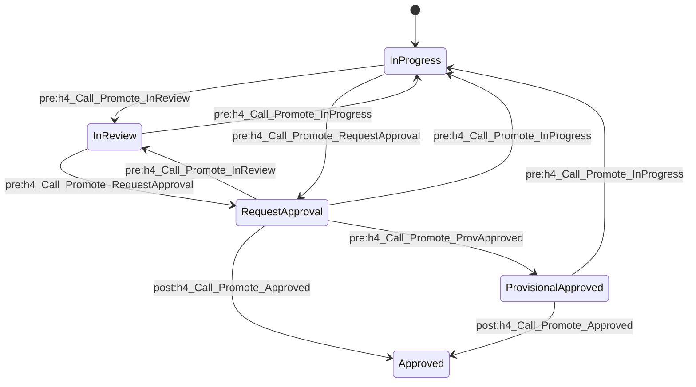
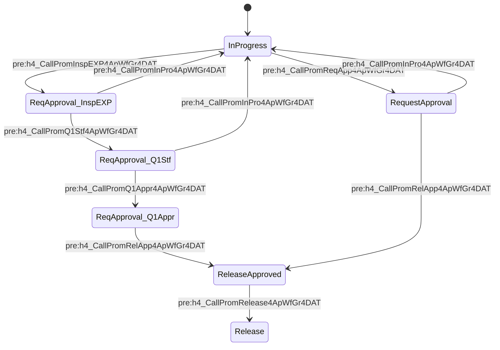
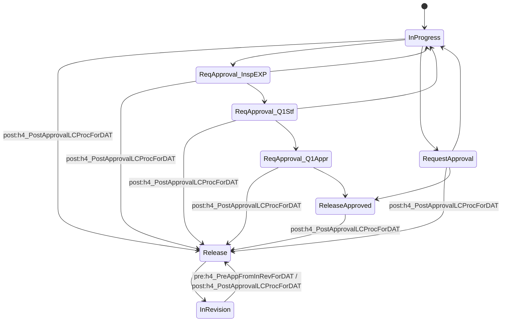
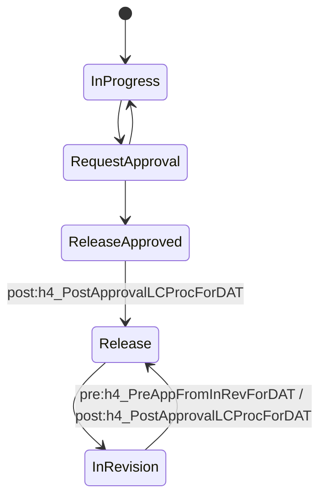
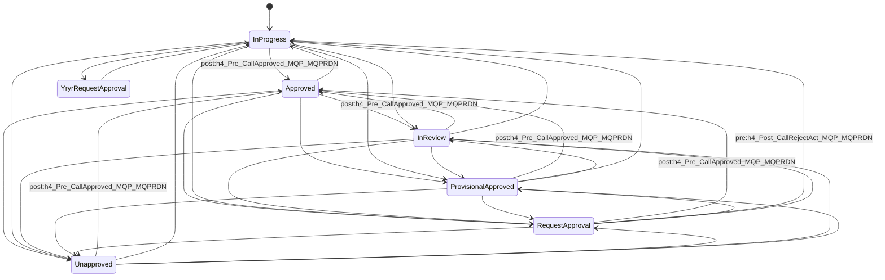
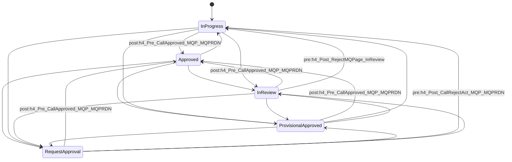
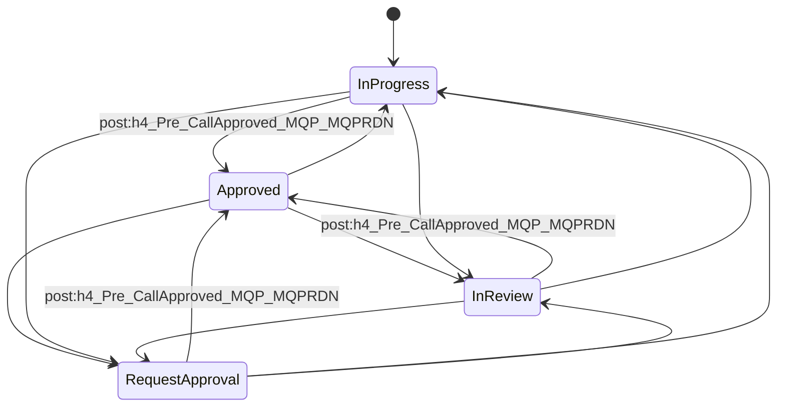

<!-- meta
legacy: knowledge/_legacy/機能設計書.md L2640-L3344
source: source/package/ (Life Cycle Map / Workflow Map)
-->
## 2. Life Cycle Map (7件)

### 2.0 全体サマリ

| # | LC名 | 説明(description) | ステート数 | 遷移数 | 対応する用途(名称/Listから) |
|---|---|---|---|---|---|
| 1 | h4_ApprovalWFGroupLC | 一括承認アイテムのLC | 5 | 10 | 一括承認(ApprovalWFGroup)。List `h4_ApprovalWFGroupLCS` が同じ5ステート名を持つ |
| 2 | h4_AppWFGroupForDATFormatLC | 開達実施要領一括承認のLC | 7 | 10 | 開達実施要領一括承認(AppWFGroupForDATFormat) |
| 3 | h4_DATFormatLC | 開達書式のライフサイクル | 8 | 17 | 開達書式(DATFormat) |
| 4 | h4_DATMasterLC | (空) | 5 | 6 | 帳票マスタ(DATMaster) |
| 5 | h4_MQPage ReqDocsNLC | 必要資料のライフサイクル | 7 | 32 | 必要資料(ReqDoc)。List `h4_MQLDOCNULLLCS` が同じ7ステート名を持つ |
| 6 | h4_MQPageLC | マルQページのライフサイクル | 5 | 20 | マルQページ(MQPage)。List `h4_MQLCS` が同じ5ステート名を持つ |
| 7 | h4_Test_ResultLC | テスト結果のライフサイクル | 4 | 12 | テスト結果(Test_Result)。List `h4_TestResultLCS` が同じ4ステート名を持つ |

主要ステート名(英語name = ja label):

| LC | ステート |
|---|---|
| h4_ApprovalWFGroupLC | InProgress=作業中 / InReview=確認中 / RequestApproval=承認依頼 / ProvisionalApproved=仮承認 / Approved=承認 |
| h4_AppWFGroupForDATFormatLC | InProgress=作業中 / RequestApproval=承認依頼 / ReqApproval_InspEXP=承認依頼(EXP検定) / ReqApproval_Q1Stf=承認依頼(品質一課担当者) / ReqApproval_Q1Appr=承認依頼(品質一課承認者) / ReleaseApproved=公開承認 / Release=公開 |
| h4_DATFormatLC | InProgress=作業中 / RequestApproval=承認依頼 / ReqApproval_InspEXP / ReqApproval_Q1Stf / ReqApproval_Q1Appr(各 承認依頼(...)) / ReleaseApproved=公開承認 / Release=公開 / InRevision=改訂中 |
| h4_DATMasterLC | InProgress=作業中 / RequestApproval=承認依頼 / ReleaseApproved=公開承認 / Release=公開 / InRevision=改訂中 |
| h4_MQPage ReqDocsNLC | InProgress=作業中 / YryrRequestApproval=やるやら承認依頼 / InReview=確認中 / RequestApproval=承認依頼 / ProvisionalApproved=仮承認 / Approved=承認 / Unapproved=承認却下 |
| h4_MQPageLC | InProgress=作業中 / InReview=確認中 / RequestApproval=承認依頼 / ProvisionalApproved=仮承認 / Approved=承認 |
| h4_Test_ResultLC | InProgress=作業中 / InReview=確認中 / RequestApproval=承認依頼 / Approved=承認 |

### 共通事項 (全7LCに共通して読み取れること)

- 全ての Life Cycle Transition の `role` は **`Aras PLM`** (Identity)。全LC・全遷移で例外なし。すなわち遷移の実行ロールは Aras PLM のみ定義されている。
- 全遷移で `get_comment=0`(遷移時にコメント入力を求めない設定)、`execute_post_in_main_txn=0`。
- 遷移に紐づく Method は `pre_action`(遷移前)または `post_action`(遷移後)として Method 名で参照される。LC毎の詳細は 2.1 以降。
- 各ステートは `state_permission_id` で Permission(第3章)を参照する。ステート毎のアクセス権は 2.x の「ステート別アクセス権」の表を参照。
- `item_behavior` / enラベルは LC により有無が異なる(h4_ApprovalWFGroupLC, h4_MQPage ReqDocsNLC, h4_MQPageLC, h4_Test_ResultLC のステートには `item_behavior` と enラベルの記載なし。他の3LCは `float`/`fixed` と enラベルあり)。
- `segments`, `x`, `y`(遷移の描画座標)は機能的な意味を持たない。

XMLから読み取れる、Method名とスロットの食い違い(事実のみ):

- `h4_MQPageLC` と `h4_MQPage ReqDocsNLC` では、`pre_action` スロットに `h4_Post_...` 系Method(`h4_Post_RejectMQPage_InReview`(MQPage: InReview→InProgress)、`h4_Post_CallRejectAct_MQP_MQPRDN`(RequestApproval→InProgress))が設定され、逆に `post_action` スロットに `h4_Pre_CallApproved_MQP_MQPRDN`(→Approved への遷移。`h4_Test_ResultLC` の →Approved 遷移も同じMethod)が設定されている。Method名のPre/Postとスロットが逆。意図かどうかはXMLからは判断できない。Methodの実際の処理はMethodフォルダを参照すること。
- `h4_MQPage ReqDocsNLC` の `YryrRequestApproval` ステートは `state_permission_id` が未設定。
- `h4_ApprovalWFGroupLC` は `pre_action`(遷移前)で `h4_Call_Promote_*`、`Approved` への遷移のみ `post_action`(`h4_Call_Promote_Approved`)。`h4_AppWFGroupForDATFormatLC` の遷移は全て `pre_action`(`h4_CallProm*4ApWfGr4DAT`)。`h4_DATFormatLC` / `h4_DATMasterLC` は Release への遷移に `post_action`(`h4_PostApprovalLCProcForDAT`)、InRevision→Release のみ `pre_action` `h4_PreAppFromInRevForDAT` も併用。

以降、LC毎に XML から自動抽出した表を記載する(ステート一覧は sort_order 昇順、遷移は from→to 昇順)。「図示用」として 遷移マトリクス と Mermaid状態遷移図 を付けた。

### 2.1 h4_ApprovalWFGroupLC

- ファイル: `Life Cycle Map\h4_ApprovalWFGroupLC.xml`
- 説明(description): 一括承認アイテムのLC
- 開始ステート(start_state): `InProgress`
- ステート数 5 / 遷移数 10

#### ステート一覧

| # | name | ラベル(ja) | ラベル(en) | item_behavior | set_is_released | set_not_lockable | state_permission | 画面座標(x,y) |
|---|---|---|---|---|---|---|---|---|
| 1 | InProgress | 作業中 |  |  | 0 | 0 | h4_InProgress_AppWFGr | 182,111 |
| 2 | InReview | 確認中 |  |  | 0 | 0 | h4_PendingApproval_AppWFGr | 278,110 |
| 3 | RequestApproval | 承認依頼 |  |  | 0 | 0 | h4_PendingApproval_AppWFGr | 376,109 |
| 4 | ProvisionalApproved | 仮承認 |  |  | 0 | 0 | h4_PendingApproval_AppWFGr | 448,154 |
| 5 | Approved | 承認 |  |  | 0 | 0 | h4_Approved_AppWFGr | 518,108 |

※ #はsort_order昇順。

#### 遷移一覧(from -> to)

| from | to | ロール(role) | pre_action(遷移前Method) | post_action(遷移後Method) | get_comment | execute_post_in_main_txn |
|---|---|---|---|---|---|---|
| InProgress | InReview | Aras PLM | `h4_Call_Promote_InReview` | - | 0 | 0 |
| InProgress | RequestApproval | Aras PLM | `h4_Call_Promote_RequestApproval` | - | 0 | 0 |
| InReview | InProgress | Aras PLM | `h4_Call_Promote_InProgress` | - | 0 | 0 |
| InReview | RequestApproval | Aras PLM | `h4_Call_Promote_RequestApproval` | - | 0 | 0 |
| ProvisionalApproved | Approved | Aras PLM | - | `h4_Call_Promote_Approved` | 0 | 0 |
| ProvisionalApproved | InProgress | Aras PLM | `h4_Call_Promote_InProgress` | - | 0 | 0 |
| RequestApproval | Approved | Aras PLM | - | `h4_Call_Promote_Approved` | 0 | 0 |
| RequestApproval | InProgress | Aras PLM | `h4_Call_Promote_InProgress` | - | 0 | 0 |
| RequestApproval | InReview | Aras PLM | `h4_Call_Promote_InReview` | - | 0 | 0 |
| RequestApproval | ProvisionalApproved | Aras PLM | `h4_Call_Promote_ProvApproved` | - | 0 | 0 |

#### ステート別アクセス権(Permission)

凡例: D=discover, G=get, U=update, X=delete, C=change_access

| ステート | Permission名 | Identity別権限 |
|---|---|---|
| InProgress | h4_InProgress_AppWFGr | Manager=DGUX, Owner=DG, Creator=DGUX, Administrators=DGUXC |
| InReview | h4_PendingApproval_AppWFGr | Manager=DG, Owner=DG, Administrators=DGUXC, Creator=DG |
| RequestApproval | h4_PendingApproval_AppWFGr | Manager=DG, Owner=DG, Administrators=DGUXC, Creator=DG |
| ProvisionalApproved | h4_PendingApproval_AppWFGr | Manager=DG, Owner=DG, Administrators=DGUXC, Creator=DG |
| Approved | h4_Approved_AppWFGr | Manager=DG, Owner=DG, Administrators=DGUXC, Creator=DG |

#### 図示用: 遷移マトリクス(行=from、列=to、○=遷移あり)

| from＼to | InProgress | InReview | RequestApproval | ProvisionalApproved | Approved |
|---|---|---|---|---|---|
| InProgress |  | ○(pre) | ○(pre) |  |  |
| InReview | ○(pre) |  | ○(pre) |  |  |
| RequestApproval | ○(pre) | ○(pre) |  | ○(pre) | ○(post) |
| ProvisionalApproved | ○(pre) |  |  |  | ○(post) |
| Approved |  |  |  |  |  |

(pre)=pre_actionあり、(post)=post_actionあり。Method名は上の遷移一覧を参照。

#### 図示用: 状態遷移図(Mermaid)

#### 遷移で呼ばれるMethod(重複排除)

- `h4_Call_Promote_Approved` (post_action) x 2遷移
- `h4_Call_Promote_InProgress` (pre_action) x 3遷移
- `h4_Call_Promote_InReview` (pre_action) x 2遷移
- `h4_Call_Promote_ProvApproved` (pre_action) x 1遷移
- `h4_Call_Promote_RequestApproval` (pre_action) x 2遷移

### 2.2 h4_AppWFGroupForDATFormatLC

- ファイル: `Life Cycle Map\h4_AppWFGroupForDATFormatLC.xml`
- 説明(description): 開達実施要領一括承認のLC
- 開始ステート(start_state): `InProgress`
- ステート数 7 / 遷移数 10

#### ステート一覧

| # | name | ラベル(ja) | ラベル(en) | item_behavior | set_is_released | set_not_lockable | state_permission | 画面座標(x,y) |
|---|---|---|---|---|---|---|---|---|
| 1 | InProgress | 作業中 | InProgress | float | 0 | 0 | h4_InProgress_AppWFGroupDAT | 13,104 |
| 2 | ReqApproval_Q1Stf | 承認依頼（品質一課担当者） | ReqApproval_Q1Stf | fixed | 0 | 0 | h4_AfterProgress_AppWFGroupDAT | 224,182 |
| 3 | ReqApproval_InspEXP | 承認依頼（EXP検定） | ReqApproval_InspEXP | fixed | 0 | 0 | h4_AfterProgress_AppWFGroupDAT | 109,151 |
| 4 | ReqApproval_Q1Appr | 承認依頼（品質一課承認者） | ReqApproval_Q1Appr | fixed | 0 | 0 | h4_AfterProgress_AppWFGroupDAT | 358,204 |
| 5 | ReleaseApproved | 公開承認 | ReleaseApproved | fixed | 0 | 0 | h4_AfterProgress_AppWFGroupDAT | 448,125 |
| 6 | Release | 公開 | Release | fixed | 0 | 0 | h4_Release_AppWFGroupDAT | 546,124 |
| 7 | RequestApproval | 承認依頼 | RequestApproval | fixed | 0 | 0 | h4_AfterProgress_AppWFGroupDAT | 107,46 |

※ #はsort_order昇順。

#### 遷移一覧(from -> to)

| from | to | ロール(role) | pre_action(遷移前Method) | post_action(遷移後Method) | get_comment | execute_post_in_main_txn |
|---|---|---|---|---|---|---|
| InProgress | ReqApproval_InspEXP | Aras PLM | `h4_CallPromInspEXP4ApWfGr4DAT` | - | 0 | 0 |
| InProgress | RequestApproval | Aras PLM | `h4_CallPromReqApp4ApWfGr4DAT` | - | 0 | 0 |
| ReleaseApproved | Release | Aras PLM | `h4_CallPromRelease4ApWfGr4DAT` | - | 0 | 0 |
| ReqApproval_InspEXP | InProgress | Aras PLM | `h4_CallPromInPro4ApWfGr4DAT` | - | 0 | 0 |
| ReqApproval_InspEXP | ReqApproval_Q1Stf | Aras PLM | `h4_CallPromQ1Stf4ApWfGr4DAT` | - | 0 | 0 |
| ReqApproval_Q1Appr | ReleaseApproved | Aras PLM | `h4_CallPromRelApp4ApWfGr4DAT` | - | 0 | 0 |
| ReqApproval_Q1Stf | InProgress | Aras PLM | `h4_CallPromInPro4ApWfGr4DAT` | - | 0 | 0 |
| ReqApproval_Q1Stf | ReqApproval_Q1Appr | Aras PLM | `h4_CallPromQ1Appr4ApWfGr4DAT` | - | 0 | 0 |
| RequestApproval | InProgress | Aras PLM | `h4_CallPromInPro4ApWfGr4DAT` | - | 0 | 0 |
| RequestApproval | ReleaseApproved | Aras PLM | `h4_CallPromRelApp4ApWfGr4DAT` | - | 0 | 0 |

#### ステート別アクセス権(Permission)

凡例: D=discover, G=get, U=update, X=delete, C=change_access

| ステート | Permission名 | Identity別権限 |
|---|---|---|
| InProgress | h4_InProgress_AppWFGroupDAT | Administrators=DGUXC, Manager=DGUX, Creator=DGUX, World=- |
| ReqApproval_Q1Stf | h4_AfterProgress_AppWFGroupDAT | Administrators=DGUXC, Manager=DG, Creator=DG, World=- |
| ReqApproval_InspEXP | h4_AfterProgress_AppWFGroupDAT | Administrators=DGUXC, Manager=DG, Creator=DG, World=- |
| ReqApproval_Q1Appr | h4_AfterProgress_AppWFGroupDAT | Administrators=DGUXC, Manager=DG, Creator=DG, World=- |
| ReleaseApproved | h4_AfterProgress_AppWFGroupDAT | Administrators=DGUXC, Manager=DG, Creator=DG, World=- |
| Release | h4_Release_AppWFGroupDAT | Administrators=DGUXC, Creator=DG, Manager=DG, World=DG |
| RequestApproval | h4_AfterProgress_AppWFGroupDAT | Administrators=DGUXC, Manager=DG, Creator=DG, World=- |

#### 図示用: 遷移マトリクス(行=from、列=to、○=遷移あり)

| from＼to | InProgress | ReqApproval_Q1Stf | ReqApproval_InspEXP | ReqApproval_Q1Appr | ReleaseApproved | Release | RequestApproval |
|---|---|---|---|---|---|---|---|
| InProgress |  |  | ○(pre) |  |  |  | ○(pre) |
| ReqApproval_Q1Stf | ○(pre) |  |  | ○(pre) |  |  |  |
| ReqApproval_InspEXP | ○(pre) | ○(pre) |  |  |  |  |  |
| ReqApproval_Q1Appr |  |  |  |  | ○(pre) |  |  |
| ReleaseApproved |  |  |  |  |  | ○(pre) |  |
| Release |  |  |  |  |  |  |  |
| RequestApproval | ○(pre) |  |  |  | ○(pre) |  |  |

(pre)=pre_actionあり、(post)=post_actionあり。Method名は上の遷移一覧を参照。

#### 図示用: 状態遷移図(Mermaid)

#### 遷移で呼ばれるMethod(重複排除)

- `h4_CallPromInPro4ApWfGr4DAT` (pre_action) x 3遷移
- `h4_CallPromInspEXP4ApWfGr4DAT` (pre_action) x 1遷移
- `h4_CallPromQ1Appr4ApWfGr4DAT` (pre_action) x 1遷移
- `h4_CallPromQ1Stf4ApWfGr4DAT` (pre_action) x 1遷移
- `h4_CallPromRelApp4ApWfGr4DAT` (pre_action) x 2遷移
- `h4_CallPromRelease4ApWfGr4DAT` (pre_action) x 1遷移
- `h4_CallPromReqApp4ApWfGr4DAT` (pre_action) x 1遷移

### 2.3 h4_DATFormatLC

- ファイル: `Life Cycle Map\h4_DATFormatLC.xml`
- 説明(description): 開達書式のライフサイクル
- 開始ステート(start_state): `InProgress`
- ステート数 8 / 遷移数 17

#### ステート一覧

| # | name | ラベル(ja) | ラベル(en) | item_behavior | set_is_released | set_not_lockable | state_permission | 画面座標(x,y) |
|---|---|---|---|---|---|---|---|---|
| 1 | InProgress | 作業中 | InProgress | float | 0 | 0 | h4_InProgress_DAT | 15,111 |
| 2 | RequestApproval | 承認依頼 | RequestApproval | fixed | 0 | 0 | h4_AfterProgress_DAT | 98,61 |
| 3 | ReleaseApproved | 公開承認 | ReleaseApproved | fixed | 0 | 0 | h4_AfterProgress_DAT | 420,146 |
| 4 | Release | 公開 | Release | fixed | 1 | 0 | h4_Release_DAT | 554,145 |
| 5 | InRevision | 改訂中 | InRevision | float | 0 | 0 | h4_InRevision_DAT | 690,143 |
| 6 | ReqApproval_InspEXP | 承認依頼（EXP検定） | ReqApproval_InspEXP | fixed | 0 | 0 | h4_AfterProgress_DAT | 98,152 |
| 7 | ReqApproval_Q1Stf | 承認依頼（品質一課担当者） | ReqApproval_Q1Stf | fixed | 0 | 0 | h4_AfterProgress_DAT | 210,178 |
| 8 | ReqApproval_Q1Appr | 承認依頼（品質一課承認者） | ReqApproval_Q1Appr | fixed | 0 | 0 | h4_AfterProgress_DAT | 336,201 |

※ #はsort_order昇順。

#### 遷移一覧(from -> to)

| from | to | ロール(role) | pre_action(遷移前Method) | post_action(遷移後Method) | get_comment | execute_post_in_main_txn |
|---|---|---|---|---|---|---|
| InProgress | Release | Aras PLM | - | `h4_PostApprovalLCProcForDAT` | 0 | 0 |
| InProgress | ReqApproval_InspEXP | Aras PLM | - | - | 0 | 0 |
| InProgress | RequestApproval | Aras PLM | - | - | 0 | 0 |
| InRevision | Release | Aras PLM | `h4_PreAppFromInRevForDAT` | `h4_PostApprovalLCProcForDAT` | 0 | 0 |
| Release | InRevision | Aras PLM | - | - | 0 | 0 |
| ReleaseApproved | Release | Aras PLM | - | `h4_PostApprovalLCProcForDAT` | 0 | 0 |
| ReqApproval_InspEXP | InProgress | Aras PLM | - | - | 0 | 0 |
| ReqApproval_InspEXP | Release | Aras PLM | - | `h4_PostApprovalLCProcForDAT` | 0 | 0 |
| ReqApproval_InspEXP | ReqApproval_Q1Stf | Aras PLM | - | - | 0 | 0 |
| ReqApproval_Q1Appr | Release | Aras PLM | - | `h4_PostApprovalLCProcForDAT` | 0 | 0 |
| ReqApproval_Q1Appr | ReleaseApproved | Aras PLM | - | - | 0 | 0 |
| ReqApproval_Q1Stf | InProgress | Aras PLM | - | - | 0 | 0 |
| ReqApproval_Q1Stf | Release | Aras PLM | - | `h4_PostApprovalLCProcForDAT` | 0 | 0 |
| ReqApproval_Q1Stf | ReqApproval_Q1Appr | Aras PLM | - | - | 0 | 0 |
| RequestApproval | InProgress | Aras PLM | - | - | 0 | 0 |
| RequestApproval | Release | Aras PLM | - | `h4_PostApprovalLCProcForDAT` | 0 | 0 |
| RequestApproval | ReleaseApproved | Aras PLM | - | - | 0 | 0 |

#### ステート別アクセス権(Permission)

凡例: D=discover, G=get, U=update, X=delete, C=change_access

| ステート | Permission名 | Identity別権限 |
|---|---|---|
| InProgress | h4_InProgress_DAT | Manager=DGUX, Administrators=DGUXC, Creator=DGUX, Owner=DG |
| RequestApproval | h4_AfterProgress_DAT | Creator=DG, Manager=DG, Administrators=DGUXC, Owner=DG |
| ReleaseApproved | h4_AfterProgress_DAT | Creator=DG, Manager=DG, Administrators=DGUXC, Owner=DG |
| Release | h4_Release_DAT | Administrators=DGUXC, Creator=DG, Manager=DG, World=DG, Owner=DG |
| InRevision | h4_InRevision_DAT | Administrators=DGUXC, Creator=DGU, Manager=DGU, Aras PLM=DGUX, Owner=DG |
| ReqApproval_InspEXP | h4_AfterProgress_DAT | Creator=DG, Manager=DG, Administrators=DGUXC, Owner=DG |
| ReqApproval_Q1Stf | h4_AfterProgress_DAT | Creator=DG, Manager=DG, Administrators=DGUXC, Owner=DG |
| ReqApproval_Q1Appr | h4_AfterProgress_DAT | Creator=DG, Manager=DG, Administrators=DGUXC, Owner=DG |

#### 図示用: 遷移マトリクス(行=from、列=to、○=遷移あり)

| from＼to | InProgress | RequestApproval | ReleaseApproved | Release | InRevision | ReqApproval_InspEXP | ReqApproval_Q1Stf | ReqApproval_Q1Appr |
|---|---|---|---|---|---|---|---|---|
| InProgress |  | ○ |  | ○(post) |  | ○ |  |  |
| RequestApproval | ○ |  | ○ | ○(post) |  |  |  |  |
| ReleaseApproved |  |  |  | ○(post) |  |  |  |  |
| Release |  |  |  |  | ○ |  |  |  |
| InRevision |  |  |  | ○(pre/post) |  |  |  |  |
| ReqApproval_InspEXP | ○ |  |  | ○(post) |  |  | ○ |  |
| ReqApproval_Q1Stf | ○ |  |  | ○(post) |  |  |  | ○ |
| ReqApproval_Q1Appr |  |  | ○ | ○(post) |  |  |  |  |

(pre)=pre_actionあり、(post)=post_actionあり。Method名は上の遷移一覧を参照。

#### 図示用: 状態遷移図(Mermaid)

#### 遷移で呼ばれるMethod(重複排除)

- `h4_PostApprovalLCProcForDAT` (post_action) x 7遷移
- `h4_PreAppFromInRevForDAT` (pre_action) x 1遷移

### 2.4 h4_DATMasterLC

- ファイル: `Life Cycle Map\h4_DATMasterLC.xml`
- 説明(description): (空)
- 開始ステート(start_state): `InProgress`
- ステート数 5 / 遷移数 6

#### ステート一覧

| # | name | ラベル(ja) | ラベル(en) | item_behavior | set_is_released | set_not_lockable | state_permission | 画面座標(x,y) |
|---|---|---|---|---|---|---|---|---|
| 1 | InProgress | 作業中 | InProgress | float | 0 | 0 | h4_InProgress_DATMas | 21,62 |
| 2 | Release | 公開 | Release | fixed | 1 | 0 | h4_Release_DATMas | 396,61 |
| 3 | ReleaseApproved | 公開承認 | ReleaseApproved | fixed | 0 | 0 | h4_AfterProgress_DATMas | 275,61 |
| 4 | RequestApproval | 承認依頼 | RequestApproval | fixed | 0 | 0 | h4_AfterProgress_DATMas | 149,60 |
| 5 | InRevision | 改訂中 | InRevision | float | 0 | 0 | h4_InRevision_DATMas | 507,61 |

※ #はsort_order昇順。

#### 遷移一覧(from -> to)

| from | to | ロール(role) | pre_action(遷移前Method) | post_action(遷移後Method) | get_comment | execute_post_in_main_txn |
|---|---|---|---|---|---|---|
| InProgress | RequestApproval | Aras PLM | - | - | 0 | 0 |
| InRevision | Release | Aras PLM | `h4_PreAppFromInRevForDAT` | `h4_PostApprovalLCProcForDAT` | 0 | 0 |
| Release | InRevision | Aras PLM | - | - | 0 | 0 |
| ReleaseApproved | Release | Aras PLM | - | `h4_PostApprovalLCProcForDAT` | 0 | 0 |
| RequestApproval | InProgress | Aras PLM | - | - | 0 | 0 |
| RequestApproval | ReleaseApproved | Aras PLM | - | - | 0 | 0 |

#### ステート別アクセス権(Permission)

凡例: D=discover, G=get, U=update, X=delete, C=change_access

| ステート | Permission名 | Identity別権限 |
|---|---|---|
| InProgress | h4_InProgress_DATMas | Administrators=DGUXC, Creator=DGUX, Manager=DGUX |
| Release | h4_Release_DATMas | Administrators=DGUXC, Creator=DG, Manager=DG, World=DG |
| ReleaseApproved | h4_AfterProgress_DATMas | Administrators=DGUXC, Manager=DG, Creator=DG |
| RequestApproval | h4_AfterProgress_DATMas | Administrators=DGUXC, Manager=DG, Creator=DG |
| InRevision | h4_InRevision_DATMas | Administrators=DGUXC, Manager=DGU, Creator=DGU |

#### 図示用: 遷移マトリクス(行=from、列=to、○=遷移あり)

| from＼to | InProgress | Release | ReleaseApproved | RequestApproval | InRevision |
|---|---|---|---|---|---|
| InProgress |  |  |  | ○ |  |
| Release |  |  |  |  | ○ |
| ReleaseApproved |  | ○(post) |  |  |  |
| RequestApproval | ○ |  | ○ |  |  |
| InRevision |  | ○(pre/post) |  |  |  |

(pre)=pre_actionあり、(post)=post_actionあり。Method名は上の遷移一覧を参照。

#### 図示用: 状態遷移図(Mermaid)

#### 遷移で呼ばれるMethod(重複排除)

- `h4_PostApprovalLCProcForDAT` (post_action) x 2遷移
- `h4_PreAppFromInRevForDAT` (pre_action) x 1遷移

### 2.5 h4_MQPage ReqDocsNLC

- ファイル: `Life Cycle Map\h4_MQPage ReqDocsNLC.xml`
- 説明(description): 必要資料のライフサイクル
- 開始ステート(start_state): `InProgress`
- ステート数 7 / 遷移数 32

#### ステート一覧

| # | name | ラベル(ja) | ラベル(en) | item_behavior | set_is_released | set_not_lockable | state_permission | 画面座標(x,y) |
|---|---|---|---|---|---|---|---|---|
| 1 | InProgress | 作業中 |  |  | 0 | 0 | h4_InProgress | 121,82 |
| 2 | InReview | 確認中 |  |  | 0 | 0 | h4_PendingApproval | 265,16 |
| 3 | RequestApproval | 承認依頼 |  |  | 0 | 0 | h4_PendingApproval | 121,257 |
| 4 | Approved | 承認 |  |  | 0 | 0 | h4_Approved | 402,260 |
| 5 | Unapproved | 承認却下 |  |  | 0 | 0 | h4_Approved | 403,74 |
| 6 | ProvisionalApproved | 仮承認 |  |  | 0 | 0 | h4_PendingApproval | 264,328 |
| 7 | YryrRequestApproval | やるやら承認依頼 |  |  | 0 | 0 |  | 69,19 |

※ #はsort_order昇順。

#### 遷移一覧(from -> to)

| from | to | ロール(role) | pre_action(遷移前Method) | post_action(遷移後Method) | get_comment | execute_post_in_main_txn |
|---|---|---|---|---|---|---|
| Approved | InProgress | Aras PLM | - | - | 0 | 0 |
| Approved | InReview | Aras PLM | - | - | 0 | 0 |
| Approved | ProvisionalApproved | Aras PLM | - | - | 0 | 0 |
| Approved | RequestApproval | Aras PLM | - | - | 0 | 0 |
| Approved | Unapproved | Aras PLM | - | - | 0 | 0 |
| InProgress | Approved | Aras PLM | - | `h4_Pre_CallApproved_MQP_MQPRDN` | 0 | 0 |
| InProgress | InReview | Aras PLM | - | - | 0 | 0 |
| InProgress | ProvisionalApproved | Aras PLM | - | - | 0 | 0 |
| InProgress | RequestApproval | Aras PLM | - | - | 0 | 0 |
| InProgress | Unapproved | Aras PLM | - | - | 0 | 0 |
| InProgress | YryrRequestApproval | Aras PLM | - | - | 0 | 0 |
| InReview | Approved | Aras PLM | - | `h4_Pre_CallApproved_MQP_MQPRDN` | 0 | 0 |
| InReview | InProgress | Aras PLM | - | - | 0 | 0 |
| InReview | ProvisionalApproved | Aras PLM | - | - | 0 | 0 |
| InReview | RequestApproval | Aras PLM | - | - | 0 | 0 |
| InReview | Unapproved | Aras PLM | - | - | 0 | 0 |
| ProvisionalApproved | Approved | Aras PLM | - | `h4_Pre_CallApproved_MQP_MQPRDN` | 0 | 0 |
| ProvisionalApproved | InProgress | Aras PLM | - | - | 0 | 0 |
| ProvisionalApproved | InReview | Aras PLM | - | - | 0 | 0 |
| ProvisionalApproved | RequestApproval | Aras PLM | - | - | 0 | 0 |
| ProvisionalApproved | Unapproved | Aras PLM | - | - | 0 | 0 |
| RequestApproval | Approved | Aras PLM | - | `h4_Pre_CallApproved_MQP_MQPRDN` | 0 | 0 |
| RequestApproval | InProgress | Aras PLM | `h4_Post_CallRejectAct_MQP_MQPRDN` | - | 0 | 0 |
| RequestApproval | InReview | Aras PLM | - | - | 0 | 0 |
| RequestApproval | ProvisionalApproved | Aras PLM | - | - | 0 | 0 |
| RequestApproval | Unapproved | Aras PLM | - | - | 0 | 0 |
| Unapproved | Approved | Aras PLM | - | `h4_Pre_CallApproved_MQP_MQPRDN` | 0 | 0 |
| Unapproved | InProgress | Aras PLM | - | - | 0 | 0 |
| Unapproved | InReview | Aras PLM | - | - | 0 | 0 |
| Unapproved | ProvisionalApproved | Aras PLM | - | - | 0 | 0 |
| Unapproved | RequestApproval | Aras PLM | - | - | 0 | 0 |
| YryrRequestApproval | InProgress | Aras PLM | - | - | 0 | 0 |

#### ステート別アクセス権(Permission)

凡例: D=discover, G=get, U=update, X=delete, C=change_access

| ステート | Permission名 | Identity別権限 |
|---|---|---|
| InProgress | h4_InProgress | Manager=DGUX, Owner=DG, Creator=DGUX, Administrators=DGUXC |
| InReview | h4_PendingApproval | Owner=DG, Manager=DG, Administrators=DGUXC, Creator=DG |
| RequestApproval | h4_PendingApproval | Owner=DG, Manager=DG, Administrators=DGUXC, Creator=DG |
| Approved | h4_Approved | Manager=DG, Owner=DG, Administrators=DGUXC, Creator=DG |
| Unapproved | h4_Approved | Manager=DG, Owner=DG, Administrators=DGUXC, Creator=DG |
| ProvisionalApproved | h4_PendingApproval | Owner=DG, Manager=DG, Administrators=DGUXC, Creator=DG |
| YryrRequestApproval |  | (なし) |

#### 図示用: 遷移マトリクス(行=from、列=to、○=遷移あり)

| from＼to | InProgress | InReview | RequestApproval | Approved | Unapproved | ProvisionalApproved | YryrRequestApproval |
|---|---|---|---|---|---|---|---|
| InProgress |  | ○ | ○ | ○(post) | ○ | ○ | ○ |
| InReview | ○ |  | ○ | ○(post) | ○ | ○ |  |
| RequestApproval | ○(pre) | ○ |  | ○(post) | ○ | ○ |  |
| Approved | ○ | ○ | ○ |  | ○ | ○ |  |
| Unapproved | ○ | ○ | ○ | ○(post) |  | ○ |  |
| ProvisionalApproved | ○ | ○ | ○ | ○(post) | ○ |  |  |
| YryrRequestApproval | ○ |  |  |  |  |  |  |

(pre)=pre_actionあり、(post)=post_actionあり。Method名は上の遷移一覧を参照。

#### 図示用: 状態遷移図(Mermaid)

#### 遷移で呼ばれるMethod(重複排除)

- `h4_Pre_CallApproved_MQP_MQPRDN` (post_action) x 5遷移
- `h4_Post_CallRejectAct_MQP_MQPRDN` (pre_action) x 1遷移

### 2.6 h4_MQPageLC

- ファイル: `Life Cycle Map\h4_MQPageLC.xml`
- 説明(description): マルQページのライフサイクル
- 開始ステート(start_state): `InProgress`
- ステート数 5 / 遷移数 20

#### ステート一覧

| # | name | ラベル(ja) | ラベル(en) | item_behavior | set_is_released | set_not_lockable | state_permission | 画面座標(x,y) |
|---|---|---|---|---|---|---|---|---|
| 1 | InProgress | 作業中 |  |  | 0 | 0 | h4_InProgress | 34,161 |
| 2 | RequestApproval | 承認依頼 |  |  | 0 | 0 | h4_PendingApproval | 210,372 |
| 3 | ProvisionalApproved | 仮承認 |  |  | 0 | 0 | h4_PendingApproval | 543,363 |
| 4 | InReview | 確認中 |  |  | 0 | 0 | h4_PendingApproval | 369,40 |
| 5 | Approved | 承認 |  |  | 0 | 0 | h4_Approved | 696,163 |

※ #はsort_order昇順。

#### 遷移一覧(from -> to)

| from | to | ロール(role) | pre_action(遷移前Method) | post_action(遷移後Method) | get_comment | execute_post_in_main_txn |
|---|---|---|---|---|---|---|
| Approved | InProgress | Aras PLM | - | - | 0 | 0 |
| Approved | InReview | Aras PLM | - | - | 0 | 0 |
| Approved | ProvisionalApproved | Aras PLM | - | - | 0 | 0 |
| Approved | RequestApproval | Aras PLM | - | - | 0 | 0 |
| InProgress | Approved | Aras PLM | - | `h4_Pre_CallApproved_MQP_MQPRDN` | 0 | 0 |
| InProgress | InReview | Aras PLM | - | - | 0 | 0 |
| InProgress | ProvisionalApproved | Aras PLM | - | - | 0 | 0 |
| InProgress | RequestApproval | Aras PLM | - | - | 0 | 0 |
| InReview | Approved | Aras PLM | - | `h4_Pre_CallApproved_MQP_MQPRDN` | 0 | 0 |
| InReview | InProgress | Aras PLM | `h4_Post_RejectMQPage_InReview` | - | 0 | 0 |
| InReview | ProvisionalApproved | Aras PLM | - | - | 0 | 0 |
| InReview | RequestApproval | Aras PLM | - | - | 0 | 0 |
| ProvisionalApproved | Approved | Aras PLM | - | `h4_Pre_CallApproved_MQP_MQPRDN` | 0 | 0 |
| ProvisionalApproved | InProgress | Aras PLM | - | - | 0 | 0 |
| ProvisionalApproved | InReview | Aras PLM | - | - | 0 | 0 |
| ProvisionalApproved | RequestApproval | Aras PLM | - | - | 0 | 0 |
| RequestApproval | Approved | Aras PLM | - | `h4_Pre_CallApproved_MQP_MQPRDN` | 0 | 0 |
| RequestApproval | InProgress | Aras PLM | `h4_Post_CallRejectAct_MQP_MQPRDN` | - | 0 | 0 |
| RequestApproval | InReview | Aras PLM | - | - | 0 | 0 |
| RequestApproval | ProvisionalApproved | Aras PLM | - | - | 0 | 0 |

#### ステート別アクセス権(Permission)

凡例: D=discover, G=get, U=update, X=delete, C=change_access

| ステート | Permission名 | Identity別権限 |
|---|---|---|
| InProgress | h4_InProgress | Manager=DGUX, Owner=DG, Creator=DGUX, Administrators=DGUXC |
| RequestApproval | h4_PendingApproval | Owner=DG, Manager=DG, Administrators=DGUXC, Creator=DG |
| ProvisionalApproved | h4_PendingApproval | Owner=DG, Manager=DG, Administrators=DGUXC, Creator=DG |
| InReview | h4_PendingApproval | Owner=DG, Manager=DG, Administrators=DGUXC, Creator=DG |
| Approved | h4_Approved | Manager=DG, Owner=DG, Administrators=DGUXC, Creator=DG |

#### 図示用: 遷移マトリクス(行=from、列=to、○=遷移あり)

| from＼to | InProgress | RequestApproval | ProvisionalApproved | InReview | Approved |
|---|---|---|---|---|---|
| InProgress |  | ○ | ○ | ○ | ○(post) |
| RequestApproval | ○(pre) |  | ○ | ○ | ○(post) |
| ProvisionalApproved | ○ | ○ |  | ○ | ○(post) |
| InReview | ○(pre) | ○ | ○ |  | ○(post) |
| Approved | ○ | ○ | ○ | ○ |  |

(pre)=pre_actionあり、(post)=post_actionあり。Method名は上の遷移一覧を参照。

#### 図示用: 状態遷移図(Mermaid)

#### 遷移で呼ばれるMethod(重複排除)

- `h4_Pre_CallApproved_MQP_MQPRDN` (post_action) x 4遷移
- `h4_Post_CallRejectAct_MQP_MQPRDN` (pre_action) x 1遷移
- `h4_Post_RejectMQPage_InReview` (pre_action) x 1遷移

### 2.7 h4_Test_ResultLC

- ファイル: `Life Cycle Map\h4_Test_ResultLC.xml`
- 説明(description): テスト結果のライフサイクル
- 開始ステート(start_state): `InProgress`
- ステート数 4 / 遷移数 12

#### ステート一覧

| # | name | ラベル(ja) | ラベル(en) | item_behavior | set_is_released | set_not_lockable | state_permission | 画面座標(x,y) |
|---|---|---|---|---|---|---|---|---|
| 1 | InProgress | 作業中 |  |  | 0 | 0 | h4_InProgress_Test_Result | 42,167 |
| 2 | InReview | 確認中 |  |  | 0 | 0 | h4_PendingApproval_Test_Result | 198,47 |
| 3 | RequestApproval | 承認依頼 |  |  | 0 | 0 | h4_PendingApproval_Test_Result | 199,299 |
| 4 | Approved | 承認 |  |  | 0 | 0 | h4_Approved_Test_Result | 353,167 |

※ #はsort_order昇順。

#### 遷移一覧(from -> to)

| from | to | ロール(role) | pre_action(遷移前Method) | post_action(遷移後Method) | get_comment | execute_post_in_main_txn |
|---|---|---|---|---|---|---|
| Approved | InProgress | Aras PLM | - | - | 0 | 0 |
| Approved | InReview | Aras PLM | - | - | 0 | 0 |
| Approved | RequestApproval | Aras PLM | - | - | 0 | 0 |
| InProgress | Approved | Aras PLM | - | `h4_Pre_CallApproved_MQP_MQPRDN` | 0 | 0 |
| InProgress | InReview | Aras PLM | - | - | 0 | 0 |
| InProgress | RequestApproval | Aras PLM | - | - | 0 | 0 |
| InReview | Approved | Aras PLM | - | `h4_Pre_CallApproved_MQP_MQPRDN` | 0 | 0 |
| InReview | InProgress | Aras PLM | - | - | 0 | 0 |
| InReview | RequestApproval | Aras PLM | - | - | 0 | 0 |
| RequestApproval | Approved | Aras PLM | - | `h4_Pre_CallApproved_MQP_MQPRDN` | 0 | 0 |
| RequestApproval | InProgress | Aras PLM | - | - | 0 | 0 |
| RequestApproval | InReview | Aras PLM | - | - | 0 | 0 |

#### ステート別アクセス権(Permission)

凡例: D=discover, G=get, U=update, X=delete, C=change_access

| ステート | Permission名 | Identity別権限 |
|---|---|---|
| InProgress | h4_InProgress_Test_Result | Manager=DGUX, Owner=D, Creator=DGUX, Administrators=DGUXC |
| InReview | h4_PendingApproval_Test_Result | Manager=DG, Owner=D, Administrators=DGUXC, Creator=DG |
| RequestApproval | h4_PendingApproval_Test_Result | Manager=DG, Owner=D, Administrators=DGUXC, Creator=DG |
| Approved | h4_Approved_Test_Result | Manager=DG, Owner=DG, Administrators=DGUXC, Creator=DG |

#### 図示用: 遷移マトリクス(行=from、列=to、○=遷移あり)

| from＼to | InProgress | InReview | RequestApproval | Approved |
|---|---|---|---|---|
| InProgress |  | ○ | ○ | ○(post) |
| InReview | ○ |  | ○ | ○(post) |
| RequestApproval | ○ | ○ |  | ○(post) |
| Approved | ○ | ○ | ○ |  |

(pre)=pre_actionあり、(post)=post_actionあり。Method名は上の遷移一覧を参照。

#### 図示用: 状態遷移図(Mermaid)

#### 遷移で呼ばれるMethod(重複排除)

- `h4_Pre_CallApproved_MQP_MQPRDN` (post_action) x 3遷移

---

